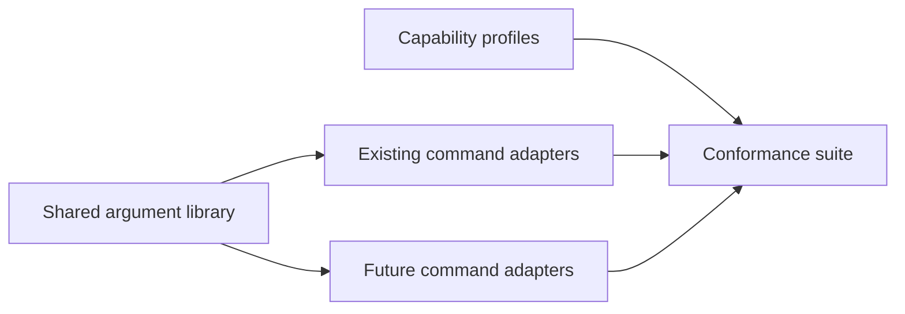

# Design Document

## Overview

Deliver a common CLI library without changing the meaning of established invocations. Existing users keep their positionals, default renderings and vocabulary import behavior; new command families compose the same groups where applicable.

### Goals
- One reusable parameter and exit implementation with executable compatibility coverage.
- A command-capability profile that distinguishes report output from generated artifacts.
- First deliverable: migrate `check` and prove equivalent behavior through the real binary.

### Non-Goals
Code analysis, ledger/evidence decisions, new vocabulary formats, analyzer execution and plugin UI changes.

## Boundary Commitments

### This Spec Owns
- `kiro-cli-common` types, output routing, environment resolution and exit helpers.
- Migration of existing command argument definitions and their compatibility behavior.
- CLI standard and conformance tests. Feature specs own their new subcommand semantics.

### Out of Boundary
No rule catalogue, metric facts, evidence schema or acceptance decision lives in this library. Gate flags are not added to commands with no gate.

### Allowed Dependencies
Consumes cli-gate's established command surface and core Finding/Severity. Uses the workspace's clap 4 lockfile resolution; clap completion generation is native-only. No dependency from core or the WASM plugin back to the CLI library. The verification-evidence harness is optional during the first slice: reuse existing tests/common until that foundation lands.

### Revalidation Triggers
Flag spelling/defaults, positional arity, profile changes, report schemas, exit behavior, destination routing or environment precedence require all command-profile tests and downstream code/breadth journey checks.

## Architecture

### Existing Architecture Analysis
`crates/kiro-cli/src/cli.rs` already defines clap groups and `exit.rs` defines outcomes. `vocab import --format` is InputFormat, not ReportFormat. Graph/tasks have a table toggle and existing default renderings. Preserve these actual contracts instead of inferring one identical CLI profile.

### Architecture Pattern & Boundary Map


Dependency direction: core types → shared CLI groups → command adapters. The profile is data owned here; downstream adapters register their capability declarations and are tested by the same conformance loop.

### Technology Stack
| Layer | Choice / Version | Role | Constraint |
|---|---|---|---|
| Native CLI | Rust edition 2024; existing clap 4 lockfile pin | Derive/flatten and command introspection | No parser replacement |
| Completion | clap_complete compatible with locked clap 4 | Generate scripts from command tree | Pin during dependency change |
| Tests | Existing binary helper and standard Rust test harness | Behavior and help checks | No second fixture framework |

## File Structure Plan

| Component | File | Responsibility |
|---|---|---|
| CliGroups | `crates/kiro-cli-common/src/lib.rs` | Shared parameter and exit types |
| CliGroups | `crates/kiro-cli-common/src/output.rs` | Report destination and output routing |
| CliGroups | `crates/kiro-cli-common/Cargo.toml` | Native-only shared crate dependencies |
| CliMigration | `crates/kiro-cli/src/cli.rs` | Command profiles, group composition and legacy flags |
| CliMigration | `crates/kiro-cli/src/exit.rs` | Compatibility re-exports of shared exit types |
| CliMigration | `crates/kiro-cli/src/main.rs` | Shared context construction and dispatch |
| CliMigration | `crates/kiro-cli/src/viz.rs` | Graph and task format adaptation |
| CliMigration | `crates/kiro-cli/src/import/mod.rs` | Separate import artifact and report output |
| CliConformance | `crates/kiro-cli/tests/cli_standard.rs` | Every profile and legacy invocation regression |
| CliConformance | `crates/kiro-cli/tests/e2e_cli_contracts.rs` | First migrated check and remaining command journeys |
| CliConformance | `docs/cli-standard.md` | Canonical standard and supported exceptions |

Shared registry edits to workspace Cargo.toml and kiro-cli/Cargo.toml are additive integration changes owned by the existing cli-gate package boundary; perform them serially. They do not transfer ownership of all workspace packages to this spec.

## System Flows

Resolve explicit CLI values → applicable environment fallback → built-in default → typed command profile → execute → route artifact/report → exit. Reject conflicts before any write. Preserve `--root` as project alias and `--out` as import-artifact alias.

## Requirements Traceability

| Requirement | Summary | Components | Interfaces | Flows |
|---|---|---|---|---|
| 1.1 | The workspace shall provide one library for reusable global, report-output and gate p… | CliGroups, CliConformance | CliGroups contract | Shared Parameters and Output Contract |
| 1.2 | The kiro-cli shall preserve existing command names, positionals, defaults and accepte… | CliGroups, CliConformance | CliGroups contract | Shared Parameters and Output Contract |
| 1.3 | The kiro-cli shall take each shared parameter from, in order, the command line, an en… | CliGroups, CliConformance | CliGroups contract | Shared Parameters and Output Contract |
| 1.4 | The kiro-cli shall follow one naming rule for every parameter: long flags in kebab-ca… | CliGroups, CliConformance | CliGroups contract | Shared Parameters and Output Contract |
| 1.5 | When JSON report output is selected, the kiro-cli shall write only the schema-version… | CliGroups, CliConformance | CliGroups contract | Shared Parameters and Output Contract |
| 1.6 | The kiro-cli shall offer completions <shell> printing a shell completion script gener… | CliGroups, CliConformance | CliGroups contract | Shared Parameters and Output Contract |
| 1.7 | The repository shall provide an executable conformance suite covering every command's… | CliGroups, CliConformance | CliGroups contract | Shared Parameters and Output Contract |
| 2.1 | The kiro-cli shall retain vocab import --format as a legacy input-format spelling, in… | CliMigration, CliConformance | CliMigration contract | Compatibility and Executable Conformance |
| 2.2 | The kiro-cli shall preserve graph and tasks default rendering and --table behavior, r… | CliMigration, CliConformance | CliMigration contract | Compatibility and Executable Conformance |
| 2.3 | The conformance suite shall validate applicable shared groups from a command-capabili… | CliMigration, CliConformance | CliMigration contract | Compatibility and Executable Conformance |
| 2.4 | The first CLI deliverable shall migrate one existing check command through the shared… | CliMigration, CliConformance | CliMigration contract | Compatibility and Executable Conformance |

## Components and Interfaces

### CliGroups
**Intent:** reusable argument groups and destination/exit behavior. **Requirements:** all criteria in 1. **Dependencies:** core Finding/Severity outbound P0; clap external P0. **Contracts:** Service, State.

```rust
pub struct GlobalArgs { pub project: PathBuf, pub verbose: u8, pub quiet: bool, pub color: ColorChoice }
pub struct ReportArgs { pub format: ReportFormat, pub output: Option<PathBuf> }
pub struct GateArgs { pub fail_on: FailOn }
pub enum ReportFormat { Text, Json }
pub enum Exit { Clean, Findings, Failure }
pub enum Destination { Stdout, File(PathBuf) }
pub struct CommandProfile { pub id: String, pub reports: bool, pub gates: bool, pub artifact: bool }
pub fn resolve_context(args: GlobalArgs, env: &EnvironmentValues) -> Result<CliContext, CliFailure>;
pub fn write_report(destination: &Destination, document: &[u8]) -> Result<(), CliFailure>;
pub fn verdict(findings: &[Finding], fail_on: FailOn) -> Exit;
```

Preconditions: command-specific eligibility (such as pre-existing debt) has already filtered findings before verdict. Invariants: shared helpers never reinterpret rule semantics; CLI values override environment even for color. NO_COLOR selects never when present unless explicit CLI color overrides; otherwise nonzero CLICOLOR_FORCE selects always; default auto. Conflicting -q and -v are usage errors. Invalid applicable environment enum values fail with variable name, without leaking unrelated environment values.

`KIRO_PROJECT`, `KIRO_FORMAT`, `KIRO_FAIL_ON` apply only to supported groups. JSON has schema_version first and diagnostics only on stderr. `--output -` means report stdout; named output means no report copy on stdout. Output-write failure is exit 2. The library makes no source-tree reads.

### CliMigration
**Intent:** preserve existing commands while composing shared groups. **Requirements:** 1.2, 1.3, 1.5, 2.1–2.4. **Dependencies:** CliGroups outbound P0; existing import/viz/check adapters inbound P0. **Contracts:** Service.

| Command | Shared groups | Specific behavior |
|---|---|---|
| check; vocab validate | Global, Report, Gate | --format text/json; existing flags/positionals retained |
| status | Global, Report | Default text unchanged; JSON is additive |
| graph; tasks | Global, destination | Existing default unchanged; --table retained; explicit --format default/table/json is command-specific |
| vocab import | Global, Gate where meaningful | --input-format with legacy --format alias; --report-format text/json; artifact --output with legacy --out |
| completions | Global only | Script on stdout; no report/gate flags |
| code/breadth families | Declared by owner | Conformance uses registered profile; no downstream implementation here |

GateArgs applies to import validation findings only; a successful import with no eligible findings remains exit 0, while usage/I/O errors remain exit 2. Imported artifact content is never wrapped in the report schema.

Import has two destinations: artifact `--output` (old `--out`, default .kiro/vocabulary.toml), diagnostic report `--report-output` (default stderr for text). JSON report defaults to stdout only when the artifact does not; artifact stdout plus JSON stdout is rejected unless --report-output names a distinct file. Reject destinations resolving to the same file. KIRO_FORMAT selects diagnostic report format, never vocabulary input format. Existing import text diagnostics remain on stderr. Both --format and --input-format together are rejected rather than silently prioritized. `--table` plus an explicit conflicting view format is a usage error.

Migration first re-exports Exit/Failure from old exit.rs and migrates check; then views, vocabulary and completion. Feature commands added later call the same library.

### CliConformance
**Intent:** executable compatibility contract and documentation. **Requirements:** 1.4–1.7, 2.1–2.4. **Dependencies:** command tree inbound P0; existing test helper outbound P0. **Contracts:** Batch.

The test enumerates command definitions, verifies allowed short flags (-v,-q,-h,-V), names/defaults for applicable groups and declared exceptions, then executes table-driven invocations. Help inspection alone is insufficient. Documentation is checked against the same profile names, not regenerated blindly from help.

## Data Models
The profile declares applicability, allowed formats, destination roles, legacy aliases and default behavior. It is not a plugin system or a second CLI parser. No persistent user data format changes. Machine report schemas are versioned per command; imported vocabulary TOML remains unchanged.

## Error Handling
Usage/conflict/env/write errors → exit 2 with one-line actionable stderr message. Rule findings → shared 0/1 contract. Text/JSON formatting never hides diagnostics. Failure before import output leaves the previous artifact intact.

## Testing Strategy
- 1.1–1.7: enumerate profiles; exercise project/environment/verbosity/color, JSON routing, errors, completions and version.
- 2.1: legacy/new input-format invocations produce equal TOML; two report/artifact destinations cannot collide; stdout conflict fails before write.
- 2.2: graph/task default and table outputs equal pre-migration fixtures; incompatible selectors fail.
- 2.3: every existing command has at least one real invocation, including aliases and output failure.
- 2.4: existing check fixture through shared groups yields identical verdict and report. Later reuse verification-evidence's event recorder without duplicating fixture setup.

## Deliverables and Development Gates
1. C0: profile table, compatibility fixtures and output conflict tests.
2. C1: shared library plus migrated check; fail/fix/pass over an existing spec fixture.
3. C2: remaining commands, docs and completion; full compatibility suite.
Acceptance needs C0–C2 and fresh required evidence. No implementation task waits for clone/locality analyzers. Gate G6 reruns these checks at downstream joins.

## Integration & Migration Notes
No existing flag is removed. New downstream flags need a profile entry and conformance fixture. Production dependencies/lockfile are changed during implementation, not as an untested design artifact. Current design review is not runtime acceptance.
