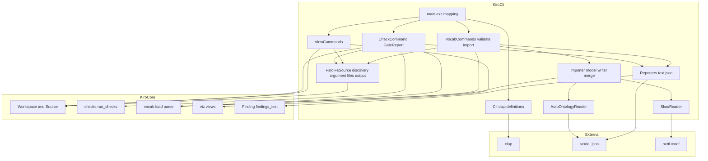
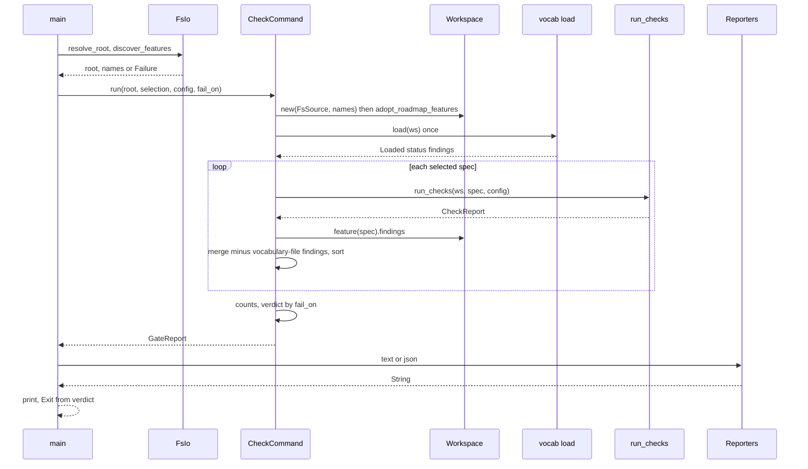
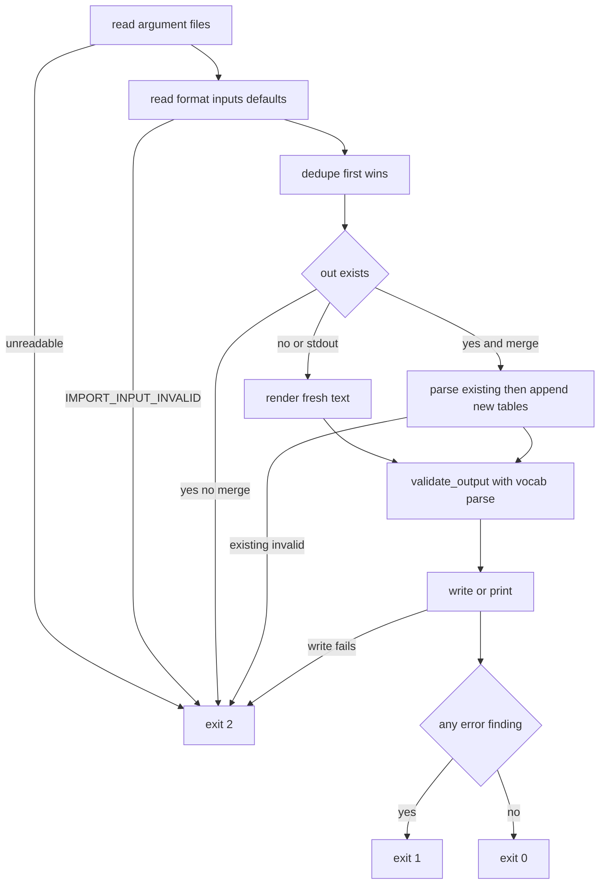

# Design Document: cli-gate

## Overview

**Purpose**: cli-gate is the native frontend of the v2 engine: a `kiro-cli` binary that walks a project's `.kiro/specs` tree through a root-confined `std::fs` read port, runs exactly the checks the OpenIDEA plugin runs (`kiro_core::checks::run_checks`) together with each spec's structural findings, prints them as the same text lines the IDE shows or as the engine's `Finding` JSON verbatim, and exits `0`/`1`/`2` so CI can block merges. It also prints the three `kiro_core::viz` views natively, validates a vocabulary with the engine loader, and is the only place in the project that converts an external vocabulary — Auto Ontology's `GET /api/terms` JSON (primary) or SKOS Turtle (secondary) — into `.kiro/vocabulary.toml`.

**Users**: CI pipelines (`check --all --fail-on error`); developers reading CI logs or wanting a view without the IDE; vocabulary maintainers seeding or extending `.kiro/vocabulary.toml`; the specs this CLI consumes (their revalidation triggers name it).

**Impact**: Adds `crates/kiro-cli` to the root workspace, four importer finding codes to kiro-core's catalogue, `docs/ci.md` and `docs/cli.md`, and reconciles `docs/vocabulary.md`. No engine contract changes shape; no plugin file changes.

### Goals
- Every finding the CLI prints comes from the engine or the importer's four codes; the CLI has no parser, check or renderer.
- Results identical to the IDE: the same `run_checks`, the same finding lines, the same view bytes, the same vocabulary loader.
- A tested exit-code contract and byte-identical reports across runs and platforms.
- One importer model fed by two readers, one TOML writer, merge by appending, output validated by the engine before the maintainer commits it.

### Non-Goals
- Changing any check, view or loader semantics (upstream specs); a configuration file; colour or progress output; installing the binary into CI images; network access; the JSON → SKOS conversion (replaced by the direct JSON reader).

## Boundary Commitments

### This Spec Owns
- The `kiro-cli` crate: command line, `FsSource` (the only `Source` over `std::fs`), spec discovery, the `check`/`status`/`graph`/`tasks`/`vocab validate`/`vocab import` command bodies, the `GateReport` envelope with its text and JSON forms, the exit-code mapping, and the `Failure` → exit 2 path.
- The importer: `ImportedTerm`, `derive_id`, deduplication, the TOML writer, append-only merge, output validation, the Auto Ontology JSON reader and the SKOS Turtle reader (implementing vocabulary-grounding's normative mapping).
- The four `IMPORT_*` finding codes (appended to kiro-core's catalogue; emitted only by the CLI).
- Fixtures under `crates/kiro-cli/fixtures/`, the integration tests, `docs/ci.md`, `docs/cli.md`, and the reconciliation paragraph of `docs/vocabulary.md`.

### Out of Boundary
- `Source`, `Workspace`, `Finding`, `findings_text`, `sort_findings` (kiro-core); `CheckConfig`, `CheckReport`, `run_checks`, check codes and their messages, the wording of the `check.spec` lines (spec-constraints — reproduced here, not redefined); the TOML format, id rule, label normalisation, loader findings and the SKOS → TOML mapping (vocabulary-grounding — implemented here, not redefined); the three views and their text (spec-visualization); the plugin and its presentation.
- Editing spec, steering or vocabulary files beyond writing `--out`.

### Allowed Dependencies
- `kiro-core` by path: `source` (`Source`, `Workspace`, `Feature`), `spec` (`Doc`, `Phase`), `finding` (`Finding`, `Severity`, `CODES`, `codes`, `sort_findings`), `render::text::findings_text`, `checks` (`CheckConfig`, `CheckKind`, `CheckStatus`, `CheckReport`, `CHECK_CODES`, `run_checks`), `vocab` (`VOCABULARY_PATH`, `Kind`, `Status`, `Loaded`, `Vocabulary`, `Lookup`, `load`, `parse`, `normalize_label`, `is_id`), `viz` (`CAPS`, `RawLabeler`, `Format`, `render_body`, `compose`, `status::{status_view, status_text}`, `graph::{graph_view, graph_summary}`, `tasks::{tasks_view, tasks_summary}`), `resolve::SuccessorChain` (through `Workspace::successor_chain`).
- Crates (CLI only): `clap = "4.5"` (`derive`), `serde = "1"` (`derive`), `serde_json = "1"`, `oxttl = "0.2"`, `oxrdf = "0.3"`; dev: `tempfile = "3"`.
- `std::fs`, `std::io`, `std::process::ExitCode`, `std::env::current_dir` — `std::fs` only inside `fs.rs`.
- Internal direction (left imports only from the left): `exit` → `fs` → `cli` → {`report`, `viz`, `import/*`} → {`check`, `vocab`} → `main`. `import/auto_ontology` and `import/skos` import only `import/mod` and kiro-core `vocab`/`finding`.

### Revalidation Triggers
- Any change to the `GateReport` JSON envelope keys or `schema_version`, the exit-code mapping, the command or option names (CI pipelines, `docs/ci.md`, `docs/cli.md`).
- Any change to the TOML the importer writes (header, key order, comment lines) or to `derive_id` (vocabulary maintainers, seed-file conventions).
- Adding or re-levelling an `IMPORT_*` code (kiro-core catalogue test, `docs/vocabulary.md`).
- Upstream integration touches made by this spec's tasks (one line each, no contract change): root `Cargo.toml` members gain `crates/kiro-cli` (kiro-core design Out of Boundary anticipates it); kiro-core `finding.rs`/`lib.rs` gain the four codes; vocabulary-grounding design's Non-Goals sentence about "no tool in this project" and its VocabDocs row are amended to name `kiro-cli vocab import --format auto-ontology-json`; `docs/vocabulary.md` is reconciled accordingly.
- Upstream: any change to `Source::read` semantics, `Finding` fields or JSON order, `findings_text`, `CheckConfig`/`CheckReport`/`run_checks`, the `scope_line`/`status_line` wording in spec-constraints' CheckCommands, `vocab::{load, parse}`/`Loaded`/`Kind`/`Topic.line`, the SKOS mapping table, `viz` function signatures or text formats, the plugin host read limits.

## Architecture

### Existing Architecture Analysis
- kiro-core: `Workspace<S: Source>::new(source, known)`; `adopt_roadmap_features()` loads the roadmap and adds its names; `load(name)` caches four reads and yields `Feature { findings }`; `findings()` merges features and roadmap; `Finding` derives `Serialize` with fixed field order; `Severity` derives `Ord` with `Error < Warning < Info`; `findings_text` is the shared line format.
- spec-constraints: `run_checks(&mut ws, feature, &config)` loads the vocabulary once through the cache, returns `CheckReport { topics, vocabulary: Status, status: BTreeMap<CheckKind, CheckStatus>, ears, terms, contradictions, findings }`; pass-through of `VOCAB_MISSING`/`VOCAB_INVALID` and scope findings per spec; `CheckConfig` defaults; the plugin's `scope_line`/`status_line` formats are specified literally.
- vocabulary-grounding: `vocab::load(&mut ws) -> Loaded`, `vocab::parse(text, file) -> Loaded`; `Vocabulary` fields private, queries scoped; `Topic.line` is `None` for implicit topics; the SKOS → TOML table and `kiro:` namespace are normative.
- spec-visualization: `status_view(feature, chain)`, `status_text`; `graph_view(feature, &dyn Labeler) -> Option<GraphView>`, `render_body(graph, format, &CAPS)`, `graph_summary`, `compose`; `tasks_view`, `tasks_summary`; the plugin bodies and error messages are specified and the trigger "cli-gate adopting the views: byte-identical" exists.
- plugin-core: host reads are root-confined, UTF-8, ≤ 16 MiB; `findings_text` lines are "identical to cli-gate's text reporter".

### Architecture Pattern & Boundary Map



**Architecture Integration**:
- Selected pattern: the second ports-and-adapters frontend — `FsSource` is the adapter on the engine's one port; command bodies orchestrate engine calls; reporters serialise engine data (research.md, pattern evaluation).
- Domain boundaries: `fs` is the only module that touches the filesystem; `cli` is the only module that knows clap; `report` is the only module that formats; `import` is the only module that knows TOML writing or external formats; command modules compose these and the engine.
- Existing patterns preserved: plain owned values, `BTreeMap` ordering, the kiro-core lint table, `Result<_, Failure>` at command boundaries (the CLI analogue of the plugin's `Result<_, String>`), fixtures copied from kiro-core's trees.
- New components rationale: `GateReport` exists because the CI envelope (several specs, vocabulary and roadmap sections, verdict) is not a `CheckReport`; `Importer` is split into model/writer and two readers so that `derive_id`, ordering and merge are tested once.
- Steering compliance: thin frontend, no logic duplication beyond the pinned header lines, deterministic output, `SCREAMING_SNAKE` codes in the engine catalogue, Windows-safe paths (`/` in reports).

### Technology Stack

| Layer | Choice / Version | Role in Feature | Notes |
|-------|------------------|-----------------|-------|
| Binary | Rust `edition = "2024"`, crate `kiro-cli`, root workspace member; lints as kiro-core (`unsafe_code = "forbid"`; clippy `unwrap_used`, `expect_used`, `panic`, `indexing_slicing`, `todo`, `unimplemented` = deny) | The native frontend | Native targets only; never built for wasm |
| Arguments | `clap 4.5` (`derive`, `value_enum`) | Subcommands, options, usage errors (exit 2 via `Error::exit` mapped to `ExitCode::from(2)`) | `--project`, `--verbose` global |
| Engine | `kiro-core` by path | Workspace, checks, vocabulary, views, findings | No parsing in the CLI |
| JSON | `serde 1` + `serde_json 1` | `GateReport` envelope (`to_string_pretty`); lenient `Value` reading of Auto Ontology exports; error line numbers | `Finding` serialises through its own derive |
| RDF | `oxttl 0.2` (Turtle parser), `oxrdf 0.3` (terms) | SKOS reader | CLI only; pure Rust |
| Tests | `cargo test -p kiro-cli`; `tempfile 3`; `std::process::Command` on `CARGO_BIN_EXE_kiro-cli` | Integration over fixture trees in temp dirs | Release-only timing test |

## File Structure Plan

### Directory Structure
```
Cargo.toml                                   # + "crates/kiro-cli" in workspace members
docs/
├── ci.md                                    # GitHub Actions job, generic shell snippet, exit codes, JSON example
├── cli.md                                   # Command reference: every command, option, default, exit code, example
└── vocabulary.md                            # (modified; owned by vocabulary-grounding) reconciled Auto Ontology procedure
crates/kiro-core/src/
├── finding.rs                               # + IMPORT_INPUT_INVALID, IMPORT_TERM_SKIPPED, IMPORT_DUPLICATE_ID, IMPORT_MERGE_CONFLICT
└── lib.rs                                   # + four rows in the documented code table
crates/kiro-cli/
├── Cargo.toml                               # Package, deps, lint table
├── README.md                                # One paragraph pointing at docs/cli.md and docs/ci.md
├── src/
│   ├── main.rs                              # Parse, dispatch, Exit -> ExitCode; the only `fn main`
│   ├── exit.rs                              # Exit, Failure, FailOn, meets()
│   ├── fs.rs                                # ProjectRoot, FsSource, discover_features, read_argument_file, write_output, display_path
│   ├── cli.rs                               # clap derive types for all commands and options
│   ├── report.rs                            # GateReport, SpecResult, Counts, VocabReport; text/json; scope_line, status_line, summary_line
│   ├── check.rs                             # `check`: select, workspace, vocabulary once, per-spec run_checks + structural findings, verdict
│   ├── viz.rs                               # `status`, `graph`, `tasks`: engine views printed unchanged
│   ├── vocab.rs                             # `vocab validate`, `vocab import` orchestration
│   └── import/
│       ├── mod.rs                           # InputFormat, Input, Defaults, ImportedTerm, Imported, derive_id, dedupe, render, merge, validate_output, read()
│       ├── auto_ontology.rs                 # JSON page/array reader (serde_json::Value)
│       └── skos.rs                          # Turtle reader implementing the SKOS -> TOML mapping
├── fixtures/
│   ├── import/
│   │   ├── terms-page.json                  # TermsPageResponse shape with four terms (one without name, two colliding ids, zones)
│   │   ├── terms-array.json                 # Bare array of the same terms
│   │   ├── terms-detail.json                # Array of TermDetail objects with related_terms
│   │   ├── invalid.json                     # Syntax error at a known line
│   │   ├── concepts.ttl                     # Concept scheme + concepts exercising every mapped predicate and kiro: annotations
│   │   ├── invalid.ttl                      # Turtle syntax error at a known line
│   │   └── existing.toml                    # Merge target with comments, a declared topic, a deprecated term, a label that collides
│   ├── trees/warnings/.kiro/                # Warnings-only tree: vocabulary, roadmap, spec `late` (tasks-generated, design.md missing)
│   └── trees/vocab-findings/.kiro/          # Two clean specs `one`, `two` (topics ops) + a vocabulary with one term lacking a definition
└── tests/
    ├── common/mod.rs                        # copy_tree(src) -> TempDir, run(args, cwd) -> (status, stdout, stderr), fixture paths
    ├── check.rs                             # Exit-code contract, text and JSON reports, determinism, options
    ├── views.rs                             # status/graph/tasks vs kiro-core golden files; error parity
    ├── vocab.rs                             # validate; import over both formats; merge; refusal; stdout mode
    ├── self_tree.rs                         # This repository's own .kiro tree: never 2, byte-identical twice
    └── perf.rs                              # Generated 20-spec tree < 5 s (release only)
```

### Files by Component

| Component | File | Responsibility |
|-----------|------|----------------|
| CliScaffold | `Cargo.toml` | Add `crates/kiro-cli` to `[workspace] members` |
| CliScaffold | `.cargo/config.toml` | Append `cargo run -p kiro-cli -- check --project . --all --fail-on error` to the `gate` alias |
| CliScaffold | `.github/workflows/ci.yml` | Append the plugin `wasm32-wasip2` build step and `cargo run -p kiro-cli -- check --project . --all --fail-on error` to the CI job |
| CliScaffold | `crates/kiro-cli/Cargo.toml` | Package `kiro-cli` (binary), edition 2024, dependencies, lint table |
| CliScaffold | `crates/kiro-cli/README.md` | Pointer to the docs |
| CliScaffold | `crates/kiro-cli/src/main.rs` | `Cli::parse()` (usage errors → 2), dispatch to command modules, `Exit` → `ExitCode` |
| ExitModel | `crates/kiro-cli/src/exit.rs` | `Exit`, `Failure`, `FailOn`, `meets`, `Severity` parsing |
| FsIo | `crates/kiro-cli/src/fs.rs` | `ProjectRoot`, `resolve_root`, `FsSource` (guard + read), `discover_features`, `read_argument_file`, `write_output`, `output_exists`, `display_path` |
| CliArgs | `crates/kiro-cli/src/cli.rs` | `Cli`, `Command`, `CheckArgs`, `ViewArgs`, `GraphArgs`, `VocabCommand`, `ValidateArgs`, `ImportArgs`, value enums, `--severity` parser, `CheckConfig` construction |
| Reporters | `crates/kiro-cli/src/report.rs` | `GateReport`, `SpecResult`, `Counts`, `VocabReport` (the envelope types); text and JSON; `scope_line`, `status_line`, `summary_line` |
| CheckCommand | `crates/kiro-cli/src/check.rs` | `select`, `run` (builds the `GateReport`) |
| ViewCommands | `crates/kiro-cli/src/viz.rs` | `status`, `graph`, `tasks` |
| VocabCommands | `crates/kiro-cli/src/vocab.rs` | `validate`, `import` orchestration (read inputs, read, dedupe, render or merge, write, validate output, print findings, exit) |
| Importer | `crates/kiro-cli/src/import/mod.rs` | Model, `derive_id`, `dedupe`, `render`, `merge`, `validate_output`, `toml_string`, `read` dispatch |
| AutoOntologyReader | `crates/kiro-cli/src/import/auto_ontology.rs` | `read(inputs, defaults) -> Result<Imported, Finding>` |
| SkosReader | `crates/kiro-cli/src/import/skos.rs` | `read(inputs, defaults) -> Result<Imported, Finding>`, namespace constants |
| CoreIntegration | `crates/kiro-core/src/finding.rs` | Append the four `IMPORT_*` codes to `CODES` and `codes` |
| CoreIntegration | `crates/kiro-core/src/lib.rs` | Four rows in the documented code table (doc test keeps them in sync) |
| CliFixtures | `crates/kiro-cli/fixtures/import/terms-page.json` | Page object: `terms` with `Order` (synonyms `PO`, `purchase order`; zones Finance, Sales), `order` (duplicate id after derivation), an object with `name: null`, `Customer Lifetime Value` (empty description) |
| CliFixtures | `crates/kiro-cli/fixtures/import/terms-array.json` | The same four term objects as a bare array |
| CliFixtures | `crates/kiro-cli/fixtures/import/terms-detail.json` | Two `TermDetail` objects with `related_terms` as `{id, name, description}` objects and `tags` |
| CliFixtures | `crates/kiro-cli/fixtures/import/invalid.json` | Trailing comma at line 3 |
| CliFixtures | `crates/kiro-cli/fixtures/import/concepts.ttl` | One `skos:ConceptScheme` with `dct:title`; concepts `InsiderThreat`, `HTTPSProxy`, `Level2Cache` (ids per the mapping examples), prefLabel in three language forms, definitions, altLabels, `broader` and inverse `narrower`, `owl:deprecated` + `dct:isReplacedBy`, `kiro:topic`, `kiro:kind "enum"` + `kiro:value`, `kiro:kind "int"` + `kiro:min`/`kiro:max`, a `skos:Collection` and a blank node to ignore, a broader target that is not a concept |
| CliFixtures | `crates/kiro-cli/fixtures/import/invalid.ttl` | Unterminated IRI at line 4 |
| CliFixtures | `crates/kiro-cli/fixtures/import/existing.toml` | Header comment, `[topics.sdd]` declared, `[terms.order]` (label "Order"), `[terms.old-task]` deprecated → `task`, `[terms.task]`; term `purchase-order` with alt label "PO" to collide with an imported synonym |
| CliFixtures | `crates/kiro-cli/fixtures/trees/warnings/.kiro/vocabulary.toml` | Copy of kiro-core `fixtures/checks/good` vocabulary |
| CliFixtures | `crates/kiro-cli/fixtures/trees/warnings/.kiro/steering/roadmap.md` | Lists `late` |
| CliFixtures | `crates/kiro-cli/fixtures/trees/warnings/.kiro/specs/late/{spec.json,requirements.md,tasks.md}` | `tasks-generated`, topics `ops`, clean requirements, tasks with a `_Boundary:_` — no `design.md` → `SPEC_DOC_MISSING` warning and `TASK_BOUNDARY_UNKNOWN`-free (no design → link skips it); zero check findings |
| CliFixtures | `crates/kiro-cli/fixtures/trees/vocab-findings/.kiro/{vocabulary.toml,steering/roadmap.md,specs/one/*,specs/two/*}` | The good-tree vocabulary plus a term `blank` with `definition = ""` (`TERM_NO_DEFINITION`), two copies of the clean spec named `one` and `two` — proves the vocabulary section is printed once with `--all` |
| CliTests | `crates/kiro-cli/tests/common/mod.rs` | Temp-dir tree copy, binary runner, paths to kiro-core fixtures (`../kiro-core/fixtures/checks/{good,bad}`, `../kiro-core/fixtures/minimal`, golden files), the source-grep test (`std::fs` only in `fs.rs`) |
| CliTests | `crates/kiro-cli/tests/check.rs` | 13.4 scenarios, option handling, vocabulary-once, roadmap-once |
| CliTests | `crates/kiro-cli/tests/views.rs` | Goldens and error parity (7.1–7.5) |
| CliTests | `crates/kiro-cli/tests/vocab.rs` | 8.x and 9.x–11.x scenarios |
| CliTests | `crates/kiro-cli/tests/self_tree.rs` | 13.6 |
| CliTests | `crates/kiro-cli/tests/perf.rs` | 13.7 |
| Docs | `docs/ci.md` | 12.1 |
| Docs | `docs/cli.md` | 12.2 |
| Docs | `docs/vocabulary.md` | 12.3 (reconciliation of the existing document) |

### Modified Files
- `Cargo.toml` — workspace member.
- `.cargo/config.toml` — append the `kiro-cli check` step to the `gate` alias.
- `.github/workflows/ci.yml` — append the plugin `wasm32-wasip2` build step and the `kiro-cli check` step to the CI job.
- `crates/kiro-core/src/finding.rs`, `crates/kiro-core/src/lib.rs` — four codes and their doc rows.
- `docs/vocabulary.md` — verify and reconcile the Auto Ontology section (`kiro-cli vocab import --format auto-ontology-json --topic <t>`); mapping table unchanged.
- `.kiro/specs/vocabulary-grounding/requirements.md` and `.kiro/specs/vocabulary-grounding/design.md` — verify that Requirement 10.1, Non-Goals and the VocabDocs row already name `kiro-cli vocab import --format auto-ontology-json` (applied during cross-spec review).

## System Flows

### Running `check --all`



Flow decisions: discovery and selection validation happen before any engine call so that an unknown `--feature` exits 2 without a report; the vocabulary is read once (workspace cache) and its findings are kept in the report's own section, so each spec's pass-through copies are dropped by file name; the verdict considers every finding in the report, including vocabulary and roadmap sections.

### Importing a vocabulary



Flow decisions: validation runs on the exact text that will be written (fresh or merged), before writing, so a maintainer sees `TERM_DUPLICATE_LABEL`-class problems with the right lines; `--out -` takes the same path with the write replaced by a print.

## Requirements Traceability

| Requirement | Summary | Components | Interfaces | Flows |
|-------------|---------|------------|------------|-------|
| 1.1, 1.2 | Root option, unusable root | FsIo, CliArgs | `resolve_root`, `Cli.project` | check |
| 1.3, 1.4 | Discovery, known names | FsIo, CheckCommand | `discover_features`, `Workspace::new`, `adopt_roadmap_features` | check |
| 1.5, 1.6, 1.7 | Selection, unknown feature, nothing to check | CliArgs, CheckCommand | `Selection`, `select` | check |
| 2.1, 2.2 | Read semantics and confinement | FsIo | `FsSource::read`, `guard` | — |
| 2.3 | No writes except `--out` | FsIo, VocabCommands | `write_output` only call site | import |
| 2.4 | Verbose read diagnostics | FsIo | `FsSource.verbose` | — |
| 2.5 | Explicit argument files | FsIo, VocabCommands | `read_argument_file` | import |
| 3.1, 3.2, 3.3 | Check findings, structural findings, once-only sections | CheckCommand | `run`, `SpecResult`, `GateReport` | check |
| 3.4, 3.5, 3.6, 3.7, 3.8 | Options to `CheckConfig` | CliArgs, ExitModel | `CheckArgs::config`, `parse_override` | — |
| 3.9 | Deterministic order | CheckCommand, Reporters | `sort_findings`, section order | check |
| 4.1, 4.2, 4.3, 4.4, 4.5 | Text report | Reporters | `text`, `scope_line`, `status_line`, `summary_line` | — |
| 5.1, 5.2, 5.3, 5.4 | JSON report | Reporters, ExitModel | `json`, `JsonReport`, `Failure` | — |
| 6.1, 6.2, 6.3 | Verdict and `--fail-on` | ExitModel, CheckCommand | `FailOn`, `meets`, `Verdict` | check |
| 6.4, 6.6 | Failure path, no panics | ExitModel, CliScaffold | `Failure`, lint table | — |
| 6.5 | View exit codes | ViewCommands | `status`/`graph`/`tasks` | — |
| 7.1, 7.2, 7.3, 7.4, 7.5 | Views byte-identical, labels, errors | ViewCommands, CliTests (views) | `viz::*`, `RawLabeler`, message catalogue | — |
| 8.1, 8.2, 8.3, 8.4 | Vocabulary validation | VocabCommands, Reporters | `validate`, `vocab_text`, `vocab_json` | — |
| 9.1 | Import command line | CliArgs | `ImportArgs` | import |
| 9.2 | Output TOML shape | Importer | `render`, `toml_string` | import |
| 9.3, 9.4, 9.6 | `--out` default, stdout, refusal, merge-when-absent | VocabCommands, FsIo | `import`, `output_exists` | import |
| 9.5 | Append-only merge with conflicts | Importer | `merge` | import |
| 9.7, 9.8, 9.9 | Output validation, stderr diagnostics, exit codes | VocabCommands, Importer | `validate_output`, `print_findings` | import |
| 9.10, 9.11, 9.12 | Skipped/duplicate ids, empty definition, defaults | Importer, readers | `derive_id`, `dedupe`, `Defaults` | import |
| 10.1, 10.2, 10.3, 10.4, 10.5, 10.6, 10.7 | Auto Ontology mapping | AutoOntologyReader | `auto_ontology::read` | import |
| 11.1, 11.2, 11.3, 11.4, 11.5, 11.6, 11.7 | SKOS mapping | SkosReader | `skos::read`, namespace constants | import |
| 12.1, 12.2, 12.3 | Documentation | Docs | — | — |
| 13.1, 13.2, 13.3 | Crate quality, catalogue, no logic | CliScaffold, CoreIntegration | lint table, `CODES` | — |
| 13.4, 13.5, 13.6, 13.7 | Tests | CliTests, CliFixtures | `tests/*.rs` | — |

## Components and Interfaces

| Component | Domain/Layer | Intent | Req Coverage | Key Dependencies (P0/P1) | Contracts |
|-----------|--------------|--------|--------------|--------------------------|-----------|
| CliScaffold | Build | Crate, member, lints, `main` | 6.6, 13.1 | none | State |
| ExitModel | Foundation | Exit codes, failure type, fail-on rule | 3.8, 5.4, 6.1–6.4, 6.6 | kiro-core finding (P0) | Service |
| FsIo | I/O adapter | Root, `Source` over `std::fs`, discovery, argument files, output | 1.1–1.4, 1.7, 2.1–2.5 | kiro-core source (P0) | Service |
| CliArgs | Interface | Command line → typed arguments and `CheckConfig` | 1.5, 3.4–3.8, 6.3, 9.1 | clap (P0), kiro-core checks (P0) | Service |
| Reporters | Presentation | `GateReport` text/JSON; vocabulary report | 3.9, 4.1–4.5, 5.1–5.3, 8.1, 8.2 | kiro-core render/finding (P0), serde_json (P0) | Service |
| CheckCommand | Command | Discovery → workspace → checks → envelope → verdict | 1.4–1.7, 3.1–3.3, 3.9, 5.4, 6.1, 6.2 | FsIo (P0), kiro-core checks/vocab (P0) | Service |
| ViewCommands | Command | The three views, unchanged | 6.5, 7.1–7.5 | kiro-core viz (P0) | Service |
| VocabCommands | Command | `vocab validate`, `vocab import` orchestration | 2.3, 2.5, 8.1–8.4, 9.3, 9.4, 9.6–9.9 | FsIo (P0), Importer (P0), kiro-core vocab (P0) | Service |
| Importer | Import | Model, id rule, dedupe, writer, merge, output validation | 9.2, 9.5, 9.10–9.12 | kiro-core vocab (P0) | Service |
| AutoOntologyReader | Import | JSON page/array → `Imported` | 10.1–10.7 | serde_json (P0), Importer (P0) | Service |
| SkosReader | Import | Turtle → `Imported` per the mapping | 11.1–11.7 | oxttl/oxrdf (P0), Importer (P0) | Service |
| CoreIntegration | Engine build | Four codes in the catalogue | 13.2 | kiro-core finding (P0) | State |
| CliFixtures | Test data | Import inputs, merge target, warnings tree | 13.4, 13.5 | none | — |
| CliTests | Tests | Binary-level integration, goldens, self tree, perf | 13.4–13.7 | tempfile (P0), kiro-core fixtures (P1) | — |
| Docs | Docs | CI, reference, vocabulary reconciliation | 12.1–12.3 | none | — |

### Build and foundation

#### CliScaffold
Summary-only: `Cargo.toml` members gain `"crates/kiro-cli"`; `crates/kiro-cli/Cargo.toml` declares `[package] name = "kiro-cli"`, `edition = "2024"`, `[[bin]] name = "kiro-cli"`, dependencies of the Technology Stack, the kiro-core lint table; `main.rs` is `fn main() -> ExitCode` that parses with `Cli::try_parse()` (clap errors print their own message to stderr; `DisplayHelp`/`DisplayVersion` exit 0, everything else 2), dispatches, and maps `Exit`. Validation: `cargo build -p kiro-cli`, `cargo clippy -p kiro-cli --all-targets -- -D warnings`, `cargo fmt --check`; `cargo build -p kiro-core --target wasm32-wasip2` still passes (the CLI is not a dependency of anything).

#### ExitModel

| Field | Detail |
|-------|--------|
| Intent | One exit vocabulary and one failure type for every command |
| Requirements | 3.8, 5.4, 6.1, 6.2, 6.3, 6.4, 6.6 |

**Contracts**: Service [x]

##### Service Interface
```rust
#[derive(Debug, Clone, Copy, PartialEq, Eq)]
pub enum Exit { Clean, Findings, Failure }                 // 0, 1, 2
impl From<Exit> for std::process::ExitCode { /* 0 | 1 | 2 */ }
/// A single-line reason printed to stderr by main; always exit 2.
#[derive(Debug, Clone, PartialEq, Eq)]
pub struct Failure(pub String);
impl Failure { pub fn new(msg: impl Into<String>) -> Self; }   // newlines replaced by "; "
#[derive(Debug, Clone, Copy, PartialEq, Eq, clap::ValueEnum, serde::Serialize)]
#[serde(rename_all = "lowercase")]
pub enum FailOn { Error, Warning }
/// Error always meets; Warning meets when fail_on == Warning; Info never (explicit match, no Ord).
pub fn meets(fail_on: FailOn, severity: Severity) -> bool;
pub fn verdict(fail_on: FailOn, findings: impl Iterator<Item = &Finding>) -> Exit;   // Findings when any meets, else Clean
pub fn parse_severity(s: &str) -> Option<Severity>;        // "error" | "warning" | "info", ASCII case-insensitive
```

### I/O adapter

#### FsIo

| Field | Detail |
|-------|--------|
| Intent | The only module with `std::fs`: project root, the `Source` adapter with confinement, discovery, operator files, the one write |
| Requirements | 1.1, 1.2, 1.3, 1.4, 1.7, 2.1, 2.2, 2.3, 2.4, 2.5 |

**Contracts**: Service [x]

##### Service Interface
```rust
pub const MAX_READ_BYTES: u64 = 16 * 1024 * 1024;
pub const SPECS_DIR: &str = ".kiro/specs";
#[derive(Debug, Clone)]
pub struct ProjectRoot { path: PathBuf /* canonicalised */, pub display: String /* as given, '/' separators */ }
/// Canonicalise `arg`; Err when it does not exist or is not a directory ("project root `<arg>` is not a directory").
pub fn resolve_root(arg: &Path) -> Result<ProjectRoot, Failure>;
impl ProjectRoot { pub fn join(&self, project_relative: &str) -> PathBuf; pub fn path(&self) -> &Path; }

#[derive(Debug, Clone, PartialEq, Eq)]
pub enum Refusal { Absolute, ParentSegment, NotFile, TooLarge(u64), NotUtf8, Io(String) }
#[derive(Debug, Clone)]
pub struct FsSource { root: ProjectRoot, verbose: bool }
impl FsSource {
    pub fn new(root: ProjectRoot, verbose: bool) -> Self;
    /// Lexical guard, no filesystem access: rejects `Path::is_absolute`, a leading `/` or `\`, a `<letter>:` prefix,
    /// any `..` component; accepts the rest and returns root.join(path).
    pub fn guard(&self, project_relative: &str) -> Result<PathBuf, Refusal>;
    /// guard → metadata (regular file, len <= MAX_READ_BYTES) → read → String::from_utf8; any failure is None.
    pub fn read_checked(&self, project_relative: &str) -> Result<String, Refusal>;
}
impl Source for FsSource {
    /// read_checked(..).ok(); when verbose, each Err is printed as "read refused|failed: <path>: <reason>" on stderr.
    fn read(&self, project_relative_path: &str) -> Option<String>;
}
/// Directories directly under `.kiro/specs` containing `spec.json` or `requirements.md`, sorted by name.
/// Err when `.kiro/specs` is missing or not a directory ("no .kiro/specs directory under <root>").
pub fn discover_features(root: &ProjectRoot) -> Result<Vec<String>, Failure>;
/// Operator-given path, read as given; Err names the path and the OS error. Strips a UTF-8 BOM.
pub fn read_argument_file(path: &Path) -> Result<String, Failure>;
pub fn output_exists(path: &Path) -> bool;
pub fn write_output(path: &Path, text: &str) -> Result<(), Failure>;   // std::fs::write; Err names the path
/// `\` → `/`; used for every path that appears in a report.
pub fn display_path(path: &Path) -> String;
```
- Postconditions: `guard` never touches the filesystem; `read` returns `Some` only for a regular UTF-8 file ≤ 16 MiB inside the root; a directory, a device or an oversized file is `None`; `discover_features` ignores files and dot-directories under `.kiro/specs` and never recurses.
- Invariants: no other module names `std::fs`; a clippy-free grep (`rg "std::fs" crates/kiro-cli/src`) in the test suite asserts the only hits are in `fs.rs`.

### Interface

#### CliArgs

| Field | Detail |
|-------|--------|
| Intent | The command line as typed data, and the translation of `check` options into the engine's `CheckConfig` |
| Requirements | 1.5, 3.4, 3.5, 3.6, 3.7, 3.8, 6.3, 9.1 |

**Contracts**: Service [x]

##### Service Interface
```rust
#[derive(clap::Parser)]
#[command(name = "kiro-cli", version, about = "Spec constraint gate and tooling for kiro / cc-sdd projects")]
pub struct Cli {
    #[arg(long, global = true, default_value = ".")] pub project: PathBuf,
    #[arg(long, global = true)] pub verbose: bool,
    #[command(subcommand)] pub command: Command,
}
#[derive(clap::Subcommand)]
pub enum Command {
    /// Run the spec checks over the project and exit non-zero on findings.
    Check(CheckArgs),
    /// Print the status view of a spec.
    Status(ViewArgs),
    /// Print the spec graph of a spec.
    Graph(GraphArgs),
    /// Print the task graph of a spec.
    Tasks(GraphArgs),
    /// Vocabulary tools.
    #[command(subcommand)] Vocab(VocabCommand),
}
#[derive(clap::ValueEnum, Clone, Copy)] pub enum ReportFormat { Text, Json }
#[derive(clap::ValueEnum, Clone, Copy)] pub enum CheckName { Ears, Terms, Contradictions }
#[derive(clap::Args)]
pub struct CheckArgs {
    #[arg(long = "feature")] pub features: Vec<String>,
    #[arg(long)] pub all: bool,
    #[arg(long, value_enum, default_value = "text")] pub format: ReportFormat,
    #[arg(long, value_enum, default_value = "error")] pub fail_on: FailOn,
    #[arg(long, value_delimiter = ',', value_enum)] pub checks: Option<Vec<CheckName>>,
    #[arg(long)] pub patterns: bool,
    #[arg(long)] pub no_suggest: bool,
    #[arg(long)] pub max_variables: Option<usize>,
    #[arg(long)] pub max_nodes: Option<usize>,
    #[arg(long = "severity", value_name = "CODE=LEVEL")] pub severities: Vec<String>,
}
impl CheckArgs {
    /// Features given → Selection::Features (deduplicated, order kept); --all → All; neither/both → Err(usage).
    pub fn selection(&self) -> Result<Selection, Failure>;
    /// CheckConfig::default() with: enabled kinds from `checks` (all when None); report_patterns = patterns;
    /// suggest_terms = !no_suggest; caps when given; overrides parsed as `CODE=level` where CODE ∈ CHECK_CODES
    /// (Err "unknown check code `X`") and level ∈ {error, warning, info} (Err "unknown severity `X`"). Zero caps are Err.
    pub fn config(&self) -> Result<CheckConfig, Failure>;
}
#[derive(clap::Args)] pub struct ViewArgs { pub spec: String }
#[derive(clap::Args)] pub struct GraphArgs { pub spec: String, #[arg(long)] pub table: bool }
#[derive(clap::Subcommand)] pub enum VocabCommand { Validate(ValidateArgs), Import(ImportArgs) }
#[derive(clap::Args)]
pub struct ValidateArgs {
    pub file: Option<PathBuf>,
    #[arg(long, value_enum, default_value = "text")] pub format: ReportFormat,
    #[arg(long, value_enum, default_value = "error")] pub fail_on: FailOn,
}
#[derive(clap::ValueEnum, Clone, Copy)] pub enum InputFormat { #[value(name = "auto-ontology-json")] AutoOntologyJson, #[value(name = "skos-turtle")] SkosTurtle }
#[derive(clap::ValueEnum, Clone, Copy)] pub enum KindArg { Entity, Bool, Enum, Int }   // Enum/Int yield Kind::Enum { values: [] } / Kind::Int { None, None } defaults; the loader reports an enum without values
#[derive(clap::Args)]
pub struct ImportArgs {
    #[arg(required = true)] pub files: Vec<PathBuf>,
    #[arg(long, value_enum)] pub format: InputFormat,
    #[arg(long)] pub topic: String,                               // validated with vocab::is_id → Err "invalid topic id"
    #[arg(long, value_enum, default_value = "entity")] pub kind: KindArg,
    #[arg(long)] pub out: Option<PathBuf>,                        // None → <root>/.kiro/vocabulary.toml; "-" → stdout
    #[arg(long)] pub merge: bool,
}
#[derive(Debug, Clone, PartialEq, Eq)] pub enum Selection { All, Features(Vec<String>) }
```
- `--feature` and `--all` are declared without clap's `conflicts_with` so that the usage message (1.5) is this spec's own wording and tested; `--severity` is parsed in `config()` so that the error names the value.

### Presentation

#### Reporters

| Field | Detail |
|-------|--------|
| Intent | Every byte printed on standard output: the gate report in text and JSON, the vocabulary report |
| Requirements | 3.9, 4.1, 4.2, 4.3, 4.4, 4.5, 5.1, 5.2, 5.3, 8.1, 8.2 |

**Contracts**: Service [x]

##### Service Interface
```rust
pub const REPORT_SCHEMA_VERSION: &str = "1";
#[derive(Debug, Clone, PartialEq, Eq)]
pub struct SpecResult { pub spec: String, pub report: CheckReport, pub findings: Vec<Finding> }   // findings: structural ∪ check, minus VOCABULARY_PATH, sorted
#[derive(Debug, Clone, PartialEq, Eq)]
pub struct Counts { pub errors: usize, pub warnings: usize, pub info: usize }
#[derive(Debug, Clone, PartialEq, Eq)]
pub struct GateReport {
    pub specs: Vec<String>,                 // names checked, in order
    pub vocabulary: Loaded,                 // status + findings (findings printed once)
    pub roadmap: Vec<Finding>,
    pub checked: Vec<SpecResult>,
    pub fail_on: FailOn, pub counts: Counts, pub exit: Exit,   // exit ∈ {Clean, Findings}
}
impl GateReport { pub fn all_findings(&self) -> impl Iterator<Item = &Finding>; }
#[derive(Debug, Clone, PartialEq, Eq)]
pub struct VocabReport { pub file: String, pub status: Status, pub topics: usize, pub terms: usize, pub findings: Vec<Finding> }
pub fn text(report: &GateReport) -> String;
pub fn json(report: &GateReport) -> Result<String, Failure>;    // serde_json::to_string_pretty + "\n"
/// Identical wording to spec-constraints' CheckCommands::scope_line:
/// "Spec: <spec> (topics: a, b | none) — vocabulary: loaded | missing | invalid"
pub fn scope_line(spec: &str, report: &CheckReport) -> String;
/// Identical wording to CheckCommands::status_line: "EARS: <criteria> criteria checked, <n> findings";
/// "Terms: <declared> declared — <resolved> resolved, <deprecated> deprecated, <mismatched> mismatched, <undeclared> undeclared, <ambiguous> ambiguous; <suggested> suggested";
/// "Contradictions: <guarded> guarded criteria, <pairs> pairs considered, <contradictions> found, <refused> refused (caps: <max_variables> variables, <max_nodes> nodes)";
/// skipped → "<Kind>: skipped (<reason>)".
pub fn status_line(kind: CheckKind, report: &CheckReport) -> String;
/// "Checked <n> specs: <e> errors, <w> warnings, <i> info — fail-on <level>: pass|fail"
pub fn summary_line(report: &GateReport) -> String;
pub fn vocab_text(report: &VocabReport) -> String;
pub fn vocab_json(report: &VocabReport) -> Result<String, Failure>;

#[derive(serde::Serialize)] struct JsonReport<'a> { schema_version: &'static str, specs: &'a [String], checked: Vec<JsonSpec<'a>>, summary: JsonCounts, fail_on: FailOn, verdict: &'static str, findings: Vec<&'a Finding> }
#[derive(serde::Serialize)] struct JsonSpec<'a> { spec: &'a str, topics: &'a [String], vocabulary: &'static str, checks: BTreeMap<&'static str, JsonStatus<'a>> }   // keys "ears" | "terms" | "contradictions"
#[derive(serde::Serialize)] #[serde(tag = "status", rename_all = "lowercase")] enum JsonStatus<'a> { Ran { findings: usize }, Skipped { reason: &'a str } }
#[derive(serde::Serialize)] struct JsonCounts { errors: usize, warnings: usize, info: usize }
```
- Text layout (each section ends with one blank line; nothing else between sections):
  1. `Vocabulary: .kiro/vocabulary.toml — loaded (<topics> topics, <terms> terms) | missing | invalid` then `findings_text(vocabulary findings)` when non-empty.
  2. `Roadmap: .kiro/steering/roadmap.md — <n> findings` then their lines, only when `n > 0`.
  3. Per checked spec: `scope_line`, the three `status_line`s in `CheckKind::ALL` order, then `findings_text(spec findings)` or `No findings.`.
  4. `summary_line`.
- JSON `findings` is the concatenation vocabulary ++ roadmap ++ per-spec lists in text order; each `Finding` serialises through kiro-core's derive (5.2); `verdict` is `"pass"` | `"fail"`.
- `VocabReport { file: String, status: Status, topics: usize, terms: usize, findings: Vec<Finding> }`; text: `Vocabulary: <file> — loaded (<t> topics, <n> terms) | missing | invalid`, blank line, findings or `No findings.`; JSON: `{ schema_version, file, status, topics, terms, findings }`.
- Invariants: no timestamps, no absolute paths (`display_path` applied before any path enters a report), `\n` only; two calls on equal reports are byte-equal.

### Commands

#### CheckCommand

| Field | Detail |
|-------|--------|
| Intent | The gate: discovery, one workspace, vocabulary once, checks per spec, envelope and verdict |
| Requirements | 1.4, 1.5, 1.6, 1.7, 3.1, 3.2, 3.3, 3.9, 5.4, 6.1, 6.2 |

**Contracts**: Service [x]

##### Service Interface
```rust
use crate::report::{GateReport, SpecResult, Counts};   // the envelope types are owned by Reporters (left of this module)
/// discovered: from discover_features. Selection::Features not ⊆ discovered → Failure listing discovered;
/// All with empty discovered → Failure "no specs found under <root>/.kiro/specs".
pub fn select(selection: &Selection, discovered: &[String]) -> Result<Vec<String>, Failure>;
pub fn run(root: &ProjectRoot, source: FsSource, discovered: Vec<String>, specs: Vec<String>, config: &CheckConfig, fail_on: FailOn) -> GateReport;
```
- Steps of `run`: `Workspace::new(source, discovered)`; `adopt_roadmap_features()`; `roadmap = load_roadmap().map(|r| r.findings.clone()).unwrap_or_default()`; `vocabulary = vocab::load(&mut ws)`; for each spec: `report = run_checks(&mut ws, &spec, config)`, `structural = ws.feature(&spec).map(|f| f.findings.clone()).unwrap_or_default()`, `findings = structural ++ report.findings.filter(file != VOCABULARY_PATH)`, `sort_findings`; `counts` over `all_findings()`; `exit = verdict(fail_on, all_findings())`.
- Postconditions: a spec never appears twice; `all_findings()` order is the printed order; the vocabulary path is read once (workspace cache) and its findings appear only in `vocabulary.findings`.

#### ViewCommands

| Field | Detail |
|-------|--------|
| Intent | Print the engine's three views exactly as the plugin returns them |
| Requirements | 6.5, 7.1, 7.2, 7.3, 7.4, 7.5 |

**Contracts**: Service [x]

##### Service Interface
```rust
/// Common: spec ∉ discovered → Failure "spec `<x>` was not found; discovered: a, b"; then Workspace::new + adopt_roadmap_features.
pub fn status(root: &ProjectRoot, source: FsSource, discovered: &[String], spec: &str) -> Result<String, Failure>;
pub fn graph(root: &ProjectRoot, source: FsSource, discovered: &[String], spec: &str, table: bool) -> Result<String, Failure>;
pub fn tasks(root: &ProjectRoot, source: FsSource, discovered: &[String], spec: &str, table: bool) -> Result<String, Failure>;
```
- Bodies mirror spec-visualization's VizCommands exactly: `status` → `load`, `superseded = phase() == Superseded`, `chain = superseded.then(|| ws.successor_chain(spec))`, `status_view(feature, chain.as_ref())`, `status_text`; `graph` → `graph_view(feature, &RawLabeler)` (`None` → `Failure("spec `<x>` has no readable requirements.md, design.md or tasks.md")`), `render_body(&view.graph, if table { Format::Table } else { Format::Mermaid }, &viz::CAPS)`, `compose(&graph_summary(&view, &body), &body.text)`; `tasks` → `feature.tasks` (`None` → `Failure("spec `<x>` has no readable .kiro/specs/<x>/tasks.md")`), `tasks_view(spec, doc)`, same rendering.
- `main` prints the returned text and appends `\n` only when the text does not already end with one; exit 0.

#### VocabCommands

| Field | Detail |
|-------|--------|
| Intent | `vocab validate` and the `vocab import` pipeline (inputs → read → dedupe → render or merge → validate → write → findings → exit) |
| Requirements | 2.3, 2.5, 8.1, 8.2, 8.3, 8.4, 9.3, 9.4, 9.6, 9.7, 9.8, 9.9 |

**Contracts**: Service [x]

##### Service Interface
```rust
use crate::report::VocabReport;
/// file None → Workspace over FsSource, vocab::load; Some(path) → read_argument_file + vocab::parse(text, display_path).
/// Exit: Failure on unreadable explicit file; Findings when status == Missing or any finding meets fail_on; else Clean.
pub fn validate(root: &ProjectRoot, source: FsSource, file: Option<&Path>, fail_on: FailOn) -> Result<(VocabReport, Exit), Failure>;
/// Steps: inputs = files.map(read_argument_file)?; imported = import::read(format, &inputs, &defaults).map_err(|f| { eprint finding; Failure })?;
/// terms = dedupe(..); out = args.out or root.join(VOCABULARY_PATH); stdout = out == "-";
/// if !stdout && output_exists(out): merge ? (existing = read_argument_file; loaded = vocab::parse; Invalid → Failure with the VOCAB_INVALID line; text = merge(..))
///                                   : Failure "`<out>` exists; use --merge to add terms or choose another --out";
/// else text = render(..); findings += validate_output(&text, out_display); stdout ? print!(text) : write_output(out, &text)?;
/// eprint findings_text(findings); Exit::Findings when any finding is Error else Clean.
pub fn import(root: &ProjectRoot, args: &ImportArgs) -> Result<Exit, Failure>;
```
- Postconditions: nothing is written when `read` fails, when the overwrite is refused, or when the existing file is invalid; the text validated is the text written; `--out -` writes no file; `IMPORT_INPUT_INVALID` is printed before the `Failure` line.

### Import

#### Importer

| Field | Detail |
|-------|--------|
| Intent | One model, one id rule, one writer, append-only merge, engine validation — shared by both readers |
| Requirements | 9.2, 9.5, 9.10, 9.11, 9.12 |

**Contracts**: Service [x]

##### Service Interface
```rust
pub struct Input { pub display: String, pub text: String }
pub struct Defaults<'a> { pub topic: &'a str, pub kind: &'a Kind }
#[derive(Debug, Clone, PartialEq, Eq)]
pub struct ImportedTerm {
    pub id: String, pub topic: String, pub label: String, pub definition: String, pub kind: Kind,
    pub broader: Vec<String>, pub alt_labels: Vec<String>, pub deprecated: bool, pub replaced_by: Option<String>,
    pub comments: Vec<String>,   // provenance lines written as "# <line>" above the term's keys
    pub source: String,          // "<input display>:<ordinal>" or the IRI, for finding messages
}
#[derive(Debug, Clone, Default, PartialEq, Eq)]
pub struct Imported { pub terms: Vec<ImportedTerm>, pub topics: BTreeMap<String, Option<String>>, pub findings: Vec<Finding> }   // topics: id -> label
pub fn read(format: InputFormat, inputs: &[Input], defaults: &Defaults<'_>) -> Result<Imported, Finding>;   // Err = IMPORT_INPUT_INVALID (file = input display, line when known)
/// Unicode-aware: insert '-' before an uppercase letter preceded by a lowercase letter or digit, or preceded by an
/// uppercase letter and followed by a lowercase letter; lower-case; every char outside [a-z0-9] → '-'; collapse
/// runs; trim '-'. InsiderThreat → insider-threat, HTTPSProxy → https-proxy, Level2Cache → level2-cache,
/// "Customer Lifetime Value" → customer-lifetime-value, "order_id" → order-id, "Ärger" → rger (then is_id decides).
pub fn derive_id(name: &str) -> String;
/// Keeps the first term per id in input order; later ones → IMPORT_DUPLICATE_ID ("`<id>` derived twice: <src a> and <src b>; first wins").
pub fn dedupe(terms: Vec<ImportedTerm>, findings: &mut Vec<Finding>) -> Vec<ImportedTerm>;
pub struct Header<'a> { pub format: InputFormat, pub inputs: &'a [String], pub topic: &'a str }
/// Fresh file text: header comments, `schema_version = "2"`, `[topics.<id>]` (+ `label` when known) for every topic
/// occurring in terms or `imported.topics`, sorted by id; then `[terms.<id>]` sorted by id with keys in the order
/// topic, label, kind, (values | min, max), definition, broader, alt_labels, deprecated, replaced_by; omitted when empty/false/None.
pub fn render(imported: &Imported, terms: &[ImportedTerm], header: &Header<'_>) -> String;
/// Append-only: existing text unchanged; conflicts (id Found via preferred_label(id, all_topics), or any of label/alt_labels
/// Found|Ambiguous via resolve(name, [topic])) → IMPORT_MERGE_CONFLICT, term dropped; `[topics.<t>]` appended only when
/// existing.topic(t).map_or(true, |t| t.line.is_none()); appended block starts with "\n# Merged by kiro-cli vocab import …".
pub fn merge(existing_text: &str, existing: &Vocabulary, imported: &Imported, terms: &[ImportedTerm], header: &Header<'_>, findings: &mut Vec<Finding>) -> String;
/// vocab::parse(text, out_display).findings (VOCAB_INVALID included when the writer produced invalid TOML — a test guard).
pub fn validate_output(text: &str, out_display: &str) -> Vec<Finding>;
/// TOML basic string with `\\`, `\"`, `\n`, `\r`, `\t` and control characters escaped.
pub fn toml_string(s: &str) -> String;
```
- Postconditions: `render` and `merge` are pure and deterministic; every emitted id satisfies `is_id`; `alt_labels` are sorted, deduplicated by `normalize_label` and never equal to the label; `broader`/`replaced_by` ids are derived with `derive_id` but not checked for existence (the loader reports); comment lines never contain `\n`.

#### AutoOntologyReader

| Field | Detail |
|-------|--------|
| Intent | The primary input: Auto Ontology's `/api/terms` page or a bare array, read leniently, never inventing hierarchy |
| Requirements | 10.1, 10.2, 10.3, 10.4, 10.5, 10.6, 10.7 |

**Contracts**: Service [x]

##### Service Interface
```rust
/// Per input: serde_json::from_str::<Value> (Err → IMPORT_INPUT_INVALID at error.line()); top level Object with
/// "terms": Array, or Array → items; else IMPORT_INPUT_INVALID ("expected the /api/terms page object or an array of terms").
/// Per item (non-object items → IMPORT_TERM_SKIPPED): name = str(name).trim(); empty/absent/null → IMPORT_TERM_SKIPPED
/// ("term <id | #ordinal> has no name"); id = derive_id(name); empty → IMPORT_TERM_SKIPPED ("name `<name>` yields no id");
/// definition = str(description) or ""; alt_labels from synonyms (strings only, trimmed, non-empty, deduplicated by
/// normalize_label, label removed, sorted); comments: "auto-ontology: id=<id>" + "; zones=<names>" when zones non-empty
/// (ZoneChip.name else .id, or string), and "related: <names>" when related_terms non-empty (TermSummary.name else .id, or string).
/// topic = defaults.topic, kind = defaults.kind.clone(), broader = [], deprecated = false, replaced_by = None.
pub fn read(inputs: &[Input], defaults: &Defaults<'_>) -> Result<Imported, Finding>;
```
- `Imported.topics` = `{ defaults.topic → None }`; ordering is input order (dedupe decides "first").

#### SkosReader

| Field | Detail |
|-------|--------|
| Intent | The secondary input: vocabulary-grounding's SKOS → TOML mapping over Turtle |
| Requirements | 11.1, 11.2, 11.3, 11.4, 11.5, 11.6, 11.7 |

**Contracts**: Service [x]

##### Service Interface
```rust
pub const SKOS: &str = "http://www.w3.org/2004/02/skos/core#";
pub const OWL: &str = "http://www.w3.org/2002/07/owl#";
pub const DCT: &str = "http://purl.org/dc/terms/";
pub const RDF_TYPE: &str = "http://www.w3.org/1999/02/22-rdf-syntax-ns#type";
pub const KIRO: &str = "urn:openidea-kiro:vocab:";   // vocabulary-grounding's namespace: topic, kind, value, min, max
/// Per input: oxttl TurtleParser over the text; the first error → IMPORT_INPUT_INVALID with its line; triples kept in
/// document order. Concepts = subjects (named nodes) with rdf:type skos:Concept, processed in first-occurrence order.
/// id = derive_id(local_name(iri)) with local_name = after '#' else after the last '/'; !is_id → IMPORT_TERM_SKIPPED.
/// label/definition by the literal rule (no tag, @en, first); altLabel sorted/deduped; broader = targets of skos:broader ∪
/// subjects of skos:narrower pointing at the concept, ids derived, sorted/deduped; owl:deprecated "true" (typed or plain) →
/// deprecated; dct:isReplacedBy → replaced_by; kiro:topic literal → topic (recorded in Imported.topics); kiro:kind literal
/// ∈ {entity,bool,enum,int} → kind with kiro:value literals (document order) / kiro:min, kiro:max integer literals
/// (an unrecognised kiro:kind literal keeps the default kind and adds the comment "kiro:kind `<x>` not recognised");
/// everything else ignored. Exactly one skos:ConceptScheme with
/// skos:prefLabel or dct:title → Imported.topics[defaults.topic] = Some(title) (only when no concept carried kiro:topic).
pub fn read(inputs: &[Input], defaults: &Defaults<'_>) -> Result<Imported, Finding>;
```
- Blank-node subjects and non-concept subjects produce nothing; a `skos:Collection` is ignored; a broader target that is not a concept is still written (the loader's `TERM_BROADER_UNKNOWN` reports it, per the mapping).

### Engine build, data, tests, docs

#### CoreIntegration
Summary-only: `finding.rs` appends `IMPORT_INPUT_INVALID` (error, "Importer input could not be parsed in the chosen format"), `IMPORT_TERM_SKIPPED` (warning, "Importer skipped a source term that yields no id or has no name"), `IMPORT_DUPLICATE_ID` (warning, "Two source terms derive the same id; first wins"), `IMPORT_MERGE_CONFLICT` (warning, "Imported term collides with an existing id or label; existing kept") to `CODES` and `codes`, "Emitted by" `kiro-cli importer`; `lib.rs` adds the four rows so the existing doc test passes. Validation: `cargo test -p kiro-core` catalogue test; `cargo build -p kiro-core --target wasm32-wasip2` unchanged.

#### CliFixtures
Summary-only: files as listed in the File Structure Plan. `terms-page.json` is shaped after the OpenAPI `TermsPageResponse` (`terms`, `total`, the three count arrays present but ignored); the `Order`/`order` pair proves `IMPORT_DUPLICATE_ID`; the `null` name proves `IMPORT_TERM_SKIPPED`; `Customer Lifetime Value` proves the empty definition passes through to `TERM_NO_DEFINITION`. `existing.toml` loads cleanly with `vocab::parse`; its term `order` collides with the imported id `order`, and its term `purchase-order` (alt label `PO`) collides with the imported synonym `PO` of `Order`, proving both merge-conflict rules. The `warnings` tree yields exactly one `SPEC_DOC_MISSING` warning (design.md required by `tasks-generated`) and no check finding, so `--fail-on warning` flips the verdict.

#### CliTests
Summary-only: `tests/common/mod.rs` copies a fixture tree into a `tempfile::TempDir` and runs the binary with `--project <dir>`; assertions compare `stdout`/`stderr` strings and `status.code()`. `check.rs`: `good` tree → 0 with `fail-on error: pass`; `bad` tree → 1 and `CONTRADICTION` lines; `warnings` tree → 0 by default and 1 with `--fail-on warning`; missing root → 2; `--feature nope` → 2 naming `clean`; neither/both selection → 2; `--severity EARS_NO_SHALL=info` turns the `bad` tree's EARS errors into info (exit changes accordingly); `--checks ears` → `Terms: skipped (disabled by configuration)`; `--format json` parses, `schema_version == "1"`, `findings[0]` has exactly the six keys in order, no key containing a timestamp; the `vocab-findings` tree with `--all` prints `TERM_NO_DEFINITION` exactly once; two runs byte-equal; `--verbose` prints a `read failed` line for the missing `design.md` and nothing otherwise. `views.rs`: `status demo` over `fixtures/minimal` equals `fixtures/golden/viz-status-demo.txt` (+ trailing newline rule); `status old` equals `viz-status-old.txt` (the superseded chain line); `graph demo` equals `viz-graph-demo.md`; `graph demo --table` equals `viz-graph-demo-table.md`; `tasks demo` and `--table` likewise; `tasks old` → 2 with the catalogue message; `status nope` → 2. `vocab.rs`: validate the seed file (0), a semantic fixture (1), a missing default (1 with `VOCAB_MISSING`), an unreadable explicit file (2); import page and array fixtures producing byte-equal TOML (asserted in-test, no committed goldens), the `related:` comment from the detail fixture, the two findings, fresh write + refusal on second run (2) + `--merge` into `existing.toml` with two `IMPORT_MERGE_CONFLICT` lines and an unchanged prefix, `--out -` printing TOML on stdout and findings on stderr, SKOS fixture producing the three mapping-example ids, `kiro:` annotations and the scheme title, invalid JSON/Turtle → 2 with the line. `self_tree.rs`: `check --all` over `CARGO_MANIFEST_DIR/../..` exits 0 or 1, twice byte-equal. `perf.rs`: 20 generated specs, release only, < 5 s. Unit tests in modules: `guard` table, `derive_id` table, `toml_string`, `meets`, `scope_line`/`status_line` literals, `summary_line`.

#### Docs
Summary-only: `docs/ci.md` — a GitHub Actions job (`actions/checkout`, `dtolnay/rust-toolchain@stable` with target `wasm32-wasip2`, `Swatinem/rust-cache`, `cargo install cargo-nextest --locked` and `cargo install cargo-deny --locked`, `cargo nextest run` + `cargo test --doc`, `cargo deny check` with `wasm32-wasip2` in `[graph] targets`, `cargo build --manifest-path plugins/kiro/Cargo.toml --release --target wasm32-wasip2`, and `cargo run -p kiro-cli -- check --project . --all --fail-on error`), a generic shell snippet, the exit-code table, a JSON example and a `jq` one-liner; `docs/cli.md` — command reference from the clap definitions (every option, default, exit code, one example each, the `--table` ≙ plugin `text` note, the stderr rule of `vocab import`); `docs/vocabulary.md` — the Auto Ontology section verified and reconciled with the exact `kiro-cli vocab import --format auto-ontology-json --topic <t>` flags and examples (page object, `TermListItem` fields, `related_terms` only in detail, what maps where per Requirement 10, what remains curation — topics, `broader`, kinds — and SKOS as secondary, the mapping table untouched).

## Data Models

### Domain Model
- **GateReport** (aggregate, value): specs checked, vocabulary `Loaded`, roadmap findings, `SpecResult`s, counts, verdict. Invariant: `exit` equals `verdict(fail_on, all_findings())`; findings of file `.kiro/vocabulary.toml` occur only in `vocabulary.findings`.
- **ImportedTerm** (value): the writer's unit; identity `id`; invariant `is_id(id)`.
- **Imported** (value): terms in input order plus topics and reader findings; after `dedupe`, ids are unique.
- **VocabReport** (value): one file's loader outcome.

### Logical Data Model
Output TOML (fresh import, Auto Ontology input):
```toml
# Generated by kiro-cli vocab import --format auto-ontology-json --topic sdd
# Inputs: terms-page.json
# Topics, hierarchy (broader) and kinds are curated by maintainers; see docs/vocabulary.md.
schema_version = "2"

[topics.sdd]

[terms.customer-lifetime-value]
# auto-ontology: id=7a1f…; zones=Finance, Sales
# related: Order, Revenue
topic = "sdd"
label = "Customer Lifetime Value"
kind = "entity"
definition = ""
alt_labels = ["CLV"]
```
Merged output = existing text + `\n# Merged by kiro-cli vocab import --format … --topic … (inputs: …)\n` + appended tables in the same shape.

### Data Contracts & Integration
- **JSON report** (`check --format json`), schema `"1"`:
```json
{
  "schema_version": "1",
  "specs": ["clean"],
  "checked": [{ "spec": "clean", "topics": ["ops"], "vocabulary": "loaded",
                "checks": { "contradictions": {"status": "ran", "findings": 0}, "ears": {"status": "ran", "findings": 0}, "terms": {"status": "ran", "findings": 0} } }],
  "summary": { "errors": 0, "warnings": 0, "info": 1 },
  "fail_on": "error",
  "verdict": "pass",
  "findings": [ {"severity":"info","code":"CHECK_COVERAGE","feature":"clean","file":".kiro/specs/clean/requirements.md","line":null,"message":"6 criteria, 4 annotated, 1 pairs considered, 0 contradictions, 0 refused"} ]
}
```
- **Engine contracts consumed**: listed under Allowed Dependencies; `Finding` JSON is the engine's (`line` serialises as `null` when absent).
- **Importer → vocabulary-grounding**: the output is schema-2 TOML that `vocab::parse` accepts; `IMPORT_*` codes live in the engine catalogue.
- **Text parity**: `findings_text` lines; `scope_line`/`status_line` equal to spec-constraints' CheckCommands; view texts equal to spec-visualization's plugin return messages.

## Error Handling

### Error Strategy
Three outcomes only. Engine data never fails (findings); the CLI's own failures are `Failure(String)` printed as one line on stderr with exit 2, raised before any report is printed; a report once started is always complete. No panics: the lint table denies the idioms, `clap` errors are caught with `try_parse`, I/O errors are mapped.

### Error Categories and Responses
- **Usage** (1.5, 3.8, 6.3, 9.1): clap's message or this spec's wording, exit 2, no report.
- **Project / selection** (1.2, 1.6, 1.7, 7.5): one line naming the root or the discovered specs, exit 2.
- **Reads** (2.1, 2.2): never an error; `None` to the engine, optional `--verbose` line.
- **Importer input** (9.9, 10.1, 11.1): the `IMPORT_INPUT_INVALID` line (file and line) on stderr, then the `Failure` line, exit 2, nothing written.
- **Output** (9.4, 9.9): refusal or write error, exit 2; a merge target that is invalid TOML → exit 2 with its `VOCAB_INVALID` line.
- **Findings** (6.1, 6.2, 8.3, 8.4, 9.9): never errors; the verdict decides 0 or 1.

### Monitoring
`--verbose` prints discovered specs, each refused or failed engine read, and the written output path on stderr; nothing else is logged.

## Testing Strategy

### Unit Tests (in-module)
- FsIo: `guard` rejects `C:/x`, `/x`, `\x`, `a/../b`, `..`; accepts `a/./b` (a `.` component is harmless and joined as is); oversized file → `TooLarge`; non-UTF-8 → `NotUtf8`; directory → `NotFile` (2.1, 2.2); `discover_features` ordering and filters (1.3).
- ExitModel: `meets` table, `verdict` with mixed severities (6.1–6.3); `parse_severity`.
- CliArgs: `selection` neither/both/dup (1.5); `config` from every option and both error messages (3.4–3.8).
- Reporters: `scope_line`/`status_line` against the literal strings of spec-constraints' design for a constructed `CheckReport` (4.2); `summary_line` (4.3); JSON key order (5.1, 5.2).
- Importer: `derive_id` table (the three mapping examples, spaces, underscores, digits, non-ASCII) (10.2, 11.2); `toml_string` escapes; `render` key order and omission rules (9.2); `merge` topic-table rule and both conflict rules on a constructed vocabulary (9.5); `dedupe` (9.10).
- Readers: page vs array vs other (10.1); null name, blank name (10.2); synonyms dedupe and label removal (10.3); zone/related comment lines for object and string forms (10.4, 10.5); unknown properties ignored (10.6); SKOS literal preference, inverse narrower, deprecation, `kiro:` annotations, non-concept subjects (11.3–11.7).

### Integration Tests (`tests/`)
- `check.rs`, `views.rs`, `vocab.rs`, `self_tree.rs`, `perf.rs` as described under CliTests (13.4–13.7, 7.1–7.5, 8.x, 9.x–11.x).

### Target Tests
- `cargo test -p kiro-cli` on Windows (dev) and Linux (CI); `cargo build -p kiro-core --target wasm32-wasip2` still passes after the catalogue change; `cargo clippy --workspace --all-targets -- -D warnings`, `cargo fmt --check`.

## Performance & Scalability
- `check --all` is one workspace: four reads per spec plus the roadmap and the vocabulary once; the engine bounds each check (spec-constraints caps); 20 specs × 100 KiB is well under 5 s native release (13.7). Discovery is one `read_dir`.
- Import: linear in triples/terms; a 10 000-term export renders in well under a second; validation reuses the engine's `O(T log T)` index build.
- Output size: the text report grows with findings only; JSON is pretty-printed (stable, diff-friendly).

## Supporting References

### Exit codes
| Code | Meaning | Commands |
|------|---------|----------|
| 0 | Completed; no finding at or above `--fail-on` (or view printed, or import clean) | all |
| 1 | Completed; findings at or above `--fail-on` (`check`, `vocab validate`), or error-level import/validation findings (`vocab import`), or a missing default vocabulary (`vocab validate`) | `check`, `vocab validate`, `vocab import` |
| 2 | Could not run: usage, project root, spec selection, unreadable/unparsable input, refused overwrite, write failure, view with no documents | all |

### Importer finding codes (appended to `finding::CODES`)
| Code | Default severity | Emitted by | Meaning / message |
|------|------------------|------------|-------------------|
| `IMPORT_INPUT_INVALID` | error | kiro-cli importer | "`<file>` is not <format>: <parser message>" (line when known) |
| `IMPORT_TERM_SKIPPED` | warning | kiro-cli importer | "term <id|#n> has no name" / "name `<x>` yields no id" / "concept `<iri>` yields no valid id" |
| `IMPORT_DUPLICATE_ID` | warning | kiro-cli importer | "`<id>` derived twice: <src a> and <src b>; first wins" |
| `IMPORT_MERGE_CONFLICT` | warning | kiro-cli importer | "`<id>` already exists in <out>; existing kept" / "label `<x>` of `<id>` already names `<existing id>` in topic <t>; not added" |

### Command summary
```
kiro-cli [--project <dir>] [--verbose] check (--all | --feature <name>...) [--format text|json] [--fail-on error|warning]
         [--checks ears,terms,contradictions] [--patterns] [--no-suggest] [--max-variables N] [--max-nodes N] [--severity CODE=LEVEL]...
kiro-cli [--project <dir>] status <spec>
kiro-cli [--project <dir>] graph <spec> [--table]
kiro-cli [--project <dir>] tasks <spec> [--table]
kiro-cli [--project <dir>] vocab validate [<file>] [--format text|json] [--fail-on error|warning]
kiro-cli [--project <dir>] vocab import <file>... --format auto-ontology-json|skos-turtle --topic <id> [--kind entity|bool|enum|int] [--out <path>|-] [--merge]
```
