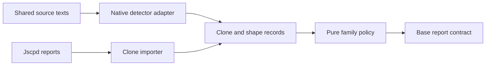

# Design Document

## Overview

Add duplicate-block and similar-routine reporting to the stable code report contract. This is independently acceptable after the base gate: introducing a copy produces a finding, removal resolves it, imported sources are visible and missing required reports fail.

### Goals
- Reuse an existing duplicate engine where its measured semantics match the contract.
- Define the token-family rule by this project's labeled corpus, with tokenization and the similarity ratio taken from adopted libraries.
- Keep AST similarity and semantic exploration clearly separate.

### Non-Goals
Metric ratchets, new-clone debt baselines, embedding-based blocking, semantic equivalence, data/locality policy or dependency graph analysis.

## Boundary Commitments

### This Spec Owns
Clone-specific models/settings, native detection/shape extraction, jscpd import, pure family policy, tests and documentation.

### Out of Boundary
Base CodeFacts, numeric baselines, source walking, attribution, shared CLI groups and evidence policy remain upstream. No source-tree walk or new top-level CLI family is introduced.

### Allowed Dependencies
Consumes SourceBundle, EntityKey, RuleOutcome and report composition from code-constraints. Native libraries stay in kiro-code; core receives plain clone/shape records. Uses the verification-evidence harness through the upstream code milestone.

### Revalidation Triggers
Detector/version, normalization, similarity definition, token dictionary, range identity, language support/exclusion, thresholds or upstream EntityKey/RuleOutcome change requires differential and journey reruns.

## Architecture

### Existing Architecture Analysis
The base CLI composes extension results without importing their private models. jscpd offers engine libraries and JSON output, but its AST similarity is a different measure from the token-shape ratio. Reuse exact duplication independently of family scoring.

### Architecture Pattern & Boundary Map


### Technology Stack
| Layer | Choice / Version | Role | Admission |
|---|---|---|---|
| Native reuse candidate | cpd-core 0.1.23 and cpd-tokenizer 0.1.22 (the library crates of jscpd 5.4.3, MIT) | Duplication primitives and tokens | Joint G1 pins the exact release and proves normalization; the API is young and moves quickly |
| Similarity ratio | difflib-fast 0.6.0 or difflib 0.4.0 (both MIT) | Gestalt ratio and single-linkage grouping | Joint G1 picks one on the labeled corpus; no custom scorer |
| External report | jscpd versioned JSON dialect fixtures | Operator-run analyzer integration | Explicit supported producer/dialect versions |
| Pure family policy | Rust core | Connected groups, filtering and stable scoring | No parser/I/O library in WASM |
| Tests | Existing fixture/nextest/evidence stack | Differential and real binary | Reuse shared harness |

Prototype cpd library reuse first. Its CLI library target is internal; do not depend on it. If an exact normalized-line adapter cannot preserve required windows/ranges, record the mismatch and implement only the missing normalization/window policy over existing tokenization. For families, adopt a library ratio and record its scores on the labeled corpus; if no library fits, return to design instead of writing a scorer. No lexer is written here: token shapes come from the adopted tokenizer or from the syntax tree of the shared parse stack. Compatibility with the archived scitools-hook scorer is not required (owner, 2026-11-10). AST scoring cannot silently replace token scoring. Any adoption that changes user-visible semantics returns to requirements/design review.

## File Structure Plan

| Component | File | Responsibility |
|---|---|---|
| CloneModel | `crates/kiro-core/src/code/clone_model.rs` | Clone ranges, token shapes and detector identity |
| CloneRules | `crates/kiro-core/src/code/clones.rs` | Pure family grouping, exclusions and findings |
| CloneSources | `crates/kiro-code/src/clones.rs` | Adopted duplicate detector and shape extraction |
| CloneSources | `crates/kiro-code/src/jscpd.rs` | Pinned report variants and source provenance |
| CloneConfig | `crates/kiro-core/src/code/clone_config.rs` | Typed clone settings and catalogue fragment |
| CloneTests | `crates/kiro-code/tests/clone_contract.rs` | Reuse comparison and differential corpus |
| CloneTests | `crates/kiro-code/fixtures/clones/expected.json` | Positive, negative and family-bridge oracle |
| CloneTests | `crates/kiro-cli/tests/e2e_clones.rs` | Introduced-copy, repair and source journeys |
| CloneDocs | `docs/clone-rules.md` | Detector definitions, thresholds and limitations |

Additive module/catalogue/config registrations are serialized with the upstream core owner. CodeCommands owns orchestration and accepts this extension's typed configuration/result. This spec owns only its registration entries, not a second dispatcher.

## System Flows

Shared bundle → clone observations → per-method deduplication → shape scoring with exact pruning → selected-family traversal → exclusions and reachability repair → base ownership/coverage/report composition. Optional invalid reports are findings; required invalid reports fail the command with exit 2 through the base source contract.

## Requirements Traceability

| Requirement | Summary | Components | Interfaces | Flows |
|---|---|---|---|---|
| 1.1 | The Code Gate shall report CODE_DUPLICATE_BLOCK for a run of at least 12 consecutive … | CloneModel, CloneRules, CloneConfig, CloneSources | CloneModel contract | Duplicate Blocks and Similar-Routine Families |
| 1.2 | The Clone Gate shall compare routines of at least 6 statements using identifier/liter… | CloneModel, CloneRules, CloneConfig, CloneSources | CloneModel contract | Duplicate Blocks and Similar-Routine Families |
| 1.3 | When a family contains a selected routine, the Code Gate shall report one CODE_SIMILA… | CloneModel, CloneRules, CloneConfig, CloneSources | CloneModel contract | Duplicate Blocks and Similar-Routine Families |
| 1.4 | The Clone Gate shall exclude ignored names, cross-language pairs and routines lacking… | CloneModel, CloneRules, CloneConfig, CloneSources | CloneModel contract | Duplicate Blocks and Similar-Routine Families |
| 1.5 | The Code Gate shall refuse a pair before scoring it when the length band or the token… | CloneModel, CloneRules, CloneConfig, CloneSources | CloneModel contract | Duplicate Blocks and Similar-Routine Families |
| 1.6 | The Code Gate shall document that the family rule finds a routine that was copied and… | CloneModel, CloneRules, CloneConfig, CloneSources | CloneModel contract | Duplicate Blocks and Similar-Routine Families |
| 1.7 | When a jscpd report is supplied, the Clone Gate shall import exact or normalized bloc… | CloneModel, CloneRules, CloneConfig, CloneSources | CloneModel contract | Duplicate Blocks and Similar-Routine Families |
| 2.1 | The Clone Gate shall accept pinned jscpd JSON report variants, preserve producer iden… | CloneModel, CloneSources, CloneConfig | CloneModel contract | Clone Sources and Comparable Semantics |
| 2.2 | The Clone Gate shall keep AST-similarity and token-shape similarity results explicitl… | CloneModel, CloneSources, CloneConfig | CloneModel contract | Clone Sources and Comparable Semantics |
| 2.3 | The Clone Gate shall merge only equivalent clone pairs with both locations and compat… | CloneModel, CloneSources, CloneConfig | CloneModel contract | Clone Sources and Comparable Semantics |
| 2.4 | The Clone Gate shall report unavailable or bounded-out clone analysis as incomplete c… | CloneModel, CloneSources, CloneConfig | CloneModel contract | Clone Sources and Comparable Semantics |
| 3.1 | The clone development workflow shall evaluate existing detection libraries and report… | CloneTests, CloneDocs | CloneTests contract | Reuse Prototype and Incremental Acceptance |
| 3.2 | The family acceptance corpus shall cover asymmetric scoring order, repeated tokens, e… | CloneTests, CloneDocs | CloneTests contract | Reuse Prototype and Incremental Acceptance |
| 3.3 | The first clone deliverable shall detect an introduced copy through the real binary a… | CloneTests, CloneDocs | CloneTests contract | Reuse Prototype and Incremental Acceptance |
| 3.4 | The clone workflow shall measure accuracy and runtime against a labeled corpus, keep … | CloneTests, CloneDocs | CloneTests contract | Reuse Prototype and Incremental Acceptance |

## Components and Interfaces

### CloneModel and CloneConfig
**Requirements:** 1.1–1.7, 2.1–2.4. **Dependencies:** EntityKey/RuleOutcome outbound P0. **Contracts:** State, Service.
```rust
pub struct CodeRange { pub path: String, pub start_line: u32, pub end_line: u32 }
pub enum CloneMethod { NormalizedLines, TokenShapes, Ast }
pub struct DetectorIdentity { pub name: String, pub version: String, pub definition: String, pub method: CloneMethod }
pub struct ClonePair { pub left: CodeRange, pub right: CodeRange, pub detector: DetectorIdentity, pub score: Option<f64> }
pub struct RoutineShape { pub key: EntityKey, pub language: String, pub statements: u32, pub tokens: Vec<u32>, pub container: Option<EntityKey> }
pub struct CloneInputs { pub pairs: Vec<ClonePair>, pub shapes: Vec<RoutineShape>, pub coverage: Vec<RuleCoverage> }
pub fn parse_settings(text: &str) -> Result<CloneSettings, ConfigError>;
```
Tokens use one deterministic intern table per bundle; IDs from unrelated runs/dictionaries are never compared. Pair endpoints canonicalized by normalized path/range, excluding self-overlap. Detector identity is part of identity; equal ranges from incompatible methods are not one clone. Reject negative/reversed/out-of-root ranges and nonfinite scores.

Defaults: duplicate min_lines=12 warning; family threshold=.9, min_statements=6, min_family=2 warning. Ignored names include dunder and setup/teardown hooks, with user additions requiring reasons. Settings/catalogue fragment obey base config validation; no clone-specific policy file.

### CloneSources
**Requirements:** 1.1–1.2, 1.7, 2, 3.1. **Dependencies:** SourceBundle outbound P0; selected detector external P0. **Contracts:** Service.
```rust
pub fn extract_clones(bundle: &SourceBundle, settings: &CloneSettings) -> Result<CloneInputs, ExtractionError>;
pub fn import_jscpd(text: &str, expected: &ReportSource) -> Result<CloneInputs, SourceError>;
```
Native block semantics: at least 12 code-bearing lines after whitespace/comment normalization, excluding empty normalized lines; contiguous in that normalized sequence. Hash candidates are confirmed against normalized text. Report both selected ends, up to three other locations, and merge contained windows of the same maximal pair deterministically.

Token shapes replace identifiers with ID and literals with LIT, preserving other tokens. Statement eligibility comes from a compatible metric profile; missing statements means unavailable rather than zero. Parser failures cannot generate clone records.

JSON adapters pin firstFile/secondFile and duplicationA/duplicationB dialects through real captured fixtures. Preserve kind, method, producer and source ranges; exact/normalized clones map to CODE_DUPLICATE_BLOCK. AST pairs map to an explicitly advisory CODE_SIMILAR_AST and never seed token-shape families. Missing kind in an older known dialect follows that dialect's documented exact-clone meaning; unknown dialects fail rather than guess. Partial imports do not prove native coverage. Read report sources through the base explicit-source contract, without invoking jscpd.

### CloneRules
**Requirements:** 1.1–1.7, 2.2–2.4. **Dependencies:** CloneModel outbound P0; base report contract outbound P0. **Contracts:** Service.
```rust
pub fn evaluate_clones(input: &CloneInputs, settings: &CloneSettings, selection: &[String], budget: WorkBudget) -> RuleOutcome;
```
Family score is the adopted library ratio, twice the matched length divided by the total length. Canonical entity-key order fixes the argument order, because gestalt ratios are not symmetric. Length-band ceiling and token-multiset ceiling may reject only pairs that provably cannot reach the threshold.

Families are connected components, not cliques: weakest retained edge describes the component, not a claim that every pair exceeds threshold. Traverse from selected seeds, cache each canonical pair once, remove ignored/nested members, recompute reachability on surviving edges and choose first selected surviving member as anchor. Parent-child pair exclusion alone is insufficient; test a third-member bridge.

Same-file family → shrink hint; cross-file → delete hint. One finding per retained family, with sorted members/size/weakest edge. Different-language pairs are excluded even if another detector supports JS/TS cross-pairs. Semantic rewrites are documented blind spots; embedding outputs never determine this gate.

Clone deduplication requires both endpoint pairs and compatible semantics; overlapping one endpoint is not sufficient. Numeric baseline cannot excuse an extension finding. New-clone fingerprint baselines remain a separately scoped future decision rather than a hidden addition.

### CloneTests and CloneDocs
**Requirements:** 1.6, 3.1–3.4. **Dependencies:** shared harness and provider fixtures outbound P0. **Contracts:** Batch.
Provide oracle examples for exact copies, renamed identifiers, harmless formatting, near-threshold scores, repeated popular tokens, excluded bridges and unrelated similar syntax. Record fixture provenance. Document version/semantic differences rather than declaring full parity from one example.

## Data Models
Private CloneInputs are transient; optional debug exports are explicitly versioned and do not alter CodeFacts baselines. RuleOutcome exposes canonical findings plus per-rule completeness and limits reached. Token order and source order cannot affect report bytes.

## Error Handling
Invalid required report → exit 2. Invalid optional report → CODE_SOURCE_INVALID with coverage. Detector failure/parse gaps/work-budget exhaustion → incomplete coverage, blocking acceptance when the rule is required. No empty-result fallback. Deterministic counters bound comparisons/tokens; elapsed timings are collected externally for performance acceptance.

## Testing Strategy
- Group 1: at/below line and statement floors; line normalization and self-overlap; scoring against the recorded corpus values; ordering/threshold ties; pruning never removes an accepted oracle pair; ignored/nested third-member bridges.
- Group 2: each pinned JSON dialect, exact versus AST handling, two-ended deduplication, malformed ranges, partial source and required absence.
- Group 3: actual binary copy introduction/removal; imported clone observed in report; missing required source exits 2; disabling detector makes journey fail.
- Measure precision/recall on labeled fixtures with all known negatives clear and all declared positives found; representative-repo findings stay advisory until reviewed. Record total/pair work and runtime, including large unrelated bundles and repetitive adversarial shapes. Respect base task/whole-tree release budget; a counter limit reports incompleteness.

## Deliverables and Development Gates
1. K0 / G1: pinned reuse/semantic comparison and supported-dialect fixtures.
2. K1 / G2: exact duplicate journey through base CLI, independently usable.
3. K2: compatible token-family rules and exclusion corpus.
4. K3 / G4–G6: source import, adversarial budget and platform/determinism joins with current evidence.
K0 cannot be replaced by an unchecked library recommendation. No implementation waits for locality/data rules.

## Integration & Migration Notes
Supersedes original code-constraints Requirement 5 and the clone portion of its source/testing promises. Historical criterion mapping lives in ../code-constraints/split-map.md. Changing the .9 token-family contract to AST similarity requires an explicit semantic amendment.
