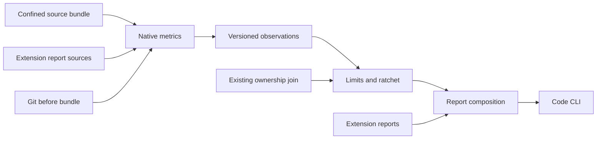
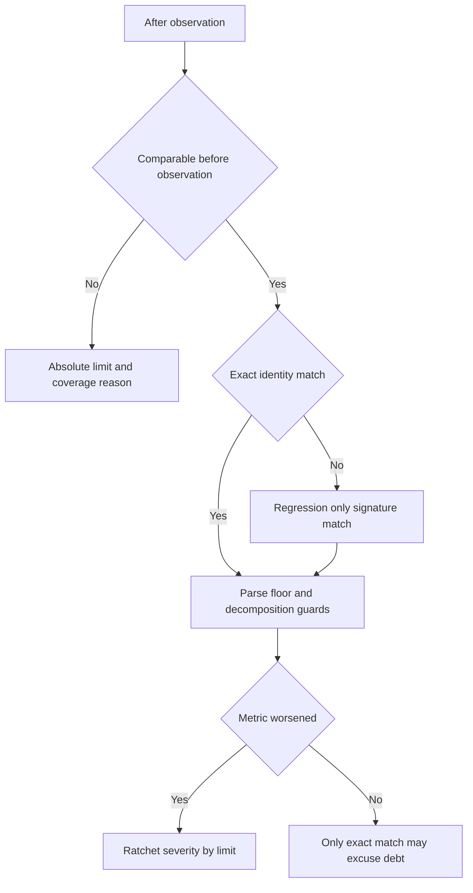

# Design Document

## Overview

Deliver the smallest complete code gate: comparable routine/container measurements, a refactoring-safe ratchet and spec/task attribution through the existing CLI. The first executable slice is Rust task-scoped fail → repair → pass, followed by baseline-debt acceptance and regression rejection.

### Goals
- Offline bundled metrics for Rust, Python and TypeScript/JavaScript, with exact semantic identities.
- Honest coverage for partial imports, parse failures and incompatible baselines.
- A stable finding/coverage contract consumed by clone and locality specs without waiting for those features.

### Non-Goals
Clone algorithms, locality/data extraction, call/dependency graphs, dead-code inference, IDE code-report UI, evidence-runner implementation and analyzer process orchestration.

## Boundary Commitments

### This Spec Owns
- CodeFacts and metric-definition/provenance contract, configuration/reasons, numeric limits and ratchet.
- Confined source bundle, native metric adapters over adopted parsing libraries, the report-source contract (no adapter of its own) and Git before-side accounting.
- Ownership selection, code report composition, code commands, hook summary and metric points, self-gate and code feedback documentation.

### Out of Boundary
No clone tokens or locality records in the numeric baseline. Extension specs own their data models, settings and algorithms. cli-contracts owns argument conventions; verification-evidence owns execution acceptance. Upstream kiro-core owns Finding, Source and the ownership join.

### Allowed Dependencies
Pure core uses existing serde/serde_json/toml and current join/vocabulary types; no filesystem, process, clock or native parser. Native kiro-code consumes core contracts. CLI consumes core, native measurement and cli-common. Extension modules depend on base contracts; base numeric evaluation never imports extension modules.

### Revalidation Triggers
Fact/schema, metric semantics, producer/grammar version, identity, baseline compatibility, selection/accounting rules, config digest, extension-report shape or join behavior require relevant provider/ratchet/consumer fixtures to rerun. A meaning change increments schema or semantic version; added observations do not become comparable automatically.

## Architecture

### Existing Architecture Analysis
Reuse join::owners_of and path_matches rather than duplicating ownership; FsSource remains the spec read port. Source code is read through one confined native bundle. Existing report findings keep their base shape, with a code-specific envelope carrying metrics, hints and provenance.

### Architecture Pattern & Boundary Map


Dependency direction: core contracts → native producers and pure policy → CLI composition. The CLI calls each enabled extension explicitly and passes its result to composition; no generic plugin runtime or rule discovery machinery is introduced.

### Technology Stack
| Layer | Choice / Version | Role | Admission |
|---|---|---|---|
| Core | Rust 2024; existing serde/toml pins | Facts, policy and renderers | Preserve wasm build |
| Measurement | ast-grep-core 0.51.1 with ast-grep-language 0.51.1 (tree-sitter 0.27.2; grammars rust 0.24.2, python 0.25.0, typescript 0.23.2, javascript 0.25.0), adopted in G1 on 2026-11-10; rust-code-analysis rejected (does not compile from crates.io) | Bundled offline metrics on Windows, Linux and macOS | Exact pins in `crates/kiro-code/Cargo.toml`; no hand-written lexer or parser; counting rules are per-language node-kind tables |
| Comparison oracle | Hand-counted corpus; Lizard as an optional cross-check | Differential research | Development-only, never required at runtime |
| Revision access | Installed Git subprocess | Read-only diff and cat-file | No checkout or mutation of user repository |
| Testing | Existing helpers, insta/nextest and evidence foundation | Oracle plus real binary | Required tools are provisioned in CI |

**Build-versus-adopt decision (owner, 2026-11-10):** parsing is always adopted. This project writes no lexer or parser for source code; it writes queries and counting rules over a syntax tree that a library produces. G1 is one joint prototype with clone-constraints and code-locality-data, so that `kiro-code` links one parse stack and one tree-sitter runtime. The adapter normalizes only metrics proven on the hand-counted corpus. A fact the library does not supply may come from a bounded query over the same tree; a mismatched definition remains a separately named metric rather than being relabeled. If no library combination meets the bundled contract on all three platforms, G1 fails and this design is revised before broad tasks begin. This is a finite prototype gate, not a claim that a dependency has already been validated.

The candidate limits are starting values carried over from the archived scitools-hook project, where they were measured with a different analyzer. They are priors. The calibration corpus (owner, 2026-11-10) is this repository plus `../facdrone` (Python), `../mmhmem` (Rust, Python), `../mvibe` (Python, TypeScript) and `../Contour` (C++, which no profile measures yet).

## File Structure Plan

| Component | File | Responsibility |
|---|---|---|
| CodeFacts | `crates/kiro-core/src/code/facts.rs` | Versioned observations, provenance, completeness and identity |
| CodeConfig | `crates/kiro-core/src/code/config.rs` | Limits, reasons, scopes, provider policy and config digest |
| CodeLimits | `crates/kiro-core/src/code/limits.rs` | Routine/container limits and highest measurements |
| CodeRatchet | `crates/kiro-core/src/code/ratchet.rs` | Eligibility, match trust, decomposition and net accounting |
| CodeAttribution | `crates/kiro-core/src/code/attribution.rs` | Existing join adaptation and task selection |
| CodeEvaluate | `crates/kiro-core/src/code/mod.rs` | Pure evaluation order and extension report composition |
| CodeReport | `crates/kiro-core/src/code/report.rs` | Canonical findings, hints and coverage contribution types |
| CodeReport | `crates/kiro-core/src/code/render.rs` | Deterministic text/JSON and SARIF representation |
| CodeFeedback | `crates/kiro-core/src/code/steering.rs` | Effective-rules block and idempotent splice |
| NativeMeasure | `crates/kiro-code/Cargo.toml` | Native measurement crate and adopted dependency pins |
| NativeMeasure | `crates/kiro-code/src/lib.rs` | Typed immutable source bundle and measurement entry point |
| NativeMeasure | `crates/kiro-code/src/walk.rs` | Confined source reads, path selection and exclusions |
| NativeMeasure | `crates/kiro-code/src/measure.rs` | Provider adapter and language metric profiles |
| NativeMeasure | `crates/kiro-code/src/sources.rs` | Report-source registration contract used by extension adapters |
| CodeReport | `crates/kiro-core/src/code/summary.rs` | ASCII hook summary and metric points from the report model |
| CodeDocs | `docs/code-hooks.md` | Pre-commit and pre-push examples for Windows, Linux and macOS |
| GitBefore | `crates/kiro-code/src/git.rs` | Revision, rename/deletion manifest and before blobs |
| CodeCommands | `crates/kiro-cli/src/code.rs` | Code command definitions and I/O orchestration |
| CodeCommands | `crates/kiro-cli/src/code_io.rs` | Baseline/report/steering output with atomic replacement |
| CodeTests | `crates/kiro-code/tests/provider_contract.rs` | Pinned hand-counted metric corpus and provider comparison |
| CodeTests | `crates/kiro-code/fixtures/metrics/expected.json` | Metric semantic oracle per language |
| CodeTests | `crates/kiro-cli/tests/e2e_code.rs` | First vertical slice and all code journeys |
| CodeTests | `crates/kiro-core/fixtures/code/ratchet.json` | Refactoring and comparison decision corpus |
| CodeDocs | `docs/code-rules.md` | Definitions, limits, blind spots, baseline and adoption procedure |
| CodeDocs | `docs/code-feature-map.md` | Versioned upstream rule and technique inventory |
| CodeDocs | `.kiro/code-rules.toml` | Reviewed self-gate configuration |
| CodeDocs | `.kiro/code-baseline.json` | Self-gate baseline created only after implementation inventory |
| CodeFeedback | `.kiro/steering/code-rules.md` | Generated code feedback block |
| CodeFeedback | `.opencode/skills/kiro-review/SKILL.md` | Code report and ownership review input |

Shared registrations in core lib.rs/catalogue and workspace manifests remain upstream-owned additive integration patches. cli-contracts owns existing CLI main/argument migration; this spec adds only its code dispatch arm through that boundary. Evidence and code-check sections in shared impl/validate skills are edited serially by their respective owners. No extension edits base schema to add private token or locality state.

## System Flows

Read/validate config → resolve selection and independent accounting scope → read after/before source bundles → produce observations → validate eligibility → limits → ratchet → ownership → combine optional extension findings → coverage → deterministic output and verdict.



Container counts bypass numeric ratcheting. Decomposition suppresses eligible count regression, not absolute thresholds. Required unavailable facts prevent acceptance; optional facts remain visibly incomplete.

## Requirements Traceability

| Requirement | Summary | Components | Interfaces | Flows |
|---|---|---|---|---|
| 1.1 | The Code Gate shall measure routine, type and file metrics for Rust, Python and TypeS… | CodeFacts, NativeMeasure | CodeFacts contract | Measurement Sources |
| 1.2 | The Code Gate shall accept an external report only through a source adapter registere… | CodeFacts, NativeMeasure | CodeFacts contract | Measurement Sources |
| 1.3 | When comparable numeric observations exist for the same entity and metric on both sid… | CodeFacts, NativeMeasure | CodeFacts contract | Measurement Sources |
| 1.4 | If a report file cannot be read, is not valid JSON or does not match its declared for… | CodeFacts, NativeMeasure | CodeFacts contract | Measurement Sources |
| 1.5 | When several sources supply one metric, the Code Gate shall select the configured pro… | CodeFacts, NativeMeasure | CodeFacts contract | Measurement Sources |
| 1.6 | While a selected file is in a language no source covers, the Code Gate shall list it … | CodeFacts, NativeMeasure | CodeFacts contract | Measurement Sources |
| 1.7 | Where a source is marked required in the configuration and its report is absent or in… | CodeFacts, NativeMeasure | CodeFacts contract | Measurement Sources |
| 2.1 | The Code Gate shall read its configuration from .kiro/code-rules.toml under the proje… | CodeConfig, CodeDocs | CodeConfig contract | Configuration, Defaults and Reasons |
| 2.2 | The Code Gate shall document the evidence behind every shipped default and enable blo… | CodeConfig, CodeDocs | CodeConfig contract | Configuration, Defaults and Reasons |
| 2.3 | The Code Gate shall accept, per rule and per metric, a severity (error, warning, info… | CodeConfig, CodeDocs | CodeConfig contract | Configuration, Defaults and Reasons |
| 2.4 | The Code Gate shall require a reason text on every scope, on every ignore entry and o… | CodeConfig, CodeDocs | CodeConfig contract | Configuration, Defaults and Reasons |
| 2.5 | If the configuration names an unknown rule, metric, severity or key, a limit that is … | CodeConfig, CodeDocs | CodeConfig contract | Configuration, Defaults and Reasons |
| 2.6 | When code config runs, the Code Gate shall print every effective limit, severity, sco… | CodeConfig, CodeDocs | CodeConfig contract | Configuration, Defaults and Reasons |
| 3.1 | The Code Gate shall measure strict cyclomatic complexity, deepest nesting, code lines… | CodeLimits, NativeMeasure, CodeTests | CodeLimits contract | Routine Complexity and Size Limits |
| 3.2 | The Code Gate shall measure the lines per statement for routines of at least 5 statem… | CodeLimits, NativeMeasure, CodeTests | CodeLimits contract | Routine Complexity and Size Limits |
| 3.3 | When a measured value exceeds its limit, the Code Gate shall report CODE_ROUTINE_LIMI… | CodeLimits, NativeMeasure, CodeTests | CodeLimits contract | Routine Complexity and Size Limits |
| 3.4 | The Code Gate shall judge every limit strictly, treating a value equal to its limit a… | CodeLimits, NativeMeasure, CodeTests | CodeLimits contract | Routine Complexity and Size Limits |
| 3.5 | Where a report supplies cognitive complexity, essential complexity or path count with… | CodeLimits, NativeMeasure, CodeTests | CodeLimits contract | Routine Complexity and Size Limits |
| 3.6 | When --show-highest is given, the Code Gate shall print for every routine, type and f… | CodeLimits, NativeMeasure, CodeTests | CodeLimits contract | Routine Complexity and Size Limits |
| 4.1 | The Code Gate shall measure each file's code lines, declared functions, declared type… | CodeLimits, NativeMeasure | CodeLimits contract | Container Limits |
| 4.2 | The Code Gate shall count each type's declared methods and fields, including Rust inh… | CodeLimits, NativeMeasure | CodeLimits contract | Container Limits |
| 4.3 | When a file or type exceeds a limit, the Code Gate shall report CODE_FILE_LIMIT or CO… | CodeLimits, NativeMeasure | CodeLimits contract | Container Limits |
| 4.4 | The Code Gate shall never ratchet container counts, retaining absolute limits and app… | CodeLimits, NativeMeasure | CodeLimits contract | Container Limits |
| 4.5 | The Code Gate shall accept coupling, cohesion and inheritance depth of types from a r… | CodeLimits, NativeMeasure | CodeLimits contract | Container Limits |
| 5.1 | The Code Gate shall identify every measured entity by a key that is stable across two… | CodeRatchet, GitBefore, CodeCommands | CodeRatchet contract | Ratchet, Baseline and Net Growth |
| 5.2 | When an eligible comparable metric worsens, the Code Gate shall report CODE_RATCHET w… | CodeRatchet, GitBefore, CodeCommands | CodeRatchet contract | Ratchet, Baseline and Net Growth |
| 5.3 | When a before side exists and an entity exceeds a limit on both sides without worseni… | CodeRatchet, GitBefore, CodeCommands | CodeRatchet contract | Ratchet, Baseline and Net Growth |
| 5.4 | The Code Gate shall take the before side from the committed baseline file .kiro/code-… | CodeRatchet, GitBefore, CodeCommands | CodeRatchet contract | Ratchet, Baseline and Net Growth |
| 5.5 | The Code Gate shall never apply the ratchet to the container counts of the container-… | CodeRatchet, GitBefore, CodeCommands | CodeRatchet contract | Ratchet, Baseline and Net Growth |
| 5.6 | When exactly one routine key disappears and one appears within the same scope, path a… | CodeRatchet, GitBefore, CodeCommands | CodeRatchet contract | Ratchet, Baseline and Net Growth |
| 5.7 | When complete comparable routine measurements exist on both sides of the accounting s… | CodeRatchet, GitBefore, CodeCommands | CodeRatchet contract | Ratchet, Baseline and Net Growth |
| 5.8 | When code baseline runs, the Code Gate shall write the baseline deterministically (so… | CodeRatchet, GitBefore, CodeCommands | CodeRatchet contract | Ratchet, Baseline and Net Growth |
| 5.9 | When baseline configuration, producer, metric definition, grammar, schema or scope id… | CodeRatchet, GitBefore, CodeCommands | CodeRatchet contract | Ratchet, Baseline and Net Growth |
| 6.1 | When a finding concerns a file that a discovered spec's design File Structure Plan ma… | CodeAttribution | CodeAttribution contract | Spec Ownership and Task Selection |
| 6.2 | When a file is mapped by more than one spec, the Code Gate shall set the feature to t… | CodeAttribution | CodeAttribution contract | Spec Ownership and Task Selection |
| 6.3 | When a selected file with at least one finding is mapped by no spec, the Code Gate sh… | CodeAttribution | CodeAttribution contract | Spec Ownership and Task Selection |
| 6.4 | When --spec <name> is given, the Code Gate shall judge only the files that spec's des… | CodeAttribution | CodeAttribution contract | Spec Ownership and Task Selection |
| 6.5 | The Code Gate shall print a per-spec summary in the text and JSON reports — findings … | CodeAttribution | CodeAttribution contract | Spec Ownership and Task Selection |
| 6.6 | The Code Gate shall accept --files <path>... and --all as selections in the same way … | CodeAttribution | CodeAttribution contract | Spec Ownership and Task Selection |
| 7.1 | Whenever a run completes, the Code Gate shall report CODE_COVERAGE naming selection, … | CodeEvaluate, CodeReport | CodeEvaluate contract | Trust Signals and Degradation |
| 7.2 | If a selected source file cannot be parsed into a syntax tree or contains an error no… | CodeEvaluate, CodeReport | CodeEvaluate contract | Trust Signals and Degradation |
| 7.3 | If a file outside the selection fails to parse, the Code Gate shall report a nonblock… | CodeEvaluate, CodeReport | CodeEvaluate contract | Trust Signals and Degradation |
| 7.4 | When a rule is off or cannot run (no source supplies its facts, the language is not c… | CodeEvaluate, CodeReport | CodeEvaluate contract | Trust Signals and Degradation |
| 7.5 | The Code Gate shall print and count warnings, information and pre-existing findings, … | CodeEvaluate, CodeReport | CodeEvaluate contract | Trust Signals and Degradation |
| 7.6 | The Code Gate shall document per rule what it deliberately does not report, stating i… | CodeEvaluate, CodeReport | CodeEvaluate contract | Trust Signals and Degradation |
| 8.1 | When code rules --write runs, the Code Gate shall write the effective rules as a bloc… | CodeFeedback, CodeReport, CodeDocs | CodeFeedback contract | Agent Feedback Contract |
| 8.2 | The Code Gate shall open every finding's hint with exactly one tag from simplify:, sp… | CodeFeedback, CodeReport, CodeDocs | CodeFeedback contract | Agent Feedback Contract |
| 8.3 | The Code Gate shall provide a JSON report in which every finding carries severity, co… | CodeFeedback, CodeReport, CodeDocs | CodeFeedback contract | Agent Feedback Contract |
| 8.4 | The code-gate workflow shall require a task-scoped check before completion and resolu… | CodeFeedback, CodeReport, CodeDocs | CodeFeedback contract | Agent Feedback Contract |
| 8.5 | The code-gate validation workflow shall require a whole-tree check against the review… | CodeFeedback, CodeReport, CodeDocs | CodeFeedback contract | Agent Feedback Contract |
| 8.6 | The Code Gate shall document a human-owned adaptation procedure in which a limit is l… | CodeFeedback, CodeReport, CodeDocs | CodeFeedback contract | Agent Feedback Contract |
| 9.1 | The kiro-cli shall offer code check with the selections --all, --changed <rev>, --spe… | CodeCommands, CodeReport, NativeMeasure | CodeCommands contract | Command Line, Exit Codes, Determinism and Performance |
| 9.2 | The kiro-cli shall use the shared exit contract: 0 for no eligible finding at --fail-… | CodeCommands, CodeReport, NativeMeasure | CodeCommands contract | Command Line, Exit Codes, Determinism and Performance |
| 9.3 | Where --sarif <path> is given, the Code Gate shall write the findings as a SARIF 2.1.… | CodeCommands, CodeReport, NativeMeasure | CodeCommands contract | Command Line, Exit Codes, Determinism and Performance |
| 9.4 | The Code Gate shall produce byte-identical text and JSON reports for the same tree, c… | CodeCommands, CodeReport, NativeMeasure | CodeCommands contract | Command Line, Exit Codes, Determinism and Performance |
| 9.5 | The Code Gate shall complete task-scoped checks over this repository within 10 second… | CodeCommands, CodeReport, NativeMeasure | CodeCommands contract | Command Line, Exit Codes, Determinism and Performance |
| 9.6 | The Code Gate shall confine source reads to the project root, read external reports o… | CodeCommands, CodeReport, NativeMeasure | CodeCommands contract | Command Line, Exit Codes, Determinism and Performance |
| 10.1 | The repository shall gate itself: the CI workflow runs kiro-cli code check --all --fa… | CodeTests, CodeDocs | CodeTests contract | Self-Application, Fixtures, Documentation and Tests |
| 10.2 | The repository shall provide expected-result fixtures for metric and container limits… | CodeTests, CodeDocs | CodeTests contract | Self-Application, Fixtures, Documentation and Tests |
| 10.3 | The repository shall document rules, defaults and blind spots, configuration and CI u… | CodeTests, CodeDocs | CodeTests contract | Self-Application, Fixtures, Documentation and Tests |
| 10.4 | The repository shall provide unit tests for every rule over the fixtures, a property … | CodeTests, CodeDocs | CodeTests contract | Self-Application, Fixtures, Documentation and Tests |
| 10.5 | The new code shall pass cargo clippy --all-targets -- -D warnings, cargo fmt --check … | CodeTests, CodeDocs | CodeTests contract | Self-Application, Fixtures, Documentation and Tests |
| 11.1 | The Code Gate shall attach producer and version, metric-definition and grammar versio… | CodeFacts, CodeRatchet, NativeMeasure | CodeFacts contract | Comparable Facts and Safe Ratchet Decisions |
| 11.2 | If a before or after file failed parsing or an observation is unavailable, the Code G… | CodeFacts, CodeRatchet, NativeMeasure | CodeFacts contract | Comparable Facts and Safe Ratchet Decisions |
| 11.3 | When code lines or statements increase while at least one comparable control-flow met… | CodeFacts, CodeRatchet, NativeMeasure | CodeFacts contract | Comparable Facts and Safe Ratchet Decisions |
| 11.4 | If either side is below a metric's minimum population, the Code Gate shall omit the c… | CodeFacts, CodeRatchet, NativeMeasure | CodeFacts contract | Comparable Facts and Safe Ratchet Decisions |
| 11.5 | The Code Gate shall preserve upstream severity, blocking, pre-existing status and hin… | CodeFacts, CodeRatchet, NativeMeasure | CodeFacts contract | Comparable Facts and Safe Ratchet Decisions |
| 11.6 | When --changed selects a revision, the Code Gate shall preserve old and new rename pa… | CodeFacts, CodeRatchet, NativeMeasure | CodeFacts contract | Comparable Facts and Safe Ratchet Decisions |
| 11.7 | If an active required measurement is unavailable or incompatible, the Code Gate shall… | CodeFacts, CodeRatchet, NativeMeasure | CodeFacts contract | Comparable Facts and Safe Ratchet Decisions |
| 12.1 | The development workflow shall compare existing measurement libraries against hand-co… | CodeTests, NativeMeasure, CodeDocs | CodeTests contract | Prototype and Incremental Delivery Gates |
| 12.2 | The first code-gate deliverable shall demonstrate a real-binary task-scoped fail, cod… | CodeTests, NativeMeasure, CodeDocs | CodeTests contract | Prototype and Incremental Delivery Gates |
| 12.3 | The code-gate acceptance suite shall cover implementer, CI, changed-revision, onboard… | CodeTests, NativeMeasure, CodeDocs | CodeTests contract | Prototype and Incremental Delivery Gates |
| 12.4 | The rollout workflow shall retain uncalibrated rules as advisory, record reviewed fin… | CodeTests, NativeMeasure, CodeDocs | CodeTests contract | Prototype and Incremental Delivery Gates |
| 12.5 | The development workflow shall test source containment, deterministic reports, Window… | CodeTests, NativeMeasure, CodeDocs | CodeTests contract | Prototype and Incremental Delivery Gates |
| 13.1 | When code check --summary is given, the Code Gate shall print a summary of at most 25… | CodeReport, CodeCommands | CodeReport contract | Hook Summary and Metric Points |
| 13.2 | The Code Gate shall restrict the summary to printable ASCII without colour sequences … | CodeReport, CodeTests | CodeReport contract | Hook Summary and Metric Points |
| 13.3 | The Code Gate shall provide its measured values as metric points to the provider cont… | CodeReport | CodeReport contract | Hook Summary and Metric Points |
| 13.4 | While telemetry is disabled or its export fails, the Code Gate shall produce the same… | CodeCommands | CodeCommands contract | Hook Summary and Metric Points |
| 13.5 | The Code Gate shall derive the summary and the metric points from the same report mod… | CodeReport, CodeTests | CodeReport contract | Hook Summary and Metric Points |
| 13.6 | The repository shall document pre-commit and pre-push hook examples that call the sum… | CodeDocs | CodeDocs contract | Hook Summary and Metric Points |

## Components and Interfaces

### CodeFacts
**Requirements:** 1.1–1.7, 11.1–11.7. **Dependencies:** serde outbound P0. **Contracts:** State, Service.
```rust
pub struct EntityKey { pub scope: Scope, pub path: String, pub qualified_name: String, pub parameters: String, pub ordinal: u32 }
pub struct MetricId { pub name: String, pub definition_version: String }
pub struct ProducerId { pub name: String, pub version: String, pub grammar: String }
pub enum Completeness { Complete, Partial, Unavailable, Failed, NotApplicable }
pub struct Observation { pub entity: EntityKey, pub metric: MetricId, pub value: f64, pub producer: ProducerId }
pub struct CoverageCell { pub path: String, pub metric: MetricId, pub state: Completeness, pub reason: Option<String> }
pub struct CodeFacts { pub schema_version: u32, pub source_manifest: String, pub scope_digest: String, pub config_digest: String, pub observations: Vec<Observation>, pub coverage: Vec<CoverageCell>, pub imported: Vec<ImportedFinding> }
pub enum MatchTrust { Exact, SignatureHeuristic, Unpaired }
pub fn compatibility(before: &Observation, after: &Observation) -> Compatibility;
```
Reject nonfinite values, duplicate conflicting observations and invalid paths. Missing is never zero. Producer/version/definition/grammar must match exactly unless a checked-in compatibility decision with corpus evidence permits equivalence. Source manifests differ naturally before/after, but both are required for provenance; scope completeness must be compatible. Configuration digest changes are visible, do not inherently invalidate raw facts, and current limits apply consistently to both sides. Changed metric definitions do invalidate comparison.

### NativeMeasure and GitBefore
**Requirements:** 1, 3, 4, 5.4, 5.7, 9.6, 11, 12.1. **Dependencies:** core facts outbound P0; native metric library/Git external P0. **Contracts:** Service, Batch.
```rust
pub struct SourceText { pub path: String, pub text: String }
pub struct SourceBundle { pub files: Vec<SourceText>, pub manifest: String }
pub struct ChangeManifest { pub selected_after: Vec<String>, pub accounting_before: Vec<String>, pub accounting_after: Vec<String>, pub renames: Vec<(String, String)> }
pub fn read_bundle(root: &Path, config: &CodeConfig) -> Result<SourceBundle, MeasureError>;
pub fn measure(bundle: &SourceBundle, profile: &MetricProfile) -> CodeFacts;
pub fn read_before(root: &Path, revision: &str) -> Result<(SourceBundle, ChangeManifest), GitError>;
pub trait ReportSource { fn format(&self) -> &str; fn import(&self, text: &str) -> Result<ImportedReport, SourceError>; }
```
Sorted confined walk, root-escape symlinks rejected, line endings normalized to LF in the bundle so that a CRLF working tree and LF Git blobs measure alike, UTF-8 limit 16 MiB per source, default exclusions .git/target/node_modules/dist/minified files/lockfiles. Extensions consume immutable SourceBundle texts; native parser objects never cross into core or force unrelated grammar versions onto consumers. Any extra parsing must fit the shared runtime budget.

Extensions: rs; py/pyi; ts/mts/cts/tsx; js/mjs/cjs/jsx. Profile records supported constructs and exclusions (Rust closures/Python lambdas are not standalone routines unless a later semantic version enables them). Parse ERROR nodes remove the file's metrics and record the first location. Qualified-name nesting, collapsed parameter text and document-order ordinal define identity; normalization alone is never used to match unrelated declarations.

Metric profile pins control-flow decisions including short-circuit boolean operators, excludes routine body from nesting depth, counts code-bearing lines/statements/declared parameters excluding self/this, and counts Python docstrings as comments. File types include named classes, structs, enums, traits, interfaces and unions, excluding aliases; Rust method/field totals include same-file inherent impls. G1 supplies explicit expected values for language-specific constructs so a shared label cannot conceal a different formula.

Git uses separate argv (never interpolated shell strings): rev-parse verify, diff --name-status -z --find-renames, and cat-file --batch. The revision wins over a committed baseline. Keep deletion paths and old rename paths in accounting even though output selection contains only surviving changed paths. An unambiguous Git rename supplies an explicit path mapping before exact-identity matching; ambiguous rename detection does not excuse breaches. --changed covers tracked staged/unstaged changes relative to the revision; untracked files require --all/--files. Missing revision/shallow history gives exit 2 with fetch guidance, without fetching automatically.

Report sources: the base gate ships no adapter. An extension registers a ReportSource for its format; imported findings keep tool, rule, severity and hint as provenance, are Partial observations, never create or remove entities and never enter net totals. Local numeric comparison of an imported value needs a known metric definition on both sides. Unknown metrics stay visible in coverage.

### CodeConfig and CodeLimits
**Requirements:** 2, 3, 4. **Dependencies:** facts outbound P0. **Contracts:** Service, State.
```rust
pub struct Limit { pub maximum: f64, pub severity: Severity, pub minimum_population: Option<u32> }
pub struct CodeConfig { pub limits: ScopedLimits, pub providers: ProviderPolicy, pub ratchet: RatchetSettings, pub required_metrics: Vec<MetricId>, pub extension_config: ExtensionConfig }
pub fn parse_config(text: Option<&str>, catalogue: &RuleCatalogue) -> Result<CodeConfig, Vec<ConfigError>>;
pub fn judge(facts: &CodeFacts, config: &CodeConfig, selected: &[String]) -> Vec<Judgement>;
```
Candidate routine limits: cyclomatic 10, nesting 3, code lines 60, statements 40, parameters 5; comment lines 20 and lines/statement 4 warn, latter only at 5+ statements. File limits: 500 lines, 25 functions, max cyclomatic 10; 8 types warns. Type limits: 20 methods, 10 fields. Strict greater-than breaches; equality passes. Calibration manifest enables blocking by metric-definition/language, not a blanket transfer of Understand defaults.

Required by default: the five base routine metrics, four file metrics and two type metrics for eligible declarations in supported selected files. Optional imported/shrink metrics carry availability without asserting required coverage. The calibration manifest changes severity, not required measurement completeness.

Per-scope precedence: greatest matched path-segment specificity wins, tie goes to later scope. Unknown keys, invalid severity/metric, nonfinite limit and missing relaxation reason fail before measurement. Every scope/ignore and relaxed limit/severity requires a reason. Extension owners provide typed settings validation and catalogue fragments; the base config composes these at the CLI boundary without interpreting detector internals. A disabled extension is visible in coverage.

### CodeRatchet
**Requirements:** 5, 11. **Dependencies:** facts/limits outbound P0. **Contracts:** Service.
```rust
pub fn pair(before: &CodeFacts, after: &CodeFacts, changes: &ChangeManifest) -> Vec<EntityPair>;
pub fn ratchet(input: RatchetInput) -> RatchetOutcome;
```
Exact matches can classify debt only when both observations are valid, comparable and above current limit without worsening. Unique disappeared/appeared signature pairs in one family can add regression but never pre-existing status. Ambiguous pairs remain unpaired with coverage explanation. A routine that moves to another file within one change, with an identical normalized body and signature and exactly one candidate on each side, is an exact match under a move mapping and keeps its debt status; otherwise following a `split:` hint on a god file would be reported as new breaches. Newness requires complete coverage of the relevant before scope; otherwise missing-before is Unknown and only absolute judgment is available.

Reject before/after parse failures and either-side population below floor before attaching before values. For code-line/statement growth, suppress count ratchet only if at least one comparable metric among strict/modified cyclomatic, nesting, path count or maximum cyclomatic improves and none worsens; missing evidence cannot assert improvement. Essential complexity is not evidence/veto for this exemption. Container counts never ratchet. Absolute cap remains; it is pre-existing only when its own exact observation justifies that classification.

Eligible regression above limit errors, within limit warns. Strict mode allows pre-existing threshold breaches to block. Imported upstream verdict and local policy remain distinct fields; default preserves upstream severity, while human-reviewed source policy can explicitly override it. Imported pre-existing status is provenance only unless local identity/comparability validates it.

Net accounting uses the union of complete before/after routine scope: additions positive, deletions negative, explicit renames paired. Report unavailable instead of an invented total when any required accounting observation is missing/incompatible.

### CodeAttribution, CodeReport and CodeEvaluate
**Requirements:** 6, 7, 8.2–8.3, 9.3–9.4. **Dependencies:** existing join outbound P0; extension results inbound P1. **Contracts:** Service.
```rust
pub struct RuleOutcome { pub findings: Vec<CodeFinding>, pub coverage: Vec<RuleCoverage> }
pub fn evaluate_numeric(input: EvaluateInput) -> RuleOutcome;
pub fn compose(numeric: RuleOutcome, extensions: Vec<RuleOutcome>, specs: &[SpecView]) -> CodeReport;
```
CodeFinding wraps existing Finding plus hint/tag, optional metric/value/before/limit, provenance, match trust, pre-existing eligibility and owners. Extension findings use the same envelope and retain detector identity. No timestamps or absolute paths in deterministic reports; sort using existing finding order and stable tie-breaks. Coverage state/counts are never inferred from findings count.

Use the existing File Structure Plan/task boundary join. First roadmap owner is primary; list others. Unknown spec/task/boundary or boundary with no mapped files is usage error. Selected unowned files with findings receive CODE_FILE_UNOWNED; all unowned measured files appear in summary. Outside-selection parse diagnostics remain nonblocking even under --fail-on warning, but incomplete required global analysis causes its own coverage error.

Core exposes JSON/text, SARIF 2.1.0 data, the hook summary and metric points; native CLI writes requested paths.

```rust
pub fn summary(report: &CodeReport) -> String;            // at most 25 lines, printable ASCII, LF
impl MetricProvider for CodeReport { /* source = "code"; names under kiro.code. */ }
```
The summary has a fixed order: verdict and before side; finding counts (blocking, warning, pre-existing); worsened metrics as `entity metric before -> after (limit)`; improved metrics in the same form; net statement and line delta or `unavailable`. Lists longer than the line budget end with a count of omitted rows. No colour, no Unicode, no clock. The metric points carry per metric the highest value, total, breach count and improved/worsened counts, with spec, component and task attributes; names and attributes are registered in the quality-telemetry catalogue. The gate writes no metric file; export, identity and timing belong to quality-telemetry. Both are views of CodeReport; neither recomputes a judgement. SARIF rule IDs equal finding codes, hints become remediation text. Hint tags: simplify, split, delete, shrink, collect, name, fix; no unsupported claim that a standard library replacement was checked.

### CodeCommands, CodeFeedback, CodeTests and CodeDocs
**Requirements:** 8–10, 12. **Dependencies:** CliGroups and evidence workflow outbound P0; numeric policy outbound P0. **Contracts:** Batch.
Commands remain code check/baseline/rules/config. Exactly one selection (--all/--changed/--spec/--task/--files); --show-highest, --summary and repeatable --source format=file. `--summary` replaces the text report on standard output and leaves the exit code unchanged. Telemetry enablement follows the quality-telemetry command profile and cannot change the verdict. The gate installs no hook; `docs/code-hooks.md` shows the calls. Optional invalid source yields error finding and continues; required invalid source exits 2. Native read/write failures exit 2. --output follows cli-contracts and does not bypass source confinement.

Baseline captures numeric facts plus provenance/completeness, atomically replaces only the named baseline, and rejects incomplete required measurements. No timestamps; sorted stable JSON. Agents cannot recapture to silence regression. Rules block is regenerated from effective typed config, preserves surrounding text, and rejects malformed/duplicate marker boundaries rather than overwriting arbitrary content.

The feature map is frozen from the research log with the inspected revision of the archived scitools-hook project and includes call_cycle/reachable_complexity as deferred structure-constraints, reference-based dead-code rules as deferred lean-code, and tooling-only exceptions with reasons. Copy no unverified claim of full Understand fidelity.

## Data Models
CodeFacts schema 2 supersedes the unimplemented monolithic schema proposal. Baseline and imported report are distinct formats. The source manifest is an identity record, not a source archive. Rule catalogue extensions are explicit compile-time registrations; rules/settings not present in the build are rejected rather than silently disabled.

## Error Handling
Configuration/required-source/Git/I/O failures exit 2. Content violations, selected parse errors and required incomplete coverage exit 1. Optional unavailable observations are reported with no fabricated metric. Baseline schema/identity incompatibility produces a clear recapture-or-migrate diagnostic; the implementing agent never follows that by resetting policy without human review.

## Testing Strategy
- Groups 1–4/11: oracle fixtures per language and profile, incompatible/missing observations, invalid reports, duplicate keys, bounded parse failures, equality thresholds and scope reasons.
- Group 5/11: old debt, new regression, signature change, guard-clause count growth, floor crossing, before parse repair, exact/ambiguous rename, deleted file, moved routine, empty extension report and provider upgrade. Missing evidence cannot excuse debt or create net savings.
- Groups 6–9: real binary reports owner/component/task, unknown boundary exit 2, unowned info, text/JSON equality, SARIF parse, marker preservation, source escape and requested output behavior.
- Groups 10/12: first Rust fail/fix/pass plus debt/regression, then Python/TS milestones; implementer/CI/change/onboarding/hook-summary/attribution journeys attach current run records through verification-evidence.
- Group 13: summary line budget and order, ASCII-only bytes, improved and worsened rows against a Git before side, agreement with the JSON report, metric points equal to report values and accepted by the catalogue, verdict unchanged with telemetry off or failing; hook examples run on Windows, Linux and macOS.
- Release task <10s and whole-tree <60s on recorded machine/corpus. A bound reached produces incomplete coverage, never a complete pass. Clippy/fmt/deny, native tests/doctests and core/standalone plugin checks use the canonical runner.

## Deliverables and Development Gates
1. M0 / G1: provider comparison corpus, dependency lock decision and typed facts contract. Stop broad implementation if semantics or supported packaging cannot be met.
2. M1 / G2: Rust limits + ownership + task check + first real-binary journey; no clone/locality dependency.
3. M2 / G3: baseline/Git and all ratchet safeguards, the move rule, accounting, and the hook summary and metric points.
4. M3: Python and TS/JS profiles, configured reports, steering/docs and remaining code journeys.
5. M4 / G6–G7: self-inventory and reviewed baseline, platform/sandbox integration, advisory rollout before blocking adoption.
The feature is accepted only after all required language/profile milestones and evidence pass. Prototype or Rust-only success is Partial.

## Integration & Migration Notes
The previous monolithic task list is historical and cannot drive implementation. Consumer specs can prototype against CodeFacts/RuleOutcome fixtures after M0; final joins wait for M2/M3 contracts. A consumer requiring a base-schema change requests revalidation instead of editing upstream types independently.
