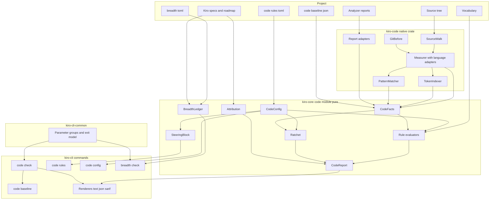
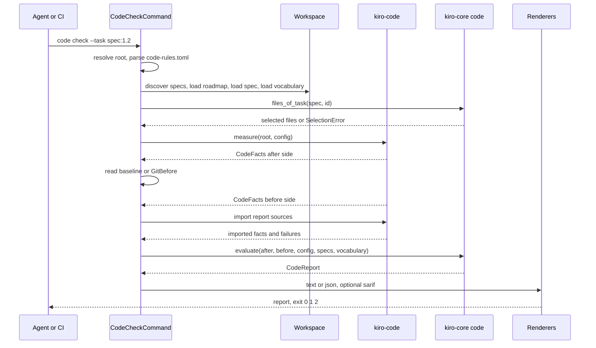
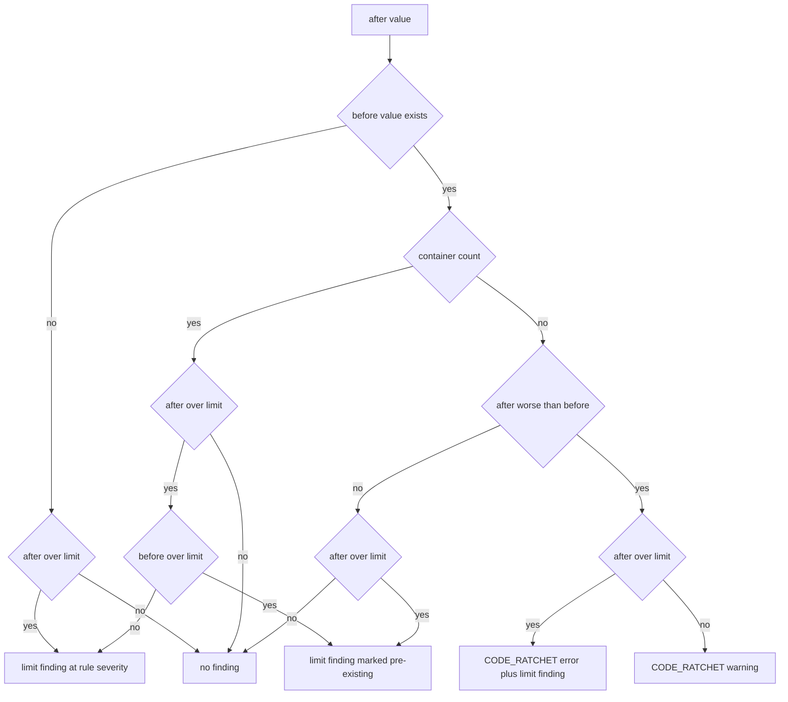

# Design Document: code-constraints

## Overview

**Purpose**: code-constraints (the Code Gate) is the implementation half of spec constraint checking. `kiro-cli code check` measures a project's source — natively for Rust, Python and TypeScript/JavaScript, through scitools-hook and jscpd reports for anything else — judges routines, types and files against measured limits, finds copies, renamed copies and scattered state, checks data code for role-named access grounded in the vocabulary, blocks only regression through a per-entity ratchet, and attributes every finding to the spec, design component and tasks that own the file.

**Users**: implementing agents gating one task before marking it complete (`--task`), reviewers reading per-spec health, CI pipelines (`--all` against a committed baseline), and maintainers who configure limits with written reasons.

**Impact**: adds a pure `code` module to `kiro-core` (fact model, configuration, rules, ratchet, attribution, report, steering block, 21 `CODE_*` codes), a new native crate `crates/kiro-code` (tree-sitter measurer, token indexer, pattern matcher, report adapters, git before side), a `code` command family to `kiro-cli`, three project files (`.kiro/code-rules.toml`, `.kiro/code-baseline.json`, `.kiro/steering/code-rules.md`), and amendments to three skills, the agent-guidance steering, the Cargo alias and the Dagger gate. The `Finding` shape, the plugin and the IDE host are unchanged.

**Amendments (2026-11-09, A1–A3)**: a pure `breadth` module in `kiro-core` with seven `BREADTH_*` codes and a `breadth check` command over the committed ledger `.kiro/breadth.toml` (QOpenBB's capability → criteria → tests → evidence shape); an end-to-end suite over the real binary and real repositories as the primary acceptance of every capability; and a shared command-line parameter library crate `crates/kiro-cli-common` that every `kiro-cli` command composes, with existing flags kept as aliases.

### Goals
- Every verdict is computed in `kiro-core` over plain facts, so the same rules run on native facts, imported facts and committed baselines, and the plugin can later read a committed report.
- Measurement never judges and judgement never measures: the native crate and the adapters produce `CodeFacts`; the engine produces findings.
- Only regression blocks: pre-existing debt is reported and never fails a run; container counts are never ratcheted.
- Every finding names its owning spec, component and tasks through the engine's join, and carries one tagged hint.
- Deterministic, byte-identical reports; exit codes `0/1/2` identical to `kiro-cli check`.
- Every user-visible capability is accepted by an end-to-end journey over the real binary and recorded in the breadth ledger with its evidence; "planned" is never read as "passed".
- Every command of the binary shares one parameter standard from one library, so a second binary inherits it.

### Non-Goals
- Dependency structure rules, dead-code rules, `recommend`, the plugin readout, auto-fixing, running analyzers (research.md records the deferrals and pendants).
- Native cognitive, essential or path-count complexity, type coupling, cohesion or inheritance depth: accepted from a report source only.
- Data-access patterns for TypeScript data libraries: configurable, not shipped.

## Boundary Commitments

### This Spec Owns
- The fact model `CodeFacts` with its JSON form, which is also the baseline format (`.kiro/code-baseline.json`).
- The configuration file `.kiro/code-rules.toml`: schema, shipped defaults, scopes, ignore lists, mandatory reasons, effective view.
- The eight rule evaluators (routine limits, container limits, duplicate blocks, similar-routine families, scattered definitions, scattered state, scattered schema, data access with column grounding), the ratchet with the stable entity key and the net line, attribution and selection, the `CodeReport` with its text, JSON and SARIF forms, the coverage record, the hint catalogue, the steering block, and the `CODE_*` finding codes.
- The native measurer: source walk, language adapters for Rust, Python and TypeScript/JavaScript, token indexer, pattern matcher; the two report adapters; the git before side.
- The `code check|baseline|rules|config` commands, their arguments and exit behaviour.
- Fixtures, tests, `docs/code-rules.md`, the CI and CLI documentation sections, the skill and steering amendments, the self-gating of this repository.
- (A1) The breadth ledger schema, its checks (`kiro_core::breadth`, `BREADTH_*` codes), the `breadth check` command, the seeded `.kiro/breadth.toml` and the ledger workflow in the skills.
- (A2) The end-to-end suite, its harness over temporary projects and repositories, its journeys and its evidence log.
- (A3) The command-line parameter library `kiro-cli-common` (global, output and gate groups, exit model, completions), the migration of every existing `kiro-cli` command onto it with aliases, the conformance test and `docs/cli-standard.md`.

### Out of Boundary
- The `Finding` shape, catalogue mechanism, sort order and text renderer (kiro-core), the file ↔ component ↔ task join (kiro-core `join`), the workspace and read port (kiro-core `source`), vocabulary loading and scoped resolution (vocabulary-grounding): consumed unchanged.
- The filesystem adapter, spec discovery, exit model and the spec gate's report envelope (cli-gate): reused, not redesigned.
- Running SciTools Understand, jscpd or any analyzer; fixing code; dependency structure and dead-code rules; proposing limits; IDE presentation.

### Allowed Dependencies
- `kiro-core::code` depends only on `std`, `serde`, `serde_json`, `toml` (already present) and the crate's own `finding`, `join`, `design`, `tasks`, `roadmap`, `vocab` and `render::text` modules. It gains no dependency and stays wasm-safe.
- `kiro-code` depends on `kiro-core` (fact model, config), `tree-sitter 0.27`, `tree-sitter-rust 0.24`, `tree-sitter-python 0.25`, `tree-sitter-typescript 0.23`, `tree-sitter-javascript 0.25`, `serde_json`; it uses `std::fs` and `std::process` (git) in its own confined modules; it never depends on `kiro-cli`.
- `kiro-cli-common` depends on `clap` 4.5, `clap-verbosity-flag` 3.0.4 and `clap_complete` 4.6.11 and on nothing else in the workspace; `kiro-cli` depends on it and re-exports its exit model for compatibility.
- `kiro-core::breadth` depends only on `toml`, `source`, `requirements`, `tasks` and `finding`; path existence is answered through the `Source` port.
- `kiro-cli` depends on `kiro-core`, `kiro-code` and `kiro-cli-common`; `kiro-cli` never parses source and never computes a verdict.
- Direction, enforced by review: `kiro-core::{code, breadth}` ← `kiro-code` ← `kiro-cli`, and `kiro-cli-common` ← `kiro-cli`.

### Revalidation Triggers
- A change to `CodeFacts` (baselines must be recaptured; adapters and the measurer re-tested) or to the configuration schema.
- An upstream change to `Finding`, `CODES`, `sort_findings`, `findings_text`, `join::owners_of`, `path_matches`, `Workspace`, `Lookup`, `FsSource`, `Exit`/`FailOn`, or the cc-sdd `_Boundary:_` convention.
- A tree-sitter core or grammar major upgrade (node kinds and ABI).
- A change to the Dagger gate order or the Cargo alias contract.
- A change to the ledger schema (`.kiro/breadth.toml`), to the shared parameter groups (every command's help output and the conformance test), or to the end-to-end harness contract.

## Architecture

### Existing Architecture Analysis
- **Engine first, frontends thin** (steering): all parsing, checking and rendering live in `kiro-core`; the plugin and CLI adapt I/O. The Code Gate keeps the verdict in the engine and puts only measurement (which needs a C parser runtime and the filesystem) in a native crate.
- **Read port and workspace**: `Workspace::new(source, known)` loads specs lazily; `FsSource` (kiro-cli `fs.rs`) is the only module naming `std::fs` in the CLI. The Code Gate reuses both for specs and vocabulary; source-tree walking is the measurer's own I/O.
- **Join**: `join::owners_of(design, tasks, path) -> Owners { covered, components, tasks, criteria }` and `path_matches` (suffix match at `/` boundaries) already answer "who owns this file"; attribution calls them per spec in roadmap order and never re-derives the mapping.
- **Finding shape and catalogue**: six fields, `Finding::new(code, file, message)` with the catalogue default severity, `CODES` plus the `lib.rs` doc table kept in agreement by a doc test, `CHECK_CODES` as the precedent for a per-spec code slice. The Code Gate appends 21 codes and a `CODE_CODES` slice.
- **cli-gate**: `Exit`/`Failure`/`FailOn`/`meets`/`verdict`, `resolve_root`, `discover_features`, `read_argument_file`, `write_output`, the `path:line: SEVERITY CODE message` line, and the Dagger gate that ends with `kiro-cli check --all --fail-on error`.
- **Vocabulary**: `Vocabulary::resolve(query, topics) -> Lookup::{Found, NotInTopic, Ambiguous, Unknown, Unscoped}` and `visible(topics)`; `vocab::load(&mut ws) -> Loaded`.
- **Precedents**: `CheckConfig` (configuration translated from flags), `CHECK_COVERAGE` (an info finding that makes "unchecked" visible), `EntityKey` and the ratchet model of scitools-hook (research.md).
- **Command line today**: `--project` (alias `--root`), `--verbose` and `--color` are global; `--format text|json` and `--fail-on` exist on `check` and `vocab validate`; `graph` and `tasks` select the table form with `--table`; `vocab import` writes to `--out`. The shared library normalises these behind aliases so no existing invocation breaks.
- **Breadth precedent**: `../QOpenBB/.kiro/breadth.toml` (200 capabilities, keys `id`, `requirements`, `planned_checks`, `test_paths`, `status`, `evidence`; statuses `planned`, `unverified`, `partial`, `implemented`, `passed`, `deferred`) kept aligned by steering rules rather than by a checker; this design adds the checker and the `e2e_paths` field.

### Architecture Pattern & Boundary Map



**Architecture Integration**:
- Selected pattern: measuring worker / judging engine / thin command adapter — the split scitools-hook itself uses, mapped onto this project's three crates.
- Domain boundaries: measurement (facts only), judgement (findings only), presentation and I/O (CLI). Attribution is judgement over spec documents the workspace already parses.
- Existing patterns preserved: `Source`/`Workspace` for specs and vocabulary, `Finding` and `findings_text` lines, `Exit` contract, confined filesystem modules, catalogue growth through `CODES` plus the doc table.
- New components rationale: a native crate because tree-sitter carries a C runtime and the sandbox target must stay free of it; a pure `code` module because the baseline and a later plugin readout need the rules to run over stored facts; report adapters because Understand-only metrics and other languages must enter the same gate.
- Steering compliance: no `std::fs`, network, threads or clock in `kiro-core`; deny bans untouched; lint table applied to the new crates; deterministic output.

### Technology Stack

| Layer | Choice / Version | Role in Feature | Notes |
|-------|------------------|-----------------|-------|
| Engine | Rust 2024, `std`, `serde` 1, `serde_json` 1, `toml` 0.8 (`parse`) | Fact model, configuration, rules, ratchet, report shapes | No new dependency in `kiro-core` |
| Measurer | `tree-sitter` 0.27.2, `tree-sitter-rust` 0.24.2, `tree-sitter-python` 0.25.0, `tree-sitter-typescript` 0.23.2, `tree-sitter-javascript` 0.25.0 (crates.io, 2026-11-09) | Parse trees, node kinds, leaf tokens, queries for data-access patterns | Native crate only; pin exact versions; ABI compatibility verified in task 1 |
| Before side | `git` ≥ 2.40 as a subprocess (`diff --name-status -z`, `cat-file --batch`) | Changed-file list and file contents at a revision | One process per run, not per file |
| CLI | `clap` 4.5 (derive), `serde_json` | `code` command family, JSON and SARIF documents | Reuses `fs`, `exit`, `report` wording |
| Hashing | FNV-1a 64-bit in `kiro_core::code::facts::hash64` | Line hashes for duplicate blocks, configuration digest | Deterministic, dependency-free |
| CI | `.cargo/config.toml` alias `kiro-code`, Dagger step | Self-gating | Appended after the spec gate step |
| Tests | `insta` (engine goldens), `tempfile` (CLI), fixed-seed loops | Fixtures, determinism, never-panic, timing | Timing tests release-only |
| CLI standard (A3) | `clap-verbosity-flag` 3.0.4, `clap_complete` 4.6.11 in `crates/kiro-cli-common` | Shared global, output and gate groups; `-v`/`-q`; shell completions | Versions from `cargo search`, 2026-11-09 |
| Ledger (A1) | `toml` 0.8 (`parse`) in `kiro-core::breadth` | Breadth ledger parsing and checks | No new engine dependency |
| End-to-end (A2) | Built binary via `CARGO_BIN_EXE_kiro-cli`, `tempfile`, real `git` | Journeys over temporary projects and repositories | Same commands locally and in the Dagger container |

## File Structure Plan

### Directory Structure
```
Cargo.toml                                   # workspace: + crates/kiro-code member
crates/
├── kiro-core/
│   ├── src/
│   │   ├── lib.rs                           # + pub mod code; doc table rows for the CODE_* codes
│   │   ├── finding.rs                       # + 21 CODE_* and 7 BREADTH_* catalogue entries, constants, CODE_CODES, BREADTH_CODES
│   │   ├── breadth/
│   │   │   ├── mod.rs                       # check(): ledger + spec views + path existence -> findings and summary
│   │   │   ├── model.rs                     # Ledger, Capability, Status, RequirementRef, TestPath parsing
│   │   │   └── check.rs                     # reference resolution, path existence, status rules, staleness, coverage
│   │   └── code/
│   │       ├── mod.rs                       # evaluate(): facts + config + specs -> CodeReport
│   │       ├── facts.rs                     # CodeFacts, EntityKey, Metric, TokenIndex, hash64, JSON form
│   │       ├── config.rs                    # CodeConfig: TOML parse, defaults, scopes, reasons, digest, effective view
│   │       ├── hints.rs                     # HintCatalog: tag and text per code and metric
│   │       ├── limits.rs                    # routine, type and file limits -> judgements; highest values
│   │       ├── duplicates.rs                # duplicate blocks over line hashes, clone import dedupe
│   │       ├── families.rs                  # gestalt ratio, exact bounds, families, nested twin exclusion
│   │       ├── scattered.rs                 # scattered definitions, state, schema
│   │       ├── data.rs                      # positional access, column grounding
│   │       ├── ratchet.rs                   # pairing, classification, pre-existing, net line, baseline staleness
│   │       ├── attribute.rs                 # owners per file, selection by spec and task, per-spec summaries
│   │       ├── report.rs                    # CodeFinding, CodeReport, Coverage, text lines
│   │       └── steering.rs                  # steering block text and marker splice
│   └── fixtures/code/                       # facts and config fixtures per rule, expected findings
├── kiro-code/
│   ├── Cargo.toml                           # native crate: tree-sitter, grammars, serde_json, kiro-core
│   ├── src/
│   │   ├── lib.rs                           # measure(), measure_texts(), re-exports
│   │   ├── io.rs                            # SourceWalk: root-confined walk, include and exclude, UTF-8 read
│   │   ├── language.rs                      # Language, extension map, LanguageAdapter trait, TokenClass
│   │   ├── measure.rs                       # Measurer: parse, dispatch, entity keys, assemble CodeFacts
│   │   ├── rust.rs                          # RustAdapter
│   │   ├── python.rs                        # PythonAdapter
│   │   ├── typescript.rs                    # TypeScriptAdapter for TS, TSX and JS
│   │   ├── tokens.rs                        # TokenIndexer: line hashes and routine shapes
│   │   ├── patterns.rs                      # PatternMatcher: shipped and configured tree-sitter queries
│   │   ├── scitools_hook.rs                 # ScitoolsAdapter: RunResult JSON -> facts
│   │   ├── jscpd.rs                         # JscpdAdapter: duplicates JSON -> clone records
│   │   └── git.rs                           # GitBefore: changed files and contents at a revision
│   └── fixtures/                            # source trees per rule and language
├── kiro-cli-common/
│   ├── Cargo.toml                           # library: clap, clap-verbosity-flag, clap_complete; lint table
│   └── src/
│       ├── lib.rs                           # re-exports of the parameter groups and the exit model
│       ├── global.rs                        # GlobalArgs: project with alias, verbosity, colour; environment fallbacks
│       ├── output.rs                        # OutputArgs: --format, --output; ReportFormat; stdout-or-file writer
│       ├── gate.rs                          # GateArgs: --fail-on; FailOn, meets, verdict
│       ├── exit.rs                          # Exit, Failure
│       └── completions.rs                   # completion script generation for a clap command
└── kiro-cli/
    ├── Cargo.toml                           # + kiro-code and kiro-cli-common dependencies
    ├── src/
    │   ├── main.rs                          # + Command::Code, Command::Breadth, Command::Completions dispatch arms
    │   ├── cli.rs                           # commands composed from the shared groups; + CodeCommand, BreadthArgs
    │   ├── exit.rs                          # re-export of the shared exit model (compatibility)
    │   ├── breadth.rs                       # BreadthCommand: ledger read, spec views, path existence, report
    │   └── code/
    │       ├── mod.rs                       # command module root
    │       ├── check.rs                     # CodeCheckCommand: load, select, measure, evaluate, render, exit
    │       ├── baseline.rs                  # CodeBaselineCommand: measure and write the baseline
    │       ├── rules.rs                     # CodeRulesCommand: print or splice the steering block
    │       ├── config_cmd.rs                # CodeConfigCommand: effective configuration listing
    │       ├── render.rs                    # text and JSON renderers for CodeReport
    │       └── sarif.rs                     # SARIF 2.1.0 writer
    └── tests/
        ├── code.rs                          # CLI integration tests over fixture trees
        ├── cli_standard.rs                  # conformance test over every command's help output
        └── e2e/
            ├── main.rs                      # journey runner and evidence log
            ├── harness.rs                   # temporary projects and git repositories, binary runner
            ├── implementer_loop.rs          # task-scoped check blocks, fix, passes
            ├── ci_loop.rs                   # baseline, regression, ratchet, pre-existing
            ├── change_loop.rs               # --changed over a two-commit repository
            ├── onboarding_loop.rs           # config, rules --write, both gates
            ├── sources_loop.rs              # report imports, required source missing
            ├── breadth_loop.rs              # ledger planned -> implemented -> passed, refused claims
            └── attribution_loop.rs          # spec, component and task names; unowned file
.kiro/
├── code-rules.toml                          # this repository's configuration
├── code-baseline.json                       # captured baseline
├── breadth.toml                             # capability ledger, seeded planned, moved by evidence
└── steering/
    ├── code-rules.md                        # generated steering block
    └── agent-guidance.md                    # + the Code Gate as the code half of the contract
.cargo/config.toml                           # + kiro-code alias
.dagger/src/kiro/main.py                     # + code check step
docs/
├── code-rules.md                            # rules reference, feature map, configuration, agent contract, limits
├── breadth.md                               # ledger schema, status rules, workflow, breadth check
├── cli-standard.md                          # the shared parameter standard, precedence, aliases
├── ci.md                                    # + code gate, breadth check and end-to-end sections
└── cli.md                                   # + code and breadth command families, completions
.opencode/skills/
├── kiro-impl/SKILL.md                       # + task-scoped code check before marking a task complete; ledger to implemented
├── kiro-review/SKILL.md                     # + code report among review inputs
├── kiro-validate-impl/SKILL.md              # + whole-tree code check, breadth check and e2e as validation gates; ledger to passed
└── kiro-spec-tasks/SKILL.md                 # + ledger capabilities entered as planned at task generation
```

### Files by Component

| Component | File | Responsibility |
|-----------|------|----------------|
| CodeCatalogue | `crates/kiro-core/src/finding.rs` | Twenty-one `CODE_*` and seven `BREADTH_*` catalogue entries, `codes` constants, `CODE_CODES` and `BREADTH_CODES` slices |
| CodeCatalogue | `crates/kiro-core/src/lib.rs` | `pub mod code`, `pub mod breadth`; doc table rows so the catalogue doc test stays green |
| BreadthLedger | `crates/kiro-core/src/breadth/mod.rs` | `check(ledger, specs, source) -> BreadthReport`: findings and summary |
| BreadthLedger | `crates/kiro-core/src/breadth/model.rs` | Ledger, capability, status, requirement reference and test path parsing |
| BreadthLedger | `crates/kiro-core/src/breadth/check.rs` | Reference resolution, path existence, status rules, staleness, per-spec coverage |
| CodeEvaluate | `crates/kiro-core/src/code/mod.rs` | `evaluate(EvaluateInput) -> CodeReport`: runs rules, ratchet, attribution, coverage |
| CodeFacts | `crates/kiro-core/src/code/facts.rs` | Fact model, `EntityKey`, `Metric`, `TokenIndex`, `hash64`, deterministic JSON |
| CodeConfig | `crates/kiro-core/src/code/config.rs` | Parse `.kiro/code-rules.toml`, defaults, scopes, reason validation, digest, effective entries |
| HintCatalog | `crates/kiro-core/src/code/hints.rs` | One tagged hint per code and metric |
| RuleLimits | `crates/kiro-core/src/code/limits.rs` | Routine, type and file judgements against scoped limits; highest values |
| RuleDuplicates | `crates/kiro-core/src/code/duplicates.rs` | Windows of equal line hashes; clone import and dedupe |
| RuleFamilies | `crates/kiro-core/src/code/families.rs` | Gestalt ratio, exact bounds, BFS families, exclusions |
| RuleScattered | `crates/kiro-core/src/code/scattered.rs` | Definitions, state and schema groups over project-wide facts |
| RuleData | `crates/kiro-core/src/code/data.rs` | Positional access findings, column grounding through the vocabulary |
| Ratchet | `crates/kiro-core/src/code/ratchet.rs` | Pairing, worse-direction classification, pre-existing, net line, staleness |
| Attribution | `crates/kiro-core/src/code/attribute.rs` | Owners per file via `join`, spec and task selection, per-spec summaries |
| CodeReportModel | `crates/kiro-core/src/code/report.rs` | `CodeFinding`, `CodeReport`, `Coverage`, text line helpers |
| SteeringBlock | `crates/kiro-core/src/code/steering.rs` | Steering block text and marker splice |
| CodeFixtures | `crates/kiro-core/fixtures/code/` | Facts and configuration fixtures with expected findings per rule |
| MeasurerCrate | `crates/kiro-code/Cargo.toml` | Native crate manifest with pinned tree-sitter dependencies and the lint table |
| MeasurerCrate | `crates/kiro-code/src/lib.rs` | `measure`, `measure_texts`, `MeasureError`, re-exports |
| SourceWalk | `crates/kiro-code/src/io.rs` | Root-confined walk, include and exclude globs, UTF-8 read, size limit |
| LanguageModel | `crates/kiro-code/src/language.rs` | `Language`, extension map, `LanguageAdapter` trait, `TokenClass` |
| Measurer | `crates/kiro-code/src/measure.rs` | Parse, dispatch to adapters, entity keys and ordinals, facts assembly |
| RustAdapter | `crates/kiro-code/src/rust.rs` | Rust node kinds to routines, types, bindings, comparisons, enum matches |
| PythonAdapter | `crates/kiro-code/src/python.rs` | Python node kinds to the same facts |
| TypeScriptAdapter | `crates/kiro-code/src/typescript.rs` | TypeScript, TSX and JavaScript node kinds to the same facts |
| TokenIndexer | `crates/kiro-code/src/tokens.rs` | Line hashes and normalised routine shapes from leaf tokens |
| PatternMatcher | `crates/kiro-code/src/patterns.rs` | Shipped and configured queries for positional and named data access |
| ScitoolsAdapter | `crates/kiro-code/src/scitools_hook.rs` | scitools-hook `RunResult` JSON to entities, breaches, parse failures |
| JscpdAdapter | `crates/kiro-code/src/jscpd.rs` | jscpd JSON to clone records |
| GitBefore | `crates/kiro-code/src/git.rs` | Changed files and blob contents at a revision through one `git` process each |
| MeasurerFixtures | `crates/kiro-code/fixtures/` | Source trees per rule and language with expected facts |
| CliCommon | `crates/kiro-cli-common/Cargo.toml` | Library manifest: `clap`, `clap-verbosity-flag`, `clap_complete`, lint table |
| CliCommon | `crates/kiro-cli-common/src/lib.rs` | Re-exports of the parameter groups and the exit model |
| CliCommon | `crates/kiro-cli-common/src/global.rs` | `GlobalArgs`: project root with alias, verbosity, colour; environment fallbacks and precedence |
| CliCommon | `crates/kiro-cli-common/src/output.rs` | `OutputArgs`: `--format`, `--output`; `ReportFormat`; stdout-or-file writer |
| CliCommon | `crates/kiro-cli-common/src/gate.rs` | `GateArgs`: `--fail-on`; `FailOn`, `meets`, `verdict` |
| CliCommon | `crates/kiro-cli-common/src/exit.rs` | `Exit`, `Failure` |
| CliCommon | `crates/kiro-cli-common/src/completions.rs` | Completion script generation for a clap command |
| CodeArgs | `crates/kiro-cli/src/cli.rs` | Every command composed from the shared groups with aliases; `CodeCommand`, `CodeCheckArgs`, `CodeBaselineArgs`, `CodeRulesArgs`, `BreadthArgs`, selection validation |
| CodeArgs | `crates/kiro-cli/src/main.rs` | Dispatch arms for the `code`, `breadth` and `completions` commands |
| CodeArgs | `crates/kiro-cli/src/exit.rs` | Re-export of the shared exit model so existing modules keep compiling |
| CodeArgs | `crates/kiro-cli/Cargo.toml` | `kiro-code` and `kiro-cli-common` dependencies |
| BreadthCommand | `crates/kiro-cli/src/breadth.rs` | `breadth check`: ledger read, spec views, path existence through the read port, report, exit |
| CodeCheckCommand | `crates/kiro-cli/src/code/mod.rs` | Command module root |
| CodeCheckCommand | `crates/kiro-cli/src/code/check.rs` | Orchestration of a check run and its exit |
| CodeBaselineCommand | `crates/kiro-cli/src/code/baseline.rs` | Measure the tree and write the baseline deterministically |
| CodeRulesCommand | `crates/kiro-cli/src/code/rules.rs` | Print the block or splice it into the steering file |
| CodeConfigCommand | `crates/kiro-cli/src/code/config_cmd.rs` | Effective configuration listing with origins and reasons |
| CodeRenderers | `crates/kiro-cli/src/code/render.rs` | Text and JSON forms of `CodeReport` |
| CodeRenderers | `crates/kiro-cli/src/code/sarif.rs` | SARIF 2.1.0 document |
| CodeCliTests | `crates/kiro-cli/tests/code.rs` | Fixture-tree runs, exit codes, determinism, SARIF validity |
| CodeCliTests | `crates/kiro-cli/tests/cli_standard.rs` | Conformance test over every command's help output against the standard |
| E2eSuite | `crates/kiro-cli/tests/e2e/main.rs` | Journey runner and evidence log (command, exit, output digest) |
| E2eSuite | `crates/kiro-cli/tests/e2e/harness.rs` | Temporary projects from fixture trees, git repositories with commits, binary runner |
| E2eSuite | `crates/kiro-cli/tests/e2e/implementer_loop.rs` | Task-scoped check blocks, code fixed, same check passes |
| E2eSuite | `crates/kiro-cli/tests/e2e/ci_loop.rs` | Baseline captured, regression exits 1 with ratchet, pre-existing alone exits 0 |
| E2eSuite | `crates/kiro-cli/tests/e2e/change_loop.rs` | `--changed` over a two-commit repository, net line |
| E2eSuite | `crates/kiro-cli/tests/e2e/onboarding_loop.rs` | `code config`, `code rules --write`, steering block, both gates |
| E2eSuite | `crates/kiro-cli/tests/e2e/sources_loop.rs` | scitools-hook and jscpd imports, required source missing exits 2 |
| E2eSuite | `crates/kiro-cli/tests/e2e/breadth_loop.rs` | Ledger planned → implemented → passed, each wrong claim refused |
| E2eSuite | `crates/kiro-cli/tests/e2e/attribution_loop.rs` | Spec, component and task names on a finding; unowned file |
| SelfGate | `Cargo.toml` | Workspace members `crates/kiro-code`, `crates/kiro-cli-common` |
| SelfGate | `.kiro/breadth.toml` | This spec's capabilities, seeded `planned`, moved by evidence |
| SelfGate | `.kiro/code-rules.toml` | This repository's configuration with reasons |
| SelfGate | `.kiro/code-baseline.json` | Baseline captured after the first inventory |
| SelfGate | `.kiro/steering/code-rules.md` | Generated steering block |
| SelfGate | `.cargo/config.toml` | `kiro-code` alias |
| SelfGate | `.dagger/src/kiro/main.py` | Code gate step after the spec gate |
| CodeDocs | `docs/code-rules.md` | Rules reference, feature map, configuration, agent contract, honest limits, end-to-end-first policy |
| CodeDocs | `docs/breadth.md` | Ledger schema, status rules, workflow, `breadth check` |
| CodeDocs | `docs/cli-standard.md` | The shared parameter standard: groups, precedence, naming, aliases, output rules |
| CodeDocs | `docs/ci.md` | Code gate, breadth check and end-to-end suite in CI, baseline capture |
| CodeDocs | `docs/cli.md` | `code` and `breadth` command families, `completions` |
| SkillAmendments | `.opencode/skills/kiro-impl/SKILL.md` | Task-scoped code check before `[x]`; never edit configuration; ledger entry to `implemented` |
| SkillAmendments | `.opencode/skills/kiro-review/SKILL.md` | Code report as a review input |
| SkillAmendments | `.opencode/skills/kiro-validate-impl/SKILL.md` | Whole-tree code check, breadth check and end-to-end suite as gates; ledger entry to `passed` with evidence |
| SkillAmendments | `.opencode/skills/kiro-spec-tasks/SKILL.md` | Ledger capabilities entered as `planned` when tasks are generated |
| SkillAmendments | `.kiro/steering/agent-guidance.md` | The Code Gate and the breadth ledger as the code half of the feedback contract |

### Modified Files
- `crates/kiro-core/src/finding.rs`, `crates/kiro-core/src/lib.rs` — catalogue growth (the path cli-gate used for its importer codes) and the two module declarations.
- `crates/kiro-cli/src/cli.rs`, `crates/kiro-cli/src/main.rs`, `crates/kiro-cli/Cargo.toml` — every existing command composed from the shared groups with its current flags kept as aliases; the `code`, `breadth` and `completions` command trees and dispatch.
- `crates/kiro-cli/src/exit.rs`, `check.rs`, `viz.rs`, `vocab.rs`, `report.rs`, `import/*` — imports move to the shared exit model and format enum; behaviour and output bytes unchanged (guarded by the existing CLI tests).
- `Cargo.toml`, `.cargo/config.toml`, `.dagger/src/kiro/main.py` — workspace member, alias, gate step.
- `docs/ci.md`, `docs/cli.md`, `.kiro/steering/agent-guidance.md`, the three skills — documentation and protocol amendments only.

## System Flows

### `code check --task <spec>:<id>`



Flow decisions: configuration errors stop before any measurement (exit 2); the whole tree is always measured so project-wide rules see every file while findings are reported only against the selection; the before side is the baseline unless `--changed` names a revision; a required source that is missing stops with exit 2, an optional one yields `CODE_SOURCE_INVALID` and continues; the exit verdict excludes pre-existing findings.

### Ratchet classification per entity and metric



A pre-existing limit finding blocks only under `ratchet.strict = true`. Worse means greater for every shipped metric (all are maxima).

## Requirements Traceability

| Requirement | Summary | Components | Interfaces | Flows |
|-------------|---------|------------|------------|-------|
| 1.1 | Native measurement for Rust, Python, TypeScript/JavaScript; documented extension map | Measurer, LanguageModel, RustAdapter, PythonAdapter, TypeScriptAdapter, TokenIndexer, PatternMatcher, CodeDocs | `measure`, `LanguageAdapter` | check |
| 1.2 | scitools-hook and jscpd reports as sources; documented facts per format | ScitoolsAdapter, JscpdAdapter, CodeArgs, CodeConfig, CodeDocs | `import`, `--source`, `[sources]` | check |
| 1.3 | Values are measurements; breaches are imported, unratcheted findings | CodeFacts, ScitoolsAdapter, Ratchet, CodeReportModel, CodeCatalogue | `ImportedFinding`, `EntityFacts`, `CODE_IMPORTED` | ratchet |
| 1.4 | Invalid report file → `CODE_SOURCE_INVALID`, continue, counted in coverage | ScitoolsAdapter, JscpdAdapter, CodeCheckCommand, CodeReportModel | `AdapterError`, `Coverage.sources_failed` | check |
| 1.5 | Native wins; disagreement reported once at info | CodeEvaluate, CodeFacts | `CODE_SOURCE_DISAGREES` | check |
| 1.6 | Uncovered language → not measured, no content finding | Measurer, CodeReportModel | `Unmeasured`, `Coverage` | check |
| 1.7 | Required source absent → exit 2 | CodeConfig, CodeCheckCommand | `SourceSpec.required` | check |
| 2.1 | Configuration file with built-in defaults | CodeConfig, CodeCheckCommand | `parse`, `CodeConfig::default` | check |
| 2.2 | Every default documented with its measurement; no blocking default without one | CodeConfig, CodeDocs | shipped defaults table | — |
| 2.3 | Per-rule severity and limit, ignore lists, path scopes with precedence | CodeConfig, RuleLimits | `limits_for`, `PathScope` | — |
| 2.4 | Mandatory reasons; `CODE_CONFIG_INVALID` and exit 2 | CodeConfig, CodeCheckCommand | `parse` validation | check |
| 2.5 | Unknown keys, non-numeric limits, unknown sources → `CODE_CONFIG_INVALID` | CodeConfig | `parse` validation | check |
| 2.6 | `code config` prints effective configuration with origins and reasons | CodeConfigCommand, CodeConfig | `effective` | — |
| 3.1 | Five routine metrics against defaults as errors | RustAdapter, PythonAdapter, TypeScriptAdapter, Measurer, RuleLimits | `Metric`, `Judgement` | check |
| 3.2 | Shrink metrics as warnings; lines per statement from 5 statements | Measurer, RuleLimits | `Metric::LinesPerStatement`, `CommentLines` | check |
| 3.3 | `CODE_ROUTINE_LIMIT` with metric, value, limit, scope and `simplify:` hint | RuleLimits, HintCatalog, CodeReportModel | `CodeFinding` | check |
| 3.4 | Strict comparison; equal passes | RuleLimits | `exceeds` | — |
| 3.5 | Cognitive, essential, path count from sources; documented as not native | ScitoolsAdapter, RuleLimits, CodeDocs | `Metric::{Cognitive, Essential, PathCount}` | — |
| 3.6 | `--show-highest` prints highest value per metric | RuleLimits, CodeRenderers, CodeArgs | `Highest` | check |
| 4.1 | File code lines, functions, types, max cyclomatic against defaults | Measurer, RuleLimits | `Metric::File*` | check |
| 4.2 | Type methods and fields; Rust inherent impl blocks counted | RustAdapter, PythonAdapter, TypeScriptAdapter, RuleLimits | `Metric::{Methods, Fields}` | check |
| 4.3 | `CODE_FILE_LIMIT` / `CODE_TYPE_LIMIT` with `split:` hint naming the component | RuleLimits, HintCatalog, Attribution | `CodeFinding.owners` | check |
| 4.4 | Container counts never ratcheted | Ratchet, CodeFacts | `Metric::is_container_count` | ratchet |
| 4.5 | Coupling, cohesion, inheritance only from sources; documented | ScitoolsAdapter, RuleLimits, CodeDocs | `Metric::{Coupling, Cohesion, InheritanceDepth}` | — |
| 5.1 | Duplicate blocks of 12 hashed code lines, three locations, self-overlap dropped | TokenIndexer, RuleDuplicates, HintCatalog | `TokenIndex.lines`, `hash64` | check |
| 5.2 | Token shapes, gestalt ratio, families at 0.9 over 6 statements | TokenIndexer, RuleFamilies | `Shape`, `ratio` | check |
| 5.3 | One `CODE_SIMILAR_FAMILY` per family with members, size, weakest link; `shrink:`/`delete:` | RuleFamilies, HintCatalog | `Family` | check |
| 5.4 | Nested twin, name ignore, cross-language, untaken statements excluded | RuleFamilies, CodeConfig | `EntityFacts.container`, `ignore_names` | — |
| 5.5 | Exact length and multiset bounds before scoring | RuleFamilies | `comparable` | — |
| 5.6 | Blind spot and embedding tools documented | CodeDocs | — | — |
| 5.7 | jscpd clones imported as `CODE_DUPLICATE_BLOCK`, deduped against native | JscpdAdapter, RuleDuplicates | `CloneRecord` | check |
| 6.1 | Module-level bindings with initialiser text, 12-line cap, unreadable skipped | RustAdapter, PythonAdapter, TypeScriptAdapter, Measurer | `Binding` | check |
| 6.2 | `CODE_SCATTERED_DEFINITION` against selected files with `collect:` hint | RuleScattered, HintCatalog | `Group` | check |
| 6.3 | Key on name and value | RuleScattered | `group_by_name_value` | — |
| 6.4 | Shipped name ignore list, documented as names | CodeConfig, CodeDocs | `ignore_names` | — |
| 6.5 | One name, two values → separate groups plus `CODE_DEFINITION_AMBIGUOUS` | RuleScattered | — | check |
| 6.6 | Textual comparison documented | CodeDocs | — | — |
| 7.1 | Literal comparisons grouped by subject and value set | RustAdapter, PythonAdapter, TypeScriptAdapter, Measurer | `LiteralComparison` | check |
| 7.2 | `CODE_SCATTERED_STATE` with `min_states`, `max_files`, `collect:` hint | RuleScattered, HintCatalog, CodeConfig | `state_groups` | check |
| 7.3 | Exhaustive enum matches in many files at info | RustAdapter, RuleScattered | `EnumMatch` | check |
| 7.4 | Once per file; single-owner subjects and ignored subjects excluded | RuleScattered, CodeConfig | `ignore_subjects` | — |
| 7.5 | Documented blind spots | CodeDocs | — | — |
| 8.1 | `CODE_POSITIONAL_ACCESS` from shipped patterns with `name:` hint | PatternMatcher, RuleData, HintCatalog | `DataAccess::Positional` | check |
| 8.2 | Column names resolved in data topics; `CODE_COLUMN_UNGROUNDED` with suggestions | PatternMatcher, RuleData | `DataAccess::Named`, `Vocabulary::resolve` | check |
| 8.3 | No data topic → positional only; coverage says ungrounded | RuleData, CodeReportModel | `Coverage.grounded_topics` | check |
| 8.4 | `CODE_SCATTERED_SCHEMA` for column literals across files | RuleScattered, RuleData | `schema_groups` | check |
| 8.5 | Shipped Python and Rust patterns; configurable with reasons | PatternMatcher, CodeConfig, CodeDocs | `PatternSpec` | — |
| 8.6 | Documented blind spots | CodeDocs | — | — |
| 9.1 | Stable entity key | CodeFacts, Measurer | `EntityKey` | ratchet |
| 9.2 | `CODE_RATCHET` error over limit, warning within | Ratchet, HintCatalog | `classify` | ratchet |
| 9.3 | Pre-existing never blocks unless strict | Ratchet, CodeCheckCommand | `preexisting`, `strict` | ratchet |
| 9.4 | Baseline or `--changed <rev>`; which one is reported | CodeCheckCommand, GitBefore, CodeReportModel | `BeforeSide` | check |
| 9.5 | No ratchet on container counts or imported breaches | Ratchet | `is_container_count`, `ImportedFinding` | ratchet |
| 9.6 | New entities by absolute limits; signature-change pairing | Ratchet, CodeFacts | `EntityKey::family`, `pair` | ratchet |
| 9.7 | Net line; `CODE_NET_GROWTH` only with a maximum | Ratchet, CodeRenderers | `NetLine` | ratchet |
| 9.8 | Deterministic baseline with configuration digest | CodeBaselineCommand, CodeFacts, CodeConfig | `to_json_sorted`, `digest` | — |
| 9.9 | `CODE_BASELINE_STALE` on digest mismatch | Ratchet, CodeCheckCommand | `BeforeSide::Baseline.stale` | check |
| 10.1 | Feature, component and tasks from the join | Attribution | `owners`, `join::owners_of` | check |
| 10.2 | First spec in roadmap order; others named | Attribution | `SpecView` ordering | check |
| 10.3 | `CODE_FILE_UNOWNED` once per file | Attribution, CodeReportModel | — | check |
| 10.4 | `--spec` and `--task` selection; exit 2 naming alternatives | Attribution, CodeArgs, CodeCheckCommand | `files_of_spec`, `files_of_task`, `SelectionError` | check |
| 10.5 | Per-spec summary in text and JSON | Attribution, CodeRenderers | `SpecSummary` | check |
| 10.6 | `--files` and `--all` selections | CodeArgs, CodeCheckCommand | `Selection` | check |
| 11.1 | `CODE_COVERAGE` content | CodeEvaluate, CodeReportModel | `Coverage` | check |
| 11.2 | `CODE_PARSE_FAILED` error in selection, no rules on the file | Measurer, CodeEvaluate | `ParseFailure` | check |
| 11.3 | Parse failure outside selection → warning, no block | CodeEvaluate | `ParseFailure` | check |
| 11.4 | Rule off or unrunnable → skipped in coverage, no findings | CodeEvaluate, CodeConfig | `Coverage.rules_skipped` | check |
| 11.5 | Nothing filtered; exit excludes pre-existing | CodeCheckCommand, CodeRenderers | `verdict` over `!preexisting` | check |
| 11.6 | Per-rule "does not report"; rungs 3–5 never checked | CodeDocs, SteeringBlock | `block` | — |
| 12.1 | `code rules --write` block between markers | SteeringBlock, CodeRulesCommand | `block`, `splice` | — |
| 12.2 | One tag per hint; hint and tag as JSON fields | HintCatalog, CodeRenderers | `Tag` | — |
| 12.3 | JSON finding fields, schema version, deterministic | CodeRenderers, CodeReportModel | `JsonCodeFinding` | — |
| 12.4 | `kiro-impl` and `kiro-review` run the task-scoped check; never edit configuration | SkillAmendments | — | — |
| 12.5 | `kiro-validate-impl` runs the whole-tree check | SkillAmendments | — | — |
| 12.6 | Human-owned adaptation procedure; agent-guidance amended | CodeDocs, SkillAmendments | — | — |
| 13.1 | Command tree and options | CodeArgs | `CodeCommand` | — |
| 13.2 | Exit codes 0/1/2 | CodeCheckCommand, CodeArgs | `Exit`, `Failure` | check |
| 13.3 | `--sarif` document | CodeRenderers | `sarif::document` | — |
| 13.4 | Byte-identical reports | CodeRenderers, CodeFacts, CodeReportModel | sorted collections, `/` paths | — |
| 13.5 | Timing bounds measured and held | CodeCliTests, MeasurerFixtures | release-only tests | — |
| 13.6 | Reads under root; writes only baseline, steering, SARIF | SourceWalk, CodeBaselineCommand, CodeRulesCommand, CodeRenderers | `write_output` | — |
| 14.1 | Self-gating in CI with alias and recorded inventory | SelfGate | `cargo kiro-code` | — |
| 14.2 | Fixture trees per rule with expected findings | CodeFixtures, MeasurerFixtures, CodeCliTests | — | — |
| 14.3 | Documentation set | CodeDocs | — | — |
| 14.4 | Unit, property, determinism, exit-code, timing tests; wasm unaffected | CodeFixtures, MeasurerFixtures, CodeCliTests, CodeCatalogue | — | — |
| 14.5 | Clippy, fmt, deny, lint table | MeasurerCrate, CodeArgs, CliCommon | manifests | — |
| A1.1 | Ledger file and schema | BreadthLedger, SelfGate | `Ledger`, `Capability`, `Status` | breadth |
| A1.2 | Requirement references resolved; `BREADTH_REQ_UNKNOWN` | BreadthLedger, BreadthCommand | `RequirementRef`, `resolve` | breadth |
| A1.3 | Test and e2e paths exist; `BREADTH_TEST_MISSING` | BreadthLedger, BreadthCommand | `TestPath`, `Source::read` | breadth |
| A1.4 | Status rules; `BREADTH_STATUS_UNSUPPORTED` | BreadthLedger | `status_rules` | breadth |
| A1.5 | Completed tasks with planned capability; `BREADTH_STALE` | BreadthLedger | `staleness` over `TasksDoc` | breadth |
| A1.6 | Unmapped criteria and coverage summary | BreadthLedger, BreadthCommand | `BREADTH_CRITERION_UNMAPPED`, `BREADTH_COVERAGE` | breadth |
| A1.7 | Invalid ledger; `BREADTH_INVALID` | BreadthLedger, BreadthCommand | `parse` | breadth |
| A1.8 | Ledger workflow in the skills | SkillAmendments | — | — |
| A1.9 | Seeded ledger; passed only through e2e; CI runs breadth check | SelfGate, E2eSuite | `cargo kiro-breadth` | — |
| A2.1 | End-to-end harness over the real binary and real repositories | E2eSuite | `harness` | e2e |
| A2.2 | Seven journeys | E2eSuite | one file per journey | e2e |
| A2.3 | Evidence log per journey | E2eSuite | `main.rs` log | e2e |
| A2.4 | CI runs e2e; passed requires an e2e path | SelfGate, BreadthLedger | Dagger step, `status_rules` | — |
| A2.5 | Same commands locally and in the container; visible skips | E2eSuite, SelfGate | `harness` tool probes | — |
| A2.6 | End-to-end-first policy documented | CodeDocs | — | — |
| A3.1 | Shared parameter library | CliCommon | `GlobalArgs`, `OutputArgs`, `GateArgs`, `Exit` | — |
| A3.2 | Every command composed from the groups; aliases | CodeArgs | `cli.rs` | — |
| A3.3 | Environment fallbacks and precedence | CliCommon, CodeArgs | `env` attributes | — |
| A3.4 | Naming rule | CliCommon, CodeCliTests | conformance test | — |
| A3.5 | Document to stdout with `schema_version` first; diagnostics to stderr | CliCommon, CodeRenderers | `OutputArgs::write` | — |
| A3.6 | `completions <shell>` and `--version` | CliCommon, CodeArgs | `completions` | — |
| A3.7 | Conformance test and `docs/cli-standard.md` | CodeCliTests, CodeDocs | `cli_standard.rs` | — |

## Components and Interfaces

| Component | Domain/Layer | Intent | Req Coverage | Key Dependencies (P0/P1) | Contracts |
|-----------|--------------|--------|--------------|--------------------------|-----------|
| BreadthLedger | Engine / breadth | Ledger model, reference resolution, path existence, status rules, staleness, coverage | A1.1–A1.7, A2.4 | `toml` (P0), `Source` (P0), `TasksDoc` (P1) | Service |
| CliCommon | CLI / library | Shared global, output and gate groups, exit model, completions | A3.1, A3.3, A3.4, A3.5, A3.6, 14.5 | `clap`, `clap-verbosity-flag`, `clap_complete` (P0) | Service |
| BreadthCommand | CLI / command | `breadth check` over the ledger and discovered specs | A1.2, A1.3, A1.6, A1.7 | BreadthLedger (P0), `fs` (P0), CliCommon (P0) | Service |
| E2eSuite | Tests | Journeys over the real binary and real repositories with an evidence log | A1.9, A2.1, A2.2, A2.3, A2.5 | built binary, `tempfile`, `git` (P0) | — |
| CodeCatalogue | Engine / catalogue | Twenty-one `CODE_*` and seven `BREADTH_*` codes, `CODE_CODES`, `BREADTH_CODES` | A1.2–A1.7, 1.3, 1.4, 1.5, 2.4, 2.5, 3.3, 4.3, 5.1, 5.3, 6.2, 6.5, 7.2, 8.1, 8.2, 8.4, 9.2, 9.7, 9.9, 10.3, 11.1, 11.2, 14.4 | `finding::CODES` (P0) | State |
| CodeFacts | Engine / model | Fact model, entity key, metrics, token index, hashing, JSON | 1.3, 1.5, 9.1, 9.6, 9.8, 13.4 | `serde_json` (P0) | Service, State |
| CodeConfig | Engine / config | Configuration parse, defaults, scopes, reasons, digest, effective view | 1.2, 1.7, 2.1–2.6, 5.4, 6.4, 7.2, 7.4, 8.5, 9.8, 11.4 | `toml` (P0) | Service |
| HintCatalog | Engine / rules | Tagged hint per finding | 3.3, 4.3, 5.1, 5.3, 6.2, 7.2, 8.1, 9.2, 12.2 | — | Service |
| RuleLimits | Engine / rules | Routine, type, file judgements; highest values | 3.1–3.6, 4.1–4.3, 4.5 | CodeConfig (P0), CodeFacts (P0) | Service |
| RuleDuplicates | Engine / rules | Duplicate blocks, clone import dedupe | 5.1, 5.7 | CodeFacts (P0) | Service |
| RuleFamilies | Engine / rules | Similar-routine families | 5.2–5.5 | CodeFacts (P0), CodeConfig (P1) | Service |
| RuleScattered | Engine / rules | Definitions, state, schema | 6.2, 6.3, 6.5, 7.2–7.4, 8.4 | CodeFacts (P0), CodeConfig (P1) | Service |
| RuleData | Engine / rules | Positional access, column grounding | 8.1–8.4 | CodeFacts (P0), `vocab::Vocabulary` (P1) | Service |
| Ratchet | Engine / rules | Pairing, classification, pre-existing, net line, staleness | 1.3, 4.4, 9.2–9.7, 9.9 | CodeFacts (P0), RuleLimits (P0) | Service |
| Attribution | Engine / specs | Owners, selection by spec and task, per-spec summaries | 4.3, 10.1–10.6 | `join` (P0), `design`, `tasks`, `roadmap` (P0) | Service |
| CodeReportModel | Engine / report | `CodeFinding`, `CodeReport`, `Coverage`, text lines | 1.4, 1.6, 8.3, 9.4, 10.3, 10.5, 11.1–11.5, 12.3, 13.4 | `finding` (P0), `render::text` (P1) | State |
| CodeEvaluate | Engine / orchestration | `evaluate()` over facts, config, specs, vocabulary | 1.5, 11.1–11.4 | all engine components (P0) | Service |
| SteeringBlock | Engine / report | Block text and marker splice | 11.6, 12.1 | CodeConfig (P0), HintCatalog (P1) | Service |
| MeasurerCrate | Measurer / build | Crate manifest and entry points | 1.1, 14.5 | tree-sitter and grammars (P0) | — |
| SourceWalk | Measurer / I/O | Confined walk and read | 1.1, 13.6 | `std::fs` (P0) | Service |
| LanguageModel | Measurer / model | Languages, extension map, adapter trait, token classes | 1.1, 1.6 | tree-sitter (P0) | Service |
| Measurer | Measurer / core | Parse, dispatch, keys, assembly | 1.1, 3.1, 3.2, 4.1, 4.2, 6.1, 7.1, 9.1, 11.2 | LanguageModel (P0), TokenIndexer (P0), PatternMatcher (P0) | Service |
| RustAdapter | Measurer / language | Rust facts | 1.1, 3.1, 4.2, 6.1, 7.1, 7.3 | tree-sitter-rust (P0) | Service |
| PythonAdapter | Measurer / language | Python facts | 1.1, 3.1, 4.2, 6.1, 7.1 | tree-sitter-python (P0) | Service |
| TypeScriptAdapter | Measurer / language | TypeScript, TSX, JavaScript facts | 1.1, 3.1, 4.2, 6.1, 7.1 | tree-sitter-typescript, tree-sitter-javascript (P0) | Service |
| TokenIndexer | Measurer / tokens | Line hashes and routine shapes | 5.1, 5.2 | LanguageModel (P0), `hash64` (P0) | Service |
| PatternMatcher | Measurer / patterns | Data-access queries | 8.1, 8.2, 8.5 | tree-sitter queries (P0), CodeConfig (P1) | Service |
| ScitoolsAdapter | Measurer / adapters | scitools-hook JSON import | 1.2–1.4, 3.5, 4.5 | `serde_json` (P0) | Service |
| JscpdAdapter | Measurer / adapters | jscpd JSON import | 1.2, 1.4, 5.7 | `serde_json` (P0) | Service |
| GitBefore | Measurer / before | Changed files and contents at a revision | 9.4 | `git` process (P0) | Batch |
| CodeArgs | CLI / interface | Command tree composed from the shared groups, aliases, argument validation | 1.2, 3.6, 10.4, 10.6, 13.1, 13.2, 14.5, A3.2, A3.3, A3.6 | CliCommon (P0), `clap` (P0) | Service |
| CodeCheckCommand | CLI / command | Orchestration of a run | 1.4, 1.7, 2.1, 2.4, 9.3, 9.4, 9.9, 10.4, 11.5, 13.2 | `fs` (P0), kiro-code (P0), CodeEvaluate (P0) | Service |
| CodeBaselineCommand | CLI / command | Baseline capture | 9.8, 13.6 | kiro-code (P0), `fs::write_output` (P0) | Service |
| CodeRulesCommand | CLI / command | Steering block print or write | 12.1, 13.6 | SteeringBlock (P0) | Service |
| CodeConfigCommand | CLI / command | Effective configuration listing | 2.6 | CodeConfig (P0) | Service |
| CodeRenderers | CLI / presentation | Text, JSON, SARIF | 3.6, 9.7, 10.5, 11.5, 12.2, 12.3, 13.3, 13.4 | `findings_text` (P0), `serde_json` (P0) | Service |
| CodeFixtures | Test data | Engine fixtures | 14.2, 14.4 | — | — |
| MeasurerFixtures | Test data | Source trees | 13.5, 14.2, 14.4 | — | — |
| CodeCliTests | Tests | CLI integration and the parameter-standard conformance test | 13.2, 13.5, 14.2, 14.4, A3.4, A3.7 | `tempfile` (P0) | — |
| SelfGate | Project | Configuration, baseline, steering file, ledger, aliases, Dagger steps | 14.1, A1.1, A1.9, A2.4, A2.5 | CodeRulesCommand, CodeBaselineCommand, BreadthCommand (P0) | — |
| CodeDocs | Docs | Rules reference, breadth, CLI standard, CI, CLI | 1.1, 1.2, 2.2, 3.5, 4.5, 5.6, 6.4, 6.6, 7.5, 8.5, 8.6, 11.6, 12.6, 14.3, A2.6, A3.7 | — | — |
| SkillAmendments | Harness | Skill and steering text | 12.4–12.6, A1.8 | — | — |

### Engine: model and configuration

#### CodeFacts

| Field | Detail |
|-------|--------|
| Intent | The one document every producer writes and every rule reads; also the baseline format |
| Requirements | 1.3, 1.5, 9.1, 9.6, 9.8, 13.4 |

**Responsibilities & Constraints**
- Plain data with `serde` derives; every collection is sorted on serialisation so two documents of the same tree are byte-equal; maps keyed by `EntityKey` serialise as vectors sorted by `EntityKey::token()`.
- `hash64` is FNV-1a over UTF-8 bytes; it hashes code lines and the effective configuration.
- No judgement: no severity, no limit, no verdict appears in facts.

**Dependencies**: Outbound `serde_json` (P0). Inbound: every rule, the measurer, the adapters, the baseline command.

**Contracts**: Service [x] / State [x]

##### Service Interface
```rust
pub struct CodeFacts {
    pub schema_version: u32,                       // 1
    pub files: Vec<FileFacts>,                     // sorted by path
    pub entities: Vec<EntityFacts>,                // sorted by key token
    pub tokens: TokenIndex,
    pub bindings: Vec<Binding>,
    pub comparisons: Vec<LiteralComparison>,
    pub enum_matches: Vec<EnumMatch>,
    pub data_accesses: Vec<DataAccess>,
    pub clones: Vec<CloneRecord>,                  // from report adapters
    pub imported: Vec<ImportedFinding>,            // breach-only records
    pub parse_failures: Vec<ParseFailure>,
    pub unmeasured: Vec<Unmeasured>,               // path + reason (language)
    pub sources: Vec<SourceProvenance>,            // Native | ScitoolsHook { file } | Jscpd { file }
    pub config_digest: Option<u64>,                // set by `code baseline`
}
pub enum Scope { Routine, Type, File }
pub struct EntityKey { pub scope: Scope, pub path: String, pub qualified_name: String, pub parameters: Option<String>, pub ordinal: u32 }
impl EntityKey { pub fn family(&self) -> (Scope, &str, &str); pub fn token(&self) -> String; }
pub enum Metric { Cyclomatic, Nesting, CodeLines, Statements, Parameters, CommentLines, LinesPerStatement, Cognitive, Essential, PathCount, Methods, Fields, FileCodeLines, FileFunctions, FileTypes, FileMaxCyclomatic, Coupling, Cohesion, InheritanceDepth }
impl Metric { pub fn name(self) -> &'static str; pub fn parse(name: &str) -> Option<Metric>; pub fn scope(self) -> Scope; pub fn is_container_count(self) -> bool; pub fn native(self) -> bool; }
pub struct EntityFacts { pub key: EntityKey, pub name: String, pub language: String, pub line: usize, pub end_line: usize, pub metrics: BTreeMap<Metric, f64>, pub container: Option<EntityKey>, pub source: SourceId }
pub struct FileFacts { pub path: String, pub language: Option<String>, pub measured_by: Vec<SourceId> }
pub struct TokenIndex { pub vocabulary: Vec<String>, pub lines: Vec<FileLines>, pub shapes: Vec<Shape>, pub unreadable: Vec<String> }
pub struct FileLines { pub path: String, pub lines: Vec<(usize, u64)> }
pub struct Shape { pub key: EntityKey, pub tokens: Vec<u32>, pub statements: usize, pub language: String }
pub struct Binding { pub name: String, pub value: Option<String>, pub path: String, pub line: usize }
pub struct LiteralComparison { pub subject: String, pub value: String, pub path: String, pub line: usize }
pub struct EnumMatch { pub enumeration: String, pub exhaustive: bool, pub path: String, pub line: usize }
pub enum DataAccess { Positional { path: String, line: usize, receiver: String, index: i64, pattern: String }, Named { path: String, line: usize, name: String, pattern: String } }
pub struct CloneRecord { pub a: Range, pub b: Range, pub lines: usize, pub tokens: usize, pub source: SourceId }
pub struct Range { pub path: String, pub start: usize, pub end: usize }
pub struct ImportedFinding { pub source: SourceId, pub rule: String, pub path: String, pub line: Option<usize>, pub message: String, pub entity: Option<EntityKey> }
pub struct ParseFailure { pub path: String, pub line: usize, pub column: usize, pub message: String, pub source: SourceId }
pub enum SourceId { Native, ScitoolsHook, Jscpd }
pub fn hash64(bytes: &[u8]) -> u64;
pub fn to_json_sorted(facts: &CodeFacts) -> String;      // two-space indent, trailing newline
pub fn from_json(text: &str) -> Result<CodeFacts, String>;
```
- Preconditions: paths are project-relative with `/`; lines are 1-based.
- Postconditions: `to_json_sorted(from_json(x)) == x` for any document this crate wrote.
- Invariants: `parameters` is `None` for types and files; `ordinal` is `0` unless two entities share the other four fields.

#### CodeConfig

| Field | Detail |
|-------|--------|
| Intent | One parsed, validated, effective view of `.kiro/code-rules.toml` |
| Requirements | 1.2, 1.7, 2.1–2.6, 5.4, 6.4, 7.2, 7.4, 8.5, 9.8, 11.4 |

**Responsibilities & Constraints**
- Shipped defaults are data in this module and documented in `docs/code-rules.md` with their source (research.md feature map); `Default::default()` is the no-file configuration.
- Validation rejects unknown rules, metrics, severities and keys, non-numeric limits, unknown required sources, and any scope, user ignore entry or relaxation without `reason`. A relaxation is a higher `max`, or a severity below the default in the order `error > warning > info > off`.
- Scope precedence: the scope whose matching glob has the most path segments wins; equal depth → later scope in the file wins (documented tie rule).
- `digest()` hashes the effective entries in sorted order, so a reordered but equal file has the same digest.

**Dependencies**: Outbound `toml` (P0), `finding` for `CODE_CONFIG_INVALID` (P0).

**Contracts**: Service [x]

##### Service Interface
```rust
pub struct CodeConfig { pub sources: Vec<SourceSpec>, pub limits: ScopedLimits, pub scopes: Vec<PathScope>, pub rules: RuleSettings, pub ratchet: RatchetSettings, pub data_topics: Vec<String>, pub include: Vec<String>, pub exclude: Vec<String> }
pub struct SourceSpec { pub id: SourceId, pub file: String, pub required: bool }
pub struct Limit { pub max: f64, pub severity: RuleSeverity, pub reason: Option<String>, pub origin: Origin }
pub enum RuleSeverity { Off, On(Severity) }
pub enum Origin { Default, File, Scope(String) }
pub struct ScopedLimits { pub routine: BTreeMap<Metric, Limit>, pub r#type: BTreeMap<Metric, Limit>, pub file: BTreeMap<Metric, Limit> }
pub struct PathScope { pub name: String, pub paths: Vec<String>, pub reason: String, pub limits: ScopedLimits }
pub struct RuleSettings { pub duplicate_block: DuplicateSettings, pub similar_family: FamilySettings, pub scattered_definition: ScatteredSettings, pub scattered_state: StateSettings, pub scattered_schema: SchemaSettings, pub positional_access: PositionalSettings, pub column_grounding: GroundingSettings }
pub struct RatchetSettings { pub strict: bool, pub below_limit_severity: Severity, pub max_net_growth: Option<i64> }
pub fn parse(text: Option<&str>, file: &str) -> Result<CodeConfig, Vec<Finding>>;   // None => defaults
impl CodeConfig {
    pub fn limits_for(&self, path: &str) -> &ScopedLimits;
    pub fn effective(&self) -> Vec<EffectiveEntry>;   // key, value, origin, reason
    pub fn digest(&self) -> u64;
    pub fn rule_enabled(&self, rule: Rule) -> Option<Severity>;
}
```
- Error envelope: `Vec<Finding>` of `CODE_CONFIG_INVALID`, each at the offending line; the CLI prints them and exits 2.

### Engine: rules

#### RuleLimits

| Field | Detail |
|-------|--------|
| Intent | Judge every measured routine, type and file metric against the scoped limit |
| Requirements | 3.1–3.6, 4.1–4.3, 4.5 |

**Responsibilities & Constraints**
- Produces `Judgement`s, not findings: the ratchet decides pre-existing and blocking; this keeps one place for the verdict.
- `LinesPerStatement` is judged only when `Statements >= 5` (configurable `verbosity_min_statements`, default 5).
- Highest values are collected over the whole measured population per metric, independent of selection.

**Contracts**: Service [x]

##### Service Interface
```rust
pub struct Judgement { pub key: EntityKey, pub metric: Metric, pub value: f64, pub limit: Limit, pub over: bool, pub line: usize }
pub fn judge(facts: &CodeFacts, config: &CodeConfig, selection: &BTreeSet<String>) -> Vec<Judgement>;   // selected files only
pub fn highest(facts: &CodeFacts) -> Vec<Highest>;   // per metric: value, key, line
pub fn exceeds(value: f64, limit: &Limit) -> bool;   // strictly greater
```

#### RuleDuplicates

| Field | Detail |
|-------|--------|
| Intent | Runs of equal line hashes the project holds in two places |
| Requirements | 5.1, 5.7 |

**Responsibilities & Constraints**
- Window keys of `min_lines` consecutive hashes are built for selected files first; the project walk records only keys a selected file carries (work follows the change, index follows the project).
- Self-overlapping runs are dropped; a window never matches itself; both ends are reported when both are selected; up to three other locations are named.
- Imported clone records whose range overlaps a native finding by at least one line are merged into it (tool named in the message); non-overlapping clones become their own `CODE_DUPLICATE_BLOCK`.

##### Service Interface
```rust
pub fn evaluate(facts: &CodeFacts, settings: &DuplicateSettings, selection: &BTreeSet<String>) -> Vec<CodeFinding>;
```

#### RuleFamilies

| Field | Detail |
|-------|--------|
| Intent | One finding per family of routines whose token shapes match |
| Requirements | 5.2–5.5 |

**Responsibilities & Constraints**
- Ratio is the Ratcliff/Obershelp gestalt measure `2·M/(|a|+|b|)` with `M` the recursively found longest common blocks — the algorithm behind Python's `SequenceMatcher` without its autojunk heuristic — so scitools-hook's calibrated `0.9` transfers.
- Exact refusals before scoring: `2·min(|a|,|b|)/(|a|+|b|) < t` and `2·overlap(multiset a, multiset b)/(|a|+|b|) < t`; both are ceilings on `M`, so no family is lost.
- Families are grown by breadth-first search from selected routines over comparable pairs; a routine whose `container` is another routine is never paired with that container; ignored names (shipped: `^__.*__$`, `^(setUp|tearDown|setup|teardown)$`) are neither members nor links; cross-language pairs are refused; routines without `statements` are not judged.

##### Service Interface
```rust
pub fn ratio(a: &[u32], b: &[u32]) -> f64;
pub fn comparable(a: &Shape, b: &Shape, threshold: f64) -> bool;
pub struct Family { pub members: Vec<EntityKey>, pub weakest: f64, pub same_file: bool }
pub fn families(facts: &CodeFacts, settings: &FamilySettings, selection: &BTreeSet<String>) -> Vec<Family>;
pub fn evaluate(facts: &CodeFacts, settings: &FamilySettings, selection: &BTreeSet<String>) -> Vec<CodeFinding>;
```

#### RuleScattered

| Field | Detail |
|-------|--------|
| Intent | Project-wide collect → group → report-against-selection for definitions, state and schema |
| Requirements | 6.2, 6.3, 6.5, 7.2–7.4, 8.4 |

**Responsibilities & Constraints**
- Definitions: group `Binding` by `(name, value)` with `value.is_some()` and name not ignored; a group whose distinct file count exceeds `max_files` reports once per selected file; names with two or more such groups add one `CODE_DEFINITION_AMBIGUOUS` (info) naming the values.
- State: group `LiteralComparison` by `subject`; the value set is the distinct literals; report when `|values| >= min_states` and distinct files `> max_files`; once per selected file; subjects in one file or on the ignore list are skipped. Exhaustive `EnumMatch` grouped by `enumeration` across `> max_files` files → `CODE_SCATTERED_STATE` at info.
- Schema: group `DataAccess::Named` by `name`; `> max_files` files → `CODE_SCATTERED_SCHEMA` (info) per selected file.
- Each finding names up to three other files and the total.

##### Service Interface
```rust
pub struct Group<K> { pub key: K, pub places: Vec<(String, usize)> }   // (path, line)
pub fn definitions(facts: &CodeFacts, s: &ScatteredSettings, selection: &BTreeSet<String>) -> Vec<CodeFinding>;
pub fn state(facts: &CodeFacts, s: &StateSettings, selection: &BTreeSet<String>) -> Vec<CodeFinding>;
pub fn schema(facts: &CodeFacts, s: &SchemaSettings, selection: &BTreeSet<String>) -> Vec<CodeFinding>;
```

#### RuleData

| Field | Detail |
|-------|--------|
| Intent | Positional access findings and vocabulary grounding of column names |
| Requirements | 8.1–8.4 |

**Responsibilities & Constraints**
- `DataAccess::Positional` in a selected file → `CODE_POSITIONAL_ACCESS` with the pattern name in the message and a `name:` hint.
- With `data_topics` non-empty and a loaded vocabulary: every `DataAccess::Named` in a selected file is resolved with `Vocabulary::resolve(name, data_topics)`; `Unknown` and `NotInTopic` → `CODE_COLUMN_UNGROUNDED` naming up to three suggestions (visible terms whose normalised label shares a prefix of three characters or is within edit distance two); `Ambiguous` → the same code with the candidate ids; `Found` → nothing.
- Without data topics the grounding step is skipped and `Coverage.grounded_topics` is empty, which the coverage finding states.

##### Service Interface
```rust
pub fn positional(facts: &CodeFacts, s: &PositionalSettings, selection: &BTreeSet<String>) -> Vec<CodeFinding>;
pub fn grounding(facts: &CodeFacts, s: &GroundingSettings, vocabulary: Option<&Vocabulary>, selection: &BTreeSet<String>) -> (Vec<CodeFinding>, Vec<String>);   // findings, topics used
```

#### Ratchet

| Field | Detail |
|-------|--------|
| Intent | Decide pre-existing and regression per entity and metric; the net line; baseline staleness |
| Requirements | 1.3, 4.4, 9.2–9.7, 9.9 |

**Responsibilities & Constraints**
- Pairing: same `EntityKey` on both sides; otherwise, when exactly one key of a `family` disappeared and exactly one appeared, they pair as a signature change; otherwise the appeared entity is new.
- Classification follows the flowchart above; `below_limit_severity` (default warning) applies to `CODE_RATCHET` within the limit; container metrics and imported breaches never produce `CODE_RATCHET`.
- Net line: over routine entities of the selected files on both sides, `Statements` and `CodeLines` after minus before, deleted routines negative, new positive; `routines` counts the union.
- Staleness: `before.config_digest != Some(config.digest())` → `CODE_BASELINE_STALE` (info) naming both digests.

##### Service Interface
```rust
pub enum BeforeSide { None, Baseline { digest: Option<u64>, stale: bool }, Git { revision: String } }
pub struct NetLine { pub statements: i64, pub lines: i64, pub routines: usize }
pub struct RatchetOutcome { pub findings: Vec<CodeFinding>, pub net: Option<NetLine> }
pub fn pair(after: &CodeFacts, before: &CodeFacts) -> Vec<(EntityKey, Option<EntityKey>)>;
pub fn apply(judgements: Vec<Judgement>, after: &CodeFacts, before: Option<&CodeFacts>, settings: &RatchetSettings, selection: &BTreeSet<String>) -> RatchetOutcome;
```

### Engine: attribution, report, steering

#### Attribution

| Field | Detail |
|-------|--------|
| Intent | Owners per file through the join; selection by spec and task; per-spec summaries |
| Requirements | 4.3, 10.1–10.6 |

**Responsibilities & Constraints**
- `SpecView`s arrive in roadmap order (`RoadmapDoc::names()`), then remaining discovered specs by name; the first spec whose `owners_of(...).covered` is true supplies `feature`; the others are listed in the finding message as "also mapped by".
- A design file entry that ends with `/` or has no extension and prefixes a measured path selects every file beneath it; otherwise `join::path_matches` decides.
- `files_of_task` errors are `SelectionError::{UnknownSpec(Vec<String>), UnknownTask(Vec<String>), NoBoundary(String), UnknownComponent(String, Vec<String>)}`, each carrying the alternatives the CLI prints.

##### Service Interface
```rust
pub struct SpecView<'a> { pub name: &'a str, pub design: Option<&'a DesignDoc>, pub tasks: Option<&'a TasksDoc> }
pub struct FileOwners { pub feature: Option<String>, pub components: Vec<String>, pub tasks: Vec<String>, pub also: Vec<String> }
pub fn owners(specs: &[SpecView], path: &str) -> FileOwners;
pub fn files_of_spec(spec: &SpecView, measured: &BTreeSet<String>) -> BTreeSet<String>;
pub fn files_of_task(specs: &[SpecView], spec: &str, task: &str, measured: &BTreeSet<String>) -> Result<BTreeSet<String>, SelectionError>;
pub struct SpecSummary { pub spec: String, pub files: usize, pub errors: usize, pub warnings: usize, pub preexisting: usize, pub info: usize, pub net: Option<NetLine> }
pub fn summaries(specs: &[SpecView], findings: &[CodeFinding], measured: &BTreeSet<String>, net_by_file: &BTreeMap<String, NetLine>) -> (Vec<SpecSummary>, Vec<String>);   // summaries, unowned files
```

#### CodeReportModel

| Field | Detail |
|-------|--------|
| Intent | The enriched finding and the run report every renderer consumes |
| Requirements | 1.4, 1.6, 8.3, 9.4, 10.3, 10.5, 11.1–11.5, 12.3, 13.4 |

##### Service Interface
```rust
pub enum Tag { Simplify, Split, Delete, Shrink, Collect, Name, Fix }
pub struct CodeFinding { pub finding: Finding, pub hint: String, pub tag: Tag, pub metric: Option<Metric>, pub value: Option<f64>, pub before: Option<f64>, pub limit: Option<f64>, pub limit_origin: Option<String>, pub preexisting: bool, pub entity: Option<EntityKey>, pub owners: FileOwners }
pub struct Coverage { pub selected: usize, pub measured_native: usize, pub measured_by_source: BTreeMap<String, usize>, pub unmeasured_by_language: BTreeMap<String, usize>, pub rules_ran: Vec<String>, pub rules_skipped: Vec<(String, String)>, pub grounded_topics: Vec<String>, pub sources_failed: usize, pub before: BeforeSide }
pub struct Counts { pub errors: usize, pub warnings: usize, pub info: usize, pub preexisting: usize }
pub struct CodeReport { pub schema_version: &'static str, pub selection: String, pub before: BeforeSide, pub specs: Vec<SpecSummary>, pub unowned: Vec<String>, pub findings: Vec<CodeFinding>, pub coverage: Coverage, pub net: Option<NetLine>, pub highest: Vec<Highest>, pub counts: Counts }
impl CodeReport { pub fn blocking<'a>(&'a self) -> impl Iterator<Item = &'a Finding>; }   // findings with !preexisting
pub fn coverage_finding(c: &Coverage) -> Finding;      // CODE_COVERAGE, line None, file ".kiro/code-rules.toml"
pub fn net_line(n: &NetLine) -> String;                // "net: +12 lloc (+30 lines) over 7 routines"
```
- Findings are sorted with `sort_findings` over the inner `Finding`, then by entity token for ties; `CODE_COVERAGE` is appended as a finding so every renderer prints it.

#### CodeEvaluate

| Field | Detail |
|-------|--------|
| Intent | The single entry point: facts in, report out |
| Requirements | 1.5, 11.1–11.4 |

##### Service Interface
```rust
pub enum Selection { All, Changed { revision: String, files: BTreeSet<String> }, Spec(String), Task { spec: String, id: String }, Files(Vec<String>) }
pub struct EvaluateInput<'a> { pub after: &'a CodeFacts, pub before: Option<&'a CodeFacts>, pub before_side: BeforeSide, pub config: &'a CodeConfig, pub selection: &'a Selection, pub specs: &'a [SpecView<'a>], pub vocabulary: Option<&'a Vocabulary>, pub show_highest: bool }
pub fn evaluate(input: EvaluateInput<'_>) -> Result<CodeReport, SelectionError>;
```
- Order: resolve selection → drop files with `ParseFailure` from judgement (error in selection, warning outside) → limits → ratchet → duplicates → families → scattered → data → imported breaches (`CODE_IMPORTED`) → source disagreements (`CODE_SOURCE_DISAGREES`) → attribution → coverage → sort.

#### SteeringBlock

| Field | Detail |
|-------|--------|
| Intent | The rules the agent reads, generated from the effective configuration |
| Requirements | 11.6, 12.1 |

##### Service Interface
```rust
pub const BEGIN: &str = "<!-- kiro-code:begin -->";
pub const END: &str = "<!-- kiro-code:end -->";
pub fn block(config: &CodeConfig) -> String;       // limits per scope, rules in force with tags, ladder, ratchet, self-check command, never-checked rungs
pub fn splice(existing: Option<&str>, block: &str) -> String;   // replace between markers or append; preserves the rest
```

#### BreadthLedger

| Field | Detail |
|-------|--------|
| Intent | Parse `.kiro/breadth.toml` and judge it against the specs' criteria, the tasks and the files that exist |
| Requirements | A1.1–A1.7, A2.4 |

**Responsibilities & Constraints**
- Schema (QOpenBB-compatible plus `e2e_paths`): `schema_version = 1`, `[[capabilities]]` with `id` (unique), `requirements` (strings `<spec>:<ref>` or `<spec>/requirements.md:<ref>`, `<ref>` ∈ `N`, `N.M`, `N.M-N.K` within one requirement, `A<K>.<M>`), `planned_checks`, `test_paths`, `e2e_paths` (each `path` or `path::name`), `status` ∈ `planned | implemented | partial | unverified | passed | deferred`, `evidence` (strings).
- Resolution against `SpecView`s (requirements and tasks documents): an unknown spec, requirement or criterion is `BREADTH_REQ_UNKNOWN`; a range whose ends lie in different requirements is `BREADTH_REQ_UNKNOWN` too.
- Existence through the read port: `source.read(path_before_double_colon).is_some()`; absent → `BREADTH_TEST_MISSING` (warning when `planned`, else error).
- Status rules (`BREADTH_STATUS_UNSUPPORTED`): `passed` needs ≥ 1 test path, ≥ 1 e2e path and ≥ 1 evidence; `implemented` needs ≥ 1 test path; `partial`, `unverified`, `deferred` need ≥ 1 evidence; `planned` needs nothing.
- Staleness (`BREADTH_STALE`): every task whose `_Requirements:_` intersects the capability's resolved criteria is `[x]` and the status is `planned`.
- Coverage: per spec whose `spec.json` phase is `tasks-generated` or later, the criteria no capability maps → one `BREADTH_CRITERION_UNMAPPED` (info) with count and the first five ids; one `BREADTH_COVERAGE` (info) per run: capabilities by status, mapped/total criteria per spec, e2e paths counted.
- Invalid TOML, missing `capabilities`, duplicate id, unknown status → `BREADTH_INVALID` (error) at the first problem's line, and nothing else is evaluated.

**Dependencies**: Outbound `toml` (P0), `Source` (P0), `RequirementsDoc`/`TasksDoc` (P0). Inbound: BreadthCommand, a later plugin readout.

**Contracts**: Service [x]

##### Service Interface
```rust
pub enum Status { Planned, Implemented, Partial, Unverified, Passed, Deferred }
pub struct RequirementRef { pub spec: String, pub from: String, pub to: Option<String>, pub line: usize }
pub struct TestPath { pub path: String, pub name: Option<String>, pub line: usize }
pub struct Capability { pub id: String, pub requirements: Vec<RequirementRef>, pub planned_checks: Vec<String>, pub test_paths: Vec<TestPath>, pub e2e_paths: Vec<TestPath>, pub status: Status, pub evidence: Vec<String>, pub line: usize }
pub struct Ledger { pub schema_version: u32, pub capabilities: Vec<Capability> }
pub const LEDGER_PATH: &str = ".kiro/breadth.toml";
pub fn parse(text: &str, file: &str) -> Result<Ledger, Finding>;                 // BREADTH_INVALID
pub struct BreadthSummary { pub by_status: BTreeMap<Status, usize>, pub mapped: BTreeMap<String, (usize, usize)>, pub e2e_paths: usize }
pub struct BreadthReport { pub findings: Vec<Finding>, pub summary: BreadthSummary }
pub fn check<S: Source>(ledger: &Ledger, specs: &[SpecView<'_>], source: &S) -> BreadthReport;
```

#### HintCatalog
Summary-only: `pub fn hint(code: &str, metric: Option<Metric>, context: &HintContext) -> (Tag, String)`; one line per code, metric-specific remedies for `CODE_ROUTINE_LIMIT`; `CODE_FILE_LIMIT`/`CODE_TYPE_LIMIT` hints name the owning component when `context.component` is set; the hint text is the single source the steering block quotes.

#### CodeCatalogue
Summary-only: twenty-one `CODE_*` and seven `BREADTH_*` entries appended to `CODES` in the order of the Supporting References tables, matching `codes::` constants, the `CODE_CODES` and `BREADTH_CODES` slices, and the `lib.rs` doc table rows; the existing doc test guards agreement.

### Measurer crate (`crates/kiro-code`)

#### Measurer

| Field | Detail |
|-------|--------|
| Intent | Parse every walked file with its grammar and assemble `CodeFacts` |
| Requirements | 1.1, 3.1, 3.2, 4.1, 4.2, 6.1, 7.1, 9.1, 11.2 |

**Responsibilities & Constraints**
- One `tree_sitter::Parser` per language per run; a tree whose root `has_error()` yields a `ParseFailure` at the first error node and no facts for the file.
- `EntityKey.qualified_name` is the adapter's path of enclosing names joined by `::` (Rust), `.` (Python, TypeScript); `parameters` is the parameter list text with whitespace collapsed; `ordinal` disambiguates duplicates in document order.
- Metrics per routine: `Cyclomatic` = 1 + decision nodes + `&&`/`||` operands; `Nesting` = deepest block depth below the routine body; `CodeLines` = lines with a non-comment leaf; `Statements` = statement nodes; `Parameters` = parameter nodes excluding `self`/`this`; `CommentLines` = lines of comment leaves inside the span (Python docstrings included); `LinesPerStatement` = `CodeLines / Statements`. Per type: `Methods`, `Fields` (Rust counts inherent `impl` blocks in the same file). Per file: `FileCodeLines`, `FileFunctions`, `FileTypes`, `FileMaxCyclomatic`.

##### Service Interface
```rust
pub struct MeasureRequest<'a> { pub root: &'a Path, pub config: &'a CodeConfig }
pub fn measure(req: &MeasureRequest<'_>) -> Result<CodeFacts, MeasureError>;              // walks and reads
pub fn measure_texts(files: &[(String, String)], config: &CodeConfig) -> CodeFacts;        // no I/O; used by GitBefore and tests
pub trait LanguageAdapter {
    fn language(&self) -> Language;
    fn grammar(&self) -> tree_sitter::Language;
    fn routines(&self, tree: &Tree, text: &str) -> Vec<RoutineNode>;   // span, name path, parameters, body, container
    fn types(&self, tree: &Tree, text: &str) -> Vec<TypeNode>;
    fn bindings(&self, tree: &Tree, text: &str) -> Vec<Binding>;
    fn comparisons(&self, tree: &Tree, text: &str) -> Vec<LiteralComparison>;
    fn enum_matches(&self, tree: &Tree, text: &str) -> Vec<EnumMatch>;
    fn token_class(&self, node: &Node) -> TokenClass;                  // Identifier | Literal | Comment | Other
    fn is_statement(&self, kind: &str) -> bool;
    fn is_decision(&self, kind: &str) -> bool;
}
pub enum MeasureError { Io(String), Confinement(String) }
```

#### SourceWalk
Summary-only: walks `root` depth-first in sorted order, applies `config.include` (default: every file with a known extension) and `config.exclude` (default: `.git/**`, `target/**`, `node_modules/**`, `dist/**`, `**/*.min.js`, `*.lock`), refuses symlinks that leave the root, reads UTF-8 up to 16 MiB; the only `std::fs` module of the crate.

#### LanguageModel
Summary-only: `Language::{Rust, Python, TypeScript, Tsx, JavaScript}`; extension map `rs`, `py`/`pyi`, `ts`/`mts`/`cts`, `tsx`, `js`/`mjs`/`cjs`/`jsx`; `TokenClass`; the adapter registry.

#### RustAdapter
Summary-only: maps Rust node kinds to `RoutineNode` (`function_item`, methods in `impl` blocks; closures excluded), `TypeNode` (`struct_item`, `enum_item`, `trait_item`, `union_item`, with inherent `impl` methods counted on the type), module-level bindings (`const_item`, `static_item`), literal comparisons (`==`/`!=` against string and integer literals; `match` arms with literal patterns), exhaustive enum matches (a `match` whose arms are all variant paths with no wildcard), token classes and statement/decision kinds. Tested against its fixture tree with an expected facts snapshot.

#### PythonAdapter
Summary-only: maps Python node kinds to `RoutineNode` (`function_definition`, methods; lambdas excluded), `TypeNode` (`class_definition`), module-level bindings (module-scope `assignment`), literal comparisons (`comparison_operator` with `==`/`!=` against string and integer literals; `match_statement` case patterns with literals; `in` over literal tuples, lists and sets), token classes (docstrings count as comments) and statement/decision kinds. Tested against its fixture tree with an expected facts snapshot.

#### TypeScriptAdapter
Summary-only: one adapter for TypeScript, TSX and JavaScript grammars mapping `function_declaration`, `method_definition` and named `arrow_function`s to `RoutineNode`, `class_declaration`, `interface_declaration` and `enum_declaration` to `TypeNode`, top-level `const`/`let`/`var` declarations to bindings, `===`/`==`/`!==`/`!=` against string and number literals and `switch` cases with literals to comparisons, plus token classes and statement/decision kinds. Tested against its fixture tree with an expected facts snapshot.

#### TokenIndexer
Summary-only: from leaf tokens in document order, dropping `Comment` and whitespace: per file one `(line, hash64(joined texts))` per code line; per routine one shape where `Identifier` → `ID`, `Literal` → `LIT`, other leaves → their text, encoded through one run-wide vocabulary to `u32`; a file whose leaves cannot be enumerated is listed in `unreadable`.

#### PatternMatcher
Summary-only: compiles the shipped `PatternSpec`s (language, kind, query, capture names) plus configured ones into `tree_sitter::Query` objects once per run and emits `DataAccess` records; a query that fails to compile is a `CODE_CONFIG_INVALID` (configured) or a test failure (shipped). Shipped patterns are listed in Supporting References.

#### ScitoolsAdapter

| Field | Detail |
|-------|--------|
| Intent | scitools-hook `RunResult` JSON (schema 2) into facts |
| Requirements | 1.2–1.4, 3.5, 4.5 |

**Responsibilities & Constraints**
- `findings[]` with `kind = "threshold"` and a numeric `value` and `entity.key` → `EntityFacts` with the mapped metric (table in Data Contracts); `highest[]` entries likewise; `kind = "structural" | "codecheck"` → `ImportedFinding` (breach-only); `parse_errors[]` → `ParseFailure` with `source = ScitoolsHook`; `net_delta` is ignored (the gate computes its own).
- The report carries values only for entities it reported, so it is a partial measurement; `FileFacts.measured_by` records it, and `CODE_COVERAGE` counts files it touched.
- Any JSON that is not an object with `schema_version = 2` and a `findings` array → `AdapterError` → `CODE_SOURCE_INVALID`.

##### Service Interface
```rust
pub struct Imported { pub entities: Vec<EntityFacts>, pub clones: Vec<CloneRecord>, pub breaches: Vec<ImportedFinding>, pub parse_failures: Vec<ParseFailure>, pub files: Vec<String> }
pub fn import(text: &str, root_display: &str) -> Result<Imported, AdapterError>;
pub struct AdapterError { pub problem: String, pub line: Option<usize> }
```

#### JscpdAdapter
Summary-only: accepts `duplicates[]` entries with `firstFile`/`secondFile` (jscpd 3–5) or `duplicationA`/`duplicationB` (Rust port), reading `name`, `start`, `end` (falling back to `startLoc.line`/`endLoc.line`), `lines`, `tokens`; paths are made project-relative by stripping the root display prefix; anything else → `AdapterError`.

#### GitBefore

| Field | Detail |
|-------|--------|
| Intent | Before-side texts for `--changed <rev>` |
| Requirements | 9.4 |

**Contracts**: Batch [x]

##### Batch / Job Contract
- Trigger: `code check --changed <rev>`.
- Input / validation: `git -C <root> rev-parse --verify <rev>^{commit}` must succeed; `git diff --name-status -z <rev>` lists changed paths with status `A|M|D|R`; invalid revision or no repository → `GitError` → exit 2.
- Output / destination: `git cat-file --batch` fed `<rev>:<path>` for every selected changed or deleted path returns blobs, measured with `measure_texts` into the before `CodeFacts`; a path missing at `<rev>` is "new".
- Idempotency & recovery: read-only; two processes per run; the selection for `Changed` is the changed paths that exist in the worktree.

### Command-line library (`crates/kiro-cli-common`)

#### CliCommon

| Field | Detail |
|-------|--------|
| Intent | One library every binary composes for global, output and gate parameters, the exit model and completions |
| Requirements | A3.1, A3.3, A3.4, A3.5, A3.6, 14.5 |

**Responsibilities & Constraints**
- `GlobalArgs`: `--project <dir>` (alias `--root`, env `KIRO_PROJECT`, default `.`), verbosity from `clap-verbosity-flag` (`-v`/`--verbose`, `-q`/`--quiet`), `--color auto|always|never` (env `NO_COLOR` forces never, `CLICOLOR_FORCE` forces always).
- `OutputArgs`: `--format text|json` (env `KIRO_FORMAT`, default text), `--output <path>` (`-` or absent = standard output); `write(document)` sends the document to the chosen destination and nothing else to standard output; a JSON document's first key is `schema_version` (the writer asserts it in debug builds).
- `GateArgs`: `--fail-on error|warning` (env `KIRO_FAIL_ON`, default error); `FailOn`, `meets`, `verdict` move here from `kiro-cli::exit`.
- `Exit`, `Failure` move here; `kiro-cli::exit` re-exports them.
- Precedence: command line > environment > default; configuration files never set these parameters.
- Naming rule enforced by the conformance test: long kebab-case flags, short flags only `-v`, `-q`, `-h`, `-V`, repeatable flags once per value, lowercase enumerations.
- `completions(cmd: &mut clap::Command, shell: Shell) -> String` through `clap_complete`.

**Dependencies**: External `clap` 4.5, `clap-verbosity-flag` 3.0.4, `clap_complete` 4.6.11 (P0); `kiro-core` for `Severity` and `Finding` in `meets`/`verdict` (P0). Inbound: `kiro-cli` (every command).

**Contracts**: Service [x]

##### Service Interface
```rust
#[derive(clap::Args)] pub struct GlobalArgs { pub project: PathBuf, pub verbosity: clap_verbosity_flag::Verbosity, pub color: ColorChoice }
#[derive(clap::Args)] pub struct OutputArgs { pub format: ReportFormat, pub output: Option<PathBuf> }
#[derive(clap::Args)] pub struct GateArgs { pub fail_on: FailOn }
pub enum ReportFormat { Text, Json }
pub enum FailOn { Error, Warning }
pub enum Exit { Clean, Findings, Failure }
pub struct Failure(pub String);
impl OutputArgs { pub fn write(&self, document: &str) -> Result<(), Failure>; }
pub fn meets(fail_on: FailOn, severity: Severity) -> bool;
pub fn verdict<'a>(fail_on: FailOn, findings: impl IntoIterator<Item = &'a Finding>) -> Exit;
pub fn completions(cmd: &mut clap::Command, shell: clap_complete::Shell) -> String;
```
- Invariants: no `std::fs` except the `--output` file writer; the library never names a command of its own.

### CLI (`crates/kiro-cli`)

#### CodeArgs
Summary-only: every command's argument struct flattens `GlobalArgs` (at the root) and `OutputArgs`/`GateArgs` where the command reports; existing flags remain accepted as hidden aliases (`--root`, `--table` → `--format table` on `graph`/`tasks`, `--out` → `--output` on `vocab import`); `Command::Code(CodeCommand)`, `Command::Breadth(BreadthArgs)`, `Command::Completions { shell }`; `CodeCommand::{Check(CodeCheckArgs), Baseline(CodeBaselineArgs), Rules(CodeRulesArgs), Config}`; `CodeCheckArgs { all, changed: Option<String>, spec: Option<String>, task: Option<String>, files: Vec<PathBuf>, output: OutputArgs, gate: GateArgs, show_highest: bool, sources: Vec<String> /* format=file */, sarif: Option<PathBuf> }` with exactly one selection required (usage failure otherwise, exit 2); `--source` values parsed to `SourceSpec { required: false }` and merged over the configuration's `[sources]`.

#### CodeCheckCommand

| Field | Detail |
|-------|--------|
| Intent | One run: configuration, specs, measurement, before side, sources, evaluation, rendering, exit |
| Requirements | 1.4, 1.7, 2.1, 2.4, 9.3, 9.4, 9.9, 10.4, 11.5, 13.2 |

**Responsibilities & Constraints**
- Order: `resolve_root` → read and parse `.kiro/code-rules.toml` (findings → stderr, exit 2) → `discover_features`, `Workspace` with roadmap adoption, load every discovered spec and the vocabulary → `kiro_code::measure` → before side (baseline file if present, `GitBefore` if `--changed`) → sources (required missing → exit 2; optional invalid → facts failure) → `evaluate` → render → write `--sarif` → exit by `verdict(fail_on, report.blocking())`.
- Writes nothing except the SARIF path when asked.

##### Service Interface
```rust
pub fn run(root: &ProjectRoot, args: &CodeCheckArgs, verbose: bool) -> Result<(CodeReport, Exit), Failure>;
```

#### CodeBaselineCommand
Summary-only: measures the whole tree, sets `config_digest`, writes `to_json_sorted` to `.kiro/code-baseline.json` (or `--out`), prints one line with entity and file counts; exit 2 on configuration or I/O failure.

#### CodeRulesCommand
Summary-only: prints `steering::block(config)`; with `--write [path]` (default `.kiro/steering/code-rules.md`) reads the existing file through `read_argument_file`, applies `splice`, writes with `write_output`, prints the path.

#### CodeConfigCommand
Summary-only: prints `config.effective()` as `key = value  (origin; reason)` lines sorted by key, plus the sources and data topics.

#### BreadthCommand
Summary-only: `breadth check [--format text|json] [--fail-on error|warning] [--output <path>]`: resolve the root, read `.kiro/breadth.toml` through the read port (absent → `BREADTH_INVALID`, exit 1), discover specs and load each one's requirements and tasks into `SpecView`s, call `breadth::check` with the filesystem `Source` for path existence, render the findings with `findings_text` plus a summary line (`Breadth: <n> capabilities — <by status>; criteria mapped <m>/<t> over <k> specs; <e> e2e paths`) or the JSON form `{ schema_version: "1", capabilities, summary, findings, fail_on, verdict }`, exit by `verdict`; adds only its own dispatch arm.

#### CodeRenderers

| Field | Detail |
|-------|--------|
| Intent | Text, JSON and SARIF forms of one `CodeReport` |
| Requirements | 3.6, 9.7, 10.5, 11.5, 12.2, 12.3, 13.3, 13.4 |

**Responsibilities & Constraints**
- Text: header `Code gate: <selection> — before side: none | baseline | git <rev>`; per spec `Spec: <name> — <n> files measured, <e> errors, <w> warnings (<p> pre-existing), <i> info` followed by its findings in `findings_text` form, each followed by `  hint: <tag>: …` and `  pre-existing` when flagged; `Unowned files:` section; `Highest values` table when asked; the net line; the summary line `Code: <n> files measured — <e> errors, <w> warnings, <p> pre-existing, <i> info — fail-on <level>: pass|fail`.
- JSON: `{ schema_version: "1", selection, before, specs: [SpecSummary], unowned, findings: [JsonCodeFinding], coverage, net, highest, summary, fail_on, verdict }`; `JsonCodeFinding` flattens `Finding` fields then `hint, tag, metric, value, before, limit, limit_origin, preexisting, entity: { scope, path, qualified_name, parameters, ordinal }, components, tasks, also_mapped_by`; `serde_json::to_string_pretty` plus one trailing newline.
- SARIF 2.1.0: `runs[0].tool.driver = { name: "kiro-cli code", rules: [CODE_* with shortDescription] }`; one `result` per finding with `ruleId`, `level` (`error`, `warning`, `note`), `message.text` = message, a second sentence carrying the hint, `locations[0].physicalLocation` with `artifactLocation.uri` and `region.startLine`, `properties { tag, preexisting, feature, components, tasks }`.

### Project, docs, tests

#### SelfGate
Summary-only: `.kiro/code-rules.toml` with a `tests` scope (`crates/*/tests/**`, `**/fixtures/**` excluded from analysis as inputs) carrying reasons; `.kiro/code-baseline.json` captured after the inventory is recorded in research.md; `.kiro/steering/code-rules.md` generated; `.kiro/breadth.toml` seeded with this spec's capabilities as `planned` and moved to `implemented` and `passed` only by the end-to-end journeys with dated evidence; `.cargo/config.toml` aliases `kiro-code = "run -p kiro-cli -- code check --project . --all --fail-on error"` and `kiro-breadth = "run -p kiro-cli -- breadth check --project . --fail-on error"`; the Dagger steps after the spec gate: code gate, breadth check, then the end-to-end suite (`cargo test -p kiro-cli --test e2e`); the workspace members.

#### CodeDocs
Summary-only: `docs/code-rules.md` sections — how to read a report, the rules reference (one entry per rule: reports, does not report, default, measurement or source), the feature map and pendant decisions (summarised from research.md), the configuration file with every key, the agent contract (steering block, tags, ladder, adaptation procedure), honest limits; `docs/ci.md` and `docs/cli.md` sections.

#### SkillAmendments
Summary-only: `kiro-impl` manual and autonomous modes run `kiro-cli code check --task <spec>:<id> --format json` before `kiro-verify-completion` and treat blocking findings as review failures to fix in code, never by editing `.kiro/code-rules.toml`, the baseline or ignore lists; `kiro-review` lists the code report among inputs and its Boundary Audit checks the findings' components; `kiro-validate-impl` runs `cargo kiro-code` as a mechanical check; `agent-guidance.md` gains a fourth mechanism naming the Code Gate.

#### CodeFixtures
Summary-only: engine fixtures under `crates/kiro-core/fixtures/code/` are facts JSON plus configuration plus expected findings per rule (clean, routine limits, container limits, duplicate block, family with nested twin and ignored name, scattered definition with idiom ignore and two-values case, scattered state with single owner, positional and ungrounded column with a vocabulary carrying a `data` topic, ratchet pair with signature change, unowned file, stale baseline).

#### MeasurerFixtures
Summary-only: small source trees per language under `crates/kiro-code/fixtures/` producing the facts the engine fixtures expect (snapshots with `insta`), plus a parse-failure file, a scitools-hook report fixture with value and breach records, jscpd fixtures in both key spellings, and an invalid report file.

#### CodeCliTests
Summary-only: `crates/kiro-cli/tests/code.rs` builds temporary projects from the fixture trees and asserts findings, hints and tags, exit codes per scenario, byte-equality of two runs, SARIF parse-back, and the release-only timing bounds over this repository; `crates/kiro-cli/tests/cli_standard.rs` walks every command and subcommand of the built binary's `--help`, asserts the shared groups appear with identical names, values and defaults, that no short flag outside `-v -q -h -V` exists, and that `docs/cli-standard.md` names every global flag the binary prints.

#### E2eSuite

| Field | Detail |
|-------|--------|
| Intent | The primary acceptance: journeys over the real binary, real temporary projects and real git repositories |
| Requirements | A1.9, A2.1, A2.2, A2.3, A2.5 |

**Responsibilities & Constraints**
- One integration-test binary (`tests/e2e/main.rs`) with one module per journey; the harness assembles a temporary project from a measurer fixture tree, a spec tree with a File Structure Plan, a roadmap, a vocabulary and, when asked, initialises a git repository and commits named states; it runs `CARGO_BIN_EXE_kiro-cli` with explicit arguments and captures status, stdout, stderr and written files.
- Assertions are on observable output only: exit codes, finding lines, hint lines, JSON fields, files written (baseline, steering, SARIF, ledger).
- Evidence log: for every journey step the harness prints `e2e: <journey> | <command line> | exit <n> | stdout sha256 <digest>` so a failure is reproducible from the log; the ledger entries for this spec cite journey names as `crates/kiro-cli/tests/e2e/<journey>.rs::<step>`.
- Tool probes: a journey that needs `git` checks for it first and skips with `skipped: git not found` printed, never silently; the Dagger image has git, so CI runs every journey.
- The seven journeys of A2.2, one file each (File Structure Plan).

**Dependencies**: the built binary (P0), `tempfile` (P0), `git` (P0 for `change_loop` and `ci_loop`).

**Contracts**: — (test code)

## Data Models

### Domain Model
- **Entity** (aggregate root for judgement): identified by `EntityKey`; carries metrics; routines may have a `container`. Invariant: a key is unique within one `CodeFacts`.
- **Judgement** → **Finding**: a judgement is a value against a limit; the ratchet turns it into a finding with pre-existing and regression semantics.
- **Family**, **Group**: derived aggregates over shapes, bindings, comparisons and accesses; reported against the selection.
- **Run**: `CodeFacts` (after) + optional `CodeFacts` (before) + `CodeConfig` + specs → `CodeReport`.

### Logical Data Model
- `CodeFacts` and `CodeConfig` as defined in the component interfaces; `EntityKey` is the natural key; `Metric` is a closed enumeration with `scope()` and `is_container_count()`.
- Referential rules: every `Shape.key`, `EntityFacts.container`, `ImportedFinding.entity` names a key present in `entities` or is dropped by the measurer with a note in `unmeasured`.
- Temporal: the baseline is a full `CodeFacts` with `config_digest`; no history, no narrowing.

### Physical Data Model

**`.kiro/code-rules.toml`** (every key optional; shown with shipped defaults):
```toml
schema_version = "1"
include = []                      # default: every file with a bundled extension
exclude = [".git/**", "target/**", "node_modules/**", "dist/**", "**/*.min.js", "*.lock"]
data_topics = []                  # vocabulary topics that ground column names

[sources]                         # optional report sources
# scitools_hook = { file = "reports/scitools.json", required = false }
# jscpd = { file = "reports/jscpd.json", required = false }

[limits.routine]
cyclomatic = 10
nesting = 3
code_lines = 60
statements = 40
parameters = 5
comment_lines = { max = 20, severity = "warning" }
lines_per_statement = { max = 4, severity = "warning" }
# cognitive, essential, path_count: no default; from a source only

[limits.type]
methods = 20
fields = 10

[limits.file]
code_lines = 500
functions = 25
types = { max = 8, severity = "warning" }
max_cyclomatic = 10

[rules.duplicate_block]
severity = "warning"
min_lines = 12
ignore_paths = []

[rules.similar_family]
severity = "warning"
threshold = 0.9
min_statements = 6
min_family = 2
ignore_names = ["^__.*__$", "^(setUp|tearDown|setup|teardown)$"]
ignore_paths = []

[rules.scattered_definition]
severity = "warning"
max_files = 3
ignore_names = ["log", "logger", "pytestmark", "__all__"]   # user additions need { name, reason }

[rules.scattered_state]
severity = "warning"
min_states = 2
max_files = 3
ignore_subjects = []                                        # entries { subject, reason }

[rules.scattered_schema]
severity = "info"
max_files = 3

[rules.positional_access]
severity = "warning"
# [[rules.positional_access.patterns]] language = "python" query = "..." name = "..." reason = "..."

[rules.column_grounding]
severity = "warning"

[ratchet]
strict = false
below_limit_severity = "warning"
# max_net_growth = 0

# [[scope]]
# name = "tests"
# paths = ["crates/*/tests/**"]
# reason = "fixtures explain themselves; longer routines are set-up"
# [scope.limits.routine]
# code_lines = 120
```

**`.kiro/code-baseline.json`**: `to_json_sorted(CodeFacts)` with `config_digest` set; two-space indent, `\n` endings, trailing newline.

**`.kiro/breadth.toml`** (A1; QOpenBB's shape plus `e2e_paths`):
```toml
schema_version = 1

[[capabilities]]
id = "code-gate-task-scoped-check"
requirements = ["code-constraints:10.4", "code-constraints:13.1-13.2", "code-constraints:A2.2"]
planned_checks = ["task-scoped check blocks on a routine over its limit", "the same check passes after the fix"]
test_paths = ["crates/kiro-cli/tests/code.rs::task_selection_judges_boundary_files"]
e2e_paths = ["crates/kiro-cli/tests/e2e/implementer_loop.rs::blocks_then_passes"]
status = "planned"                       # planned | implemented | partial | unverified | passed | deferred
evidence = []                            # "2026-11-20 <commit>: cargo test -p kiro-cli --test e2e implementer_loop -> exit 0"
```

**`.kiro/steering/code-rules.md`**: free text plus one block between `<!-- kiro-code:begin -->` and `<!-- kiro-code:end -->`.

### Data Contracts & Integration

**scitools-hook `RunResult` (schema 2) → facts**

| scitools-hook field | Code Gate fact |
|---|---|
| `findings[].kind == "threshold"`, `entity.key { scope, path, longname, parameters, ordinal }`, `metric`, `value` | `EntityFacts { key: EntityKey { scope: routine→Routine, class→Type, file→File, path, qualified_name: longname, parameters, ordinal }, metrics: { mapped metric: value } }` |
| `highest[] { scope, metric, value, entity }` | same as above |
| metric names `CyclomaticStrict`, `MaxNesting`, `CountLineCode` (routine / file), `CountStmt`, `CountParams`, `CountLineComment`, `LinesPerStatement`, `CognitiveComplexity`, `Essential`, `CountPath`, `CountDeclMethod`, `CountDeclInstanceVariable`, `CountDeclFunction`, `CountDeclClass`, `MaxCyclomaticStrict`, `CountClassCoupled`, `PercentLackOfCohesion`, `MaxInheritanceTree` | `Cyclomatic`, `Nesting`, `CodeLines` / `FileCodeLines`, `Statements`, `Parameters`, `CommentLines`, `LinesPerStatement`, `Cognitive`, `Essential`, `PathCount`, `Methods`, `Fields`, `FileFunctions`, `FileTypes`, `FileMaxCyclomatic`, `Coupling`, `Cohesion`, `InheritanceDepth`; unknown metric → record skipped, counted once in the message of `CODE_COVERAGE` |
| `findings[].kind in {"structural", "codecheck", "ratchet"}`, or a threshold record without a numeric `value` | `ImportedFinding { rule, path, line, message, hint }` → one `CODE_IMPORTED` finding (warning) naming the tool and its rule, carrying the source's own hint when present, never ratcheted |
| `parse_errors[] { path, line, message }` | `ParseFailure { source: ScitoolsHook }` |
| `schema_version != 2` or missing `findings` | `AdapterError` → `CODE_SOURCE_INVALID` |

**jscpd JSON → facts**

| jscpd field | Code Gate fact |
|---|---|
| `duplicates[].firstFile` / `secondFile` (or `duplicationA` / `duplicationB`): `name`, `start`, `end` (else `startLoc.line`, `endLoc.line`) | `CloneRecord { a: Range, b: Range }` with project-relative paths |
| `duplicates[].lines`, `tokens` | `CloneRecord.lines`, `tokens` |
| missing `duplicates` array | `AdapterError` → `CODE_SOURCE_INVALID` |

**Report JSON**: schema version `"1"`; fields as listed under CodeRenderers; a field whose meaning changes bumps the version, an added field does not.

## Error Handling

### Error Strategy
- Fail fast on configuration: every `CODE_CONFIG_INVALID` is collected and printed, exit 2, nothing measured.
- Degrade per rule and per file: a parse failure removes one file from judgement and says so; an optional source failure removes one source and says so; a missing vocabulary or data topic disables grounding and says so in `CODE_COVERAGE`.
- Never silent: every skipped rule, unmeasured file and failed source is in the coverage finding.

### Error Categories and Responses
- **Usage** (exit 2): no or several selections; unknown spec, task, component or boundary (alternatives named); `--source` without `format=file`; unknown format.
- **Configuration** (exit 2): unknown keys, metrics, rules, severities; non-numeric limits; missing reasons; unknown or unreadable required source; a configured pattern that does not compile.
- **Environment** (exit 2): project root not a directory; `--changed` without a git repository or with an unknown revision; baseline file present but unreadable or not a `CodeFacts` document ("recapture with `code baseline`"); SARIF or baseline path not writable.
- **Analysis** (findings): `CODE_PARSE_FAILED` (error in selection, warning outside), `CODE_SOURCE_INVALID` (error), `CODE_BASELINE_STALE` (info), `CODE_SOURCE_DISAGREES` (info).
- **Verdict** (exit 1): any non-pre-existing finding at or above `--fail-on`.
- **Breadth** (findings, A1): `BREADTH_INVALID` stops evaluation of the ledger; `BREADTH_REQ_UNKNOWN`, `BREADTH_TEST_MISSING`, `BREADTH_STATUS_UNSUPPORTED` are errors; `BREADTH_STALE` a warning; `BREADTH_CRITERION_UNMAPPED` and `BREADTH_COVERAGE` info.
- **Parameter precedence** (A3): command line over environment over default, printed by `--verbose` as `project from env KIRO_PROJECT` style lines; a malformed environment value is a usage failure naming the variable (exit 2).

### Monitoring
- `--verbose` prints discovered specs, files walked and skipped by exclude, parse times per language, before-side source, and each refused read, on standard error.

## Testing Strategy

### Unit Tests (engine, `crates/kiro-core/src/code/*`)
- `config`: every shipped default parses to itself; each invalid key, non-numeric limit, missing reason and unknown source yields one `CODE_CONFIG_INVALID` at the right line; scope precedence table; digest invariance under reordering (2.1–2.6, 9.8).
- `limits` + `ratchet`: the flowchart's eleven outcomes as a table; container metrics never ratchet; signature-change pairing; net line signs and the zero-over-nothing case (3.1–3.4, 4.4, 9.1–9.7).
- `families`: `ratio` against known `SequenceMatcher` values; both bounds are exact (a refused pair never reaches the threshold when scored); nested twin and ignored names; the 1 000-routine synthetic guard under one second (5.2–5.5, 13.5).
- `duplicates`: window arithmetic, self-overlap drop, both ends, clone dedupe (5.1, 5.7).
- `scattered`: name+value keying, idiom ignore, two-values case, single-owner exclusion, enum exhaustive info (6.2–6.5, 7.2–7.4, 8.4).
- `data`: positional findings; grounding outcomes per `Lookup` variant; suggestions; no topics → coverage states it (8.1–8.3).
- `attribute`: roadmap order, multi-spec ownership, unowned, `files_of_task` errors (10.1–10.4).
- `steering`: block content and `splice` on absent, marker-less and marked files (12.1).
- Catalogue doc test, `CODE_CODES.len() == 21` and `BREADTH_CODES.len() == 7` (14.4).

### Unit Tests (measurer, `crates/kiro-code`)
- Per adapter: fixture tree → facts snapshot (`insta`); the five routine metrics on hand-counted routines; type and file counts; bindings with the 12-line cap; comparisons and enum matches; token classes (1.1, 3.1, 3.2, 4.1, 4.2, 6.1, 7.1, 7.3).
- Token indexer: identical code with renamed identifiers yields identical shapes; comments and whitespace do not change line hashes (5.1, 5.2).
- Pattern matcher: every shipped pattern fires on its positive fixture and not on its negative one (8.1, 8.2, 8.5).
- Adapters: scitools-hook fixture (both value and breach kinds, parse errors) and jscpd fixtures (both key spellings); invalid documents → `AdapterError` (1.2–1.4, 5.7).
- Never-panic: a fixed-seed loop feeds random bytes and random slices of real files to `measure_texts` (14.4).
- `GitBefore`: temporary repository with two commits; changed-file statuses; blob retrieval; unknown revision error (9.4).

### Integration Tests (`crates/kiro-cli/tests/code.rs`)
- Each fixture tree: expected finding codes, hints and tags; exit 0/1/2 per scenario; `--spec`, `--task`, `--files`, `--all`, `--changed` selections; required and optional source failures (10.4, 10.6, 13.2).
- Determinism: two runs byte-equal in text and JSON; baseline captured twice byte-equal (9.8, 13.4).
- SARIF: document parses back, rule ids equal codes, levels mapped (13.3).
- Self: `code check --all` over this repository against the committed baseline exits 0 (14.1).

### End-to-end journeys (primary acceptance, A2)
- The seven journeys of A2.2 over the real binary and real temporary projects and repositories; each step logs command, exit and output digest (A2.3); a capability of this spec is `passed` in the ledger only with one of these journeys as its e2e path (A1.9, A2.4).
- Breadth journey: a ledger with a `passed` entry lacking evidence is refused, a `planned` entry with all mapped tasks complete is stale, a reference to an unknown criterion is an error, and a correct `planned → implemented → passed` sequence exits 0 at each step (A1.2–A1.7).
- Conformance: `cli_standard.rs` over every command's help (A3.4, A3.7); alias journeys prove `--table`, `--root` and `--out` still work with byte-identical output (A3.2).

### Engine tests (breadth, A1)
- `breadth::parse`: valid ledger, both reference spellings, every status, duplicate id, unknown status, bad TOML with line (A1.1, A1.7).
- `breadth::check`: unknown spec/requirement/criterion, cross-requirement range, missing test path per status, each status rule, staleness over a tasks fixture, unmapped criteria and the coverage summary (A1.2–A1.6).

### Performance (release-only)
- `--task` over any task of this repository ≤ 10 s; `--all` ≤ 60 s; measured and recorded in research.md (13.5).

## Performance & Scalability
- Measurement is linear in bytes parsed; one parser per language; the whole tree is walked once per run.
- Duplicate blocks are `O(L · min_lines)` with the kept map following the selection; families prune pairs through two exact bounds before scoring; scattered rules are hash grouping.
- `--task` and `--changed` bound judgement to the change while the index stays project-wide, which is what keeps the implementer's loop short.

## Supporting References

### Finding codes (appended to `finding::CODES`)

| Code | Severity | Description |
|------|----------|-------------|
| `CODE_ROUTINE_LIMIT` | error | A routine metric exceeds its limit |
| `CODE_TYPE_LIMIT` | error | A type holds more methods or fields than its limit |
| `CODE_FILE_LIMIT` | error | A file holds more code, functions, types or complexity than its limit |
| `CODE_RATCHET` | error | An entity's metric got worse than the before side (warning while still within its limit) |
| `CODE_NET_GROWTH` | warning | The change's net statement growth exceeds the configured maximum |
| `CODE_DUPLICATE_BLOCK` | warning | Twelve or more normalised code lines the project holds elsewhere |
| `CODE_SIMILAR_FAMILY` | warning | A family of routines with matching token shapes |
| `CODE_SCATTERED_DEFINITION` | warning | A module-level name bound to the same value in too many files |
| `CODE_DEFINITION_AMBIGUOUS` | info | One name bound to two different values each in several files |
| `CODE_SCATTERED_STATE` | warning | A set of literal states tested in too many files (info for exhaustive enum matches) |
| `CODE_SCATTERED_SCHEMA` | info | A column-name literal used in too many files |
| `CODE_POSITIONAL_ACCESS` | warning | A tabular receiver indexed by an integer literal |
| `CODE_COLUMN_UNGROUNDED` | warning | A column name that resolves to no term of the data topics |
| `CODE_FILE_UNOWNED` | info | A file with findings that no spec's design maps |
| `CODE_PARSE_FAILED` | error | A selected file could not be parsed; nothing was judged on it |
| `CODE_SOURCE_INVALID` | error | A report source could not be read or does not match its format |
| `CODE_SOURCE_DISAGREES` | info | Native and imported values differ for the same entity and metric |
| `CODE_IMPORTED` | warning | A breach imported from a report source without a measured value; not ratcheted |
| `CODE_CONFIG_INVALID` | error | `.kiro/code-rules.toml` has an unknown or malformed entry or lacks a reason |
| `CODE_BASELINE_STALE` | info | The baseline was captured under a different effective configuration |
| `CODE_COVERAGE` | info | What was measured, by which source, which rules ran or were skipped, which before side was used |

### Breadth finding codes (appended to `finding::CODES`, A1)

| Code | Severity | Description |
|------|----------|-------------|
| `BREADTH_INVALID` | error | The ledger is missing, not valid TOML, lacks capabilities, repeats an id or uses an unknown status |
| `BREADTH_REQ_UNKNOWN` | error | A capability references a spec, requirement or criterion that does not exist |
| `BREADTH_TEST_MISSING` | error | A listed test or end-to-end path does not exist (warning while the capability is planned) |
| `BREADTH_STATUS_UNSUPPORTED` | error | A status claims more than the capability's tests and evidence support |
| `BREADTH_STALE` | warning | Every task mapped to the capability is complete while its status is still planned |
| `BREADTH_CRITERION_UNMAPPED` | info | Criteria of a spec with generated tasks that no capability maps |
| `BREADTH_COVERAGE` | info | Capabilities by status, mapped criteria per spec, end-to-end paths counted |

### Command-line parameter standard (A3)

| Group | Flags | Environment | Default | Notes |
|-------|-------|-------------|---------|-------|
| Global | `--project <dir>` (alias `--root`), `-v`/`--verbose`, `-q`/`--quiet`, `--color auto\|always\|never` | `KIRO_PROJECT`, `NO_COLOR`, `CLICOLOR_FORCE` | `.`, off, auto | On the root command, inherited by every subcommand |
| Output | `--format text\|json`, `--output <path>` (`-` = stdout) | `KIRO_FORMAT` | text, stdout | Document only on stdout; `schema_version` first key in JSON; diagnostics on stderr |
| Gate | `--fail-on error\|warning` | `KIRO_FAIL_ON` | error | Exit 1 when any non-pre-existing finding meets the level |
| Naming | long kebab-case; short only `-v -q -h -V`; repeatable once per value; lowercase enum values | — | — | Enforced by `cli_standard.rs` |
| Aliases kept | `--root`, `--table` (graph, tasks), `--out` (vocab import) | — | — | Hidden in help, accepted forever, documented in `docs/cli-standard.md` |
| Utilities | `completions <shell>`, `--version` | — | — | Generated from the command definitions |

### Hint tags

| Tag | Codes | Meaning |
|-----|-------|---------|
| `simplify:` | `CODE_ROUTINE_LIMIT`, `CODE_RATCHET` (routine metrics) | Less branching or length in one routine |
| `split:` | `CODE_FILE_LIMIT`, `CODE_TYPE_LIMIT` | Move a cohesive group out of the container, in the File Structure Plan first |
| `delete:` | `CODE_DUPLICATE_BLOCK`, `CODE_SIMILAR_FAMILY` (across files) | Keep one, remove the copy |
| `shrink:` | `CODE_SIMILAR_FAMILY` (same file), `CODE_NET_GROWTH` | The same work in less code |
| `collect:` | `CODE_SCATTERED_DEFINITION`, `CODE_SCATTERED_STATE`, `CODE_SCATTERED_SCHEMA`, `CODE_DEFINITION_AMBIGUOUS` | One home for the decision |
| `name:` | `CODE_POSITIONAL_ACCESS`, `CODE_COLUMN_UNGROUNDED` | Address data by its role name, grounded in the vocabulary |
| `fix:` | `CODE_PARSE_FAILED`, `CODE_SOURCE_INVALID`, `CODE_CONFIG_INVALID`, `CODE_BASELINE_STALE`, `CODE_SOURCE_DISAGREES`, `CODE_COVERAGE` | An action on the run itself: fix the syntax error, regenerate the report, add the key or reason, recapture the baseline, read the coverage |
| tag of the closest rule family | `CODE_IMPORTED` | The source's own hint when present; `simplify:` for routine thresholds, `split:` for type and file thresholds, `delete:` for duplication, `fix:` otherwise |

`CODE_FILE_UNOWNED` carries `collect:` (give the file a home in a design's File Structure Plan).

### Shipped data-access patterns

| Language | Kind | Pattern (summary) | Name |
|----------|------|-------------------|------|
| Python | positional | `X.iloc[..., <int>]` where the last subscript element is an integer literal | `pandas-iloc-column` |
| Python | positional | `X[:, <int>]` (second axis integer on a 2-D slice) | `array-column-axis` |
| Python | positional | `row[<int>]` where `row` is the loop variable of `for row in <reader or rows>` | `row-record-index` |
| Python | named | `X["name"]`, `X.loc[..., "name"]`, `pl.col("name")`, `.select("name")`, `.with_columns(... alias("name"))`, `.group_by("name")`, `.sort("name")` | `column-literal` |
| Rust | positional | `df[<int>]`, `.select_at_idx(<int>)`, `.column(<int>)` on an array, `a[[i, <int>]]` | `polars-ndarray-column-index` |
| Rust | named | `col("name")`, `.column("name")`, `df["name"]` | `column-literal` |

### Command summary

| Command | Purpose | Exit |
|---------|---------|------|
| `code check (--all \| --changed <rev> \| --spec <name> \| --task <spec>:<id> \| --files <path>...) [--format text\|json] [--fail-on error\|warning] [--show-highest] [--source <format>=<file>]... [--sarif <path>]` | Measure, judge, attribute, report | 0 / 1 / 2 |
| `code baseline [--out <path>]` | Capture `.kiro/code-baseline.json` | 0 / 2 |
| `code rules [--write [<path>]]` | Print or splice the steering block | 0 / 2 |
| `code config` | Effective configuration with origins and reasons | 0 / 2 |
| `breadth check [--format text\|json] [--fail-on error\|warning] [--output <path>]` | Judge the breadth ledger against specs, tasks and files | 0 / 1 / 2 |
| `completions <shell>` | Print a shell completion script | 0 / 2 |
