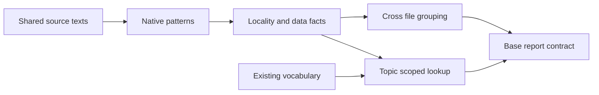

# Design Document

## Overview

Find duplicated policy declarations, scattered state/schema literals and positional data access while keeping heuristic uncertainty visible. Each rule is a separate acceptance milestone over the same source bundle and reporting contract.

### Goals
- Consolidation hints grounded in observed declarations and file ownership.
- Topic-scoped vocabulary checks for supported data-access patterns.
- Positive/negative fixtures and advisory defaults before blocking policy.

### Non-Goals
General type inference, interprocedural resolution, semantic equivalence, graph/layer rules, dead-code analysis, automatic fixes or IDE presentation.

## Boundary Commitments

### This Spec Owns
Locality/data facts, shipped patterns, typed configuration, cross-file aggregation, vocabulary lookup adapter, hints and feature journeys.

### Out of Boundary
No metric measurement/ratchet or baseline change. The existing vocabulary parser/resolver and ownership join remain authoritative. No second filesystem walk, generic policy language or shared test framework.

### Allowed Dependencies
SourceBundle, EntityKey when available, RuleOutcome and ownership presentation from code-constraints; vocabulary-grounding's topic-scoped Lookup. Native query engine dependencies live only in kiro-code. Core receives strings/ranges/enum evidence and returns findings without I/O.

### Revalidation Triggers
Pattern engine/version, receiver-confidence rules, query definitions, normalization, vocabulary topics/aliases or upstream source/report contract changes require pattern corpus and related journeys to rerun.

## Architecture

### Existing Architecture Analysis
Scitools demonstrates scattered definitions, but not general scattered state or role-named data access. These are new heuristic rules, not a claim of upstream parity. The existing vocabulary resolves multiple outcomes; unknown/ambiguous/deprecated/topic mismatch must stay distinguishable.

### Architecture Pattern & Boundary Map


### Technology Stack
| Layer | Choice / Version | Role | Admission |
|---|---|---|---|
| Native pattern prototype | Direct tree-sitter queries versus ast-grep | Extract supported patterns | Choose/pin with fixture results before broad rules |
| Core | Existing Rust/serde/toml and vocabulary API | Aggregation and name policy | No parser/fs dependency |
| Tests | Shared real-binary harness/evidence runner | Independent journeys | No duplicated fixture system |

The engine is chosen in the joint G1 prototype with code-constraints and clone-constraints, so that all three link one parse stack; ast-grep-core, already pinned by ../lesscode, is the first candidate. No lexer or parser is written here (owner, 2026-11-10). Neither choice transfers cross-file grouping or vocabulary policy to the external tool. The selected engine and custom-query syntax are documented together; only one pattern language is exposed in configuration.

## File Structure Plan

| Component | File | Responsibility |
|---|---|---|
| LocalityFacts | `crates/kiro-core/src/code/locality_model.rs` | Bindings, comparisons, qualified enum evidence and data access facts |
| LocalityExtract | `crates/kiro-code/src/locality.rs` | Supported native extraction over shared source texts |
| DataPatterns | `crates/kiro-code/src/data_patterns.rs` | Receiver-aware pattern matching and custom-query validation |
| LocalityRules | `crates/kiro-core/src/code/locality.rs` | Scattered-definition/state/schema aggregation |
| DataGrounding | `crates/kiro-core/src/code/data.rs` | Positional and topic-scoped data-name policy |
| LocalityConfig | `crates/kiro-core/src/code/locality_config.rs` | Rule settings, ignores, reasons and default severities |
| LocalityTests | `crates/kiro-code/fixtures/locality/expected.json` | Labeled patterns and ambiguity corpus |
| LocalityTests | `crates/kiro-code/tests/locality_contract.rs` | Pattern-engine comparison and extraction regression |
| LocalityTests | `crates/kiro-cli/tests/e2e_locality.rs` | Consolidation, state and vocabulary journeys |
| LocalityDocs | `docs/locality-data-rules.md` | Patterns, heuristic limits and calibration |

Base owners handle additive catalogue/module registration at a serialized join. Existing core vocabulary types and source walking are consumed without modification. No rule takes ownership of another spec's physical schema.

## System Flows
Read a complete source bundle → extract supported facts and per-profile confidence → group across project → filter findings to selection → resolve configured data topics → emit findings plus skipped/ambiguous coverage → base ownership/report presentation.

## Requirements Traceability

| Requirement | Summary | Components | Interfaces | Flows |
|---|---|---|---|---|
| 1.1 | The Code Gate shall collect every module-level binding of the project (constants, sta… | LocalityFacts, LocalityExtract, LocalityRules, LocalityConfig | LocalityFacts contract | Scattered Definitions |
| 1.2 | When a name is bound to the same initialiser text in more files than max_files (defau… | LocalityFacts, LocalityExtract, LocalityRules, LocalityConfig | LocalityFacts contract | Scattered Definitions |
| 1.3 | The Code Gate shall key on the name and the value together, so that a name bound to a… | LocalityFacts, LocalityExtract, LocalityRules, LocalityConfig | LocalityFacts contract | Scattered Definitions |
| 1.4 | The Code Gate shall accept an ignore list of binding names for the per-module idiom, … | LocalityFacts, LocalityExtract, LocalityRules, LocalityConfig | LocalityFacts contract | Scattered Definitions |
| 1.5 | When one name is bound to two or more different values and each value stands in at le… | LocalityFacts, LocalityExtract, LocalityRules, LocalityConfig | LocalityFacts contract | Scattered Definitions |
| 1.6 | The Code Gate shall document that comparison is textual, that a value referencing ano… | LocalityFacts, LocalityExtract, LocalityRules, LocalityConfig | LocalityFacts contract | Scattered Definitions |
| 2.1 | The Code Gate shall collect, project-wide, every comparison of a subject against a st… | LocalityFacts, LocalityExtract, LocalityRules | LocalityFacts contract | Scattered State |
| 2.2 | When a subject is compared with at least min_states (default 2) distinct literal valu… | LocalityFacts, LocalityExtract, LocalityRules | LocalityFacts contract | Scattered State |
| 2.3 | Where an enumeration declaration and all compared variant paths can be resolved witho… | LocalityFacts, LocalityExtract, LocalityRules | LocalityFacts contract | Scattered State |
| 2.4 | The Code Gate shall report each subject at most once per file, never for a subject wh… | LocalityFacts, LocalityExtract, LocalityRules | LocalityFacts contract | Scattered State |
| 2.5 | The Code Gate shall document what the rule cannot see: a state carried in booleans, a… | LocalityFacts, LocalityExtract, LocalityRules | LocalityFacts contract | Scattered State |
| 3.1 | The Code Gate shall report CODE_POSITIONAL_ACCESS as a warning when a tabular receive… | DataPatterns, DataGrounding, LocalityRules, LocalityConfig | DataPatterns contract | Role-Named Data Access |
| 3.2 | Where the configuration names one or more vocabulary topics as data topics, the Code … | DataPatterns, DataGrounding, LocalityRules, LocalityConfig | DataPatterns contract | Role-Named Data Access |
| 3.3 | While no data topic is configured, the Code Gate shall run only the positional check,… | DataPatterns, DataGrounding, LocalityRules, LocalityConfig | DataPatterns contract | Role-Named Data Access |
| 3.4 | When the same column-name literal is used in more files than max_files, the Code Gate… | DataPatterns, DataGrounding, LocalityRules, LocalityConfig | DataPatterns contract | Role-Named Data Access |
| 3.5 | The Code Gate shall ship the receiver and position patterns for Python (pandas, polar… | DataPatterns, DataGrounding, LocalityRules, LocalityConfig | DataPatterns contract | Role-Named Data Access |
| 3.6 | The Code Gate shall document what the rule cannot see: a position computed from a var… | DataPatterns, DataGrounding, LocalityRules, LocalityConfig | DataPatterns contract | Role-Named Data Access |
| 4.1 | The Locality Gate shall ship new locality and data-access rules as warning or informa… | LocalityTests, LocalityDocs | LocalityTests contract | Noise Control and Independent Acceptance |
| 4.2 | The Locality Gate shall distinguish supported, unsupported, ambiguous and failed extr… | LocalityTests, LocalityDocs | LocalityTests contract | Noise Control and Independent Acceptance |
| 4.3 | The locality acceptance suite shall exercise same-name unrelated subjects, ignored pe… | LocalityTests, LocalityDocs | LocalityTests contract | Noise Control and Independent Acceptance |
| 4.4 | The first locality deliverable shall show a real-binary scattered-definition finding … | LocalityTests, LocalityDocs | LocalityTests contract | Noise Control and Independent Acceptance |

## Components and Interfaces

### LocalityFacts and LocalityConfig
**Requirements:** 1–3. **Dependencies:** base ranges/report types outbound P0. **Contracts:** State, Service.
```rust
pub enum ExtractionConfidence { Supported, Ambiguous, Unsupported }
pub struct Binding { pub path: String, pub line: u32, pub name: String, pub initializer: String }
pub struct Comparison { pub path: String, pub line: u32, pub subject: String, pub literal: LiteralValue }
pub struct EnumEvidence { pub declaration_id: String, pub all_variants: Vec<String>, pub matched_variants: Vec<String>, pub path: String }
pub struct DataAccess { pub path: String, pub line: u32, pub receiver_profile: String, pub role: AccessRole, pub confidence: ExtractionConfidence }
pub struct LocalityInputs { pub bindings: Vec<Binding>, pub comparisons: Vec<Comparison>, pub enums: Vec<EnumEvidence>, pub data: Vec<DataAccess>, pub coverage: Vec<RuleCoverage> }
```
Typed settings include max_files=3, min_states=2, binding/subject/path ignores, data topics and pattern additions with reasons. New rule defaults: scattered definition/state warning, scattered schema information, positional/ungrounded warning, exhaustive-enum information. Unknown names and uncompileable configured patterns fail configuration before source analysis.

### LocalityExtract and DataPatterns
**Requirements:** 1.1, 1.4, 1.6, 2.1, 2.3, 2.5, 3.1, 3.5–3.6. **Dependencies:** SourceBundle outbound P0; selected query engine external P0. **Contracts:** Service.
```rust
pub fn extract_locality(bundle: &SourceBundle, config: &LocalityConfig) -> Result<LocalityInputs, ExtractionError>;
pub fn compile_patterns(config: &LocalityConfig) -> Result<CompiledPatterns, Vec<PatternError>>;
```
Definitions: module-level Rust const/static, Python module assignment and TS/JS top-level binding; initializer text must close within 12 lines. Preserve initializer text under documented whitespace normalization only; no evaluation or resolution of referenced names. Discard unreadable records with coverage reasons.

State: literal equality/inequality, match literal arms and membership in literal sets. Group subject spelling and typed literal values; no claim that same-spelled variables share semantics. Enumeration candidates require a unique declaration identity and exact qualified variant references under the supported profile. Wildcards, unresolved aliases and ambiguous declarations make exhaustiveness unavailable. Do not infer completeness merely because a match has no wildcard.

Data profiles: Python pandas/polars/NumPy positional column/axis and row-record selections; Rust polars/ndarray column/axis selectors. Require a recognized library method or explicit import/annotation/receiver pattern. Ordinary list indexing, tuple positions and unknown row[N] receivers are negative/ambiguous cases, not automatic tabular violations. Named column selection and explicit row record fields produce name facts. TS/JS gets definitions/state extraction; no shipped tabular profile is claimed.

Configured queries have a name, language, receiver/position role and reason; validate syntax/capture contract before measuring. Query evaluation limits and malformed source report incomplete extraction. No query executes code or performs I/O.

### LocalityRules
**Requirements:** 1.2–1.6, 2.1–2.5, 3.4. **Dependencies:** LocalityFacts and base report contract outbound P0. **Contracts:** Service.
```rust
pub fn evaluate_locality(facts: &LocalityInputs, config: &LocalityConfig, selected: &[String]) -> RuleOutcome;
```
Definitions group by (name, normalized initializer), count distinct files, report when count > max_files. Shipped ignored names log/logger/pytestmark/__all__ are ignored by name. If multiple initializer groups for one name each reach at least max_files, add ambiguity info and retain separate groups; never unify them.

State groups by subject spelling and union of literal values: at least min_states and >max_files. One finding per subject per selected file; a single-file owner never triggers. Enum exhaustiveness requires all variants in the explicit declaration evidence; repeated complete matches are information only. Schema groups identical named column literals across >max_files.

Each collect hint offers a declaration/schema/state owner, lists up to three other paths and names the mapped design component when available. It does not prescribe merging unrelated concepts; documentation describes the same-name false-positive case and human reason-bearing ignores.

### DataGrounding
**Requirements:** 3.1–3.6. **Dependencies:** existing Vocabulary/Lookup outbound P0. **Contracts:** Service.
```rust
pub fn evaluate_data(facts: &LocalityInputs, config: &LocalityConfig, vocabulary: Option<&Vocabulary>, selected: &[String]) -> RuleOutcome;
```
Supported integer-literal column/axis access yields CODE_POSITIONAL_ACCESS with a name hint. Exclude ambiguous receivers from definitive findings and include the ambiguity in coverage. Resolve supported named columns/fields only within configured topics. No topic means positional check only and grounding skipped. Unknown term yields CODE_COLUMN_UNGROUNDED with scoped suggestions; ambiguous term yields an ambiguity diagnostic rather than a false resolved result; deprecated terms retain warning context. A configured missing vocabulary/topic is an explicit failure to ground, never a clean grounded result.

Computed indices, runtime names, helper-mediated accesses and unsupported libraries remain documented blind spots. No symbolic execution or type inference is added to broaden claims.

### LocalityTests and LocalityDocs
**Requirements:** 4.1–4.4 and limitations in 1–3. **Dependencies:** shared harness/evidence workflow outbound P0. **Contracts:** Batch.
Pin positive/negative expected facts and findings before rule implementation. Engine comparison records fixture count, expected matches, false positives, false negatives, grammar/pattern version and build compatibility. All known negatives must stay clear; broader corpus findings remain advisory pending review.

## Data Models
LocalityInputs are transient extension facts; they do not enter numeric baselines. Subject names are textual grouping keys, while EnumEvidence uses declaration identity. Coverage distinguishes unsupported language/receiver, ambiguous evidence, parse failure and successfully measured absence.

## Error Handling
Malformed custom pattern/config → exit 2. Selected parse failure and required extraction unavailable → coverage failure. Missing data-topic grounding is visible; optional grounding can remain unavailable, but cannot satisfy a required grounding capability. Rules return base findings with CODE_SCATTERED_DEFINITION, CODE_DEFINITION_AMBIGUOUS, CODE_SCATTERED_STATE, CODE_SCATTERED_SCHEMA, CODE_POSITIONAL_ACCESS and CODE_COLUMN_UNGROUNDED; ambiguity has distinct context and no guessed match.

## Testing Strategy
- Group 1: repeated value/name across four files; different values; long/unreadable initializer; idiom ignore; same name with two sufficiently large groups; consolidation removes finding.
- Group 2: literal comparisons/membership; one-file owner; unrelated same spelling; ignored subject; enum alias ambiguity/wildcard; literal-through-variable blind spot.
- Group 3: per-profile positive positional and named cases; ordinary indexing negative; unknown receiver ambiguous; no topics; unknown/ambiguous/deprecated names; topic isolation; scattered schema; computed names/positions.
- Group 4: real-binary consolidation, scattered-state and named-data repair journeys; disabled rule cannot satisfy required capability; fixture and runtime evidence on Windows/Linux/macOS. Profile gaps stay unverified.
- Large source-bundle exercise includes global extraction cost in the code gate's recorded task/whole-tree budget.

## Deliverables and Development Gates
1. L0 / G1: choose one extraction engine from the bounded fixture comparison.
2. L1 / G2: scattered-definition consolidation journey, accepted independently.
3. L2: scattered-state/schema aggregation and ambiguity corpus.
4. L3: named-data profiles and vocabulary journeys.
5. L4 / G4–G6: corpus/noise review, runtime/platform integration and current required evidence.
No step waits for clone detection. Warning defaults become blocking only after human-approved calibration; passing known fixtures is not proof of semantic completeness.

## Integration & Migration Notes
Supersedes original code-constraints Requirements 6–8. Existing vocabulary format is unchanged. Pattern/schema version changes invalidate only affected evidence scopes through verification-evidence's input manifest.
