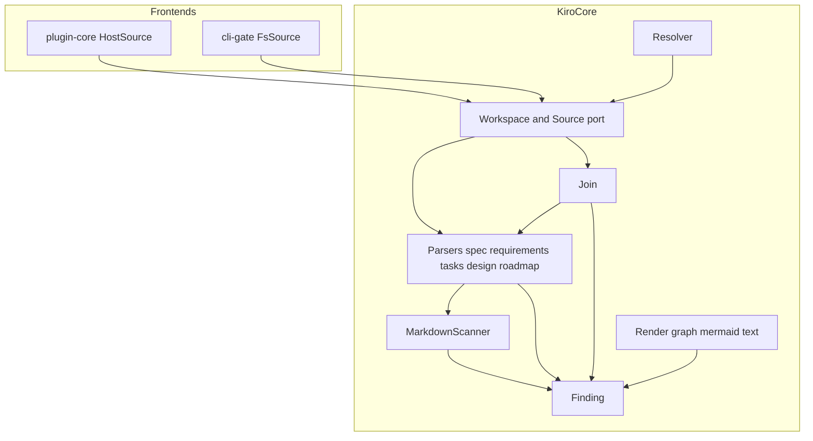
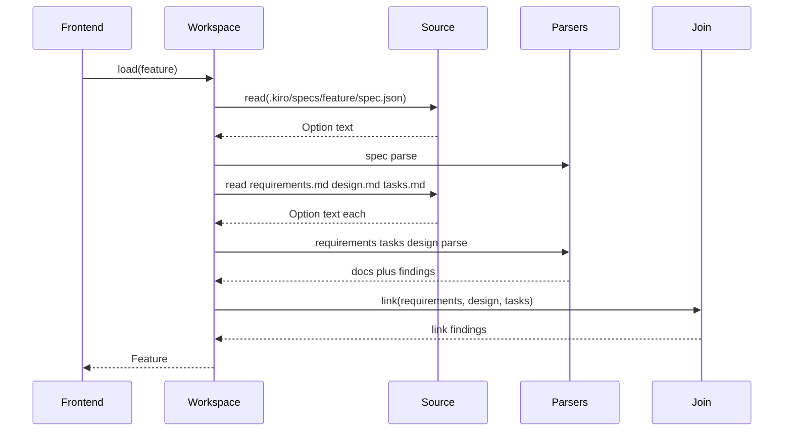
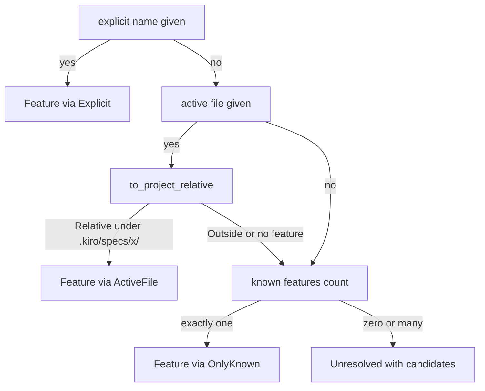

# Design Document: kiro-core

## Overview

**Purpose**: kiro-core is the engine every v2 capability runs on. It converts the text of a cc-sdd `.kiro` tree into a plain Rust model with line spans, computes current-spec resolution and the file ↔ component ↔ task join, produces findings in one stable shape, and renders graphs and lists as Mermaid or text. It performs no I/O: content enters through a `Source` port and known feature names are supplied by the caller, so the same crate runs inside the OpenIDEA WASM sandbox and in the native CLI with identical results.

**Users**: plugin-core and cli-gate (the two `Source` adapters); spec-navigation, spec-visualization, vocabulary-grounding and spec-constraints (consumers of the model, join and renderers); developers writing fixtures and tests for later specs.

**Impact**: Creates the root Cargo workspace and the first crate of this repository. No existing code is modified.

### Goals
- One parser per cc-sdd document type, written against this repo's templates, accepting the four requirement grammars seen in real specs, returning partial data plus findings and never panicking.
- A spec model whose every element records `file` and 1-based `line`/`end_line`.
- Current-spec resolution and path normalisation in exactly one place.
- The join from a code file to components, tasks and criteria, and the reverse coverage listing.
- Generic Mermaid/text renderers with safe identifiers and caps.
- Byte-identical output on native and `wasm32-wasip2`.

### Non-Goals
- Vocabulary loading or term resolution (vocabulary-grounding); EARS, declared-before-use or contradiction checks (spec-constraints).
- Any concrete `Source` implementation over the host API or `std::fs` (plugin-core, cli-gate).
- Deciding which nodes and edges a visualization shows (spec-visualization builds `Graph` values; core only renders them).
- Notification clipping, editor insertion, command parsing (plugin-core).
- Writing files of any kind.

## Boundary Commitments

### This Spec Owns
- The `Source` trait, `MemorySource`, `Workspace`, `Feature` and the lazy, cached loading of the four spec documents and the roadmap.
- The Markdown line scanner shared by all Markdown parsers (fences, headings, list items, checkboxes, `_Key: value_` annotations, table rows).
- Parsers and model types for `spec.json`, `requirements.md`, `tasks.md`, `design.md` and `.kiro/steering/roadmap.md`, including their grammar documentation.
- The join (`owners_of`, `coverage`, cross-document link findings).
- Path normalisation, current-spec resolution and the superseded → successor rule.
- The `Finding` type, its ordering and the catalogue of finding codes produced by this crate.
- The generic `Graph` model and the Mermaid/text renderers with caps and clipping.
- Fixtures under `crates/kiro-core/fixtures/` and the crate's tests.
- The root `Cargo.toml` workspace and `.cargo/config.toml`.

### Out of Boundary
- `vocab` and `checks` modules (listed in steering's module map) — created by vocabulary-grounding and spec-constraints respectively; this crate reserves nothing for them beyond generic annotations.
- Interpretation of annotation keys other than `_Requirements:_`, `_Depends:_`, `_Boundary:_` on tasks.
- The "unreciprocated supersession" prose check from v1 (a cross-spec check; deferred per the roadmap).
- Graph *shapes* for status/graph/tasks views and vocabulary labels (spec-visualization).
- `kiro-cli` and `plugins/kiro` crates; the workspace member list grows when those specs land.

### Allowed Dependencies
- Rust standard library (`std` without `fs`, `net`, `thread`, `env`, `time`, `process`); `serde` with `derive`; `serde_json`. Nothing else at runtime, plus wasm-safe pure-Rust dependencies added by sibling modules and listed in their designs (`toml` for `vocab`, `biodivine-lib-bdd` and `winnow` for `checks` — `winnow` is already transitive via `toml` → `toml_edit`, adopted 2026-11-04).
- Dev-dependencies only for tests: `insta` for golden-fixture review (adopted 2026-11-04, see tech.md Testing); tests otherwise use `MemorySource` and the fixture directory via `include_str!`/`include_dir`-free manual constants. Dev-dependencies never link into the wasm `cdylib`.
- Internal dependency direction (left imports only from the left): `finding` → `md` → {`spec`, `requirements`, `tasks`, `design`, `roadmap`} → `join` → `source` → `resolve`; `render` depends on `finding` only. Violations are review errors.

### Revalidation Triggers
- Any change to `Source::read`'s signature or `None` semantics (plugin-core, cli-gate).
- Any change to `Finding` fields or ordering, or renaming a finding code (cli-gate JSON, plugin-core presentation).
- Any change to criterion id format (`N.M`, `A<K>.M`), task id format, or `Component`/`DesignFile` shapes (spec-navigation, spec-visualization, spec-constraints).
- Any change to `Graph`/`Caps`/`Rendered` (spec-visualization, cli-gate).
- Adding a required runtime dependency (plugin size and wasm build).

## Architecture

### Architecture Pattern & Boundary Map

Ports-and-adapters around a pure engine: the only port is `Source`; frontends are adapters; everything that parses, resolves, joins or renders is inside the crate and free of I/O.



**Architecture Integration**:
- Selected pattern: pure engine with a single read port; chosen because the sandbox forbids I/O and the CLI must produce identical results (research.md, pattern evaluation).
- Domain boundaries: one module per seam; parsers know one document each; cross-document knowledge lives only in `join`; path knowledge lives only in `resolve`.
- Existing patterns preserved: steering's module map (`source`, `spec`, `requirements`, `tasks`, `design`, `roadmap`, `resolve`, `render`, `finding`); two files are added under the same pattern — `md.rs` (shared scanner) and `join.rs` (the join seam split out of `resolve` so it can be implemented in parallel).
- Dependency direction: `finding` → `md` → parsers → `join` → `source` → `resolve`; `render` → `finding`. `render` never imports the model, which keeps it generic.
- Steering compliance: no `std::fs`/`net`/`thread`/`env`/`time`; `#![forbid(unsafe_code)]`; no `unwrap`/`expect`/indexing panics in library code; deterministic ordering (`BTreeMap`/sorted vectors).

### Technology Stack

| Layer | Choice / Version | Role in Feature | Notes |
|-------|------------------|-----------------|-------|
| Language / toolchain | Rust, `edition = "2024"` (rustc 1.85+), `resolver = "3"` | Engine crate in a root Cargo workspace | Targets `x86_64-pc-windows-msvc` (dev) and `wasm32-wasip2` |
| Serialization | `serde` 1 (`derive`), `serde_json` 1 | `spec.json` parsing; `Finding` JSON output for cli-gate | Both pure Rust, wasm-safe |
| Lints | `[lints.rust] unsafe_code = "forbid"`; `[lints.clippy] unwrap_used, expect_used, panic, indexing_slicing = "deny"` | Enforce the no-panic rule at compile time | Test modules may `#![allow]` these locally |
| Test runtime | native `cargo test` locally; CI runs `cargo nextest run` + `cargo test --doc` (12.7); optional `wasmtime` runner via `.cargo/config.toml` `[target.wasm32-wasip2] runner` | 12.4, 12.7 | wasm build is mandatory in CI; wasm test run requires the runner |

## File Structure Plan

### Directory Structure
```
Cargo.toml                                   # Root workspace: members = ["crates/kiro-core"]
deny.toml                                    # cargo-deny config (wasm32-wasip2 target graph)
.cargo/
└── config.toml                              # wasm32-wasip2 runner (wasmtime) and gate alias
.github/
└── workflows/
    └── ci.yml                               # Parallel nextest + doc tests + deny + wasm build
crates/
└── kiro-core/
    ├── Cargo.toml                           # Package, deps serde + serde_json, dev-dep insta, lints
    ├── src/
    │   ├── lib.rs                           # Crate docs (grammar overview), module re-exports
    │   ├── finding.rs                       # Finding, Severity, code catalogue, ordering
    │   ├── md.rs                            # Shared Markdown line scanner
    │   ├── spec.rs                          # spec.json -> SpecMeta
    │   ├── requirements.rs                  # requirements.md -> RequirementsDoc
    │   ├── tasks.rs                         # tasks.md -> TasksDoc
    │   ├── design.rs                        # design.md -> DesignDoc
    │   ├── roadmap.rs                       # roadmap.md -> RoadmapDoc
    │   ├── join.rs                          # owners_of, coverage, link findings
    │   ├── source.rs                        # Source, MemorySource, Workspace, Feature
    │   ├── resolve.rs                       # Path normalisation, resolve_current, successors
    │   └── render/
    │       ├── mod.rs                       # Graph, Caps, Rendered, safe ids, clip_lines
    │       ├── mermaid.rs                   # Graph -> Mermaid
    │       └── text.rs                      # Graph -> text, findings_text, table
    ├── fixtures/
    │   ├── minimal/                         # Smallest complete tree (demo feature + roadmap)
    │   ├── grammars/                        # Requirement grammar matrix G1..G4
    │   ├── tasks/                           # Task grammar variants
    │   ├── design/                          # File Structure Plan shapes
    │   ├── self/                            # Copy of this spec's own documents
    │   └── golden/                          # Expected renderer output
    └── tests/                               # Integration tests over fixtures
```

### Files by Component

| Component | File | Responsibility |
|-----------|------|----------------|
| CrateScaffold | `Cargo.toml` | Root workspace manifest (`members = ["crates/kiro-core"]`, `resolver = "3"`) |
| CrateScaffold | `.cargo/config.toml` | `[target.wasm32-wasip2] runner = "wasmtime"` and `[alias] gate` |
| CrateScaffold | `deny.toml` | `cargo-deny` configuration with `wasm32-wasip2` target graph |
| CrateScaffold | `.github/workflows/ci.yml` | CI workflow (`cargo nextest run`, `cargo test --doc`, `cargo deny check`, `wasm32-wasip2` build) |
| CrateScaffold | `crates/kiro-core/Cargo.toml` | Package `kiro-core`, edition 2024, `serde`/`serde_json`, `insta` dev-dependency, lint table |
| CrateScaffold | `crates/kiro-core/src/lib.rs` | `#![forbid(unsafe_code)]`, crate-level docs with the accepted grammars and the finding-code list, `pub mod` declarations and re-exports |
| Finding | `crates/kiro-core/src/finding.rs` | `Severity`, `Finding`, builder helpers, `CODES` catalogue, `codes` constants, `sort_findings` |
| MarkdownScanner | `crates/kiro-core/src/md.rs` | `scan(text, file) -> Scan`: typed lines, outline, fences, owned `Annotation`, `MD_FENCE_UNCLOSED` |
| SpecMetaParser | `crates/kiro-core/src/spec.rs` | `parse(text, file) -> (SpecMeta, Vec<Finding>)`, `Phase`, `Approvals`, `Doc`, `phase_label`, required-document table, `successors` |
| RequirementsParser | `crates/kiro-core/src/requirements.rs` | Four grammars → `RequirementsDoc` with criteria `N.M`/`A<K>.M`, objectives, annotations |
| TasksParser | `crates/kiro-core/src/tasks.rs` | Two-level task tree, checkbox/optional/parallel flags, three interpreted annotations, counts |
| DesignParser | `crates/kiro-core/src/design.rs` | Components, File Structure Plan (table, bullet, tree shapes), Mermaid blocks, path normalisation of design paths |
| RoadmapParser | `crates/kiro-core/src/roadmap.rs` | `## Specs (dependency order)` entries, dependency validation |
| Join | `crates/kiro-core/src/join.rs` | `path_matches`, `owners_of`, `coverage`, `link` findings |
| Workspace | `crates/kiro-core/src/source.rs` | `Source` trait, `MemorySource`, `Workspace<S>`, `Feature`, lazy cached loads, `SPEC_DOC_MISSING`, merged findings (uses `spec::Doc`) |
| Resolver | `crates/kiro-core/src/resolve.rs` | `normalize_relative`, `to_project_relative`, `feature_of_path`, `resolve_current`, `successors`, `successor_chain` |
| RenderGraph | `crates/kiro-core/src/render/mod.rs` | `Graph`, `Node`, `Edge`, `Direction`, `Caps`, `Rendered`, `IdMap` (safe unique ids), `clip_lines`, cap application |
| MermaidRenderer | `crates/kiro-core/src/render/mermaid.rs` | `mermaid(graph, caps) -> Rendered` with label escaping and ellipsis node |
| TextRenderer | `crates/kiro-core/src/render/text.rs` | `graph_text`, `findings_text`, `table` |
| Fixtures | `crates/kiro-core/fixtures/minimal/.kiro/steering/roadmap.md` | Roadmap with two entries and a dependency |
| Fixtures | `crates/kiro-core/fixtures/minimal/.kiro/specs/demo/spec.json` | `tasks-generated` metadata with topics |
| Fixtures | `crates/kiro-core/fixtures/minimal/.kiro/specs/demo/requirements.md` | Canonical grammar, two requirements, annotations |
| Fixtures | `crates/kiro-core/fixtures/minimal/.kiro/specs/demo/design.md` | Table-shape File Structure Plan, two components, one Mermaid block |
| Fixtures | `crates/kiro-core/fixtures/minimal/.kiro/specs/demo/tasks.md` | Major + sub-tasks, `(P)`, `[x]`, `[ ]*`, all three annotations |
| Fixtures | `crates/kiro-core/fixtures/minimal/.kiro/specs/old/spec.json` | `superseded` metadata whose notes name `demo` |
| Fixtures | `crates/kiro-core/fixtures/grammars/g1-canonical.md` | `### Requirement N` + `#### Acceptance Criteria` `M.` |
| Fixtures | `crates/kiro-core/fixtures/grammars/g1-dotted.md` | Self-numbered `N.M` criteria |
| Fixtures | `crates/kiro-core/fixtures/grammars/g2-rstyle.md` | `### R1 — title` with `- R1.1` bullets |
| Fixtures | `crates/kiro-core/fixtures/grammars/g3-amendment.md` | `### Amendment A1 — title (extends Requirement 1)` |
| Fixtures | `crates/kiro-core/fixtures/grammars/g4-empty.md` | Placeholder-only document |
| Fixtures | `crates/kiro-core/fixtures/grammars/fenced-example.md` | Requirement inside a fence must be ignored |
| Fixtures | `crates/kiro-core/fixtures/grammars/malformed.md` | Duplicate ids, non-numeric heading, unclosed fence |
| Fixtures | `crates/kiro-core/fixtures/tasks/variants.md` | `[X]`, `[ ]*`, `(P)` on major, depth-3 id, duplicate id, invalid requirement ref |
| Fixtures | `crates/kiro-core/fixtures/design/table-plan.md` | Table-shape plan with multi-path cells |
| Fixtures | `crates/kiro-core/fixtures/design/bullet-plan.md` | `- **Component**: ` bullet shape |
| Fixtures | `crates/kiro-core/fixtures/design/tree-plan.md` | Template tree shape with comments; unassigned files |
| Fixtures | `crates/kiro-core/fixtures/design/no-plan.md` | Missing File Structure Plan |
| Fixtures | `crates/kiro-core/fixtures/self/spec.json` | Copy of `.kiro/specs/kiro-core/spec.json` at the time of implementation |
| Fixtures | `crates/kiro-core/fixtures/self/requirements.md` | Copy of this spec's requirements |
| Fixtures | `crates/kiro-core/fixtures/self/design.md` | Copy of this design (parsed by its own DesignParser) |
| Fixtures | `crates/kiro-core/fixtures/self/tasks.md` | Copy of this spec's tasks |
| Fixtures | `crates/kiro-core/fixtures/self/roadmap.md` | Copy of `.kiro/steering/roadmap.md` |
| Fixtures | `crates/kiro-core/fixtures/golden/graph.mermaid` | Expected Mermaid for the golden graph |
| Fixtures | `crates/kiro-core/fixtures/golden/graph.text` | Expected text rendering of the golden graph |
| Fixtures | `crates/kiro-core/fixtures/golden/graph-truncated.mermaid` | Expected Mermaid with caps exceeded |
| Fixtures | `crates/kiro-core/fixtures/golden/findings.text` | Expected `findings_text` output |
| IntegrationTests | `crates/kiro-core/tests/common/mod.rs` | Fixture loading into `MemorySource` via `include_str!` constants |
| IntegrationTests | `crates/kiro-core/tests/grammar.rs` | Requirement grammar matrix over `fixtures/grammars` |
| IntegrationTests | `crates/kiro-core/tests/workspace.rs` | Load, missing documents, link findings, resolution, successors over `fixtures/minimal` and `fixtures/self` |
| IntegrationTests | `crates/kiro-core/tests/golden.rs` | Renderer golden comparisons |
| IntegrationTests | `crates/kiro-core/tests/no_panic.rs` | Deterministic pseudo-random garbage, truncated fixtures, deep nesting through every parser |
| IntegrationTests | `crates/kiro-core/tests/perf.rs` | 16 MiB synthetic document timing (asserted in release builds only) |

### Modified Files
- None (greenfield).

## System Flows

### Loading a feature



Flow decisions: each path is read once and cached whether or not it existed; a missing document yields `SPEC_DOC_MISSING` whose severity follows the phase table in SpecMetaParser; `link` runs only when `tasks.md` parsed, and tolerates absent requirements or design (then only the checks that have both sides run).

### Resolving the current feature



## Requirements Traceability

| Requirement | Summary | Components | Interfaces | Flows |
|-------------|---------|------------|------------|-------|
| 1.1, 1.2, 1.3, 1.4, 1.5, 1.6 | Read port, known features, lazy cached loads, missing docs, plain data | Workspace, SpecMetaParser (required-doc table), CrateScaffold (no-I/O lints) | `Source`, `Workspace::new/load/feature/findings`, `Feature` | Loading a feature |
| 2.1, 2.2, 2.3, 2.4, 2.5, 2.6, 2.7 | spec.json fields, phases, invalid JSON, defaults, unknown fields | SpecMetaParser, Finding | `spec::parse`, `SpecMeta`, `Phase`, `Approvals`, `spec::phase_label`, `spec::successors` (used by 8.7) | Loading a feature |
| 3.1, 3.2, 3.3, 3.4, 3.5, 3.6 | Line numbering, BOM, outline, fences, unclosed fence | MarkdownScanner | `md::scan`, `Scan`, `ScannedLine`, `Heading`, `Fence` | — |
| 4.1, 4.2, 4.3, 4.4, 4.5, 4.6, 4.7, 4.8, 4.9, 4.10, 4.11, 4.12 | Four requirement grammars, continuations, objective, annotations, findings | RequirementsParser, Fixtures (grammars) | `requirements::parse`, `RequirementsDoc`, `Requirement`, `Criterion`, `Annotation` | — |
| 5.1, 5.2, 5.3, 5.4, 5.5, 5.6, 5.7, 5.8, 5.9, 5.10, 5.11, 5.12, 5.13 | Task tree, flags, details, annotations, hierarchy and duplicate findings, counts | TasksParser, Fixtures (tasks) | `tasks::parse`, `TasksDoc`, `Task`, `Counts` | — |
| 6.1, 6.2, 6.3, 6.4, 6.5, 6.6, 6.7, 6.8, 6.9, 6.10 | File Structure Plan shapes, components, unassigned files, Mermaid blocks, path normalisation | DesignParser, Fixtures (design) | `design::parse`, `DesignDoc`, `Component`, `DesignFile`, `MermaidBlock` | — |
| 7.1, 7.2, 7.3, 7.4, 7.5, 7.6 | Roadmap entries, dependencies, missing section, names | RoadmapParser | `roadmap::parse`, `RoadmapDoc`, `RoadmapEntry` | — |
| 8.1, 8.2, 8.3, 8.4, 8.5, 8.6, 8.7, 8.8, 8.9 | Resolution order, path normalisation, outside paths, successors, dangling, cycles | Resolver, SpecMetaParser (`successors`), Workspace (dangling at load) | `resolve_current`, `to_project_relative`, `feature_of_path`, `spec::successors`, `successor_chain` | Resolving the current feature |
| 9.1, 9.2, 9.3, 9.4, 9.5, 9.6, 9.7, 9.8, 9.9, 9.10 | Owners of a file, matching rule, multi-match, not covered, name comparison, link findings, coverage (including unknown-boundary tasks) | Join | `owners_of`, `path_matches`, `coverage`, `link` | Loading a feature (link step) |
| 10.1, 10.2, 10.3, 10.4 | Finding shape, ordering, catalogue, workspace merge | Finding, Workspace | `Finding`, `Severity`, `CODES`, `sort_findings`, `Workspace::findings` | — |
| 11.1, 11.2, 11.3, 11.4, 11.5, 11.6, 11.7, 11.8 | Safe ids, label escaping, caps with ellipsis, text graph, findings text, table, clipping, determinism | RenderGraph, MermaidRenderer, TextRenderer, Fixtures (golden) | `Graph`, `Caps`, `Rendered`, `mermaid`, `graph_text`, `findings_text`, `table`, `clip_lines` | — |
| 12.1–12.7 | Totality, partial data, single pass and timing, dual target, determinism, grammar docs, parallel CI gate wiring | CrateScaffold (gate alias, CI workflow, deny.toml), MarkdownScanner, IntegrationTests (no_panic, perf), all parsers | lint table, `.cargo/config.toml`, `deny.toml`, `.github/workflows/ci.yml`, crate docs in `lib.rs` | — |

## Components and Interfaces

| Component | Domain/Layer | Intent | Req Coverage | Key Dependencies (P0/P1) | Contracts |
|-----------|--------------|--------|--------------|--------------------------|-----------|
| CrateScaffold | Build | Workspace, package, lints, targets, CI files | 1.1, 12.4, 12.6, 12.7 | none | State |
| Finding | Foundation | One finding shape, codes, ordering | 10.1, 10.2, 10.3 | serde (P1) | Service |
| MarkdownScanner | Foundation | Typed line stream shared by Markdown parsers | 3.1–3.6, 12.3 | Finding (P0) | Service |
| SpecMetaParser | Parsers | `spec.json` → `SpecMeta`, `phase_label`, successor names from notes | 2.1–2.7, 1.4, 8.7 | serde_json (P0), Finding (P0) | Service |
| RequirementsParser | Parsers | `requirements.md` → requirements and criteria | 4.1–4.12 | MarkdownScanner (P0) | Service |
| TasksParser | Parsers | `tasks.md` → task tree | 5.1–5.13 | MarkdownScanner (P0) | Service |
| DesignParser | Parsers | `design.md` → components, files, Mermaid | 6.1–6.10 | MarkdownScanner (P0) | Service |
| RoadmapParser | Parsers | `roadmap.md` → entries | 7.1–7.6 | MarkdownScanner (P0) | Service |
| Join | Model | File ↔ component ↔ task join and link findings | 9.1–9.10 | parsers' doc types (P0) | Service |
| Workspace | Model | `Source` port, lazy cached feature loading, merged findings | 1.1–1.6, 8.8, 10.4 | parsers (P0), Join (P0) | Service, State |
| Resolver | Model | Path normalisation, current feature, successors | 8.1–8.9 | Workspace (P0), SpecMetaParser (P0) | Service |
| RenderGraph | Render | Graph model, caps, safe ids, clipping | 11.1, 11.3, 11.7, 11.8 | none | Service |
| MermaidRenderer | Render | Graph → Mermaid | 11.1, 11.2, 11.3 | RenderGraph (P0) | Service |
| TextRenderer | Render | Graph → text, findings → text, table | 11.4, 11.5, 11.6 | RenderGraph (P0), Finding (P0) | Service |
| Fixtures | Test data | cc-sdd sample trees, grammar matrix, golden files | 4.x, 5.x, 6.x, 11.x | none | — |
| IntegrationTests | Tests | Fixture-driven behaviour, no-panic, perf, golden | 12.1, 12.2, 12.3, 12.5 | all | — |

### Build

#### CrateScaffold

| Field | Detail |
|-------|--------|
| Intent | Root workspace, package manifest, lints, targets and CI files so every other component compiles under the same rules |
| Requirements | 1.1, 12.4, 12.6, 12.7 |

**Responsibilities & Constraints**
- Root `Cargo.toml`: `[workspace] members = ["crates/kiro-core"]`, `resolver = "3"`; later specs append members.
- `crates/kiro-core/Cargo.toml`: `edition = "2024"`, `[dependencies] serde = { version = "1", features = ["derive"] }`, `serde_json = "1"`; `[dev-dependencies] insta = "1"` (sanctioned dev-dependency for golden-fixture review; never linked into the wasm `cdylib`); `[lints.rust] unsafe_code = "forbid"`; `[lints.clippy] unwrap_used = "deny"`, `expect_used = "deny"`, `panic = "deny"`, `indexing_slicing = "deny"`, `todo = "deny"`, `unimplemented = "deny"`.
- `.cargo/config.toml`: `[target.wasm32-wasip2] runner = "wasmtime"` and `[alias] gate` (installed in task 5.5; cli-gate task 7.4 extends the gate flow once `kiro-cli` exists).
- `deny.toml` and `.github/workflows/ci.yml`: `cargo-deny` config with `wasm32-wasip2` in `[graph] targets` (banning filesystem-dependent crates and direct `rand`/`getrandom` on wasm32, while allowing `rand`/`getrandom` when wrapped solely by `biodivine-lib-bdd`, whose random sampling paths are dead-code-eliminated by the linker) and GitHub Actions workflow (`dtolnay/rust-toolchain`, `Swatinem/rust-cache`, `rustup target add wasm32-wasip2`, `cargo install cargo-nextest cargo-deny --locked`, `cargo nextest run`, `cargo test --doc`, `cargo deny check`, `cargo build -p kiro-core --target wasm32-wasip2`).
- `lib.rs`: crate-level documentation listing, per document type, the accepted grammar (one subsection each) and the finding code table generated from `finding::CODES` by a doc test that asserts the documentation and the catalogue agree; public `pub mod` declarations and crate-root `pub use` re-exports (`finding::{Finding, Severity, CodeInfo, CODES, codes, sort_findings}`, `source::{Source, MemorySource, Workspace, Feature}`, `spec::{SpecMeta, Phase, Approvals, Approval, Doc, phase_label, required_docs, successors}`, `requirements::{RequirementsDoc, Requirement, Criterion, ReqKind, Annotation}`, `tasks::{TasksDoc, Task, Counts}`, `design::{DesignDoc, Component, DesignFile, MermaidBlock, normalize_design_path}`, `roadmap::{RoadmapDoc, RoadmapEntry}`, `join::{Owners, Coverage, ComponentCoverage, TaskRef, owners_of, coverage, link, path_matches, names_equal}`, `resolve::{ProjectPath, ResolveInput, Resolution, ResolvedVia, SuccessorChain, normalize_relative, to_project_relative, feature_of_path, resolve_current}`, `render::{Graph, Node, Edge, Direction, Caps, DEFAULT_CAPS, Rendered, IdMap, clip_lines, mermaid::mermaid, text::{graph_text, findings_text, table}}`).

**Implementation Notes**
- Validation: `cargo build -p kiro-core --target wasm32-wasip2`, `cargo clippy --all-targets -- -D warnings`, `cargo fmt --check` all pass on the scaffold alone.
- Risks: `indexing_slicing` is strict for a scanner; use iterators, `get`, `split_at_checked`, `strip_prefix` — the lint is the point.

### Foundation

#### Finding

| Field | Detail |
|-------|--------|
| Intent | The one finding shape rendered by both frontends |
| Requirements | 10.1, 10.2, 10.3 |

**Contracts**: Service [x]

##### Service Interface
```rust
#[derive(Debug, Clone, Copy, PartialEq, Eq, PartialOrd, Ord, Hash, serde::Serialize)]
#[serde(rename_all = "lowercase")]
pub enum Severity { Error, Warning, Info }

#[derive(Debug, Clone, PartialEq, Eq, serde::Serialize)]
pub struct Finding {
    pub severity: Severity,
    pub code: &'static str,
    pub feature: Option<String>,
    pub file: String,          // project-relative, '/' separators
    pub line: Option<usize>,   // 1-based
    pub message: String,
}

impl Finding {
    /// Severity defaults from the catalogue entry for `code`.
    pub fn new(code: &'static str, file: impl Into<String>, message: impl Into<String>) -> Self;
    pub fn at(self, line: usize) -> Self;
    pub fn feature(self, name: impl Into<String>) -> Self;
    pub fn severity(self, severity: Severity) -> Self;
}

pub struct CodeInfo { pub code: &'static str, pub severity: Severity, pub description: &'static str }
pub const CODES: &[CodeInfo];       // every code this crate emits (see Supporting References)
pub mod codes { pub const SPEC_DOC_MISSING: &str = "SPEC_DOC_MISSING"; /* … one per catalogue entry */ }

/// Orders by (file, line with None first, code, message); stable.
pub fn sort_findings(findings: &mut Vec<Finding>);
```
- Invariants: `code` is always one of `CODES` (a unit test iterates `codes::*` against `CODES`); `file` never contains `\`.

#### MarkdownScanner

| Field | Detail |
|-------|--------|
| Intent | One forward pass turning text into typed lines with identical fence, heading and numbering semantics for every Markdown parser |
| Requirements | 3.1, 3.2, 3.3, 3.4, 3.5, 3.6, 12.3 |

**Contracts**: Service [x]

##### Service Interface
```rust
pub struct Scan<'a> {
    pub lines: Vec<ScannedLine<'a>>,
    pub outline: Vec<Heading>,
    pub fences: Vec<Fence>,
    pub findings: Vec<Finding>,
}
pub struct ScannedLine<'a> { pub line: usize, pub raw: &'a str, pub indent: usize, pub kind: LineKind<'a> }
pub enum LineKind<'a> {
    Blank,
    Heading { level: u8, text: &'a str },
    ListItem { bullet: Option<char>, checkbox: Option<Checkbox>, marker: Option<Numbered<'a>>, text: &'a str },
    Annotation { key: &'a str, value: &'a str },      // `_Key: value_`, optionally after a bullet
    TableRow { cells: Vec<&'a str>, separator: bool },
    FenceOpen { info: &'a str }, FenceClose, Fenced,
    Text,
}
pub struct Checkbox { pub checked: bool, pub optional: bool }        // `[ ]`, `[x]`, `[X]`, trailing `*`
pub struct Numbered<'a> { pub label: &'a str, pub closed_by: Option<char> } // `1.` `1)` `1.1` `1.1.`
pub struct Heading { pub level: u8, pub text: String, pub line: usize }
pub struct Fence { pub info: String, pub start: usize, pub end: usize, pub body: String }
/// Owned form of an `_Key: value_` line; shared by the requirements and tasks parsers (defined here so both import downward).
#[derive(Debug, Clone, PartialEq, Eq)]
pub struct Annotation { pub key: String, pub value: String, pub line: usize }

pub fn scan<'a>(text: &'a str, file: &str) -> Scan<'a>;
```
- Preconditions: none; any `&str` is accepted.
- Postconditions: `lines.len()` equals the number of lines (`split_inclusive('\n')`, CR stripped); `outline` contains every `Heading` line outside fences; every `Fence` has `start <= end`; an unclosed fence ends at the last line with `MD_FENCE_UNCLOSED`.
- Recognition rules: heading = 1–6 `#` followed by space or end of line; bullet = `-`, `*`, `+` followed by space; checkbox = `[ ]`/`[x]`/`[X]` directly after the bullet, optional `*` directly after `]`; numbered label = digits with optional `.digits` groups, closed by `.`/`)` + space or followed by space; annotation = text that starts with `_`, ends with `_`, contains `: ` and whose key is non-empty and has no spaces; table row = line whose trimmed form starts with `|`; separator row = every cell matches `:?-+:?`.

**Implementation Notes**
- Validation: unit tests per rule including BOM, CRLF, `##tag` (not a heading), fence of 4 backticks closed by 3 (not closed), tilde fences.
- Risks: label detection must not consume `1.1.1`-style ids incorrectly — `label` keeps every group; parsers decide validity.

### Parsers

#### SpecMetaParser

| Field | Detail |
|-------|--------|
| Intent | `spec.json` into a typed `SpecMeta` with phase classification, the required-document table and successor-name extraction |
| Requirements | 2.1, 2.2, 2.3, 2.4, 2.5, 2.6, 2.7, 1.4, 8.7 |

**Contracts**: Service [x]

##### Service Interface
```rust
#[derive(Debug, Clone, Copy, Default, PartialEq, Eq)]
pub enum Phase { Initialized, RequirementsGenerated, DesignGenerated, TasksGenerated, Superseded, Reserved, Unknown, #[default] Missing }
#[derive(Debug, Clone, Copy, Default, PartialEq, Eq)]
pub struct Approval { pub generated: bool, pub approved: bool }
#[derive(Debug, Clone, Default, PartialEq, Eq)]
pub struct Approvals { pub requirements: Approval, pub design: Approval, pub tasks: Approval }
#[derive(Debug, Clone, Default, PartialEq, Eq)]
pub struct SpecMeta {
    pub feature_name: Option<String>, pub language: Option<String>,
    pub phase: Phase, pub phase_raw: Option<String>,
    pub approvals: Approvals, pub ready_for_implementation: bool,
    pub topics: Vec<String>, pub notes: String,
    pub created_at: Option<String>, pub updated_at: Option<String>,
}
#[derive(Debug, Clone, Copy, PartialEq, Eq)]
pub enum Doc { SpecJson, Requirements, Design, Tasks }

/// Never fails: invalid JSON yields `SpecMeta::default()` (phase Missing) plus SPEC_JSON_INVALID.
pub fn parse(text: &str, file: &str) -> (SpecMeta, Vec<Finding>);
/// Trimmed `phase_raw` when present and non-empty, else `"missing"`. Shared by plugin-core (`ws`) and spec-visualization (`viz`).
pub fn phase_label(meta: Option<&SpecMeta>) -> String;
/// Which documents the phase implies must exist (drives SPEC_DOC_MISSING severity).
pub fn required_docs(phase: Phase) -> &'static [Doc];
/// Known names occurring as whole words (name chars: ASCII alphanumerics, `-`, `_`) in `meta.notes`,
/// checked longest-first; result in that order, deduplicated. Lives here (not in `resolve`) so that
/// `Workspace::load` can emit SPEC_SUPERSEDED_DANGLING without importing upward.
pub fn successors(meta: &SpecMeta, known: &[String]) -> Vec<String>;
```
- Required-document table: `Initialized`/`RequirementsGenerated` → `[Requirements]`; `DesignGenerated` → `[Requirements, Design]`; `TasksGenerated` → `[Requirements, Design, Tasks]`; `Superseded`/`Reserved`/`Unknown`/`Missing` → `[]`. `SpecJson` itself missing is always `warning`.
- Parsing uses `serde_json::Value` (not a derive struct) so unknown fields and wrong-typed fields degrade field-by-field: a non-boolean approval flag is treated as absent.

#### RequirementsParser

| Field | Detail |
|-------|--------|
| Intent | `requirements.md` into requirements and `N.M` criteria under grammars G1-canonical, G1-dotted, G2 R-style and G3 amendment |
| Requirements | 4.1, 4.2, 4.3, 4.4, 4.5, 4.6, 4.7, 4.8, 4.9, 4.10, 4.11, 4.12 |

**Contracts**: Service [x]

##### Service Interface
```rust
#[derive(Debug, Clone, Copy, PartialEq, Eq)]
pub enum ReqKind { Baseline, Amendment }
pub use crate::md::Annotation;   // re-exported; defined in MarkdownScanner
#[derive(Debug, Clone, PartialEq, Eq)]
pub struct Criterion { pub id: String, pub number: String, pub text: String, pub line: usize, pub end_line: usize, pub annotations: Vec<Annotation> }
#[derive(Debug, Clone, PartialEq, Eq)]
pub struct Requirement {
    pub id: String,            // "1" or "A1"
    pub kind: ReqKind, pub title: String, pub objective: Option<String>,
    pub extends: Vec<String>,  // amendment only
    pub line: usize, pub end_line: usize,
    pub annotations: Vec<Annotation>, pub criteria: Vec<Criterion>,
}
#[derive(Debug, Clone, PartialEq, Eq)]
pub struct RequirementsDoc { pub file: String, pub outline: Vec<Heading>, pub fences: Vec<Fence>, pub requirements: Vec<Requirement>, pub findings: Vec<Finding> }
impl RequirementsDoc {
    pub fn criteria(&self) -> impl Iterator<Item = &Criterion>;
    pub fn criterion(&self, id: &str) -> Option<&Criterion>;
    pub fn requirement(&self, id: &str) -> Option<&Requirement>;
}
pub fn parse(text: &str, file: &str) -> RequirementsDoc;
```
- Grammar (state machine over `ScannedLine`): a `Heading` whose text matches `Requirement <digits>[sep title]` (case-insensitive `requirement`, sep ∈ `:`, `-`, `–`, `—`) opens a baseline block; `R<digits>` followed by a dash or colon opens a baseline block; `Amendment A<digits>[sep title][(extends …)]` opens an amendment block; a heading whose text is `Acceptance Criteria` (case-insensitive) sets the bare-marker gate; any other heading closes the block. Inside a block: `ListItem` with `marker.label == "<N>.<M>"` (after stripping an optional leading `r`/`R` from the text for bulleted form) opens criterion `N.M` anywhere; `ListItem` with label `<M>` and `closed_by` `.`/`)` opens criterion `N.M` only when the gate is set or the block is an amendment; `Annotation` lines attach to the open criterion when indented under it, otherwise to the requirement; a `Text` line starting with `**Objective:**` sets the objective; `Blank` closes the open criterion; other `Text` lines continue the open criterion (joined with one space, `end_line` advanced). `Requirement <non-digits>` produces `REQ_NON_NUMERIC_ID` and the block is skipped until the next heading.
- Postconditions: criterion ids unique (later duplicates dropped with `REQ_DUPLICATE_ID`); every requirement with zero criteria and kind Baseline has `REQ_NO_CRITERIA` at its heading line; `end_line` of a requirement is the line before the closing heading or the last line.

#### TasksParser

| Field | Detail |
|-------|--------|
| Intent | `tasks.md` into a two-level task tree with flags, details, interpreted annotations and counts |
| Requirements | 5.1, 5.2, 5.3, 5.4, 5.5, 5.6, 5.7, 5.8, 5.9, 5.10, 5.11, 5.12, 5.13 |

**Contracts**: Service [x]

##### Service Interface
```rust
#[derive(Debug, Clone, Copy, Default, PartialEq, Eq)]
pub struct Counts { pub total: usize, pub checked: usize }
#[derive(Debug, Clone, PartialEq, Eq)]
pub struct Task {
    pub id: String, pub major: u32, pub sub: Option<u32>,
    pub description: String, pub checked: bool, pub optional: bool, pub parallel: bool,
    pub line: usize, pub end_line: usize,
    pub details: Vec<String>,          // non-annotation detail lines, trimmed
    pub requirements: Vec<String>, pub depends: Vec<String>, pub boundary: Vec<String>,
    pub requirements_line: Option<usize>, pub depends_line: Option<usize>, pub boundary_line: Option<usize>, // line of each interpreted annotation (for Join findings)
    pub annotations: Vec<Annotation>,  // other `_Key: value_` lines
    pub subtasks: Vec<Task>,           // empty for sub-tasks
    pub counts: Counts,                // sub-tasks only; {1, checked as usize} when a major has none
}
#[derive(Debug, Clone, PartialEq, Eq)]
pub struct TasksDoc { pub file: String, pub outline: Vec<Heading>, pub fences: Vec<Fence>, pub tasks: Vec<Task>, pub counts: Counts, pub findings: Vec<Finding> }
impl TasksDoc {
    pub fn all(&self) -> impl Iterator<Item = &Task>;   // majors then their subs, document order
    pub fn task(&self, id: &str) -> Option<&Task>;
}
pub fn parse(text: &str, file: &str) -> TasksDoc;
```
- Grammar: a `ListItem` with `checkbox` and a `marker.label` of one or two groups opens a task; `(P)` is recognised when the text after the marker starts with `(P)` (case-sensitive) and is removed from the description; `closed_by` `.` is accepted and ignored. Indented `ListItem`/`Annotation`/`Text` lines until the next task line or heading are details; `Annotation` keys `Requirements`, `Depends`, `Boundary` (case-insensitive) split their value on `,` and trim, dropping empty entries; other keys are stored raw. A requirement reference is valid when it matches `digits`, `digits.digits` or `A digits.digits`. A sub-task whose major has not been seen, or a label with three or more groups, yields `TASK_HIERARCHY` and the task is appended at top level with `sub = None` and `id` as written. `counts.total` of the document counts every task item (majors and subs).

#### DesignParser

| Field | Detail |
|-------|--------|
| Intent | `design.md` into components, design files with owners, unassigned files and Mermaid blocks |
| Requirements | 6.1, 6.2, 6.3, 6.4, 6.5, 6.6, 6.7, 6.8, 6.9, 6.10 |

**Contracts**: Service [x]

##### Service Interface
```rust
#[derive(Debug, Clone, PartialEq, Eq)]
pub struct Component { pub name: String, pub line: usize, pub files: Vec<String> }
#[derive(Debug, Clone, PartialEq, Eq)]
pub struct DesignFile { pub path: String, pub component: Option<String>, pub responsibility: Option<String>, pub line: usize }
#[derive(Debug, Clone, PartialEq, Eq)]
pub struct MermaidBlock { pub start: usize, pub end: usize, pub body: String }
#[derive(Debug, Clone, PartialEq, Eq)]
pub struct DesignDoc {
    pub file: String, pub outline: Vec<Heading>, pub fences: Vec<Fence>,
    pub mermaid: Vec<MermaidBlock>, pub components: Vec<Component>, pub files: Vec<DesignFile>,
    pub findings: Vec<Finding>,
}
impl DesignDoc {
    pub fn component(&self, name: &str) -> Option<&Component>;   // trimmed, case-insensitive
    pub fn files_of(&self, component: &str) -> impl Iterator<Item = &DesignFile>;
    pub fn unassigned_files(&self) -> impl Iterator<Item = &DesignFile>;
}
pub fn parse(text: &str, file: &str) -> DesignDoc;
pub fn normalize_design_path(raw: &str) -> String;   // strips backticks, `\`→`/`, leading `./`, repeated `/`
```
- Section detection: the File Structure Plan region is from a heading whose trimmed text equals `File Structure Plan` (case-insensitive, ignoring a trailing colon) to the next heading with level ≤ that heading's level. The Components region is detected the same way from `Components and Interfaces`.
- Mapping shapes inside the plan region: (a) `TableRow` with a header row containing a cell equal to `component` and a cell in {`file`, `files`, `path`} (case-insensitive) — each data row yields one `DesignFile` per backticked path in the file cell (a cell with no backticks is taken whole), `responsibility` from a cell headed `responsibility`/`purpose`/`role` when present; (b) `ListItem` whose text starts with `**Name**:` or `**Name** —` followed by one or more backticked paths; (c) a `Fence` whose body is a tree: for each body line, `name_col` is the index of the first char that is not a space or one of `│├└─`; depth = `name_col / unit` where `unit` = 4 when any tree glyph is present in the block, else the smallest non-zero `name_col`; the entry is `name` up to an optional `#` comment; entries ending with `/` push a directory at their depth; other entries become `DesignFile { component: None, responsibility: comment }` with the path joined from the directory stack. Tree files also named by (a) or (b), in either order, are merged (component filled in, responsibility kept if the mapping has none).
- Components: every `####` heading in the Components region and every value in a `Component` column of any table (summary table or plan table) registers a component (first occurrence wins; name trimmed). Components with no files → `DESIGN_COMPONENT_NO_FILES` (info); `DesignFile`s with `component: None` → `DESIGN_FILE_UNASSIGNED` (info, one per file); no plan region → `DESIGN_NO_FILE_PLAN` (warning).

#### RoadmapParser

| Field | Detail |
|-------|--------|
| Intent | `.kiro/steering/roadmap.md` specs list into entries and known feature names |
| Requirements | 7.1, 7.2, 7.3, 7.4, 7.5, 7.6 |

**Contracts**: Service [x]

##### Service Interface
```rust
#[derive(Debug, Clone, PartialEq, Eq)]
pub struct RoadmapEntry { pub name: String, pub checked: bool, pub description: String, pub dependencies: Vec<String>, pub line: usize }
#[derive(Debug, Clone, PartialEq, Eq)]
pub struct RoadmapDoc { pub file: String, pub outline: Vec<Heading>, pub entries: Vec<RoadmapEntry>, pub findings: Vec<Finding> }
impl RoadmapDoc { pub fn names(&self) -> Vec<String>; }   // document order, deduplicated
pub fn parse(text: &str, file: &str) -> RoadmapDoc;
```
- Grammar: region starts at a heading whose text starts with `specs` and contains `dependency order` (case-insensitive) and ends at the next heading of level ≤ it. Each `ListItem` with a checkbox: `name` is the text up to the first ` -- ` or ` — ` (backticks stripped; if no separator, the first whitespace-delimited token); `description` is the remainder up to `Dependencies:` (case-insensitive) with a trailing `.` trimmed; dependencies split on `,`, trimmed, trailing `.` removed, `none` → empty. Unknown dependency names → `ROADMAP_DEP_UNKNOWN` at that line after all entries are read.

### Model

#### Join

| Field | Detail |
|-------|--------|
| Intent | The file ↔ component ↔ task join and the cross-document link findings, pure over document values |
| Requirements | 9.1, 9.2, 9.3, 9.4, 9.5, 9.6, 9.7, 9.8, 9.9, 9.10 |

**Contracts**: Service [x]

##### Service Interface
```rust
#[derive(Debug, Clone, PartialEq, Eq)]
pub struct TaskRef { pub id: String, pub description: String, pub line: usize, pub checked: bool }
#[derive(Debug, Clone, Default, PartialEq, Eq)]
pub struct Owners { pub covered: bool, pub components: Vec<String>, pub tasks: Vec<TaskRef>, pub criteria: Vec<String> }
#[derive(Debug, Clone, PartialEq, Eq)]
pub struct ComponentCoverage { pub name: String, pub files: Vec<String>, pub tasks: Vec<TaskRef> }
#[derive(Debug, Clone, Default, PartialEq, Eq)]
pub struct Coverage { pub components: Vec<ComponentCoverage>, pub unscoped_tasks: Vec<TaskRef>, pub unassigned_files: Vec<String>, pub unknown_boundary_tasks: Vec<(TaskRef, Vec<String>)> }

/// Equal after normalisation, or one is a suffix of the other starting at a `/` boundary.
pub fn path_matches(design_path: &str, query: &str) -> bool;
pub fn owners_of(design: Option<&DesignDoc>, tasks: Option<&TasksDoc>, query: &str) -> Owners;
pub fn coverage(design: Option<&DesignDoc>, tasks: Option<&TasksDoc>) -> Coverage;
/// TASK_BOUNDARY_UNKNOWN at the task line (needs design); TASK_REQ_UNKNOWN at `requirements_line` (needs requirements);
/// TASK_DEPENDS_UNKNOWN at `depends_line` (tasks only).
pub fn link(feature: &str, requirements: Option<&RequirementsDoc>, design: Option<&DesignDoc>, tasks: &TasksDoc) -> Vec<Finding>;
pub fn names_equal(a: &str, b: &str) -> bool;   // trimmed, ASCII case-insensitive
```
- Postconditions: `Owners.components` in design order, deduplicated; `tasks` in document order; `criteria` sorted and deduplicated as written in `_Requirements:_`; `covered == !components.is_empty()`. A task whose boundary names a component is bound to it even if the component has no files. `unknown_boundary_tasks` lists every task (any level, in document order) whose `_Boundary:_` contains one or more names that match no design component, paired with those unmatched boundary names as written; when the design document is absent, every task with a non-empty boundary is listed with all of its boundary names (amendment 2026-11-04, gap-analysis issue 8). `TASK_REQ_UNKNOWN` is only emitted for references that passed `TASK_REQ_REF_INVALID` (valid shape, undefined id); a reference `N` (whole requirement) is known when requirement `N` exists.

#### Workspace

| Field | Detail |
|-------|--------|
| Intent | The `Source` port, lazy cached loading of feature documents and the roadmap, missing-document and dangling-successor findings, merged findings |
| Requirements | 1.1, 1.2, 1.3, 1.4, 1.5, 1.6, 8.8, 10.4 |

**Contracts**: Service [x] / State [x]

##### Service Interface
```rust
pub trait Source {
    /// Text of the file at a project-relative path with '/' separators, or None when absent/unreadable.
    fn read(&self, project_relative_path: &str) -> Option<String>;
}
#[derive(Debug, Default, Clone)]
pub struct MemorySource { files: BTreeMap<String, String> }
impl MemorySource {
    pub fn new() -> Self;
    pub fn with(mut self, path: impl Into<String>, text: impl Into<String>) -> Self;
    pub fn insert(&mut self, path: impl Into<String>, text: impl Into<String>);
}
impl Source for MemorySource { /* exact key lookup; keys and queries are project-relative with '/' — no path logic here, so `source` imports nothing from `resolve` */ }

#[derive(Debug, Clone)]
pub struct Feature {
    pub name: String, pub dir: String,                  // ".kiro/specs/<name>"
    pub meta: Option<SpecMeta>,                         // None only when spec.json is absent
    pub requirements: Option<RequirementsDoc>, pub design: Option<DesignDoc>, pub tasks: Option<TasksDoc>,
    pub findings: Vec<Finding>,                         // parse + link + missing-doc + dangling, sorted
}
impl Feature {
    pub fn phase(&self) -> Phase;                        // Missing when meta is None
    pub fn path(&self, doc: Doc) -> String;
}

pub struct Workspace<S: Source> { /* source, known: BTreeSet<String>, cache: BTreeMap<String, Option<String>>, features: BTreeMap<String, Feature>, roadmap: Option<RoadmapDoc> */ }
impl<S: Source> Workspace<S> {
    pub fn new(source: S, known_features: impl IntoIterator<Item = String>) -> Self;
    pub fn source(&self) -> &S;
    pub fn known_features(&self) -> Vec<String>;         // sorted
    pub fn add_known(&mut self, name: &str) -> bool;
    pub fn read(&mut self, project_relative_path: &str) -> Option<&str>;   // cached raw read
    pub fn load(&mut self, feature: &str) -> &Feature;   // idempotent; adds to known
    pub fn feature(&self, name: &str) -> Option<&Feature>;
    pub fn loaded(&self) -> impl Iterator<Item = &Feature>;
    pub fn load_roadmap(&mut self) -> Option<&RoadmapDoc>;           // ".kiro/steering/roadmap.md"
    pub fn adopt_roadmap_features(&mut self) -> usize;               // load_roadmap + add_known each name
    pub fn findings(&self) -> Vec<Finding>;              // all features + roadmap, sorted
}
```
- Postconditions of `load`: four `read` calls at most, each path read once for the lifetime of the workspace (`cache` also stores `None`); `SPEC_DOC_MISSING` per absent document with severity from `required_docs(phase)` (`warning` if required, else `info`; `SpecJson` absent is always `warning`); `join::link` run when `tasks` is `Some`; when `meta.phase == Superseded` and `spec::successors(meta, known)` is empty → `SPEC_SUPERSEDED_DANGLING` on `spec.json`. All findings carry `feature`.
- State: cache and features are append-only; there is no invalidation (a frontend builds a new workspace per command).

#### Resolver

| Field | Detail |
|-------|--------|
| Intent | Path normalisation, current-feature resolution and the successor rule — the only place path logic lives |
| Requirements | 8.1, 8.2, 8.3, 8.4, 8.5, 8.6, 8.7, 8.8, 8.9 |

**Contracts**: Service [x]

##### Service Interface
```rust
#[derive(Debug, Clone, PartialEq, Eq)]
pub enum ProjectPath { Relative(String), Outside(String) }
/// `\`→`/`, strip leading `./` (repeatedly), collapse `//`, trim trailing `/`.
pub fn normalize_relative(path: &str) -> String;
/// Absolute = starts with `/`, `\\`, or `<letter>:` ; root compared after normalisation, case-insensitively when
/// the path is Windows-style (drive letter or UNC), else case-sensitively.
pub fn to_project_relative(path: &str, workspace_root: Option<&str>) -> ProjectPath;
/// Some(feature) when the relative path is `.kiro/specs/<feature>/<more>`.
pub fn feature_of_path(relative: &str) -> Option<String>;

pub struct ResolveInput<'a> { pub explicit: Option<&'a str>, pub active_file: Option<&'a str>, pub workspace_root: Option<&'a str> }
#[derive(Debug, Clone, Copy, PartialEq, Eq)]
pub enum ResolvedVia { Explicit, ActiveFile, OnlyKnown }
#[derive(Debug, Clone, PartialEq, Eq)]
pub enum Resolution {
    Feature { name: String, via: ResolvedVia },
    Unresolved { candidates: Vec<String>, active_file: Option<ProjectPath> },
}
pub fn resolve_current(input: &ResolveInput<'_>, known: &[String]) -> Resolution;

pub use crate::spec::successors;   // re-exported for consumers; defined in SpecMetaParser
#[derive(Debug, Clone, PartialEq, Eq)]
pub struct SuccessorChain { pub path: Vec<String>, pub terminal: Option<String>, pub cyclic: bool, pub findings: Vec<Finding> }
impl<S: Source> Workspace<S> {
    pub fn resolve_current(&self, input: &ResolveInput<'_>) -> Resolution;
    /// Follows the first successor of each superseded feature, loading as needed; stops at a
    /// non-superseded feature (terminal) or a repeat (cyclic, SPEC_SUPERSEDED_CYCLE).
    pub fn successor_chain(&mut self, feature: &str) -> SuccessorChain;
}
```
- Preconditions: `explicit` is trimmed by the caller; an empty string counts as absent.
- Postconditions: `Resolution::Feature` via `ActiveFile` may name a feature not in `known` (the caller loads it, which adds it); `Unresolved.candidates` is the sorted known list.

### Render

#### RenderGraph

| Field | Detail |
|-------|--------|
| Intent | Graph model, caps, safe unique ids and line clipping shared by both backends |
| Requirements | 11.1, 11.3, 11.7, 11.8 |

**Contracts**: Service [x]

##### Service Interface
```rust
#[derive(Debug, Clone, Copy, Default, PartialEq, Eq)]
pub enum Direction { #[default] TopDown, LeftRight }
#[derive(Debug, Clone, PartialEq, Eq)]
pub struct Node { pub id: String, pub label: String, pub class: Option<String> }
#[derive(Debug, Clone, PartialEq, Eq)]
pub struct Edge { pub from: String, pub to: String, pub label: Option<String> }
#[derive(Debug, Clone, Default, PartialEq, Eq)]
pub struct Graph { pub direction: Direction, pub nodes: Vec<Node>, pub edges: Vec<Edge> }
#[derive(Debug, Clone, Copy, PartialEq, Eq)]
pub struct Caps { pub max_nodes: usize, pub max_edges: usize }   // no `Default` impl
pub const DEFAULT_CAPS: Caps = Caps { max_nodes: 200, max_edges: 400 };
#[derive(Debug, Clone, PartialEq, Eq)]
pub struct Rendered { pub text: String, pub truncated: bool, pub omitted_nodes: usize, pub omitted_edges: usize }

/// Maps arbitrary ids to `[A-Za-z0-9_]+`, prefixing `n_` when the result would start with a digit or be empty,
/// and suffixing `_2`, `_3`, … on collisions; stable for a given insertion order.
pub struct IdMap { /* … */ }
impl IdMap { pub fn new() -> Self; pub fn get(&mut self, id: &str) -> String; }
/// First `max_nodes` nodes in input order; edges kept in input order when both ends are kept, up to `max_edges`.
pub(crate) fn apply_caps(graph: &Graph, caps: &Caps) -> Capped;   // Capped { nodes, edges, omitted_nodes, omitted_edges }
/// Cuts at the last '\n' at or before `max_bytes` (leaving room for the trailer) and appends `"… {N} more lines"`
/// when `hint` is `None`, or `"… {N} more lines — {hint}"` when `Some(hint)` (amendment 2026-11-04).
pub fn clip_lines(text: &str, max_bytes: usize, hint: Option<&str>) -> String;
```

#### MermaidRenderer

| Field | Detail |
|-------|--------|
| Intent | `Graph` → Mermaid `graph TD|LR` text that renders in strict mode |
| Requirements | 11.1, 11.2, 11.3 |

**Contracts**: Service [x]

##### Service Interface
```rust
pub fn mermaid(graph: &Graph, caps: &Caps) -> Rendered;
```
- Output shape: `graph TD` or `graph LR`; one `    <id>["<label>"]` per node; `    class <id> <class>` after the node when `class` is set (class names sanitised like ids); one `    <from> --> <to>` or `    <from> -->|"<label>"| <to>` per edge; when truncated, a final node `    n_more["… N more nodes, M more edges"]` and `truncated = true`.
- Escaping: `"` → `#quot;`, `<` → `#lt;`, `>` → `#gt;`; newlines in labels → space. Output ends with a single `\n`.

#### TextRenderer

| Field | Detail |
|-------|--------|
| Intent | Text forms shared by notifications and the CLI reporter |
| Requirements | 11.4, 11.5, 11.6 |

**Contracts**: Service [x]

##### Service Interface
```rust
/// One line per kept node "<label> [<id>]" followed by "  -> <to label>[: <edge label>]" lines; same caps as mermaid;
/// trailer "… N more nodes, M more edges" when truncated.
pub fn graph_text(graph: &Graph, caps: &Caps) -> Rendered;
/// "<file>:<line>: <SEVERITY> <CODE> <message>" per finding, sorted with `sort_findings`; ":<line>" omitted when None.
pub fn findings_text(findings: &[Finding]) -> String;
/// Markdown table; `|` in cells escaped as `\|`; rows shorter than headers padded with empty cells.
pub fn table(headers: &[&str], rows: &[Vec<String>]) -> String;
```

### Test Data and Tests

#### Fixtures
Summary-only: cc-sdd sample trees and golden files listed in the File Structure Plan. `fixtures/grammars/*` are adapted from `D:\Source\spec-kit-ears-tdd\conformance\cases\kiro-*` inputs (prose trimmed, ids kept). `fixtures/self/*` are byte copies of this spec's own documents taken when the fixture task runs; `tests/workspace.rs` asserts that `fixtures/self/design.md` yields every component named in its own `Files by Component` table with at least one file, so this design stays parseable by its own parser.

#### IntegrationTests
Summary-only: `tests/common/mod.rs` builds a `MemorySource` from `include_str!` constants so no test touches `std::fs` (keeps the test suite runnable under the wasm runner). `tests/no_panic.rs` feeds every parser with: empty text, a single BOM, 10 000 nested `#` headings, 10 000 unclosed fences, lines of 1 MiB, and 256 documents generated by a fixed-seed linear congruential generator from a marker alphabet (`#`, `-`, `[`, `]`, `_`, `:`, `|`, backtick, digits, letters). `tests/perf.rs` builds a 16 MiB `tasks.md`-shaped document and asserts `< 2 s` only when `!cfg!(debug_assertions)`.

## Data Models

### Domain Model
- **Feature** (aggregate root): name, directory, optional `SpecMeta`, optional `RequirementsDoc`, `DesignDoc`, `TasksDoc`, findings. Invariant: every finding carries `feature == name` and a `file` under `dir` or `.kiro/steering/roadmap.md`.
- **Requirement** → **Criterion** (1:N): criterion id `"<req>.<n>"` unique per document.
- **Task** (major) → **Task** (sub) (1:N, depth ≤ 2): task id unique per document; `boundary` references `Component.name` (case-insensitive); `requirements` reference criterion or requirement ids; `depends` reference task ids.
- **Component** → **DesignFile** (1:N via `DesignFile.component`); a `DesignFile` with no component is unassigned.
- **RoadmapEntry**: name unique; `dependencies` reference other entry names.
- **Finding** (value object): identity is the full tuple; ordering total.
- **Graph** (value object for rendering): node ids unique by construction of the consumer; `IdMap` guarantees unique Mermaid ids regardless.

### Logical Data Model
All model types are plain owned Rust values (`String`, `Vec`, `Option`, `usize`), `Clone + Debug + PartialEq + Eq`, with public fields; no interior references after parsing (the scanner's borrowed `ScannedLine<'a>` never escapes a parser). `Finding` and `Severity` derive `serde::Serialize` for the CLI's JSON output; nothing derives `Deserialize` except through `serde_json::Value` in `spec.rs`. Ordering guarantees: findings sorted by `(file, line, code, message)`; `known_features` and `Unresolved.candidates` sorted; everything else in document order.

### Data Contracts & Integration
- `Source::read(path)` — `path` is project-relative with `/` separators and no leading `./` (core only ever builds such paths from feature names and fixed file names; frontends normalise external paths through `resolve` before reading); the adapter decides how to map it (the host accepts relative paths directly; the CLI joins to its root). `None` means absent, unreadable, too large or outside the root; core never distinguishes these.
- Finding JSON (consumed by cli-gate): `{"severity":"warning","code":"TASK_REQ_UNKNOWN","feature":"demo","file":".kiro/specs/demo/tasks.md","line":12,"message":"…"}`; field order fixed by the struct.
- Criterion and task ids are the strings written in the documents (`"1.2"`, `"A1.3"`, `"2.1"`), never re-formatted.

## Error Handling

### Error Strategy
No function in the public API returns `Result`. Malformed input is represented in the model (missing fields default, unknown phase keeps `phase_raw`) and explained by findings; absent documents are `None` plus a finding. The crate therefore cannot fail a plugin command; only the frontends' own I/O can.

### Error Categories and Responses
- **Malformed document structure** (unclosed fence, non-numeric heading, hierarchy violations, duplicate ids): parse continues; the offending element is dropped or demoted; one finding at the offending line with the code from the catalogue.
- **Invalid `spec.json`**: `SPEC_JSON_INVALID` (error), metadata defaults to `phase: Missing`, other documents still load.
- **Dangling references** (`_Depends:_`, `_Requirements:_`, `_Boundary:_`, roadmap dependencies): kept as written, finding at the annotation line.
- **Unresolvable current feature**: `Resolution::Unresolved` with candidates for the frontend to present; never a finding.
- **Over-cap rendering**: truncated output with an explicit marker and counts in `Rendered`.
- Library-level panics are prevented by the lint table; a `debug_assert!` is permitted only for internal invariants that are also covered by tests.

### Monitoring
Not applicable inside the crate (no logging, no clock). Frontends log `Workspace::findings().len()` and `Rendered.truncated` if they wish.

## Testing Strategy

### Unit Tests (in-module, per component)
- MarkdownScanner: fence open/close rules (3.4), BOM (3.2), CRLF numbering (3.1), heading edge cases (3.3), checkbox and `*` (5.1, 5.2), annotation shape (4.8, 5.10), table row splitting and separator detection.
- SpecMetaParser: every phase string including case/whitespace variants (2.2), unknown and missing phase (2.3, 2.4), invalid JSON and non-object JSON (2.5), defaults and unknown fields (2.6, 2.7), `phase_label` (absent, empty, padded, present), `required_docs` table (1.4).
- RequirementsParser: the four grammars (4.1–4.5), continuation joining and blank-line closing (4.6), objective (4.7), annotations on requirement vs criterion (4.8), `REQ_NO_CRITERIA`, `REQ_DUPLICATE_ID`, `REQ_NON_NUMERIC_ID` (4.9–4.11), empty doc (4.12), fenced example ignored (3.4).
- TasksParser: flags (5.1–5.3), nesting and `TASK_HIERARCHY` (5.4, 5.5), details (5.6), the three annotations and generic ones (5.7–5.10), `TASK_REQ_REF_INVALID` shapes (5.11), duplicates (5.12), counts per doc and per major (5.13).
- DesignParser: region detection (6.1), table with multi-path cells (6.2), bullet shape (6.3), tree reconstruction with comments and directories (6.4), component discovery from headings and tables (6.5), the three findings (6.6–6.8), Mermaid blocks (6.9), path normalisation (6.10).
- RoadmapParser: entry shapes with `--` and em dash, `none`, missing section, unknown dependency (7.1–7.6).
- Resolver: `to_project_relative` with `C:\root\x`, `c:/ROOT/x`, `/root/x`, mixed separators, outside paths (8.5, 8.6); `feature_of_path`; resolution order (8.1–8.4); `successors` longest-first and whole-word (8.7).
- Join: `path_matches` boundary cases (`b/c.rs` vs `ab/c.rs` must not match) (9.2), multi-match (9.3), not covered (9.4), name comparison (9.5), the three link findings (9.6–9.8), coverage with unscoped tasks and unknown-boundary tasks with design present and absent (9.9, 9.10).
- Finding: builder defaults from catalogue, `sort_findings` order with `None` lines first (10.1, 10.2), catalogue completeness (10.3).
- Render: `IdMap` sanitising and collisions (11.1), escaping (11.2), caps and ellipsis node (11.3), text graph (11.4), findings text (11.5), table escaping (11.6), `clip_lines` at boundaries with and without trailer hint (11.7).

### Integration Tests (`tests/`)
- `grammar.rs`: every `fixtures/grammars/*.md` parses to the expected criterion id list and finding codes.
- `workspace.rs`: `fixtures/minimal` loads `demo` with zero `SPEC_DOC_MISSING`; removing `design.md` from the `MemorySource` yields a `warning` for a `tasks-generated` feature and an `info` for an `initialized` one (1.4); each path read exactly once (counting `Source` wrapper) (1.3); `old` is superseded with successor `demo` and a chain terminating at `demo` (8.7–8.9); `owners_of` on a demo source file returns its component, task and criteria (9.1); `fixtures/self` yields every component of this design with files and no `TASK_BOUNDARY_UNKNOWN`; `findings()` order is stable across two runs (10.4, 12.5).
- `golden.rs`: `mermaid`, `graph_text`, `findings_text` against `fixtures/golden/*` byte-for-byte (11.8); truncated case against `graph-truncated.mermaid`.
- `no_panic.rs` and `perf.rs` as described under IntegrationTests (12.1–12.3).

### Target Tests
- CI: `cargo build -p kiro-core --target wasm32-wasip2` (12.4, mandatory); `cargo test -p kiro-core --target wasm32-wasip2` when `wasmtime` is on `PATH` (documented, optional until the CI image is confirmed).

## Performance & Scalability
- Targets: 16 MiB document parsed in under 2 s native release (12.3); well inside the plugin's 5 s / 5·10⁹ fuel budget for realistic specs (tens of KiB).
- Approach: one `scan` pass with `Vec::with_capacity(line_count)`; parsers iterate `ScannedLine`s once; per-line work is a bounded number of `strip_prefix`/`split_once`/`chars().take_while` operations; no regex, no backtracking, no re-scanning of whole lines in nested loops. Join queries are `O(files × segments)`; `names_in` for successors is `O(known × notes_len)`.
- Memory: the scan vector holds borrowed slices (no copy of the text); model strings copy only the recognised text.

## Supporting References

### Finding code catalogue (`finding::CODES`)

| Code | Default severity | Emitted by | Meaning |
|------|------------------|------------|---------|
| `SPEC_DOC_MISSING` | info (warning when the phase requires it; always warning for `spec.json`) | Workspace | A feature document could not be read |
| `SPEC_JSON_INVALID` | error | SpecMetaParser | `spec.json` is not a JSON object |
| `SPEC_PHASE_UNKNOWN` | warning | SpecMetaParser | `phase` is not a recognised value |
| `SPEC_PHASE_MISSING` | warning | SpecMetaParser | `phase` absent or empty |
| `SPEC_SUPERSEDED_DANGLING` | warning | Workspace | Superseded feature names no known successor |
| `SPEC_SUPERSEDED_CYCLE` | warning | Resolver | Successor chain revisits a feature |
| `MD_FENCE_UNCLOSED` | info | MarkdownScanner | A fenced block runs to the end of the document |
| `REQ_NO_CRITERIA` | warning | RequirementsParser | Baseline requirement without criteria |
| `REQ_DUPLICATE_ID` | warning | RequirementsParser | Requirement or criterion id defined twice |
| `REQ_NON_NUMERIC_ID` | warning | RequirementsParser | `### Requirement` heading without a number |
| `TASK_HIERARCHY` | warning | TasksParser | Depth > 2 or sub-task without its major |
| `TASK_REQ_REF_INVALID` | warning | TasksParser | `_Requirements:_` entry not `N`, `N.M` or `A<K>.M` |
| `TASK_DUPLICATE_ID` | warning | TasksParser | Task id defined twice |
| `TASK_BOUNDARY_UNKNOWN` | warning | Join | `_Boundary:_` names no design component |
| `TASK_REQ_UNKNOWN` | warning | Join | `_Requirements:_` names an undefined criterion |
| `TASK_DEPENDS_UNKNOWN` | warning | Join | `_Depends:_` names an undefined task |
| `DESIGN_COMPONENT_NO_FILES` | info | DesignParser | Component with no mapped file |
| `DESIGN_FILE_UNASSIGNED` | info | DesignParser | Plan file with no component |
| `DESIGN_NO_FILE_PLAN` | warning | DesignParser | No File Structure Plan section |
| `ROADMAP_DEP_UNKNOWN` | warning | RoadmapParser | Dependency names no roadmap entry |
| `ROADMAP_NO_SPECS_SECTION` | info | RoadmapParser | No `## Specs (dependency order)` section |

### Accepted grammar summary (also in `lib.rs` docs)
- **requirements.md**: `### Requirement N[: title]`, `### R<N> — title`, `### Amendment A<K> — title (extends Requirement X / Y)`; criteria `M.`/`M)` under `#### Acceptance Criteria`, or self-numbered `N.M` / `- R<N>.<M>` anywhere in the block; continuation lines joined; `**Objective:**`; `_Key: value_` annotations.
- **tasks.md**: `- [ ] N. text`, `- [ ] N.M text`, `[x]`/`[X]`, `- [ ]*` optional, `(P)` after the id; indented details; `_Requirements:_`, `_Depends:_`, `_Boundary:_`, other `_Key: value_`.
- **design.md**: `## File Structure Plan` with a table (`Component` + `File|Files|Path` columns), `- **Component**: ` bullets, or a fenced directory tree with `#` comments; `## Components and Interfaces` with `#### Name` headings and tables with a `Component` column; ```` ```mermaid ```` blocks anywhere.
- **roadmap.md**: `## Specs (dependency order)` followed by `- [ ] name -- description. Dependencies: a, b|none`.
- **spec.json**: object with `feature_name`, `language`, `phase`, `approvals.{requirements,design,tasks}.{generated,approved}`, `ready_for_implementation`, `topics`, `notes`, `created_at`, `updated_at`; unknown keys ignored.
