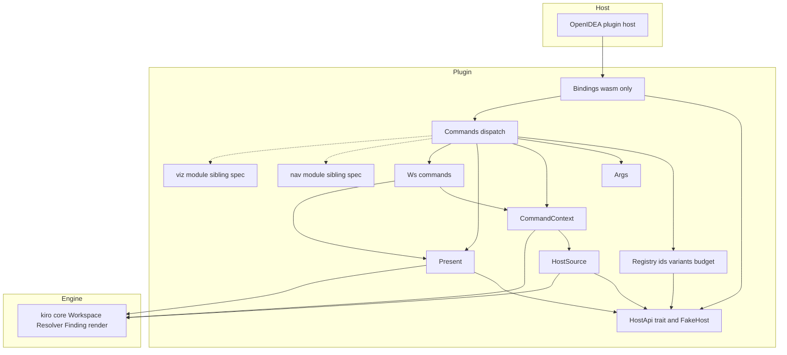
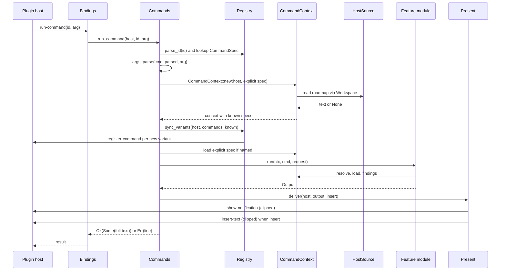
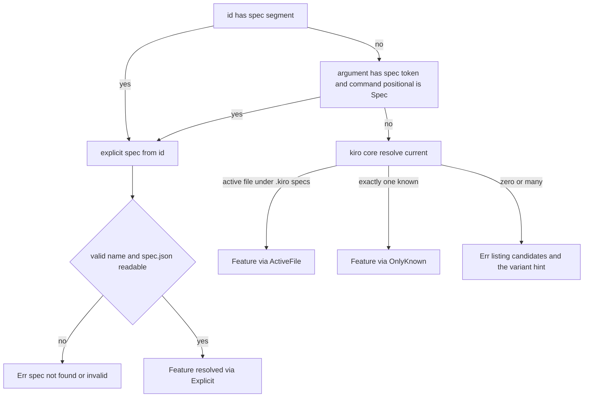
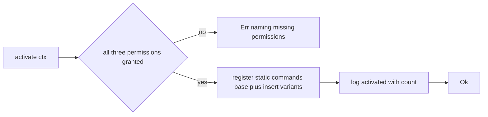

# Design Document: plugin-core

## Overview

**Purpose**: plugin-core is the OpenIDEA plugin package `plugins/kiro/`: a sandboxed WebAssembly component that adapts the pure `kiro-core` engine to the host's plugin API. It owns everything that every kiro command in the IDE shares — the manifest and build, command declaration and registration, known-spec discovery without directory listing, argument interpretation and current-spec resolution, reading through the host, presentation (notification, insertion, return message) and error mapping — and ships two commands, `ws.specs` and `ws.current`, that exercise that path end to end.

**Users**: developers running cc-sdd / kiro specs in OpenIDEA; the sibling specs spec-navigation, spec-visualization, vocabulary-grounding and spec-constraints, which add their `nav.*`, `viz.*`, `vocab.*` and `check.*` commands through this spec's feature-module contract.

**Impact**: Creates `plugins/kiro/` (its own Cargo workspace) and adds an `exclude` entry to the root `Cargo.toml`. Nothing in `crates/kiro-core` or in the host repository changes.

### Goals
- A package that builds with the host's `plugins/build.sh` or plain `cargo`, installs as a dev plugin by junction, and reloads without an IDE restart.
- Every failure becomes `Err(String)`; no command path can trap.
- Spec selection that works from Search Everywhere and the keymap, where the host passes no argument: active file first, per-spec command variants second, arguments for programmatic callers.
- One notification per command, clipped below the host's limits at line boundaries; findings rendered exactly as the CLI renders them.
- Dispatch, resolution and presentation testable natively against an in-memory host; the component verified in the host as a dev plugin.

### Non-Goals
- Parsing, resolution rules, the join or rendering (kiro-core).
- The behaviour of `nav.*`, `viz.*`, `vocab.*`, `check.*` (sibling specs; this design reserves their group prefixes and the module table slot only).
- Any change to the host (WIT, plugin host crate, frontend), including a UI argument prompt.
- Writing or editing project files; the CLI.

## Boundary Commitments

### This Spec Owns
- The package `plugins/kiro/`: `Cargo.toml` (own workspace), `plugin.toml`, build script for PowerShell, README, `src/`, `tests/`.
- The `HostApi` seam: the only place the WIT bindings are used, plus the in-memory fake.
- `HostSource`, the `kiro_core::source::Source` adapter over `read-file`.
- The command registry: id grammar, static command list, variant generation, the 256-id budget, registered-id tracking.
- Argument grammar and spec-name validation.
- `CommandContext`: project root, active file normalisation, known-spec union, workspace construction, resolution and its error messages.
- Presentation: `Output`, clipping budgets, findings text, severity-to-level mapping, delivery.
- Dispatch: activation (permission check, static registration), deactivation, `run-command` orchestration, the `FeatureModule` contract and module table.
- The `ws.specs` and `ws.current` commands.
- The root `Cargo.toml` `exclude` entry for `plugins/kiro`.

### Out of Boundary
- Feature modules for `nav`, `viz`, `vocab`, `check`: each sibling spec adds one module file, one line in the module table and its `[[contributes.commands]]` entries in `plugin.toml`.
- Command inputs beyond the argument grammar (e.g. how a vocabulary term id is obtained without an argument) — the owning spec decides.
- Host-side tests (`../openidea/crates/ide-plugin/tests/host.rs`) — untouched; the WIT does not change.
- Any `kiro-core` change; if a needed engine API is missing, the gap goes back to kiro-core.

### Allowed Dependencies
- `kiro-core` by path (`../../crates/kiro-core`); plugin-core's own modules use `source`, `resolve`, `spec`, `finding`, `render`; each feature module (nav, viz, vocab, check) declares its own kiro-core imports in its design.
- `wit-bindgen` 0.63, compiled only for `wasm32`.
- Rust `std` without `fs`, `net`, `thread`, `env`, `time`, `process` (the sandbox grants clocks and randomness, but the plugin does not use them).
- Dev-dependency `toml` (0.8 or newer) for the manifest consistency test.
- Internal dependency direction (a module imports only from modules to its left): `host` → `registry` → `args` → `host_source` → `present` → `context` → `module` (the `FeatureModule` trait) → feature modules (`ws`) → `commands` → `bindings` / `lib`. Violations are review errors.

### Revalidation Triggers
- Any change to `HostApi`, `CommandSpec`, `Request`, `CommandContext` or `Output` (all four sibling specs).
- Any change to the id grammar, the variant naming or the budget (sibling specs' command lists; documentation).
- Any change to `kiro_core::source::Source`, `Workspace`, `resolve_current`, `Finding` or `clip_lines` (kiro-core revalidation triggers apply here).
- A WIT change in the host (`openidea:plugin` beyond 0.1): `bindings.rs` and the manifest's `openidea-api`.
- A change to the host's command limit, clip sizes or activation context.
- A change to the frontend's refresh-on-failure behaviour (`runPluginCommand` in `src/features/plugins/store.ts` calls `refreshPlugins()` when a command returns an error): this is what makes variants registered during a failing call visible in Search Everywhere.

## Architecture

### Existing Architecture Analysis
- Host: `openidea:plugin@0.1.0` world; imports `host` (`log`, `register-command`, `show-notification`, `workspace-root`, `active-file`, `read-file`, `insert-text`, `replace-selection`, `register-language`, `register-theme`); exports `activate(context)`, `deactivate()`, `run-command(id, arg)`. Per-call limits 5·10⁹ fuel, 5 s, 256 MiB; traps mark the plugin Failed.
- Invocation path (verified, research.md): frontend action `plugin.kiro.<id>` → `plugin_run_command` → `PluginHost::run_command`. The UI passes `arg = null`; the `Ok` message is discarded; `Err` is shown as `<title> failed: <message>`.
- Activation runs without project context. Registrations made during a call are kept by the host immediately; when the call returns `Ok`, the host emits `CommandsChanged` and the UI refreshes its action list. When the call returns `Err`, the host drops the call's effects (`runtime.rs`, `run_command`) and no event is emitted — the registrations still exist, and the frontend's `runPluginCommand` refreshes the plugin list in its error handler (`store.ts`), which is why variants registered before an "unresolved spec" error still appear.
- Engine: kiro-core is pure; `Workspace<S: Source>` takes known feature names; `resolve_current` implements the resolution order; `Finding` and `findings_text` are shared with the CLI.

### Architecture Pattern & Boundary Map



**Architecture Integration**:
- Selected pattern: ports-and-adapters around the host — one trait (`HostApi`) is the port to the IDE, one adapter per side (wasm bindings, in-memory fake); the engine is consumed through its own port (`Source`). Chosen because the host forbids everything but its functions, and because native tests must drive the full dispatch path.
- Domain boundaries: `registry` knows ids and budgets but no project; `context` knows the project but no presentation; `present` knows output budgets but no commands; feature modules know their commands and make no host call other than `ctx.host.log`.
- Existing patterns preserved: steering's module map (`host_source`, `commands`, `present`) extended with the seams above; kiro-core's no-panic lint table; the hello plugin's package layout.
- New components rationale: `HostApi` (testability and the single unsafe seam), `Registry` (the 256-id budget must be enforced before a host call, and variants are the argument fallback), `CommandContext` (one place that unites roadmap, active file and argument into known specs).
- Steering compliance: no `std::fs`/`net`/`thread`/`env`/`time`; `#![deny(unsafe_code)]` with one allowed module; `Result<_, String>` at the plugin boundary; kebab-case ids grouped by prefix; actions `plugin.kiro.<group>.<name>`.

### Technology Stack

| Layer | Choice / Version | Role in Feature | Notes |
|-------|------------------|-----------------|-------|
| Language / toolchain | Rust `edition = "2024"`, target `wasm32-wasip2` (release) and native (tests) | Plugin crate `openidea-plugin-kiro`, `crate-type = ["cdylib", "rlib"]` | `rustup target add wasm32-wasip2`; `rlib` only so `tests/` can link the crate |
| Bindings | `wit-bindgen = "0.63"` (wasm32-only target dependency) | `generate!({ world: "plugin", path: "../../../openidea/wit" })`, `export!` | Same version as `plugins/hello` |
| Engine | `kiro-core = { path = "../../crates/kiro-core" }` | Workspace, resolution, findings, text rendering, clipping | No parsing in the plugin |
| Build | `../openidea/plugins/build.sh <abs path>` or `plugins/kiro/build.ps1` | `dist/plugin.wasm` from `target/wasm32-wasip2/release/openidea_plugin_kiro.wasm` | Profile `opt-level = "s"`, `lto`, `strip`, `codegen-units = 1`, `panic = "abort"` |
| Lints | `[lints.rust] unsafe_code = "deny"`; `[lints.clippy] unwrap_used, expect_used, panic, indexing_slicing, todo, unimplemented = "deny"` | No-panic rule at compile time | `bindings.rs` carries `#![allow(unsafe_code)]` |
| Tests | native `cargo test` in `plugins/kiro`; dev-dependency `toml` ≥ 0.8 | Unit tests per module, end-to-end over `FakeHost`, manifest consistency | Host check manual via dev plugin |

## File Structure Plan

### Directory Structure
```
Cargo.toml                                   # Root workspace (kiro-core): add exclude = ["plugins/kiro"]
plugins/
└── kiro/
    ├── Cargo.toml                           # Package, own [workspace], cdylib+rlib, deps, profile, lints
    ├── plugin.toml                          # Manifest: id kiro, api 0.1, permissions, static commands
    ├── build.ps1                            # PowerShell build: cargo build + copy to dist/plugin.wasm
    ├── README.md                            # Build, dev-plugin install (junction), reload, commands, arguments
    ├── src/
    │   ├── lib.rs                           # Crate docs, lint attributes, module declarations
    │   ├── bindings.rs                      # wasm32 only: generate!, WasmHost: HostApi, Guest impl, export!
    │   ├── host.rs                          # HostApi trait, Level/LogLevel, REQUIRED_PERMISSIONS, FakeHost
    │   ├── host_source.rs                   # HostSource: kiro_core Source over HostApi::read_file
    │   ├── registry.rs                      # Group, CommandSpec, id grammar, static list, variants, budget, Registry
    │   ├── args.rs                          # Request parsing from id modifiers and the argument string
    │   ├── present.rs                       # Output, clipping budgets, findings text, level mapping, deliver
    │   ├── context.rs                       # CommandContext: root, active file, known specs, workspace, resolve
    │   ├── module.rs                        # FeatureModule trait (the contract feature modules implement)
    │   ├── commands.rs                      # Module table, activate, deactivate, run_command
    │   └── ws.rs                            # ws.specs and ws.current
    └── tests/
        ├── dispatch.rs                      # End-to-end over FakeHost with kiro-core's minimal fixture tree
        └── manifest.rs                      # plugin.toml static commands == registry::static_commands()
```

### Files by Component

| Component | File | Responsibility |
|-----------|------|----------------|
| PluginScaffold | `plugins/kiro/Cargo.toml` | Package `openidea-plugin-kiro`, edition 2024, `[workspace]`, `crate-type = ["cdylib", "rlib"]`, `kiro-core` by path, `wit-bindgen` for wasm32 only, `toml` dev-dependency, release profile, lint table |
| PluginScaffold | `plugins/kiro/build.ps1` | Ensures the `wasm32-wasip2` target, runs the release build, copies the component to `dist/plugin.wasm` |
| PluginScaffold | `plugins/kiro/README.md` | Build (bash script, PowerShell script, plain cargo), dev-plugin installation on Windows (create `.openidea\plugins`, `mklink /J`, trust, Reload Plugins), install from disk, command list, argument grammar, host limits |
| PluginScaffold | `plugins/kiro/src/lib.rs` | `#![deny(unsafe_code)]`, crate docs (command grammar, output channels), `pub mod` declarations, `#[cfg(target_arch = "wasm32")] mod bindings` |
| PluginScaffold | `Cargo.toml` | Root workspace: `exclude = ["plugins/kiro"]` |
| Manifest | `plugins/kiro/plugin.toml` | `id = "kiro"`, name, version, description, `openidea-api = "0.1"`, `wasm = "dist/plugin.wasm"`, the three permissions, `[[contributes.commands]]` for every project-independent command |
| Bindings | `plugins/kiro/src/bindings.rs` | `wit_bindgen::generate!`, `WasmHost` implementing `HostApi` over `openidea::plugin::host`, `Guest` implementation delegating to `commands`, `export!` |
| HostApi | `plugins/kiro/src/host.rs` | `HostApi` trait, `Level`, `LogLevel`, `REQUIRED_PERMISSIONS`, `FakeHost` with recorded events and host-faithful `read_file` emulation |
| HostSource | `plugins/kiro/src/host_source.rs` | `HostSource<'h>` implementing `kiro_core::source::Source`: path guard, host read, debug log on failure, `None` on any failure |
| Registry | `plugins/kiro/src/registry.rs` | `Group`, `Positional`, `CommandSpec`, `Decl`, `ParsedId`, `parse_id`, id and name validators, `static_commands`, `Registry` state, `sync_variants`, `SyncReport`, constants (`MAX_COMMANDS`, `CATEGORY`, `INSERT`) |
| Args | `plugins/kiro/src/args.rs` | `Request`, `parse(cmd, parsed_id, arg)` combining id modifiers and tokens, conflict and validity errors, insert-capability check |
| Present | `plugins/kiro/src/present.rs` | `Output`, `NOTIFICATION_BYTES`, `INSERT_BYTES`, `TITLE_BYTES`, `ERROR_BYTES`, `level_of`, `clip_notification`, `clip_insert`, `clip_title`, `error_line`, `deliver` |
| Context | `plugins/kiro/src/context.rs` | `CommandContext`, `KnownVia`, `RoadmapState`, `Resolved`, `new`, `known_names`, `resolve`, `load` |
| Commands | `plugins/kiro/src/module.rs` | `FeatureModule` trait only (group, command declarations, run) — sits left of the feature modules so they implement it without importing `commands` |
| Commands | `plugins/kiro/src/commands.rs` | `modules()` table (canonical order `ws, nav, viz, vocab, check`), `all_commands()`, `activate`, `deactivate`, `run_command`, `run_command_with` (test seam), group-without-module error |
| WsCommands | `plugins/kiro/src/ws.rs` | `Ws` module: `COMMANDS` (`ws.specs`, `ws.current`), `specs(ctx, req)`, `current(ctx, req)`, phase label and document presence helpers |
| PluginTests | `plugins/kiro/tests/dispatch.rs` | End-to-end: activation registers the static list and rejects missing permissions; `ws.current`/`ws.specs` over kiro-core's `fixtures/minimal` tree embedded with `include_str!`; variants; insert; every error message of Requirements 4, 5 and 7 |
| PluginTests | `plugins/kiro/tests/manifest.rs` | Parses `plugin.toml` with `toml`; asserts `[[contributes.commands]]` ids, titles and categories equal `static_commands(&all_commands())` |

### Modified Files
- `Cargo.toml` (root, created by kiro-core) — add `exclude = ["plugins/kiro"]` under `[workspace]` so the plugin package is never pulled into the root workspace even if a glob member list is introduced later.

## System Flows

### Running a command



Flow decisions: any `Err` before delivery returns without a notification (the host shows `<title> failed: <message>`); variants are synchronised before the module runs so that an "unresolved spec" error already leaves the per-spec commands registered in the host (visible after the frontend's refresh-on-failure, see Existing Architecture Analysis); a spec named explicitly (variant or argument) whose `spec.json` cannot be read fails before the module runs.

### Selecting the spec



### Activation



## Requirements Traceability

| Requirement | Summary | Components | Interfaces | Flows |
|-------------|---------|------------|------------|-------|
| 1.1 | Manifest identity, API, permissions, component path | Manifest | `plugin.toml` fields | — |
| 1.2 | Build with build.sh or cargo produces `dist/plugin.wasm` | PluginScaffold | `Cargo.toml` profile, `build.ps1` | — |
| 1.3 | Dev plugin loads Active, commands listed | Manifest, PluginScaffold (README) | — | Activation |
| 1.4 | Reload picks up rebuilt component | PluginScaffold (README) | — | — |
| 1.5 | Documentation of build, install, reload, install from disk | PluginScaffold (README) | — | — |
| 1.6 | Missing permissions fail activation with names | Commands, HostApi | `activate`, `REQUIRED_PERMISSIONS` | Activation |
| 1.7 | Independent of the root workspace | PluginScaffold | `[workspace]`, root `exclude` | — |
| 2.1 | Id grammar and host rule | Registry | `Group`, `CommandSpec::id`, `is_command_id`, `parse_id` | — |
| 2.2 | Titles `Kiro:` ≤ 128, category `Kiro` | Registry | `CATEGORY`, `MAX_TITLE_LEN`, `validate_spec` | — |
| 2.3 | Static list equals activation registration | Manifest, Registry, Commands, PluginTests | `static_commands`, `activate`, `tests/manifest.rs` | Activation |
| 2.4 | Only project-independent commands at activation | Commands | `activate` | Activation |
| 2.5 | ≤ 256, never an invalid request | Registry | `Registry::register`, `MAX_COMMANDS` | — |
| 2.6 | Unknown id → error naming it | Commands | `run_command` | Running a command |
| 2.7 | `ws.specs`, `ws.current` exist | WsCommands | `ws::COMMANDS` | — |
| 3.1 | Known specs = roadmap ∪ active-file spec ∪ argument spec | Context | `CommandContext::new`, `KnownVia` | Running a command |
| 3.2 | Roadmap absent/no section tolerated and reported | Context, WsCommands | `RoadmapState` | — |
| 3.3 | `ws.specs` rows: sources, spec.json readable, phase | WsCommands | `specs` | — |
| 3.4 | No spec known → message with roadmap path | WsCommands | `specs` | — |
| 4.1 | Argument tokens: insert, spec, rest | Args | `parse` | Selecting the spec |
| 4.2 | No argument defaults | Args | `parse` | — |
| 4.3 | Variants equal base + explicit spec / insert flag | Registry, Args | `parse_id`, `parse` | Selecting the spec |
| 4.4 | Spec named twice differently → error | Args | `parse` | — |
| 4.5 | Invalid spec name → error, no read | Registry, Args | `is_spec_name`, `parse` | Selecting the spec |
| 4.6 | Resolution order | Context | `resolve` → `kiro_core::resolve_current` | Selecting the spec |
| 4.7 | Outside/absent active file tolerated | Context | `CommandContext::new` (`to_project_relative`) | — |
| 4.8 | Unresolved → candidates and variant hint | Context | `resolve` | Selecting the spec |
| 4.9 | No project → `no project is open` | Context | `CommandContext::new` | Running a command |
| 5.1 | Variant ids and titles per spec-addressable command × valid spec | Registry | `sync_variants`, `CommandSpec::variant_id/variant_title`, `is_spec_segment` | — |
| 5.2 | Variants before the command runs | Commands | `run_command` | Running a command |
| 5.3 | Idempotent re-registration | Registry | `Registry::register` | — |
| 5.4 | Budget: roadmap order, skip rest, report | Registry, WsCommands, Commands | `SyncReport.skipped_budget`, log | — |
| 5.5 | Invalid segment skipped, reported | Registry, WsCommands | `SyncReport.skipped_invalid` | — |
| 5.6 | Variant for unreadable spec → not found error | Commands | `run_command` explicit-spec check | Selecting the spec |
| 5.7 | Insert variants are static | Registry, Manifest | `static_commands`, `CommandSpec::insert_id` | — |
| 6.1 | Reads via host, relative `/` paths | HostSource | `Source::read` | Running a command |
| 6.2 | Read failures → absent, continue | HostSource | `Source::read` | — |
| 6.3 | Each path once per command | Context | `Workspace` cache (kiro-core 1.3) | — |
| 6.4 | Only the needed documents | Context, WsCommands | `load` on demand | — |
| 6.5 | No writes | HostApi | trait has no write operation besides editor insertion | — |
| 6.6 | Debug log on read failure | HostSource | `HostApi::log` | — |
| 7.1 | One notification, title ≤ 256, full return message | Present | `deliver`, `clip_title` | Running a command |
| 7.2 | Notification clipped below 16 KiB at line boundary | Present | `clip_notification` (`clip_lines`) | — |
| 7.3 | Insert full text below 1 MiB, still notify | Present | `deliver`, `clip_insert` | — |
| 7.4 | Insert on non-insert-capable → error | Args | `parse` | — |
| 7.5 | Findings as `path:line: SEVERITY CODE message` | Present | `Output::with_findings` (`findings_text`) | — |
| 7.6 | Level from severities | Present | `level_of` | — |
| 7.7 | Errors single-line ≤ 1 KiB, no extra notification | Present, Commands | `error_line`, `run_command` | Running a command |
| 7.8 | `ws.current` content | WsCommands | `current` | — |
| 8.1 | Total: errors never traps | all logic modules, PluginScaffold (lints) | `Result<_, String>` everywhere | — |
| 8.2 | Only host functions | HostApi, Bindings | `HostApi` | — |
| 8.3 | 5 s budget for 64 specs / 1 MiB | Context | fresh workspace, bounded reads | — |
| 8.4 | Deactivate: log only | Commands | `deactivate` | — |
| 8.5 | Fresh view per command; two statics | Commands, Registry | `run_command`, `Registry` state, permissions static | — |
| 9.1 | Route by group | Commands | `modules()`, `FeatureModule::group` (`module.rs`) | Running a command |
| 9.2 | Per-command declaration | Registry, Commands | `CommandSpec`, `FeatureModule::commands` | — |
| 9.3 | Context and request handed to the module; Output returned | Commands (`module.rs`), Context, Present | `FeatureModule::run` | Running a command |
| 9.4 | Group without module → not available | Commands | `run_command` | — |
| 10.1 | Native unit tests | Registry, Args, Context, Present | in-module `#[cfg(test)]` | — |
| 10.2 | Native end-to-end tests | PluginTests, HostApi (`FakeHost`) | `tests/dispatch.rs` | — |
| 10.3 | Manifest equals static list | PluginTests | `tests/manifest.rs` | — |
| 10.4 | wasm build, lints, fmt | PluginScaffold | `build.ps1`, lint table | — |
| 10.5 | Host check as dev plugin | PluginScaffold (README procedure), WsCommands | `ws.current` | — |

## Components and Interfaces

| Component | Domain/Layer | Intent | Req Coverage | Key Dependencies (P0/P1) | Contracts |
|-----------|--------------|--------|--------------|--------------------------|-----------|
| PluginScaffold | Build | Package manifest, build script, docs, crate root, root exclude | 1.2, 1.3, 1.4, 1.5, 1.7, 10.4, 10.5 | kiro-core (P0), wit-bindgen (P0) | State |
| Manifest | Package | `plugin.toml` with permissions and static commands | 1.1, 1.3, 2.3, 5.7 | Registry (P0, same list) | State |
| Bindings | Host adapter | WIT bindings, `WasmHost`, `Guest` export | 8.2 | wit-bindgen (P0), Commands (P0) | Service |
| HostApi | Host port | Trait over the eight host functions (the WIT's `register-language`/`register-theme` are deliberately excluded); fake for tests | 1.6, 6.5, 8.2, 10.2 | none | Service |
| HostSource | Engine adapter | `Source` over `read-file` | 6.1, 6.2, 6.6 | HostApi (P0), kiro-core (P0) | Service |
| Registry | Commands | Ids, static list, variants, budget | 2.1, 2.2, 2.5, 4.3, 4.5, 5.1, 5.3, 5.4, 5.5, 5.7, 8.5, 9.2 | HostApi (P0) | Service, State |
| Args | Commands | Request from id modifiers and argument | 4.1, 4.2, 4.3, 4.4, 4.5, 7.4 | Registry (P0) | Service |
| Present | Presentation | Output, clipping, findings text, delivery | 7.1, 7.2, 7.3, 7.5, 7.6, 7.7 | HostApi (P0), kiro-core render (P0) | Service |
| Context | Project | Root, active file, known specs, workspace, resolution | 3.1, 3.2, 4.6, 4.7, 4.8, 4.9, 6.3, 6.4, 8.3, 9.3 | HostSource (P0), kiro-core (P0) | Service, State |
| Commands | Dispatch | Activation, deactivation, run orchestration, module table | 1.6, 2.3, 2.4, 2.6, 5.2, 5.6, 7.7, 8.1, 8.4, 8.5, 9.1, 9.3, 9.4 | all above (P0) | Service |
| WsCommands | Feature | `ws.specs`, `ws.current` | 2.7, 3.2, 3.3, 3.4, 5.4, 5.5, 7.8 | Context (P0), Present (P0) | Service |
| PluginTests | Tests | End-to-end and manifest tests | 10.2, 10.3 | HostApi fake (P0), kiro-core fixtures (P1) | — |

### Build and Package

#### PluginScaffold

| Field | Detail |
|-------|--------|
| Intent | The package builds for wasm32 and natively, under the same lint rules as kiro-core, and installs as documented |
| Requirements | 1.2, 1.3, 1.4, 1.5, 1.7, 10.4, 10.5 |

**Responsibilities & Constraints**
- `plugins/kiro/Cargo.toml`: `[package] name = "openidea-plugin-kiro", version = "0.1.0", edition = "2024", publish = false`; `[workspace]` (empty table: standalone workspace); `[lib] crate-type = ["cdylib", "rlib"]`; `[dependencies] kiro-core = { path = "../../crates/kiro-core" }`; `[target.'cfg(target_arch = "wasm32")'.dependencies] wit-bindgen = "0.63"`; `[dev-dependencies] toml = "0.8"` (or the current 0.x); `[profile.release] opt-level = "s", lto = true, strip = true, codegen-units = 1, panic = "abort"`; lint table identical to kiro-core (`unsafe_code = "deny"` instead of `forbid`).
- `build.ps1`: `rustup target add wasm32-wasip2` when missing; `cargo build --release --target wasm32-wasip2`; `New-Item dist`; copy `target\wasm32-wasip2\release\openidea_plugin_kiro.wasm` to `dist\plugin.wasm`; print the size. Equivalent to `../openidea/plugins/build.sh D:\Source\openidea-kiro\plugins\kiro`.
- `README.md` sections: Build (three ways); Install as dev plugin (`New-Item -ItemType Directory <project>\.openidea\plugins`, `cmd /c mklink /J <project>\.openidea\plugins\kiro D:\Source\openidea-kiro\plugins\kiro`, trust the project, open Settings › Plugins or run _Reload Plugins_; the project to open is the one whose `.kiro` tree the plugin should read — this repository for its own specs, `../openidea` when testing the host); Install from disk (copies the package; re-install after rebuilds); Commands (table of ids, titles, spec-addressable, insert-capable); Arguments (grammar, `executeAction` example); Limits (16 KiB notification, 1 MiB insertion, 256 commands, 5 s).
- `src/lib.rs`: `#![deny(unsafe_code)]`; crate docs; `pub mod host; pub mod registry; pub mod args; pub mod host_source; pub mod present; pub mod context; pub mod module; pub mod ws; pub mod commands;` and `#[cfg(target_arch = "wasm32")] mod bindings;`.
- Root `Cargo.toml`: `exclude = ["plugins/kiro"]`.

**Implementation Notes**
- Validation: from `plugins/kiro`: `cargo test`, `cargo clippy --all-targets -- -D warnings`, `cargo fmt --check`, `cargo build --release --target wasm32-wasip2`, `cargo clippy --target wasm32-wasip2 -- -D warnings`; from the repository root `cargo test` must not touch the plugin.
- Risks: the `.cargo/config.toml` at the repository root (wasm runner) is inherited by the plugin package — harmless; `wit-bindgen` macro options may differ between 0.63 minor releases — the hello plugin is the reference.

#### Manifest

| Field | Detail |
|-------|--------|
| Intent | The host-facing declaration of the plugin and its project-independent commands |
| Requirements | 1.1, 1.3, 2.3, 5.7 |

**Contracts**: State [x]

##### State Management
- Content: `id = "kiro"`, `name = "Kiro"`, `version = "0.1.0"`, `description`, `authors`, `openidea-api = "0.1"`, `wasm = "dist/plugin.wasm"`, `permissions = ["project-read", "editor-read", "editor-write"]`, then one `[[contributes.commands]]` block per entry of `static_commands(&all_commands())` with `id`, `title`, `category = "Kiro"`. For this spec: `ws.specs` (`Kiro: List Specs`), `ws.specs.insert` (`Kiro: List Specs — Insert at Cursor`), `ws.current` (`Kiro: Current Spec`).
- Consistency: `tests/manifest.rs` fails when the manifest and the registry disagree; sibling specs extend both.
- Unknown keys are rejected by the host (`deny_unknown_fields`): only the keys above may appear.

### Host Seam

#### Bindings

| Field | Detail |
|-------|--------|
| Intent | The only module that touches the WIT world; compiled for wasm32 only |
| Requirements | 8.2 |

**Contracts**: Service [x]

##### Service Interface
```rust
#![allow(unsafe_code)]   // generated code
wit_bindgen::generate!({ world: "plugin", path: "../../../openidea/wit" });
use openidea::plugin::host;
use openidea::plugin::types::{Context, LogLevel as WitLogLevel, NotificationLevel as WitLevel};

pub struct WasmHost;
impl crate::host::HostApi for WasmHost { /* one-to-one calls into `host::*`, enum mapping only */ }

struct Kiro;
impl Guest for Kiro {
    fn activate(ctx: Context) -> Result<(), String> { crate::commands::activate(&WasmHost, &ctx.permissions) }
    fn deactivate() { crate::commands::deactivate(&WasmHost) }
    fn run_command(id: String, arg: Option<String>) -> Result<Option<String>, String> {
        crate::commands::run_command(&WasmHost, &id, arg.as_deref())
    }
}
export!(Kiro with_types_in self);
```
- Invariants: no logic beyond enum mapping; no other module references `openidea::plugin`.
- The module carries `#![allow(unsafe_code)]` and `#![allow(clippy::all)]`-style allowances for the crate's restriction lints (`unwrap_used`, `expect_used`, `panic`, `indexing_slicing`) because `generate!`/`export!` expansions are not under the plugin's control; the allowances are module-local.

#### HostApi

| Field | Detail |
|-------|--------|
| Intent | The port every module uses to reach the IDE, with an in-memory fake for native tests |
| Requirements | 1.6, 6.5, 8.2, 10.2 |

**Contracts**: Service [x]

##### Service Interface
```rust
#[derive(Clone, Copy, Debug, PartialEq, Eq)]
pub enum LogLevel { Trace, Debug, Info, Warn, Error }
#[derive(Clone, Copy, Debug, PartialEq, Eq, PartialOrd, Ord)]
pub enum Level { Info, Warning, Error }
pub const REQUIRED_PERMISSIONS: [&str; 3] = ["project-read", "editor-read", "editor-write"];

pub trait HostApi {
    fn log(&self, level: LogLevel, message: &str);
    fn register_command(&self, id: &str, title: &str, category: Option<&str>);
    fn show_notification(&self, level: Level, title: &str, body: &str);
    fn workspace_root(&self) -> Option<String>;
    fn active_file(&self) -> Option<String>;
    fn read_file(&self, path: &str) -> Result<String, String>;
    fn insert_text(&self, text: &str);
    fn replace_selection(&self, text: &str);
}

#[derive(Clone, Debug, PartialEq, Eq)]
pub enum HostEvent {
    Log(LogLevel, String),
    Register { id: String, title: String, category: Option<String> },
    Notify { level: Level, title: String, body: String },
    Insert(String),
    Replace(String),
    Read(String),
}
#[derive(Default)]
pub struct FakeHost { pub root: Option<String>, pub active: Option<String>, pub files: BTreeMap<String, String>, events: RefCell<Vec<HostEvent>> }
impl FakeHost {
    pub fn new() -> Self;
    pub fn with_root(self, root: &str) -> Self;            // e.g. "C:\\proj"
    pub fn with_active(self, path: &str) -> Self;          // absolute, as the IDE reports it
    pub fn with_file(self, relative: &str, text: &str) -> Self;
    pub fn events(&self) -> Vec<HostEvent>;
    pub fn registered(&self) -> BTreeMap<String, (String, Option<String>)>;   // id -> (title, category)
    pub fn notifications(&self) -> Vec<(Level, String, String)>;
    pub fn inserts(&self) -> Vec<String>;
    pub fn reads(&self) -> Vec<String>;
}
impl HostApi for FakeHost { /* see below */ }
```
- `FakeHost::read_file` emulates the host: `""` → `Err("empty path")`; no root → `Err("no project is open")`; `\` normalised to `/`; an absolute path must start with the root (case-insensitive) and is made relative, else `Err("<path>: access outside the project root is not allowed")`; a relative path containing a `..` segment → the same error; lookup in `files`; absent → `Err("<path>: no such file")`. Every call is recorded as `Read`.
- `FakeHost` is compiled always (no cargo feature); it is dead-code-eliminated from the component.
- Writes: the trait exposes no file write; `insert_text`/`replace_selection` are the only mutations and touch the editor only.

#### HostSource

| Field | Detail |
|-------|--------|
| Intent | `kiro_core::source::Source` over `HostApi::read_file` |
| Requirements | 6.1, 6.2, 6.6 |

**Contracts**: Service [x]

##### Service Interface
```rust
pub struct HostSource<'h> { host: &'h dyn HostApi }
impl<'h> HostSource<'h> { pub fn new(host: &'h dyn HostApi) -> Self; }
impl kiro_core::source::Source for HostSource<'_> {
    /// Guard without a host call: empty, absolute (`/`, `\`, `<letter>:`), containing `\` or a `..` segment -> None.
    /// Otherwise host.read_file(path); Err(reason) -> log(Debug, "read {path}: {reason}") -> None.
    fn read(&self, project_relative_path: &str) -> Option<String>;
}
```
- Postconditions: never panics; never calls the host for a guarded path; returns `Some` only for `Ok`.

### Commands

#### Registry

| Field | Detail |
|-------|--------|
| Intent | Command ids, the static list, per-spec variants and the 256-id budget — the fallback for the missing argument channel |
| Requirements | 2.1, 2.2, 2.5, 4.3, 4.5, 5.1, 5.3, 5.4, 5.5, 5.7, 8.5, 9.2 |

**Contracts**: Service [x] / State [x]

##### Service Interface
```rust
pub const CATEGORY: &str = "Kiro";
pub const TITLE_PREFIX: &str = "Kiro:";
pub const INSERT: &str = "insert";
pub const INSERT_TITLE_SUFFIX: &str = " — Insert at Cursor";
pub const MAX_COMMANDS: usize = 256;
pub const MAX_ID_LEN: usize = 64;
pub const MAX_TITLE_LEN: usize = 128;

#[derive(Clone, Copy, Debug, PartialEq, Eq, PartialOrd, Ord)]
pub enum Group { Ws, Nav, Viz, Vocab, Check }
impl Group { pub fn prefix(self) -> &'static str; pub fn parse(s: &str) -> Option<Group>; pub const ALL: [Group; 5]; }

#[derive(Clone, Copy, Debug, PartialEq, Eq)]
pub enum Positional { Spec, PassThrough, None }

#[derive(Clone, Debug, PartialEq, Eq)]
pub struct CommandSpec {
    pub group: Group,
    pub name: &'static str,          // "specs"
    pub title: &'static str,         // "Kiro: List Specs"
    pub spec_addressable: bool,      // gets <group>.<name>.<spec> variants
    pub insert_capable: bool,        // gets <group>.<name>.insert and accepts the insert flag
    pub positional: Positional,      // how argument tokens are read
}
impl CommandSpec {
    pub fn id(&self) -> String;                            // "<group>.<name>"
    pub fn insert_id(&self) -> Option<String>;             // Some when insert_capable
    pub fn insert_title(&self) -> String;                  // title + INSERT_TITLE_SUFFIX
    pub fn variant_id(&self, spec: &str) -> String;        // "<group>.<name>.<spec>"
    pub fn variant_title(&self, spec: &str) -> String;     // "<title> — <spec>"
    pub fn validate(&self) -> Result<(), String>;          // name segment valid, title starts with TITLE_PREFIX and <= MAX_TITLE_LEN bytes
}

#[derive(Clone, Debug, PartialEq, Eq)]
pub struct Decl { pub id: String, pub title: String }
#[derive(Clone, Debug, PartialEq, Eq)]
pub struct ParsedId { pub base: String, pub insert: bool, pub spec: Option<String> }

/// "<group>.<name>" | "<group>.<name>.insert" | "<group>.<name>.<spec>"; None for any other shape
/// (fewer than two segments, more than three, unknown group, empty segment, invalid characters).
pub fn parse_id(id: &str) -> Option<ParsedId>;
pub fn is_command_id(s: &str) -> bool;    // [a-z0-9][a-z0-9._-]*, <= 64
pub fn is_spec_segment(s: &str) -> bool;  // [a-z0-9][a-z0-9_-]*, <= 64, != INSERT
pub fn is_spec_name(s: &str) -> bool;     // [a-z0-9][a-z0-9._-]*, no "/", no "\\", no ".." segment, <= 64

/// Base declaration of every command followed by the insert variant of each insert-capable one, in input order.
pub fn static_commands(specs: &[CommandSpec]) -> Vec<Decl>;

#[derive(Debug, Default)]
pub struct Registry { registered: BTreeSet<String> }
#[derive(Clone, Debug, PartialEq, Eq)]
pub enum RegisterError { InvalidId(String), InvalidTitle(String), Budget }
impl Registry {
    /// Validates id and title, checks the budget, calls host.register_command, records the id.
    /// Ok(true) = newly recorded; Ok(false) = already recorded (host call still made; host treats it as a no-op).
    pub fn register(&mut self, host: &dyn HostApi, decl: &Decl) -> Result<bool, RegisterError>;
    pub fn len(&self) -> usize;
    pub fn contains(&self, id: &str) -> bool;
    pub fn remaining(&self) -> usize;   // MAX_COMMANDS - len()
}
/// Plugin-wide registry (static Mutex; poisoning recovered with into_inner).
pub fn registry() -> std::sync::MutexGuard<'static, Registry>;

#[derive(Clone, Debug, Default, PartialEq, Eq)]
pub struct SyncReport { pub registered: usize, pub unchanged: usize, pub skipped_budget: Vec<String>, pub skipped_invalid: Vec<String> }
/// For each spec in `known` (roadmap order, deduplicated) and each spec-addressable command: register the variant.
/// Before any host call for a spec, every composed variant id is checked with is_command_id (the spec segment may be
/// valid on its own while "<group>.<name>.<spec>" exceeds 64 bytes); a spec whose name fails is_spec_segment or whose
/// composed ids fail is_command_id goes to skipped_invalid with no registration at all. When the remaining budget cannot
/// hold every not-yet-registered variant of a spec, that spec and every later spec go to skipped_budget
/// (a spec is either fully registered or skipped; no partial registration).
pub fn sync_variants(host: &dyn HostApi, specs: &[CommandSpec], known: &[String]) -> SyncReport;
```
- Invariants: `registry().len() <= MAX_COMMANDS`; every id ever passed to `host.register_command` satisfied `is_command_id`; every title was non-empty and ≤ 256 bytes (variant titles: base ≤ 128 + ` — ` + spec ≤ 64); for each spec either all of its variants are registered or none.
- Budget arithmetic: a spec needs `addressable_count` ids; it is registered only when `remaining() >= addressable_count - already_registered_for_that_spec`.
- Unit tests: id grammar table (valid, uppercase, leading dot, 65 chars, four segments, `insert` as spec), `static_commands` order, `sync_variants` with a budget that fits two specs out of three, re-sync yields `unchanged` only, an invalid spec name reported, a spec name valid as a segment but producing a 65-byte composed id reported under `skipped_invalid` with no `Register` event.

#### Args

| Field | Detail |
|-------|--------|
| Intent | One `Request` from the id modifiers and the optional argument string |
| Requirements | 4.1, 4.2, 4.3, 4.4, 4.5, 7.4 |

**Contracts**: Service [x]

##### Service Interface
```rust
#[derive(Clone, Debug, Default, PartialEq, Eq)]
pub struct Request {
    pub spec: Option<String>,   // explicit spec (variant id or first token), validated
    pub insert: bool,
    pub rest: Vec<String>,      // remaining tokens, unchanged
    pub raw: Option<String>,    // the argument as received
}
/// Errors (single line): "spec named twice: `a` (command) and `b` (argument)";
/// "invalid spec name `x`: use a-z, 0-9, '.', '-', '_' without path separators";
/// "`<id>` does not support insertion".
pub fn parse(cmd: &CommandSpec, parsed: &ParsedId, arg: Option<&str>) -> Result<Request, String>;
```
- Rules: tokens = `arg.split_whitespace()`; every token equal to `insert` sets the flag and is removed; `spec` = `parsed.spec`, and when `cmd.positional == Positional::Spec` the first remaining token is the argument spec — both present and different → error; the chosen spec must satisfy `is_spec_name`; `rest` = remaining tokens (after removing the spec token for `Positional::Spec`); `insert && !cmd.insert_capable` → error.

### Presentation

#### Present

| Field | Detail |
|-------|--------|
| Intent | One output shape for every command and the only code that calls `show-notification` / `insert-text` |
| Requirements | 7.1, 7.2, 7.3, 7.5, 7.6, 7.7 |

**Contracts**: Service [x]

##### Service Interface
```rust
pub const NOTIFICATION_BYTES: usize = 15 * 1024;        // host clips at 16 KiB
pub const INSERT_BYTES: usize = 1024 * 1024 - 1024;     // host clips at 1 MiB
pub const TITLE_BYTES: usize = 256;
pub const ERROR_BYTES: usize = 1024;

#[derive(Clone, Debug, PartialEq, Eq)]
pub struct Output { pub title: String, pub level: Level, pub text: String }
impl Output {
    pub fn info(title: impl Into<String>, text: impl Into<String>) -> Self;
    pub fn with_level(self, level: Level) -> Self;
    /// text = intro (if non-empty, followed by a blank line) + findings_text(findings); level = level_of(findings)
    pub fn with_findings(title: impl Into<String>, intro: &str, findings: &[kiro_core::finding::Finding]) -> Self;
}
pub fn level_of(findings: &[Finding]) -> Level;                 // explicit mapping: any Severity::Error -> Error, else any Severity::Warning -> Warning, else Info (kiro-core's Severity derives Ord with Error < Warning < Info, so no max())
pub fn clip_notification(text: &str, insert_id: Option<&str>) -> String;  // let hint = insert_id.map(|id| format!("run {id} for the full text")); kiro_core::render::clip_lines(text, NOTIFICATION_BYTES, hint.as_deref()) (amendment 2026-11-04)
pub fn clip_insert(text: &str) -> String;                       // kiro_core::render::clip_lines(text, INSERT_BYTES, None)
pub fn clip_title(title: &str) -> String;                       // char-boundary cut at TITLE_BYTES
pub fn error_line(message: &str) -> String;                     // newlines -> "; ", trimmed, char-boundary cut at ERROR_BYTES
/// show_notification(level, clip_title(title), clip_notification(text, insert_id)); if insert { insert_text(clip_insert(text)) }; returns text.
pub fn deliver(host: &dyn HostApi, out: &Output, insert: bool, insert_id: Option<&str>) -> String;
```
- Postconditions: exactly one `Notify` event per `deliver`; at most one `Insert`; the returned string is the unclipped text; `clip_notification(text, insert_id).len() <= 16 * 1024` and `clip_insert(text).len() <= 1 << 20` including the trailer (kiro-core's `clip_lines` reserves room for it); when the notification was clipped and `insert_id` is `Some(id)`, the trailer is `… N more lines — run <id> for the full text` (where `<id>` is `<group>.<name>.insert`).

### Project

#### Context

| Field | Detail |
|-------|--------|
| Intent | Everything a command knows about the project: root, active file, known specs and their sources, a fresh workspace, resolution |
| Requirements | 3.1, 3.2, 4.6, 4.7, 4.8, 4.9, 6.3, 6.4, 8.3, 9.3 |

**Contracts**: Service [x] / State [x]

##### Service Interface
```rust
#[derive(Clone, Copy, Debug, PartialEq, Eq, PartialOrd, Ord)]
pub enum KnownVia { Roadmap, ActiveFile, Argument }
#[derive(Clone, Debug, PartialEq, Eq)]
pub enum RoadmapState { Absent, NoSpecsSection, Present { entries: usize } }
#[derive(Clone, Debug, PartialEq, Eq)]
pub struct Resolved { pub name: String, pub via: kiro_core::resolve::ResolvedVia }
pub const ROADMAP_PATH: &str = ".kiro/steering/roadmap.md";

pub struct CommandContext<'h> {
    pub host: &'h dyn HostApi,
    pub root: String,                                   // as the host reports it
    pub active_file: Option<String>,                    // as the host reports it (absolute)
    pub active_path: Option<kiro_core::resolve::ProjectPath>,
    pub roadmap: RoadmapState,
    pub known: Vec<(String, Vec<KnownVia>)>,            // roadmap order, then active-file spec, then argument spec
    pub workspace: kiro_core::source::Workspace<HostSource<'h>>,
    pub sync: SyncReport,                               // filled by Commands after sync_variants
}
impl<'h> CommandContext<'h> {
    /// Err("no project is open") without a root. Reads the roadmap once through the workspace
    /// (workspace.load_roadmap(); roadmap order is `RoadmapDoc::names()` — `Workspace::known_features()` is sorted and
    /// must not be used for ordering; `adopt_roadmap_features()` then adds the names as known), derives RoadmapState
    /// (None -> Absent; a doc whose findings contain code ROADMAP_NO_SPECS_SECTION -> NoSpecsSection; else Present with
    /// entries.len()), adds the active-file spec (feature_of_path on the normalised path) and the explicit spec
    /// (already validated by Args).
    pub fn new(host: &'h dyn HostApi, explicit: Option<&str>) -> Result<Self, String>;
    pub fn known_names(&self) -> Vec<String>;           // in `known` order (roadmap order first)
    /// workspace.resolve_current(&ResolveInput { explicit, active_file, workspace_root: Some(root) });
    /// Unresolved -> Err("no current spec: open a file under .kiro/specs/<spec>/ or run the per-spec command; candidates: a, b")
    /// or, with no candidates, Err("no spec is known: add a `## Specs (dependency order)` list to .kiro/steering/roadmap.md or open a spec file").
    pub fn resolve(&self, explicit: Option<&str>) -> Result<Resolved, String>;
    pub fn load(&mut self, name: &str) -> &kiro_core::source::Feature;    // workspace.load (cached)
    pub fn is_readable(feature: &Feature, doc: kiro_core::spec::Doc) -> bool; // spec.json: meta.is_some(); others: the Option is Some
}
```
- State: one instance per `run_command`; nothing survives the call. Reads are cached by the workspace (kiro-core 1.3), which satisfies 6.3.
- Performance: `new` performs one read (roadmap); `load` performs four per spec; `ws.specs` over 64 specs performs ≤ 257 reads — far below the 5 s budget for documents totalling 1 MiB (kiro-core parses 16 MiB in under 2 s natively).

### Dispatch

#### Commands

| Field | Detail |
|-------|--------|
| Intent | Activation, deactivation, the `run-command` orchestration and the feature-module contract |
| Requirements | 1.6, 2.3, 2.4, 2.6, 5.2, 5.6, 7.7, 8.1, 8.4, 8.5, 9.1, 9.3, 9.4 |

**Contracts**: Service [x]

##### Service Interface
```rust
// module.rs — left of every feature module in the dependency direction
pub trait FeatureModule {
    fn group(&self) -> Group;
    fn commands(&self) -> &'static [CommandSpec];
    fn run(&self, ctx: &mut CommandContext<'_>, cmd: &CommandSpec, req: &Request) -> Result<Output, String>;
}

// commands.rs
/// The module table in canonical order `ws, nav, viz, vocab, check` (equal to `Group::ALL`).
/// plugin-core ships [Box::new(ws::Ws)]; each sibling spec inserts its module at its canonical position, never appends.
/// plugin.toml's static command list follows `static_commands(&all_commands())` over that order.
pub fn modules() -> Vec<Box<dyn FeatureModule>>;
pub fn all_commands() -> Vec<CommandSpec>;             // concatenation in canonical module order
pub fn granted_permissions() -> Vec<String>;           // from the static set by activate

/// 1.6: every REQUIRED_PERMISSIONS entry must be in `granted`, else Err("missing permissions: a, b (declare them in plugin.toml)").
/// Then register static_commands(&all_commands()) through the Registry and log Info "kiro activated: N commands".
pub fn activate(host: &dyn HostApi, granted: &[String]) -> Result<(), String>;
/// Logs Info "kiro deactivated"; no other host call.
pub fn deactivate(host: &dyn HostApi);
/// Steps: parse_id -> lookup (unknown or `parsed.spec.is_some() && !cmd.spec_addressable` -> Err("unknown command `id`"); group without module -> Err("`<group>` commands are not available in this build"))
/// -> args::parse -> CommandContext::new -> if explicit spec is named and `ctx.load(spec).meta.is_none()`, sync_variants over roadmap/active-file specs only and return Err("spec `x` was not found in this project (no readable .kiro/specs/x/spec.json)")
/// -> ctx.sync = sync_variants(...) (log Warn for skipped specs)
/// -> module.run -> present::deliver(host, &out, req.insert, cmd.insert_id().as_deref()) -> Ok(Some(full text)). Every Err passes through present::error_line.
pub fn run_command(host: &dyn HostApi, id: &str, arg: Option<&str>) -> Result<Option<String>, String>;
/// Test seam: the same steps over an injected module table. `run_command` is `run_command_with(host, &modules(), id, arg)`.
/// The "known group with no module" behaviour (9.4) is tested through this seam with a partial table, independent of which groups a build ships.
pub fn run_command_with(host: &dyn HostApi, modules: &[Box<dyn FeatureModule>], id: &str, arg: Option<&str>) -> Result<Option<String>, String>;
```
- Invariants: no `show_notification` on the error path; `run_command` never panics (all modules obey the lint table; no indexing, no unwrap); permissions and the registry are the only statics.
- The "group without module" check: `Group::parse(prefix)` succeeds but no module in the table returns that group. plugin-core owns this test (via `run_command_with` with a partial table); sibling specs do not touch it.

### Feature

#### WsCommands

| Field | Detail |
|-------|--------|
| Intent | The two commands of this spec; the reference implementation of a feature module |
| Requirements | 2.7, 3.2, 3.3, 3.4, 5.4, 5.5, 7.8 |

**Contracts**: Service [x]

##### Service Interface
```rust
pub struct Ws;
pub static COMMANDS: [CommandSpec; 2] = [
    CommandSpec { group: Group::Ws, name: "specs",   title: "Kiro: List Specs",   spec_addressable: false, insert_capable: true,  positional: Positional::PassThrough },
    CommandSpec { group: Group::Ws, name: "current", title: "Kiro: Current Spec", spec_addressable: true,  insert_capable: false, positional: Positional::Spec },
];
impl FeatureModule for Ws { /* group Ws; commands &COMMANDS; run dispatches on cmd.name */ }
fn specs(ctx: &mut CommandContext<'_>, req: &Request) -> Result<Output, String>;
fn current(ctx: &mut CommandContext<'_>, req: &Request) -> Result<Output, String>;
pub use kiro_core::spec::phase_label;   // re-exported from kiro_core::spec (`phase_raw` trimmed, or "missing")
```
- `ws.specs` text: line 1 `Known specs: N (roadmap: r, active file: a, argument: g)`; line 2 roadmap state (`Roadmap: .kiro/steering/roadmap.md (r entries)` | `Roadmap: .kiro/steering/roadmap.md not found` | `Roadmap: .kiro/steering/roadmap.md has no "## Specs (dependency order)" section`); a blank line; `kiro_core::render::text::table(&["Spec", "Source", "spec.json", "Phase"], rows)` with one row per known spec in `known` order (`Source` = sources joined by `, `; `spec.json` = `readable` | `missing`); a blank line; `Per-spec commands: k registered, u unchanged` plus `; skipped (command limit): …` and `; skipped (invalid name): …` when non-empty. With no known spec: text `No spec is known. Looked for .kiro/steering/roadmap.md and an active file under .kiro/specs/<spec>/.` and level Warning. Title `Kiro: N specs known`. Each known spec is loaded (`ctx.load`) to read its phase.
- `ws.current` text: `Spec: <name> (named explicitly | from the active file | the only known spec)`; `Phase: <phase_label>`; `Documents: spec.json present, requirements.md present, design.md missing, tasks.md missing`; `Findings: e errors, w warnings, i info`; blank line; `findings_text(feature.findings)` (omitted when empty). Title `Kiro: <name> (<phase>)`. Level `level_of(findings)`. The spec comes from `ctx.resolve(req.spec)`.

### Tests

#### PluginTests
Summary-only: `tests/dispatch.rs` embeds kiro-core's `fixtures/minimal/.kiro/**` files with `include_str!` into a `FakeHost` with root `C:\proj` and drives `commands::activate` / `commands::run_command`; `tests/manifest.rs` parses `plugin.toml` with `toml` and compares `[[contributes.commands]]` to `static_commands(&all_commands())`. Both link the crate as `rlib`.

## Data Models

### Domain Model
- **CommandSpec** (value, static): identity `(group, name)`; derives base id, insert id and variant ids. A **Decl** is what the host sees (`id`, `title`); category is always `Kiro`.
- **Request** (value, per call): explicit spec, insert flag, remaining tokens.
- **CommandContext** (aggregate, per call): root, active file, roadmap state, known specs with sources, workspace, sync report. Invariant: `known` has no duplicate names; the explicit spec, when present, is in `known`.
- **Registry** (state, per plugin instance): set of registered ids; invariant `len <= 256`.
- **Output** (value): title, level, text; text is complete, clipping happens only at delivery.

### Data Contracts & Integration
- Host command id: `<group>.<name>[.insert | .<spec>]`; action id in the IDE: `plugin.kiro.<id>`.
- Argument string: whitespace-separated tokens, `insert` flag anywhere, spec first (for `Positional::Spec`), rest passed through.
- Notification: title ≤ 256 bytes, body ≤ 16 KiB with a trailer; insertion ≤ 1 MiB with the same trailer; return message = full text. The trailer is `… N more lines`, or `… N more lines — run <id>.insert for the full text` when clipping occurred and the command has an insert variant (amendment 2026-11-04: the host discards the `Ok` message, so the trailer is how the full-output path is discovered).
- Findings: `kiro_core::render::text::findings_text` lines, identical to cli-gate's text reporter.
- Engine contracts consumed (kiro-core design): `Source::read -> Option<String>`; `Workspace::{new, adopt_roadmap_features, load_roadmap, add_known, load, known_features, resolve_current}`; `Feature::{meta, requirements, design, tasks, findings, phase}`; `spec::phase_label`; `resolve::{ResolveInput, Resolution::{Feature, Unresolved}, ResolvedVia, ProjectPath, to_project_relative, feature_of_path}`; `finding::{Finding, Severity}`; `render::clip_lines`, `render::text::{findings_text, table}`.

## Error Handling

### Error Strategy
Every public function in the logic modules returns `Result<_, String>` or an infallible value; the lint table forbids panicking constructs; `bindings.rs` only forwards. `run_command` returns `Err` through `present::error_line` (single line, ≤ 1 KiB) and shows no notification of its own; the host presents `<title> failed: <message>`.

### Error Categories and Responses
- **Unknown or malformed command id** (2.6): `unknown command `x``; group known but no module (9.4): ``nav` commands are not available in this build`.
- **Argument errors** (4.4, 4.5, 7.4): spec named twice; invalid spec name (no file read); insertion not supported.
- **Project errors** (4.9, 4.8, 5.6): `no project is open`; unresolved spec with candidates and the variant hint; explicit spec without readable `spec.json`.
- **Read failures** (6.2, 6.6): never errors — `None` plus a debug log; the engine records `SPEC_DOC_MISSING`.
- **Registration limits** (2.5, 5.4, 5.5): never a host error — skipped specs are reported in `ws.specs` and logged at Warn.
- **Activation** (1.6): missing permissions → `Err` naming them; the host marks the plugin Failed with that message.
- **Host-side clipping**: avoided by clipping first; if the host still clips (future limit change) the output degrades but the call succeeds.

### Monitoring
`log(Info)` on activation (command count) and deactivation; `log(Debug)` per failed read; `log(Warn)` per skipped variant spec; `log(Debug)` per command with id, resolved spec and output length.

## Testing Strategy

### Unit Tests (in-module)
- Registry: `parse_id` table (2.1, 4.3); `is_spec_segment`/`is_spec_name` including `..`, `/`, `\`, `insert`, 65 chars (4.5, 5.1); `static_commands` order and insert ids (2.3, 5.7); `sync_variants` budget with three specs and room for two, roadmap order, `skipped_budget`/`skipped_invalid`, idempotent re-sync (5.3, 5.4, 5.5); `Registry::register` refusing an invalid id without a host call (2.5).
- Args: no argument (4.2); `insert` anywhere; spec from id vs token agreement and conflict (4.3, 4.4); pass-through positional keeps all tokens (4.1); insert on a non-capable command (7.4).
- Present: `level_of` (7.6); `clip_notification` on a 20 KiB text ends at a line boundary with a trailer and ≤ 16 KiB (7.2); `clip_insert` (7.3); `clip_title` on multibyte text (7.1); `error_line` flattens newlines and caps length (7.7); `with_findings` matches `findings_text` byte for byte (7.5).
- HostSource: guarded paths make no host call; `Err` becomes `None` with a debug log event (6.1, 6.2, 6.6).
- Context: known union and sources with roadmap + active file + argument, deduplicated (3.1); `RoadmapState` for absent and no-section roadmaps (3.2); active file outside the root and absent (4.7); resolution messages for zero and many candidates (4.8); no root (4.9).

### Integration Tests (`tests/`)
- `dispatch.rs`: activation registers exactly `static_commands` (2.3, 2.4) and fails with the three names when `granted` is empty (1.6); `ws.current` with the active file `C:\proj\.kiro\specs\demo\design.md` notifies `Kiro: demo (tasks-generated)` and returns the full text (7.1, 7.8, 10.5 analogue); after that call `ws.current.demo` and `ws.current.old` are registered and running `ws.current.old` reports the superseded spec (5.1, 5.2, 4.3); `ws.current` with no active file and two known specs fails with both candidates (4.8); `ws.current.nope` fails with "not found" (5.6); `ws.specs insert` produces one `Insert` event and one notification (7.3); `ws.current insert` fails (7.4); unknown id, a known group with no module via `run_command_with` with a partial table (9.4), `no project is open` (4.9), spec named twice (4.4), invalid spec name without any `Read` event (4.5); a 20 KiB synthetic finding list is clipped in the notification but complete in the return value (7.2); every read path appears at most once in the fake's `Read` events (6.3); no event other than `Log` on `deactivate` (8.4).
- `manifest.rs`: manifest equals static list (10.3).

### Target Tests
- `cargo build --release --target wasm32-wasip2` and `cargo clippy --target wasm32-wasip2 -- -D warnings` from `plugins/kiro` (10.4).
- Manual host check (10.5): junction into the open project's `.openidea/plugins/kiro`, Reload Plugins, open `.kiro/specs/plugin-core/design.md`, run `Kiro: Current Spec` → notification `Kiro: plugin-core (…)`; run `Kiro: List Specs` → table and per-spec commands appear in Search Everywhere; then, right after a reload with no spec document open, run `Kiro: Current Spec` → `Kiro: Current Spec failed: no current spec …` and the per-spec commands `Kiro: Current Spec — <spec>` appear in Search Everywhere (verifies the error-path visibility that depends on the frontend's refresh-on-failure).

## Performance & Scalability
- Per call: one roadmap read, four reads per loaded spec; no parsing in the plugin. `ws.specs` over 64 specs ≈ 257 reads of small files — well within 5 s / 5·10⁹ fuel (8.3).
- Memory: one workspace per call, dropped at return; the registry holds ≤ 256 short strings.
- Component size: `opt-level = "s"`, `lto`, `strip`; kiro-core's only dependencies are `serde`/`serde_json`.

## Supporting References

### Command budget worked example
Base commands across all specs (from the five COMMANDS tables): ws 2, nav 6, viz 3, vocab 3, check 4 = 18; insert variants 7 (`ws.specs.insert`, `nav.context.insert`, `viz.status.insert`, `viz.graph.insert`, `viz.tasks.insert`, `vocab.list.insert`, `check.spec.insert`); spec-addressable per known spec 17 (ws 1, nav 6, viz 3, vocab 3, check 4). Total = 25 + 17·n: with 7 roadmap specs, 25 + 17 × 7 = 144 ids. The budget (256) accommodates (256 − 25) / 17 = 13 specs; the 14th roadmap spec is skipped by `sync_variants` (in roadmap order) and `ws.specs` reports it.

### Message catalogue (single-line, shown as `<title> failed: …`)
| Situation | Message |
|-----------|---------|
| Unknown id | `unknown command `<id>`` |
| Group without module | ``<group>` commands are not available in this build` |
| No root | `no project is open` |
| Spec named twice | `spec named twice: `<a>` (command) and `<b>` (argument)` |
| Invalid spec name | `invalid spec name `<x>`: use a-z, 0-9, '.', '-', '_' without path separators` |
| Insert unsupported | ``<id>` does not support insertion` |
| Unresolved, candidates | `no current spec: open a file under .kiro/specs/<spec>/ or run the per-spec command; candidates: a, b` |
| Unresolved, none | `no spec is known: add a `## Specs (dependency order)` list to .kiro/steering/roadmap.md or open a spec file` |
| Explicit spec unreadable | `spec `<x>` was not found in this project (no readable .kiro/specs/<x>/spec.json)` |
| Missing permissions | `missing permissions: <a>, <b> (declare them in plugin.toml)` |
