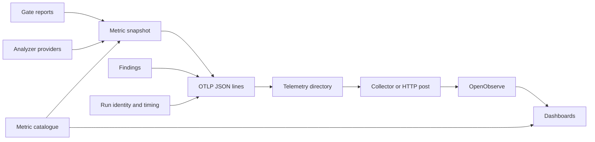

# Design Document

## Overview

Turn each gate run into OpenTelemetry signal files keyed by spec, so that specification health and code health can be read side by side in one backend. The engine reduces reports to a pure snapshot and maps it to OTLP JSON; the CLI appends the lines to a directory outside the repository; an OpenTelemetry Collector or a plain HTTP post ships them to OpenObserve; dashboards are committed as definitions. The first slice exports what `check` and `status` already know.

Owner decision, 2026-11-10: OTLP JSON files, not an in-process exporter. The prototype showed the exporter crates cost 127 dependencies including an async runtime and could block for 32 seconds on an unreachable backend. Files need neither.

### Goals
- One snapshot model shared by every view, with no second computation of any value.
- Standard OTLP JSON that existing tools ship unchanged; no network code, exporter library or agent in this project.
- Four dashboard definitions (developer, architect, code health, side by side) versioned with the catalogue they read.

### Non-Goals
Sending anything over the network from the gate, hosting or provisioning a backend or a Collector, alerting rules, a metric file inside the repository, telemetry from the WASM plugin, per-user analytics, and any measurement of code (owned by the analyzer specs).

## Boundary Commitments

### This Spec Owns
- The snapshot model, the provider contract, the metric catalogue and the spec and traceability metrics.
- The OTLP JSON mapping, resource identity, the telemetry directory, failure behaviour and the `telemetry` command.
- The Collector configuration example, dashboard definitions, their consistency test and the telemetry documentation.

### Out of Boundary
Rules, limits, measurements and findings stay with their owners; they hand over points through the provider contract. cli-contracts owns argument groups. verification-evidence owns acceptance. Nothing here changes a verdict. Shipping, retry, credentials and file removal belong to the Collector or the operator's script.

### Allowed Dependencies
Core module: existing serde and serde_json and the existing report, status and join types; no clock, network or filesystem. CLI: standard library file append and the existing Git subprocess pattern. Development only: `opentelemetry-proto` with its serde support, to decode written lines in tests. No runtime dependency is added.

### Revalidation Triggers
Metric names, units or attributes, the provider contract, resource attributes, the JSON mapping, file names, the pinned Collector or backend release or a dashboard query require the catalogue test, the decode journey and the dashboard consistency test to rerun.

## Architecture

### Existing Architecture Analysis
`kiro-core` already returns findings, term and contradiction counts, status and the file, component and task join as plain data. The CLI renders them. Telemetry is a third rendering of the same data, so it follows the renderer pattern: pure construction in core, file output in the CLI. The core has no clock; timestamps, phase durations and trace identifiers are produced in the CLI and passed in.

### Architecture Pattern & Boundary Map


Dependency direction: core reports → snapshot → JSON lines → CLI file append. Everything to the right of the telemetry directory is outside the gate process.

### Technology Stack
| Layer | Choice / Version | Role | Constraint |
|---|---|---|---|
| Core | Rust 2024; existing serde, serde_json | Snapshot, catalogue, spec metrics, OTLP JSON structures | Preserve wasm build |
| CLI | Standard library | Append lines, resource identity, timing | No new dependency |
| Shipping | OpenTelemetry Collector contrib 0.165.0, `otlp_json_file` receiver and `otlp_http` exporter; or an HTTP post of each line | Deliver files to the backend | Operated outside the gate |
| Backend | OpenObserve, image digest recorded in research.md | Reference store and dashboards | Any OTLP backend may receive the signals; only OpenObserve dashboards ship |
| Tests | opentelemetry-proto with serde | Decode what was written | Development dependency only |

## File Structure Plan

| Component | File | Responsibility |
|---|---|---|
| MetricSnapshot | `crates/kiro-core/src/telemetry/mod.rs` | Snapshot assembly and provider contract |
| MetricSnapshot | `crates/kiro-core/src/telemetry/model.rs` | Points, attributes, units and coverage |
| MetricCatalogue | `crates/kiro-core/src/telemetry/catalogue.rs` | Metric names, units, attributes and sources |
| SpecMetrics | `crates/kiro-core/src/telemetry/spec.rs` | Specification and traceability points |
| OtlpJson | `crates/kiro-core/src/telemetry/otlp.rs` | Snapshot, findings and run timing as OTLP JSON request lines |
| TelemetryCommand | `crates/kiro-cli/src/telemetry.rs` | Command, enablement, dry run and failure handling |
| TelemetryCommand | `crates/kiro-cli/src/telemetry_io.rs` | Directory check, line append, resource identity and run timing |
| Shipping | `telemetry/otelcol.yaml` | Collector example: telemetry directory to OpenObserve |
| Dashboards | `dashboards/openobserve/developer.json` | Branch and task view |
| Dashboards | `dashboards/openobserve/architect.json` | Spec and component view |
| Dashboards | `dashboards/openobserve/code-health.json` | Repository trend view |
| Dashboards | `dashboards/openobserve/spec-code.json` | Side-by-side view per spec |
| TelemetryTests | `crates/kiro-core/fixtures/telemetry/expected.json` | Expected snapshot of a fixture tree |
| TelemetryTests | `crates/kiro-cli/tests/e2e_telemetry.rs` | Real-binary export, decode, dry run and unwritable directory |
| TelemetryTests | `crates/kiro-cli/tests/dashboards.rs` | Dashboard queries against the catalogue |
| TelemetryDocs | `docs/telemetry.md` | Catalogue, setup, shipping, environment and dashboard import |

Registrations in core `lib.rs` and CLI dispatch are additive changes made serially through their existing owners.

## System Flows

Gate command runs as today → reports → snapshot from reports and registered providers → if a telemetry directory is set: resource identity, three JSON lines (metrics, logs, traces) → one append per file → a write failure goes to standard error only → the command exits with its own verdict. Separately and later: the Collector tails the directory, or a script posts each line, to the backend.

## Requirements Traceability

| Requirement | Summary | Components | Interfaces | Flows |
|---|---|---|---|---|
| 1.1 | The Telemetry Engine shall build one snapshot of metric points from the reports of a … | MetricSnapshot | MetricSnapshot contract | Metric Snapshot |
| 1.2 | The Telemetry Engine shall name every metric under the kiro. prefix from one catalogu… | MetricCatalogue, TelemetryDocs | MetricCatalogue contract | Metric Snapshot |
| 1.3 | Where the source report names a spec, a design component or a task, the Telemetry Eng… | MetricSnapshot, SpecMetrics | MetricSnapshot contract | Metric Snapshot |
| 1.4 | The Telemetry Engine shall keep routine names, file paths and message texts out of me… | MetricSnapshot, MetricCatalogue | MetricSnapshot contract | Metric Snapshot |
| 1.5 | If a source report is absent from a run, the Telemetry Engine shall omit its points a… | MetricSnapshot | MetricSnapshot contract | Metric Snapshot |
| 1.6 | The Telemetry Engine shall accept points from other specifications through one provid… | MetricSnapshot | MetricSnapshot contract | Metric Snapshot |
| 2.1 | The Telemetry Engine shall report per spec the phase, the approval state of each docu… | SpecMetrics | SpecMetrics contract | Specification and Traceability Metrics |
| 2.2 | The Telemetry Engine shall report per spec the number of findings by finding code and… | SpecMetrics | SpecMetrics contract | Specification and Traceability Metrics |
| 2.3 | The Telemetry Engine shall report per spec the declared, resolved, undeclared, ambigu… | SpecMetrics | SpecMetrics contract | Specification and Traceability Metrics |
| 2.4 | The Telemetry Engine shall report per spec the share of acceptance criteria that the … | SpecMetrics | SpecMetrics contract | Specification and Traceability Metrics |
| 2.5 | The Telemetry Engine shall report per spec the criteria referenced by no task, the ta… | SpecMetrics | SpecMetrics contract | Specification and Traceability Metrics |
| 3.1 | The kiro-cli shall offer telemetry export for an explicit export and an automatic exp… | TelemetryCommand | TelemetryCommand contract | Export |
| 3.2 | The kiro-cli shall write signals as OpenTelemetry protocol JSON, one request object p… | OtlpJson, TelemetryCommand | OtlpJson contract | Export |
| 3.3 | The kiro-cli shall open no network connection for telemetry. | TelemetryCommand | TelemetryCommand contract | Export |
| 3.4 | If a telemetry file cannot be written, the kiro-cli shall report the failure on stand… | TelemetryCommand | TelemetryCommand contract | Export |
| 3.5 | If the telemetry directory lies inside the project root, the kiro-cli shall refuse it… | TelemetryCommand | TelemetryCommand contract | Export |
| 3.6 | When telemetry export --dry-run is given, the kiro-cli shall print the snapshot to st… | TelemetryCommand | TelemetryCommand contract | Export |
| 3.7 | The kiro-cli shall attach to every signal the service name and version, the repositor… | TelemetryCommand, OtlpJson | TelemetryCommand contract | Export |
| 3.8 | The kiro-cli shall write no absolute path, user name, source text, credential or othe… | OtlpJson, TelemetryCommand | OtlpJson contract | Export |
| 4.1 | The kiro-cli shall write every metric point as a gauge data point with its attributes. | OtlpJson | OtlpJson contract | Signals |
| 4.2 | The kiro-cli shall write every finding as one log record carrying code, severity, spe… | OtlpJson | OtlpJson contract | Signals |
| 4.3 | The kiro-cli shall write one trace per gate run with one span per phase and the verdi… | OtlpJson, TelemetryCommand | OtlpJson contract | Signals |
| 4.4 | The kiro-cli shall produce byte-identical text and JSON reports for the same input wh… | TelemetryCommand, TelemetryTests | TelemetryCommand contract | Signals |
| 5.1 | The repository shall provide OpenObserve dashboard definitions for a developer view, … | Dashboards | Dashboards contract | Dashboards |
| 5.2 | The repository shall provide a test that every metric name and attribute used in a da… | Dashboards, TelemetryTests | Dashboards contract | Dashboards |
| 5.3 | While a source contributes no points, the dashboards shall show its panels as without… | Dashboards | Dashboards contract | Dashboards |
| 5.4 | The repository shall document the backend setup, the Collector and direct-post shippi… | TelemetryDocs | TelemetryDocs contract | Dashboards |
| 6.1 | The development workflow shall verify that the written files are ingested by a pinned… | TelemetryTests, Shipping | TelemetryTests contract | Prototype, Packaging and Acceptance |
| 6.2 | The workspace shall add no network, asynchronous-runtime or protocol dependency to th… | OtlpJson, TelemetryCommand | OtlpJson contract | Prototype, Packaging and Acceptance |
| 6.3 | The acceptance suite shall drive the real binary, decode every written line with the … | TelemetryTests | TelemetryTests contract | Prototype, Packaging and Acceptance |
| 6.4 | The acceptance suite shall run on Windows, Linux and macOS. | TelemetryTests | TelemetryTests contract | Prototype, Packaging and Acceptance |
| 6.5 | The first deliverable shall export the specification and traceability metrics of this… | TelemetryTests, SpecMetrics | TelemetryTests contract | Prototype, Packaging and Acceptance |
| 6.6 | The repository shall provide an OpenTelemetry Collector configuration example that re… | Shipping, TelemetryDocs | Shipping contract | Prototype, Packaging and Acceptance |

## Components and Interfaces

### MetricSnapshot
**Requirements:** 1.1, 1.3–1.6. **Dependencies:** existing report types inbound P0. **Contracts:** State, Service.
```rust
pub enum Unit { Count, Ratio, Lines, Statements, Milliseconds, Value }
pub struct Attr { pub key: &'static str, pub value: String }
pub struct MetricPoint { pub name: &'static str, pub unit: Unit, pub value: f64, pub attrs: Vec<Attr> }
pub struct SourceCoverage { pub source: &'static str, pub present: bool, pub reason: Option<String> }
pub struct MetricSnapshot { pub schema_version: u32, pub points: Vec<MetricPoint>, pub coverage: Vec<SourceCoverage> }
pub trait MetricProvider { fn source(&self) -> &'static str; fn points(&self) -> Vec<MetricPoint>; }
pub fn snapshot(providers: &[&dyn MetricProvider], expected: &[&'static str]) -> MetricSnapshot;
```
Points are sorted by name then attributes, so two snapshots of the same run are equal. A name outside the catalogue, an attribute key the catalogue does not list for that name, a nonfinite value or a duplicate point is rejected in tests and dropped with a coverage reason at run time. An expected source with no provider is listed as absent; nothing is filled with zero. Analyzer specs implement MetricProvider over their own report types; this module never imports them.

### MetricCatalogue
**Requirements:** 1.2, 1.4. **Contracts:** State.

Allowed attribute keys: `kiro.spec`, `kiro.component`, `kiro.task`, `kiro.code` (finding code), `kiro.severity`, `kiro.metric`, `kiro.language`, `kiro.phase`, `kiro.document`, `kiro.status`. All have bounded value sets. Routine names, paths and messages are not attribute keys.

| Metric | Unit | Attributes | Source |
|---|---|---|---|
| `kiro.spec.phase` | Value | spec, phase | status |
| `kiro.spec.approved` | Value | spec, document | status |
| `kiro.spec.tasks.total`, `kiro.spec.tasks.done` | Count | spec | status |
| `kiro.spec.findings` | Count | spec, code, severity | check |
| `kiro.spec.terms` | Count | spec, status | check |
| `kiro.spec.contradiction.pairs` | Count | spec, status | check |
| `kiro.spec.criteria.total`, `kiro.spec.criteria.checked` | Count | spec | check |
| `kiro.trace.criteria.untasked`, `kiro.trace.tasks.unknown_boundary`, `kiro.trace.components.unmapped`, `kiro.trace.files.multi_owned` | Count | spec | join |
| `kiro.run.duration` | Milliseconds | phase | CLI timing |
| `kiro.run.findings.dropped` | Count | none | OTLP mapping |

Reserved prefixes for later providers, defined by their owners: `kiro.code.` (code-constraints), `kiro.clone.` (clone-constraints), `kiro.locality.` (code-locality-data), `kiro.evidence.` (verification-evidence). The share of checked criteria is derived in the dashboard from total and checked, so that sums across specs stay correct.

The catalogue also states the backend names observed in the prototype, because dashboards and their test need them: OpenObserve creates one metrics stream per metric with dots replaced by underscores (`kiro_spec_findings`, value in field `value`), turns attributes into fields (`kiro_spec`), and prefixes resource attributes with `service_` in traces but not in metrics and logs.

### SpecMetrics
**Requirements:** 1.3, 2.1–2.5, 6.5. **Dependencies:** existing check report, status and join outbound P0. **Contracts:** Service.
```rust
pub struct SpecMetrics<'a> { pub reports: &'a [SpecReport], pub statuses: &'a [SpecStatus], pub coverage: &'a [JoinCoverage] }
impl MetricProvider for SpecMetrics<'_> { /* source = "spec" */ }
```
Reads existing values only: no parsing and no new check. The three type names stand for the types the core already exports. Phase and approval are encoded as value 1 with the state in an attribute, so that a dashboard counts specs by state.

### OtlpJson
**Requirements:** 3.2, 3.7, 3.8, 4.1–4.3, 6.2. **Dependencies:** snapshot inbound P0; serde_json outbound P0. **Contracts:** Service.
```rust
pub struct ResourceIdentity { pub attributes: Vec<(String, String)> }
pub struct RunIdentity { pub trace_id: [u8; 16], pub root_span_id: [u8; 8], pub start_unix_nanos: u64, pub phases: Vec<(&'static str, u64, u64)>, pub verdict: String }
pub struct OtlpLines { pub metrics: String, pub logs: String, pub traces: String, pub dropped_records: usize }
pub fn otlp_lines(snapshot: &MetricSnapshot, findings: &[Finding], resource: &ResourceIdentity, run: &RunIdentity, max_records: usize) -> OtlpLines;
```
Each string is one line: an `ExportMetricsServiceRequest`, `ExportLogsServiceRequest` or `ExportTraceServiceRequest` in the OTLP JSON encoding (lower camel case keys, 64-bit integers and timestamps as decimal strings, trace and span identifiers as lowercase hex, `intValue` as a string). Gauges: one metric per name with one data point per MetricPoint. Log records: one per finding, body is the message, attributes are code, severity, spec, project-relative file, line, hint, component and tasks; default maximum 2000 per run, errors first, with the dropped count as `kiro.run.findings.dropped`. Trace: root span `kiro.gate` with verdict and counts, one child span per phase. Span identifiers of the phases are derived from the root identifier and the phase index. The function is pure; a line contains no newline and ends without one.

This is serialization of a published schema with serde structures, not a protocol implementation. Conformance is checked in tests by decoding every line with the official protocol definitions.

### TelemetryCommand
**Requirements:** 3.1, 3.3–3.7, 4.3, 4.4, 6.2. **Dependencies:** CliGroups outbound P0; OtlpJson outbound P0. **Contracts:** Batch.

`telemetry export [--all | --feature <name>] [--telemetry-dir <dir>] [--dry-run]` composes the global and report groups. `--telemetry-dir` and `KIRO_TELEMETRY_DIR` enable the automatic export on `check` now and on later gate commands through their profiles. The directory is canonicalized and must lie outside the project root; inside is a usage error with exit 2 before the gate runs. It is created when missing. Each of the three files receives exactly one `write` of one complete line with a trailing newline, on a handle opened for append, so that concurrent runs do not interleave within a line on the supported platforms; the journey tests this with parallel runs. The export happens after the report is written and the exit code is decided. A write failure prints one line on standard error and changes nothing else.

Resource identity: `service.name` (default `kiro-cli`, `OTEL_SERVICE_NAME` overrides), `service.version`, `vcs.repository.url.full` with credentials stripped, `vcs.ref.head.name`, `vcs.ref.head.revision`, `kiro.run.kind`, then the pairs of `OTEL_RESOURCE_ATTRIBUTES` as the operator's own statement. Git values come from a read-only subprocess with separate arguments and are omitted when Git is absent. `KIRO_RUN_KIND` accepts `hook`, `agent`, `ci`, `manual`; other values are a usage error; the default is `manual`. No other environment value is read. Trace identifiers are derived in the CLI from the start time, the process identifier and the revision with the existing hash; no random-number dependency is added. Phase timing wraps the existing discover, parse, check and render calls with a monotonic clock.

The gate never removes or rotates the files. The shipper does.

### Shipping
**Requirements:** 6.1, 6.6. **Contracts:** State.

`telemetry/otelcol.yaml` is an example for the Collector contrib distribution: an `otlp_json_file` receiver including `*.jsonl` of the telemetry directory, starting at the beginning, used by a metrics, a logs and a traces pipeline, each exporting through `otlp_http` to `<backend>/api/<organisation>` with the authorization header taken from the Collector's environment. The documentation also shows the alternative verified in the prototype: an HTTP post of each line with content type `application/json` to `/v1/metrics`, `/v1/logs` and `/v1/traces` under the same base address. Both were accepted by OpenObserve.

### Dashboards
**Requirements:** 5.1–5.3. **Dependencies:** MetricCatalogue outbound P0. **Contracts:** State.

| View | Reader's question | Panels |
|---|---|---|
| Developer | What did my branch or task change? | Open findings by code for the selected branch and task; latest run verdict; runs until pass; run and phase duration |
| Architect | Which spec or component is drifting? | Specs by phase and approval; task completion; untasked criteria, unknown boundaries, unmapped components and multi-owned files per spec; term and contradiction counts over time |
| Code health | Is the repository getting better or worse? | Reserved `kiro.code.`, `kiro.clone.` and `kiro.locality.` panels: debt and regressions per week, duplication, net growth, measurement coverage |
| Side by side | Where do weak specs and weak code coincide? | One row per spec: checked-criteria share, findings and traceability gaps on the left; code debt and regressions on the right |

Trend panels filter run kind `ci` and the default branch, using the per-signal field names above. Panels of a source that sends nothing use the backend's no-data state; no query coalesces a missing value to zero. Definitions are exported from OpenObserve and committed; the stream and field names in their queries are the test's input.

### TelemetryTests and TelemetryDocs
**Requirements:** 1.2, 4.4, 5.2, 5.4, 6.1, 6.3–6.5. **Contracts:** Batch.

The journey runs the built binary with a temporary telemetry directory, reads the three files and decodes every line with `opentelemetry-proto`. It repeats with a directory that cannot be written and with a directory inside the project. The documentation lists the catalogue, generated from the same table the catalogue test reads.

## Data Models
The snapshot is transient and versioned. The telemetry directory holds three append-only files of OTLP JSON lines and is never inside the repository. Dashboard definitions are committed JSON in the backend's export format.

## Error Handling
Write failure or a rejected point: one line on standard error, exit code unchanged. Invalid `KIRO_RUN_KIND`, or a telemetry directory inside the project root: usage error, exit 2, before the gate runs. Delivery failure is the shipper's concern and is not visible to the gate.

## Testing Strategy
- Group 1: snapshot equality on a fixture tree; absent source listed and not zero; rejected name, attribute and nonfinite value; provider added without a change to the mapping; catalogue equals documentation.
- Group 2: each spec metric against the fixture's known counts.
- Groups 3 and 4: every written line decodes with the official definitions into the expected gauges, records and spans; record cap and dropped count; no absolute path, user name or environment value in any line; directory inside the project refused; unwritable directory keeps the exit code; reports byte-identical with telemetry on and off; dry run writes nothing; parallel runs produce only whole lines.
- Group 5: every stream, metric and field in each dashboard query exists in the catalogue; no query coalesces to zero.
- Group 6: the prototype record; unchanged runtime dependency graph and wasm build; the Collector example loads in the pinned Collector; the journey on Windows, Linux and macOS.

## Deliverables and Development Gates
1. T0: files ingested by the pinned OpenObserve through the pinned Collector and through a direct post; names recorded. Done on 2026-11-10 with hand-written lines; the decoder check of task 1.2 completes it.
2. T1: snapshot, catalogue and spec metrics with `--dry-run`.
3. T2: this repository's spec and traceability metrics written by `check` and decoded by the journey.
4. T3: Collector example, four dashboard definitions, consistency test, documentation and the three-platform run.
Analyzer metrics arrive with their own specs through MetricProvider and need no change here beyond catalogue entries they own.

## Integration & Migration Notes
Replaces the metric log file first proposed for code-constraints Requirement 13; that requirement now hands metric points to this contract. The ASCII hook summary stays in code-constraints. The difference from the rejected log is the format and the place: standard OTLP JSON that a Collector consumes, in a directory outside the repository. lesscode receipts can be sent to the same backend later by lesscode; this spec reserves no names for them.
