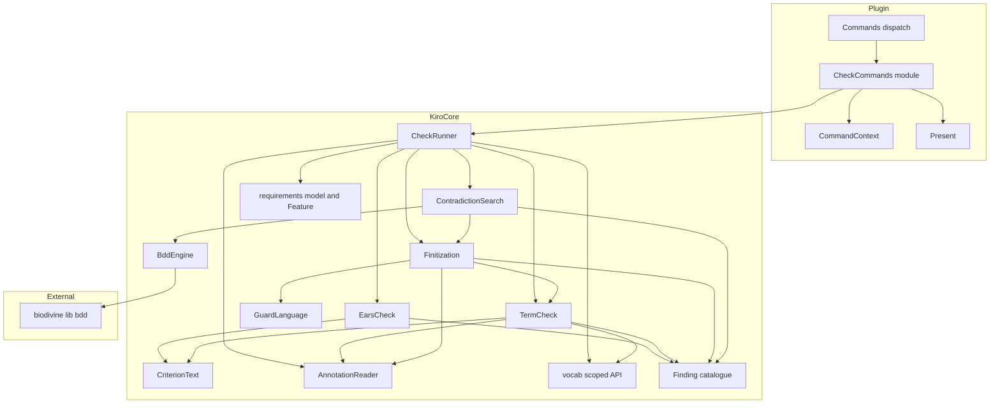
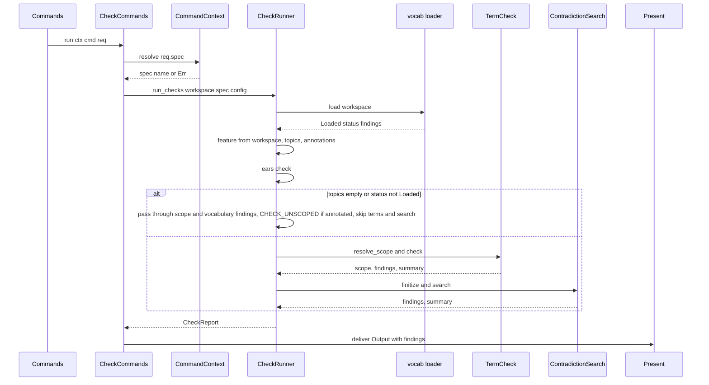
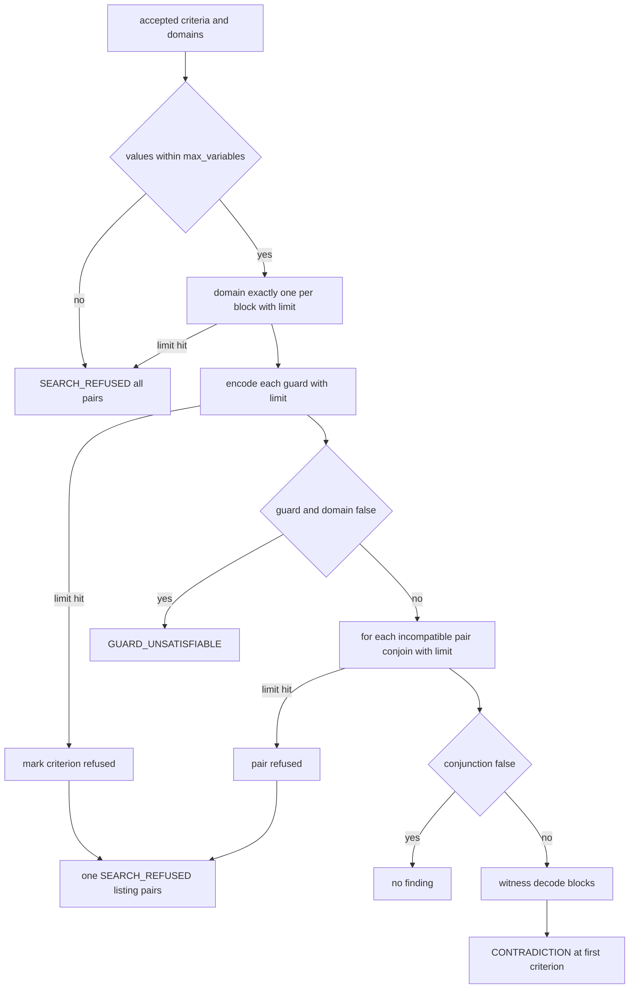

# Design Document: spec-constraints

## Overview

**Purpose**: spec-constraints adds the constraint checks that are the point of this project to the v2 engine and the IDE: an EARS shape check over every acceptance criterion, a declared-before-use term check that resolves `_Terms:_` only inside the spec's declared topics, a small refusable guard language (`_Guard:_`, `_Effect:_`, `_Conflicts:_`), and a bounded, deterministic contradiction search with witness states built on `biodivine-lib-bdd`, which the build experiment of research.md shows compiles for `wasm32-wasip2` with no host import delta. The checks are pure functions over kiro-core's feature model and vocabulary-grounding's loaded vocabulary; one `CheckReport` serves the plugin's `check.*` commands and cli-gate alike.

**Users**: spec authors and reviewers in OpenIDEA (`check.spec`, `check.ears`, `check.terms`, `check.contradictions`); cli-gate (calls `run_checks` over every feature and maps severities to exit codes); maintainers of the annotation conventions (`docs/checks.md`); later specs for intentions/precedence and envelope comparison (consume the guard model).

**Impact**: Adds `crates/kiro-core/src/checks/` and the `biodivine-lib-bdd` and `winnow` dependencies to kiro-core, appends 20 finding codes to its catalogue (19 + CHECK_COVERAGE, amendment 2026-11-04), adds `plugins/kiro/src/check.rs` and one module-table line to the plugin, adds fixtures, tests and `docs/checks.md`. No upstream interface changes shape; kiro-core's requirements parser is not touched because it already records annotations generically.

### Goals
- Findings with stable codes at `file:line`, identical in the IDE and in CI, with the v1 false positives fixed by construction and covered by regression fixtures.
- Term resolution that cannot leave the declared topics: every lookup goes through `Vocabulary::resolve(query, topics)`; `NotInTopic` is `TERM_TOPIC_MISMATCH`, never a match.
- A contradiction search that answers exactly (BDD), explains itself (witness), and refuses by sizes rather than hanging.
- Opt-in conventions: a document without annotations produces no term or contradiction failure.
- Four plugin commands that are useful with no argument and degrade with explanations.

### Non-Goals
- Vocabulary loading or resolution rules (vocabulary-grounding); annotation capture (kiro-core); CLI reporting, exit codes, tree walking (cli-gate).
- Cross-spec contradiction merge, intentions/precedence, envelope comparison, production-code separation, test traceability (later waves).
- Editing or auto-fixing spec files; applying the template change to the cc-sdd templates or skills; any host change.

## Boundary Commitments

### This Spec Owns
- `kiro_core::checks`: `CheckConfig`, `CheckReport`, `check_feature`, `run_checks`; the masking and whole-word scanning of criterion text; the EARS analysis and pattern classification; the guard/effect grammar, its parser and typed form; the reading of `_Terms:_`, `_Guard:_`, `_Effect:_`, `_Conflicts:_` values; term-scope resolution and suggestions; finitisation (one-hot domains, integer regions); the BDD encoding with caps; pair selection, witness and refusal.
- The 20 finding codes of this spec (19 + CHECK_COVERAGE, amendment 2026-11-04; Supporting References), their default severities and messages, and the severity-override mechanism.
- The `check` plugin module: four commands, their outputs, titles and degradation texts.
- `docs/checks.md` (conventions, grammar, codes, template proposal) and the fixtures under `crates/kiro-core/fixtures/checks/`.
- The decision that `biodivine-lib-bdd` (confined to `checks/bdd.rs`) and `winnow` (confined to `checks/guard.rs`) are runtime dependencies of kiro-core.

### Out of Boundary
- The `Annotation` capture rule, `Criterion`/`Requirement` shapes, `Finding`, `Workspace` (kiro-core, consumed unchanged; only `CODES`/`codes`, `lib.rs` docs and `Cargo.toml` grow).
- `Lookup`, `Kind`, `Loaded`, `spec_topics`, `scope_findings` (vocabulary-grounding, consumed unchanged); vocabulary findings themselves (passed through, never re-levelled).
- Dispatch, resolution, argument grammar, presentation budgets (plugin-core, consumed unchanged; only the module table, manifest and README grow).
- Reporting formats, exit codes and `--fail-on` (cli-gate uses `CheckReport.findings` and `Severity`).

### Allowed Dependencies
- kiro-core `checks` imports from `finding`, `requirements` (`RequirementsDoc`, `Requirement`, `Criterion`, `Annotation`), `spec` (`SpecMeta`, `Doc`), `source` (`Source`, `Workspace`, `Feature`), `vocab` (`Loaded`, `Status`, `Vocabulary`, `Lookup`, `Kind`, `Term`, `spec_topics`, `scope_findings`, `normalize_label`) and `std::collections`; never from `resolve`, `render`, `join` or `md`. Dependency direction becomes `finding` → `md` → parsers → `join` → `source` → `vocab` → `checks`; `resolve` and `render` stay where they are.
- New runtime dependencies of kiro-core: `biodivine-lib-bdd = "0.6"` (default features, which are empty), used only in `checks/bdd.rs`, and `winnow` (adopted 2026-11-04 per tech.md; already transitive via `toml` → `toml_edit`), used only for the guard/effect lexer and parser in the `checks` guard language — combinator parsing gives positioned, panic-free errors; cap the nesting depth explicitly for the wasm stack.
- Plugin `check.rs` imports `kiro_core::{checks, vocab::Status, finding}` (findings are rendered through plugin-core's `Output::with_findings`, so `render::text` is not imported) and plugin-core's `host`, `registry`, `args`, `present`, `context`, `module`; it sits where `vocab.rs` sits (left of `commands`).
- Nothing else: no `std::fs`, no regex, no clock.

### Revalidation Triggers
- Any change to `CheckConfig`, `CheckReport`, `CheckStatus`, the summaries, or the signatures of `check_feature` / `run_checks` (cli-gate, plugin `check` module).
- Renaming or re-levelling a finding code of this spec, or changing a message's leading phrase (cli-gate JSON consumers, fixtures' expected-findings comments, README).
- Any change to the guard grammar, the term-reference rule (4.2), the incompatibility rule (4.10), the integer region rule or the variable order (documentation, fixtures, later specs building on guards).
- This spec fires upstream revalidation triggers and amends the corresponding upstream lines as explicit integration touches of its tasks: kiro-core design "Allowed Dependencies" gains `biodivine-lib-bdd` (checks only) — the trigger "adding a required runtime dependency"; plugin-core design "Allowed Dependencies" gains `kiro_core::checks` for the `check` module, and the worked example in plugin-core's design is corrected to the full figures (25 + 17·n); steering `tech.md`'s conditional sentence about `biodivine-lib-bdd` is replaced by the decision (already applied: `tech.md` records the decision). Each touch is one line; no upstream contract changes.
- Upstream: any change to kiro-core's `Annotation` rule (placement under criteria), `Criterion.text` joining, `Finding`, `Workspace::read`; vocabulary-grounding's `Lookup`, `Kind`, `Loaded`, `scope_findings`; plugin-core's `FeatureModule`, `CommandSpec`, `Request`, `Output`, `CommandContext`.

## Architecture

### Existing Architecture Analysis
- kiro-core: `Requirement { annotations, criteria }` and `Criterion { text, line, annotations }` already carry `_Key: value_` lines (requirement-level unless indented under a criterion; a blank line closes a criterion). `Finding::new` takes severity from `CODES`; `Finding::severity` overrides it; `sort_findings` is the shared order; a doc test ties `lib.rs` to the catalogue.
- vocabulary-grounding: `vocab::load(&mut ws) -> Loaded`; `Vocabulary::resolve(q, topics)`; `visible(topics)`; `Kind` with enum values and int bounds; `spec_topics` and `scope_findings` produce the `spec.json` findings; the plugin's `vocab.rs` is the reference for per-call scoping and degradation.
- plugin-core: `FeatureModule`, `CommandSpec { positional: Positional::Spec }` for `check.spec [feature]`, `Output::with_findings`, `deliver` with insert, `ctx.resolve` errors passed through.

### Architecture Pattern & Boundary Map



**Architecture Integration**:
- Selected pattern: pure check functions behind one runner (`check_feature`) with a loader façade (`run_checks`); chosen because both frontends must produce identical reports and tests must run from constructed documents (research.md, pattern evaluation).
- Domain boundaries: `text` knows masking and words; `ears` knows EARS; `guard` knows the grammar and nothing about terms; `annotations` knows the four keys and nothing about meaning; `terms` is the only module that calls `resolve`; `finitize` is the only module that knows kinds and regions; `bdd` is the only module that imports the library; `contradiction` knows pairs, witnesses and refusals; `mod` knows configuration, skipping and pass-through.
- Existing patterns preserved: plain owned data + findings, no `Result` in the public report API, `BTreeMap` ordering, the lint table, a `FeatureModule` with a static `COMMANDS` like `vocab.rs`, copy-then-load for the workspace borrow.
- New components rationale: `CriterionText` is shared by EARS and suggestions; `Finitization` is separate from `BddEngine` so typing and regions are testable without the library and so a brute-force evaluator (`Typed::eval`) can cross-check the BDD on small models (v1's two-implementations discipline).
- Steering compliance: no fs/net/threads/clock; deterministic ordering; finding codes `SCREAMING_SNAKE`; command ids `check.<name>`; no cross-topic resolution path exists (the only term lookups are `resolve(name, topics)` in `terms.rs`).

### Technology Stack

| Layer | Choice / Version | Role in Feature | Notes |
|-------|------------------|-----------------|-------|
| Engine | Rust 2024, kiro-core lints | `checks` module | `#![forbid(unsafe_code)]`, no `unwrap`/indexing; `debug_assert!` only for invariants covered by tests |
| Decision diagrams | `biodivine-lib-bdd = "0.6"` (MIT, `rust-version` 1.88, default features) | ROBDD with `binary_op_with_limit`, `sat_witness`, `BddVariableSetBuilder` | Builds for `wasm32-wasip2`; no host import delta (research.md); only `checks/bdd.rs` imports it |
| Guard parser | `winnow = "0.7"` | Combinator lexer/parser for `_Guard:_` and `_Effect:_` with `MAX_GUARD_DEPTH` nesting cap | Already transitive via `toml` → `toml_edit`; only `checks/guard.rs` imports it |
| Plugin | `openidea-plugin-kiro`, plugin-core seams | `check.rs` feature module | No new plugin dependency |
| Docs/Data | Markdown, cc-sdd fixtures | `docs/checks.md`, `fixtures/checks/` | Fixture trees mirror vocabulary-grounding's `tree/` layout |

## File Structure Plan

### Directory Structure
```
docs/
└── checks.md                                # Annotation conventions, guard grammar, codes, template proposal
crates/kiro-core/
├── Cargo.toml                               # + biodivine-lib-bdd, winnow
├── src/
│   ├── lib.rs                               # + pub mod checks; + check codes in the doc table; + annotation grammar subsection
│   ├── finding.rs                           # + 20 check codes (incl. CHECK_COVERAGE) in CODES and codes
│   └── checks/
│       ├── mod.rs                           # CheckConfig, CheckKind, CheckStatus, summaries, CheckReport, check_feature, run_checks, overrides, pass-through
│       ├── text.rs                          # mask_literals, words, whole-word and phrase search, hyphen adjacency
│       ├── ears.rs                          # Pattern, Analysis, analyze, EARS findings and summary
│       ├── annotations.rs                   # The four keys, list splitting, Annotated view over a RequirementsDoc
│       ├── guard.rs                         # Op, Literal, Expr, ParseError, parse_guard, parse_effect
│       ├── terms.rs                         # DeclaredTerm, TermScope, resolve_scope, term findings, suggestions, CHECK_UNSCOPED
│       ├── finitize.rs                      # Value, Domain, Atom, Typed, Prepared, finitize (typing, regions, conflicts)
│       ├── bdd.rs                           # Encoding over biodivine with caps, Refusal, witness decoding
│       └── contradiction.rs                 # Pair, Reason, pairs, search, SEARCH_REFUSED
├── fixtures/checks/
│   ├── good/.kiro/                          # vocabulary (topic ops), roadmap, spec clean (topics ops): zero warnings/errors, only CHECK_COVERAGE info
│   ├── bad/.kiro/                           # vocabulary (ops, pm, hr, wide), specs broken, wide, none
│   └── ears/regressions.md                  # v1 false positives (no finding) and one true positive per EARS code
└── tests/
    └── checks.rs                            # Fixture-driven, self-corpus, determinism, cross-check, no-panic, perf
plugins/kiro/
├── plugin.toml                              # + check.spec, check.spec.insert, check.ears, check.terms, check.contradictions
├── README.md                                # + check commands, degradation, component size before/after
├── src/
│   ├── lib.rs                               # + pub mod check
│   ├── commands.rs                          # modules(): + Box::new(check::Check)
│   └── check.rs                             # Check module: COMMANDS, spec, ears, terms, contradictions, text helpers
└── tests/
    └── check.rs                             # End-to-end over FakeHost with fixtures/checks trees
```

### Files by Component

| Component | File | Responsibility |
|-----------|------|----------------|
| CheckRunner | `crates/kiro-core/src/checks/mod.rs` | Configuration with defaults, report shape, orchestration, skip reasons, pass-through of scope/vocabulary findings, severity overrides, sorting, re-exports |
| CriterionText | `crates/kiro-core/src/checks/text.rs` | `mask_literals`, `words`, `find_word_ci`, `hyphen_adjacent`, `contains_phrase` |
| EarsCheck | `crates/kiro-core/src/checks/ears.rs` | `Pattern`, `Keyword`, `Analysis`, `analyze`, `check` → EARS findings and `EarsSummary` |
| AnnotationReader | `crates/kiro-core/src/checks/annotations.rs` | Key constants, `split_list`, `Annotated`, `AnnotatedRequirement`, `AnnotatedCriterion`, `collect` |
| GuardLanguage | `crates/kiro-core/src/checks/guard.rs` | Lexer, parser, `Expr`, `Assignment`, `ParseError`, `parse_guard`, `parse_effect` |
| TermCheck | `crates/kiro-core/src/checks/terms.rs` | `Resolved`, `DeclaredTerm`, `TermScope`, `resolve_scope`, `check` (TERM_* findings, suggestions, `TermsSummary`), `unscoped_finding` |
| Finitization | `crates/kiro-core/src/checks/finitize.rs` | `Value`, `Domain`, `Atom`, `Typed`, `TypedEffect`, `Prepared`, `Finitized`, `finitize`, `regions`, `Typed::eval` |
| BddEngine | `crates/kiro-core/src/checks/bdd.rs` | `Encoding`, `Refusal`, `new`, `encode`, `conjoin`, `satisfiable`, `witness`, `largest_blocks` |
| ContradictionSearch | `crates/kiro-core/src/checks/contradiction.rs` | `Pair`, `Reason`, `pairs`, `search` → CONTRADICTION / GUARD_UNSATISFIABLE / SEARCH_REFUSED, `SearchSummary` |
| CoreIntegration | `crates/kiro-core/src/finding.rs` | Append the 20 codes to `CODES` and `codes` |
| CoreIntegration | `crates/kiro-core/src/lib.rs` | `pub mod checks;`, code rows in the crate docs, "requirements.md annotations" grammar subsection |
| CoreIntegration | `crates/kiro-core/Cargo.toml` | `biodivine-lib-bdd` and `winnow` dependencies |
| CheckFixtures | `crates/kiro-core/fixtures/checks/good/.kiro/vocabulary.toml` | Topic `ops`: `mode` (enum `normal`, `safe`, `maintenance`), `depth` (int, `min = 0`, no `max`), `armed` (bool), `operator` (entity, alt label `on-call engineer`), `legacy-mode` (deprecated, replaced by `mode`) |
| CheckFixtures | `crates/kiro-core/fixtures/checks/good/.kiro/steering/roadmap.md` | Roadmap listing `clean` |
| CheckFixtures | `crates/kiro-core/fixtures/checks/good/.kiro/specs/clean/spec.json` | `topics: ["ops"]`, phase `requirements-generated` |
| CheckFixtures | `crates/kiro-core/fixtures/checks/good/.kiro/specs/clean/requirements.md` | Three requirements with every EARS pattern, `_Terms:_` on requirements and one criterion, guards, effects and one declared conflict whose guards are disjoint; declares every term whose label occurs → zero warnings/errors and only the single `CHECK_COVERAGE` info finding under the default configuration |
| CheckFixtures | `crates/kiro-core/fixtures/checks/bad/.kiro/vocabulary.toml` | Topics `ops` (as above plus `level` labelled "Level"), `pm` (`pm-level` labelled "Level", `sprint`), `hr` (`shift`), `wide` (65 enum terms `w01`…`w65` with 8 values each) |
| CheckFixtures | `crates/kiro-core/fixtures/checks/bad/.kiro/steering/roadmap.md` | Roadmap listing `broken`, `wide`, `none` |
| CheckFixtures | `crates/kiro-core/fixtures/checks/bad/.kiro/specs/broken/spec.json` | `topics: ["ops", "pm"]` |
| CheckFixtures | `crates/kiro-core/fixtures/checks/bad/.kiro/specs/broken/requirements.md` | Every code of this spec at least once except `SEARCH_REFUSED`: no shall, two shalls, modals, missing trigger comma, empty subject/response, `shift` (hr → mismatch), `ghost` (unknown), `Level` (ambiguous), `legacy-mode` (deprecated), an undeclared mentioned label, an unparsable guard, a term-vs-term comparison, an undeclared guard term, entity/enum/int/bool kind mismatches, an unknown conflict id, an unsatisfiable guard, a requirement-level `_Guard:_`, and two contradicting pairs (declared and effect-derived) with known witnesses |
| CheckFixtures | `crates/kiro-core/fixtures/checks/bad/.kiro/specs/wide/{spec.json,requirements.md}` | `topics: ["wide"]`; two criteria guarded over all 65 terms with a declared conflict → 520 encoded values > 512 → `SEARCH_REFUSED`, no `CONTRADICTION` |
| CheckFixtures | `crates/kiro-core/fixtures/checks/bad/.kiro/specs/none/{spec.json,requirements.md}` | No topics; annotations present → `TOPICS_UNDECLARED` + `CHECK_UNSCOPED`, checks skipped |
| CheckFixtures | `crates/kiro-core/fixtures/checks/ears/regressions.md` | Requirements document whose header comment lists expected codes per criterion: quoted modal, hyphenated `must-gather`, possessive `tree's`, parenthetical comma in the response, both `If` forms (no finding); and one criterion per EARS code |
| CoreCheckTests | `crates/kiro-core/tests/checks.rs` | Fixture-driven assertions, self-corpus guarantee, determinism, BDD vs brute-force cross-check, no-panic, release-only timing |
| ChecksDocs | `docs/checks.md` | Conventions, placement rule, grammar, kinds and literals, regions, incompatibility, caps and refusal levers, finding table, worked example, template proposal |
| CheckCommands | `plugins/kiro/src/check.rs` | `Check` module, `COMMANDS`, `run_report`, the four command functions, `summary_lines`, `title`, `vocab_pointer` |
| PluginIntegration | `plugins/kiro/src/commands.rs` | `modules()` gains `Box::new(check::Check)` |
| PluginIntegration | `plugins/kiro/src/lib.rs` | `pub mod check;` and crate docs |
| PluginIntegration | `plugins/kiro/plugin.toml` | Five `[[contributes.commands]]` entries |
| PluginIntegration | `plugins/kiro/README.md` | Command table rows, degradation, component size before/after |
| PluginCheckTests | `plugins/kiro/tests/check.rs` | End-to-end scenarios of Requirement 8.7 over `FakeHost` |

### Modified Files
- `crates/kiro-core/Cargo.toml` — add `biodivine-lib-bdd = "0.6"` and `winnow = "0.7"`.
- `crates/kiro-core/src/finding.rs` — append 20 codes (table in Supporting References).
- `crates/kiro-core/src/lib.rs` — declare `checks`, extend the documented code table and grammar overview.
- `plugins/kiro/src/commands.rs`, `plugins/kiro/src/lib.rs`, `plugins/kiro/plugin.toml`, `plugins/kiro/README.md` — register the module and its commands.
- `.kiro/specs/kiro-core/design.md` (Allowed Dependencies: `biodivine-lib-bdd`, checks only), `.kiro/specs/plugin-core/design.md` (Allowed Dependencies: `kiro_core::checks`; budget worked example corrected to the full figures, 25 + 17·n), `.kiro/steering/tech.md` (the conditional `biodivine-lib-bdd` sentence becomes the decision — already applied, `tech.md` records the decision) — one line each, as the integration touches named under Revalidation Triggers; no contract changes.

## System Flows

### Running `check.spec`



Flow decisions: `run_checks` loads the vocabulary before borrowing the feature so the `&mut Workspace` borrow ends first; EARS runs regardless of vocabulary state; the term scope is computed whenever either the term or the contradiction check is enabled (the search needs resolved kinds), but `TERM_*` findings are emitted only when the term check is enabled; severity overrides apply last, only to codes of this spec; the report is sorted once.

### Deciding one pair



## Requirements Traceability

| Requirement | Summary | Components | Interfaces | Flows |
|-------------|---------|------------|------------|-------|
| 1.1, 1.2 | Pure entry point and workspace form | CheckRunner | `check_feature`, `run_checks`, `CheckReport` | Running `check.spec` |
| 1.3 | Configuration with defaults | CheckRunner | `CheckConfig`, `Default` | — |
| 1.4 | Finding carriage and order | CheckRunner, all check components | `Finding` feature/file/line, `sort_findings` | — |
| 1.5 | No requirements document → skipped | CheckRunner | `CheckStatus::Skipped` | Running `check.spec` |
| 1.6 | No annotations → no failures; pass-through | CheckRunner, AnnotationReader, CoreCheckTests (self-corpus) | `Annotated.any`, pass-through rule | Running `check.spec` |
| 1.7 | Disabled check skipped | CheckRunner | `CheckConfig` flags | — |
| 1.8 | CHECK_COVERAGE info finding with counts | CheckRunner, CoreCheckTests | `CHECK_COVERAGE`, coverage counts in the report | Running `check.spec` |
| 2.1 | Every criterion, joined text | EarsCheck | `check` over `RequirementsDoc::criteria` | — |
| 2.2 | Masking rules | CriterionText | `mask_literals` | — |
| 2.3, 2.4, 2.5 | No shall, multi shall, modal | EarsCheck, CriterionText | `find_word_ci`, `hyphen_adjacent` | — |
| 2.6, 2.7 | Trigger comma, both `If` forms | EarsCheck | `Analysis.trigger_comma`, `then_form` | — |
| 2.8 | Unparsed subject/response | EarsCheck | `Analysis.subject/response` | — |
| 2.9 | Pattern classification and info | EarsCheck | `Pattern`, `EarsSummary` | — |
| 2.10 | v1 false positives fixed | CriterionText, EarsCheck, CheckFixtures (regressions) | — | — |
| 3.1 | `_Terms:_` reading | AnnotationReader | `collect`, `split_list` | — |
| 3.2 | Scoped resolution only | TermCheck | `resolve_scope` → `Vocabulary::resolve(name, topics)` | — |
| 3.3, 3.4, 3.5, 3.6 | Found/deprecated, mismatch, unknown, ambiguous | TermCheck | `Resolved`, `check` | — |
| 3.7 | Suggestions | TermCheck, CriterionText | `contains_phrase`, `visible` | — |
| 3.8, 3.9 | Unscoped behaviour, pass-through, CHECK_UNSCOPED, TOPIC_UNKNOWN | CheckRunner, TermCheck | `unscoped_finding`, `scope_findings` | Running `check.spec` |
| 4.1 | Guard grammar | GuardLanguage | `parse_guard`, `Expr` | — |
| 4.2 | Term-reference rule | TermCheck | `TermScope::reference` | — |
| 4.3 | Unconditional criteria | Finitization | `Typed::True` | — |
| 4.4, 4.5, 4.6, 4.7 | Unparsed, undeclared, kind mismatch, unresolved exclusion | Finitization, GuardLanguage | `finitize`, `ParseError` | — |
| 4.8 | `_Effect:_` | GuardLanguage, Finitization | `parse_effect`, `TypedEffect` | — |
| 4.9 | `_Conflicts:_` and unknown ids | AnnotationReader, Finitization | `ConflictList`, `CONFLICT_REF_UNKNOWN` | — |
| 4.10 | Incompatibility rule | ContradictionSearch | `pairs`, `Reason` | Deciding one pair |
| 5.1, 5.2 | Pair selection, exact decision over domains | ContradictionSearch, Finitization, BddEngine | `pairs`, `Domain`, `regions`, `Encoding::conjoin` | Deciding one pair |
| 5.3, 5.4 | CONTRADICTION with witness; no finding when disjoint | ContradictionSearch, BddEngine | `witness`, `Value::display` | Deciding one pair |
| 5.5 | GUARD_UNSATISFIABLE | ContradictionSearch | `satisfiable` | Deciding one pair |
| 5.6 | Fixed order, no reordering, determinism | BddEngine, Finitization | `Domain` order (topic, id), `Encoding::new` | — |
| 5.7, 5.8 | Caps in sizes, refusal | BddEngine, ContradictionSearch | `Refusal`, `binary_op_with_limit`, `SEARCH_REFUSED` | Deciding one pair |
| 6.1, 6.8 | Four commands, insert, registration | CheckCommands, PluginIntegration | `COMMANDS`, `plugin.toml` | — |
| 6.2, 6.3, 6.4, 6.5, 6.6 | Command outputs | CheckCommands | `spec`, `ears`, `terms`, `contradictions`, `summary_lines`, `title` | Running `check.spec` |
| 6.7 | Degradation with pointer | CheckCommands, CheckRunner | `vocab_pointer`, skip reasons | Running `check.spec` |
| 6.9 | Unresolved spec error, one read, no writes | CheckCommands | `ctx.resolve`, `Workspace` cache | — |
| 7.1–7.4 | Documentation (incl. same-topic blind spot and CHECK_COVERAGE) | ChecksDocs | — | — |
| 8.1, 8.2 | Totality, both targets, determinism | all engine components, CoreCheckTests | lint table, wasm build | — |
| 8.3 | Catalogue completeness | CoreIntegration | `CODES`, `codes`, `lib.rs` table | — |
| 8.4 | Performance | EarsCheck, TermCheck, BddEngine, CoreCheckTests | release-only timing tests | — |
| 8.5 | Fixtures | CheckFixtures | — | — |
| 8.6 | Core tests | CoreCheckTests | `tests/checks.rs` | — |
| 8.7 | Plugin tests | PluginCheckTests, PluginIntegration | `tests/check.rs`, `tests/manifest.rs` | — |

## Components and Interfaces

| Component | Domain/Layer | Intent | Req Coverage | Key Dependencies (P0/P1) | Contracts |
|-----------|--------------|--------|--------------|--------------------------|-----------|
| CheckRunner | Engine / orchestration | Config, report, skipping, pass-through, overrides | 1.1–1.8, 3.8, 3.9, 6.7 | Feature (P0), Loaded (P0), all checks (P0) | Service |
| CriterionText | Engine / text | Masking and whole-word scanning without regex | 2.2, 2.10, 3.7 | none | Service |
| EarsCheck | Engine / check | EARS analysis, findings, pattern summary | 2.1–2.10 | CriterionText (P0), Finding (P0) | Service |
| AnnotationReader | Engine / annotations | The four keys as a view over the document | 1.6, 3.1, 4.9 | requirements model (P0) | Service |
| GuardLanguage | Engine / language | Guard/effect lexer and parser over `winnow` (adopted 2026-11-04), AST with positions, nesting-depth cap for the wasm stack | 4.1, 4.4, 4.8 | winnow (P0) | Service |
| TermCheck | Engine / check | Scoped resolution of declared terms, references, suggestions, the unscoped finding | 3.2–3.8, 4.2 | vocab (P0), AnnotationReader (P0), CriterionText (P1) | Service |
| Finitization | Engine / model | Typed guards, domains, integer regions, conflicts | 4.3–4.10, 5.2, 5.6 | GuardLanguage (P0), TermCheck (P0), Finding (P0) | Service |
| BddEngine | Engine / decision | Encoding with caps, witness | 5.2, 5.6, 5.7, 5.8 | biodivine-lib-bdd (P0), Finitization (P0) | Service |
| ContradictionSearch | Engine / check | Pairs, verdicts, refusal findings | 4.10, 5.1, 5.3–5.5, 5.7 | Finitization (P0), BddEngine (P0) | Service |
| CoreIntegration | Engine / build | Catalogue, module declaration, dependency | 8.3, 8.1 | Finding (P0) | State |
| CheckFixtures | Test data | Trees and documents with expected findings | 8.5, 2.10 | none | — |
| CoreCheckTests | Tests | Fixture-driven, self-corpus, cross-check, perf | 1.6, 8.1, 8.2, 8.4, 8.6 | all engine components | — |
| ChecksDocs | Docs | Conventions, grammar, codes, template proposal | 7.1–7.4 | none | — |
| CheckCommands | Plugin / feature | Four commands, outputs, degradation | 6.1–6.7, 6.9 | Context (P0), Present (P0), CheckRunner (P0) | Service |
| PluginIntegration | Plugin / package | Module table, manifest, README | 6.8, 8.7 | Registry (P0) | State |
| PluginCheckTests | Tests | End-to-end over `FakeHost` | 8.7 | FakeHost (P0), CheckFixtures (P1) | — |

### Engine / orchestration

#### CheckRunner

| Field | Detail |
|-------|--------|
| Intent | The one entry point both frontends call; owns configuration defaults, skip reasons, pass-through and overrides |
| Requirements | 1.1, 1.2, 1.3, 1.4, 1.5, 1.6, 1.7, 1.8, 3.8, 3.9, 6.7 |

**Contracts**: Service [x]

##### Service Interface
```rust
#[derive(Debug, Clone, Copy, PartialEq, Eq, PartialOrd, Ord)]
pub enum CheckKind { Ears, Terms, Contradictions }
impl CheckKind { pub const ALL: [CheckKind; 3]; pub fn name(self) -> &'static str; }   // "EARS" | "Terms" | "Contradictions"

#[derive(Debug, Clone, PartialEq, Eq)]
pub struct CheckConfig {
    pub ears: bool, pub terms: bool, pub contradictions: bool,     // default true, true, true
    pub report_patterns: bool,                                     // default false (EARS_PATTERN info lines)
    pub suggest_terms: bool,                                       // default true (TERM_SUGGESTED)
    pub severity_overrides: BTreeMap<String, Severity>,            // code -> severity; codes outside CHECK_CODES ignored
    pub max_variables: usize,                                      // default 512 one-hot values
    pub max_nodes: usize,                                          // default 100_000 nodes per operation
}
impl Default for CheckConfig { /* values above */ }
impl CheckConfig { pub fn only(kind: CheckKind) -> Self; }         // Default with the other two checks disabled

#[derive(Debug, Clone, PartialEq, Eq)]
pub enum CheckStatus { Ran { findings: usize }, Skipped { reason: String } }
#[derive(Debug, Clone, Default, PartialEq, Eq)]
pub struct EarsSummary { pub criteria: usize, pub patterns: BTreeMap<Pattern, usize>, pub unclassified: usize }
#[derive(Debug, Clone, Default, PartialEq, Eq)]
pub struct TermsSummary { pub declared: usize, pub resolved: usize, pub deprecated: usize, pub mismatched: usize, pub undeclared: usize, pub ambiguous: usize, pub suggested: usize }
#[derive(Debug, Clone, Default, PartialEq, Eq)]
pub struct SearchSummary { pub guarded: usize, pub pairs_considered: usize, pub contradictions: usize, pub refused_pairs: usize, pub variables: usize, pub max_variables: usize, pub max_nodes: usize }

#[derive(Debug, Clone, PartialEq, Eq)]
pub struct CheckReport {
    pub feature: String, pub requirements_path: String,          // ".kiro/specs/<f>/requirements.md"
    pub topics: Vec<String>, pub vocabulary: Status,
    pub status: BTreeMap<CheckKind, CheckStatus>,                // one entry per kind, always
    pub ears: Option<EarsSummary>, pub terms: Option<TermsSummary>, pub contradictions: Option<SearchSummary>,
    pub findings: Vec<Finding>,                                   // sorted with sort_findings
}
impl CheckReport { pub fn counts(&self) -> (usize, usize, usize); /* errors, warnings, info */ pub fn status_of(&self, kind: CheckKind) -> &CheckStatus; }

pub const CHECK_CODES: &[&str];   // the 20 codes of this spec (19 + CHECK_COVERAGE, amendment 2026-11-04)
pub fn check_feature(feature: &Feature, loaded: &Loaded, config: &CheckConfig) -> CheckReport;
/// vocab::load(ws) first (one cached read), then ws.load(feature) and check_feature.
pub fn run_checks<S: Source>(ws: &mut Workspace<S>, feature: &str, config: &CheckConfig) -> CheckReport;
```
- Orchestration (in order): (1) `feature.requirements` is `None` → every enabled kind `Skipped { "requirements.md not readable" }`, disabled kinds `Skipped { "disabled by configuration" }` (the deliberate reading of 1.5 with 1.7), no findings, return. (2) `topics = spec_topics(feature.meta.as_ref())`; `annotated = annotations::collect(doc)`. (3) EARS when enabled. (4) `scoped = loaded.status == Status::Loaded && !topics.is_empty()`. When terms or contradictions are enabled and `!scoped`: append `scope_findings(feature, spec_json_path, &topics, loaded)` and, when `loaded.status != Loaded`, `loaded.findings` (the single `VOCAB_MISSING`/`VOCAB_INVALID`); when `annotated.any` append `terms::unscoped_finding(first_line, reason)`; both kinds `Skipped { reason }` with reason chosen in this precedence: `"vocabulary missing"`, `"vocabulary invalid"`, then `"spec declares no topics"`. When `scoped`: append `scope_findings` (which can only hold `TOPIC_UNKNOWN`, 3.9); `scope = terms::resolve_scope(..)`; term findings when enabled; `finitize` + `search` when enabled. Pass-through decision: the report carries exactly `VOCAB_MISSING`/`VOCAB_INVALID` (when not loaded) and `TOPICS_UNDECLARED`/`TOPIC_UNKNOWN` (scope findings), each once and unchanged; semantic vocabulary-file findings (`TERM_DUPLICATE_LABEL`, …) are not included — `vocab.topics` owns them and the loaded vocabulary still answers. (5) When the term or the contradiction check ran (`matches!(status[Terms], CheckStatus::Ran { .. }) || matches!(status[Contradictions], CheckStatus::Ran { .. })`), append one `CHECK_COVERAGE` info finding (`line: None`, `file = requirements_path`, `feature = Some(name)`) with message `"{criteria} criteria, {annotated} annotated, {pairs} pairs considered, {contradictions} contradictions, {refused} refused"` (where `criteria` is the total criterion count of `doc`, `annotated` is the number of requirements and criteria carrying any of the four annotations, and `pairs`/`contradictions`/`refused` come from `SearchSummary` or `0` when the contradiction check was disabled); in `check.ears` (`CheckConfig::only(CheckKind::Ears)`) neither the term nor the contradiction check runs, so `CHECK_COVERAGE` is not emitted. (6) Overrides: for each finding whose `code` is in `CHECK_CODES` and in `severity_overrides` → `finding.severity(..)`. (7) `sort_findings`.
- Postconditions: `status` has all three keys; every finding of this spec has `feature = Some(name)` and `file = requirements_path`; pass-through findings keep their own file and severity; two calls with equal inputs return equal reports.
- State: none beyond the call (the `State` contract is therefore not ticked); `run_checks` relies on the workspace cache for the single vocabulary read (6.9).

### Engine / text and EARS

#### CriterionText

| Field | Detail |
|-------|--------|
| Intent | Masking and whole-word scanning shared by the EARS check and term suggestions, with byte offsets preserved |
| Requirements | 2.2, 2.10, 3.7 |

**Contracts**: Service [x]

##### Service Interface
```rust
/// Same byte length as `text`: the content of every balanced quoted literal is replaced by spaces (one per byte of each char).
/// Delimiters: `"`, `“`→`”`, `` ` ``, `'` and `‘`→`’` — the single-quote forms only when not between two alphanumerics.
/// The closing delimiter is the matching one at the next position that is itself a delimiter; absent → the opener stays unmasked.
pub fn mask_literals(text: &str) -> String;
#[derive(Debug, Clone, Copy, PartialEq, Eq)]
pub struct Word { pub start: usize, pub end: usize }      // byte range of a maximal run of alphanumerics, `_` and word-internal apostrophes
pub fn words(masked: &str) -> Vec<Word>;
/// Whole-word, ASCII case-insensitive matches of `word` in document order.
pub fn find_word_ci(masked: &str, word: &str) -> Vec<Word>;
/// True when the byte before `w.start` or after `w.end` is `-`.
pub fn hyphen_adjacent(masked: &str, w: Word) -> bool;
/// Whole-word phrase match: `phrase` (already `normalize_label`ed) equals a run of consecutive words of `masked`, lower-cased and joined by one space.
pub fn contains_phrase(masked: &str, phrase: &str) -> bool;
```
- Invariants: `mask_literals(t).len() == t.len()`; masking never touches characters outside a balanced pair; a possessive `tree's` is one word.

#### EarsCheck

| Field | Detail |
|-------|--------|
| Intent | EARS analysis of one criterion and the findings over a document |
| Requirements | 2.1, 2.3, 2.4, 2.5, 2.6, 2.7, 2.8, 2.9, 2.10 |

**Contracts**: Service [x]

##### Service Interface
```rust
#[derive(Debug, Clone, Copy, PartialEq, Eq, PartialOrd, Ord)]
pub enum Pattern { Ubiquitous, EventDriven, StateDriven, UnwantedBehaviour, OptionalFeature, Complex }
impl Pattern { pub fn name(self) -> &'static str; }   // "ubiquitous" | "event-driven" | "state-driven" | "unwanted-behaviour" | "optional-feature" | "complex"
#[derive(Debug, Clone, Copy, PartialEq, Eq)]
pub enum Keyword { When, While, Where, If }
#[derive(Debug, Clone, PartialEq, Eq)]
pub struct Analysis {
    pub shall: Vec<Word>,                 // whole-word `shall` in the masked text
    pub modals: Vec<String>,              // offending modals as written, document order, deduplicated
    pub leading: Option<Keyword>,         // trimmed text starts with the keyword + space (ASCII case-insensitive)
    pub trigger_comma: Option<usize>,     // byte of the last `,` before the first `shall` (only with `leading`)
    pub then_form: bool,                  // leading If and `, then ` (ci) between the comma and the shall
    pub subject: String, pub response: String,   // from the unmasked text; empty when missing
    pub pattern: Option<Pattern>,         // Some only when exactly one shall
}
pub fn analyze(text: &str) -> Analysis;
pub fn check(doc: &RequirementsDoc, feature: &str, report_patterns: bool) -> (Vec<Finding>, EarsSummary);
```
- Rules per criterion (text = `Criterion.text`): `shall.len() == 0` → `EARS_NO_SHALL`; `>= 2` → `EARS_MULTI_SHALL` ("found N"); modals = whole-word `should`, `must`, `may`, `will` not `hyphen_adjacent` → one `EARS_MODAL` naming them; with `leading` and at least one `shall`: `trigger_comma` = `rfind(',')` in `masked[..shall[0].start]`, `None` → `EARS_NO_TRIGGER`; subject = text between `trigger_comma + 1` (or 0) and `shall[0].start`, with a leading `then ` removed when `then_form`, trimmed of whitespace and commas; response = text after `shall[0].end` trimmed of whitespace and `.`; with exactly one `shall`, empty subject or response → `EARS_UNPARSED` ("no subject before shall" | "no response after shall"); pattern (exactly one `shall`, always classified): condition = `masked[..trigger_comma.unwrap_or(shall[0].start)]` when `leading`, so a criterion without the trigger comma is still classified; keyword count = whole-word `when|while|where|if` in the condition whose preceding non-space character is the start, `,`, or whose preceding word is `and`/`or`; count ≥ 2 → `Complex`, else by `leading`, no `leading` → `Ubiquitous`; `report_patterns` → `EARS_PATTERN` ("pattern: <name>"). Every finding at `Criterion.line`.
- Summary: `criteria` = all criteria; `patterns[p]` counts; `unclassified` = criteria with `pattern == None`.

### Engine / annotations and language

#### AnnotationReader

| Field | Detail |
|-------|--------|
| Intent | The four keys as a typed view over a `RequirementsDoc`, with placement preserved |
| Requirements | 1.6, 3.1, 4.9 |

**Contracts**: Service [x]

##### Service Interface
```rust
pub const KEY_TERMS: &str = "Terms"; pub const KEY_GUARD: &str = "Guard"; pub const KEY_EFFECT: &str = "Effect"; pub const KEY_CONFLICTS: &str = "Conflicts";   // matched ASCII case-insensitively
#[derive(Debug, Clone, PartialEq, Eq)]
pub struct DeclaredName { pub name: String, pub line: usize }        // trimmed; deduplicated per list by normalize_label
#[derive(Debug, Clone, PartialEq, Eq)]
pub struct ConflictList { pub ids: Vec<String>, pub line: usize }
#[derive(Debug, Clone, PartialEq, Eq)]
pub struct AnnotatedCriterion<'d> { pub criterion: &'d Criterion, pub requirement_id: String, pub terms: Vec<DeclaredName>, pub guard: Option<&'d Annotation>, pub effect: Option<&'d Annotation>, pub conflicts: Option<ConflictList>, pub duplicates: Vec<&'d Annotation> }
#[derive(Debug, Clone, PartialEq, Eq)]
pub struct AnnotatedRequirement<'d> { pub requirement: &'d Requirement, pub terms: Vec<DeclaredName>, pub misplaced: Vec<&'d Annotation>, pub criteria: Vec<AnnotatedCriterion<'d>> }
#[derive(Debug, Clone, PartialEq, Eq)]
pub struct Annotated<'d> { pub requirements: Vec<AnnotatedRequirement<'d>>, pub any: bool, pub first_line: Option<usize> }
pub fn split_list(value: &str) -> Vec<String>;     // split on ',', trim, drop empty
pub fn collect(doc: &RequirementsDoc) -> Annotated<'_>;
```
- Rules: the first `Guard`/`Effect`/`Conflicts` annotation on a criterion wins; later ones go to `duplicates` (reported by Finitization as `GUARD_UNPARSED` "second _<Key>:_ on criterion"); `Guard`/`Effect`/`Conflicts` at requirement level go to `misplaced` (reported as `GUARD_UNPARSED` "belongs indented under a criterion"); `any` is true when any of the four keys occurs anywhere; `first_line` is the smallest such line.

#### GuardLanguage

| Field | Detail |
|-------|--------|
| Intent | A deliberately small expression language that refuses what it does not understand, with byte positions |
| Requirements | 4.1, 4.4, 4.8 |

**Contracts**: Service [x]

##### Service Interface
```rust
pub const MAX_GUARD_DEPTH: usize = 64;   // explicit recursion cap on parenthesised/negated sub-expressions for the wasm stack
#[derive(Debug, Clone, Copy, PartialEq, Eq, PartialOrd, Ord)]
pub enum Op { Eq, Ne, Lt, Le, Gt, Ge }                       // `=` and `==` both parse to Eq
#[derive(Debug, Clone, PartialEq, Eq, PartialOrd, Ord)]
pub enum Literal { Int(i64), Bool(bool), Word(String) }      // Word: quoted (`'x'`, `"x"`) or bare word; never `true`/`false`
#[derive(Debug, Clone, PartialEq, Eq)]
pub enum Expr { True, Term(String), Compare { term: String, op: Op, value: Literal }, Not(Box<Expr>), And(Vec<Expr>), Or(Vec<Expr>) }
impl Expr { pub fn terms(&self) -> BTreeSet<String>; pub fn comparisons(&self) -> Vec<(&str, Op, &Literal)>; }
#[derive(Debug, Clone, PartialEq, Eq)]
pub struct ParseError { pub message: String, pub position: usize }   // byte offset into the annotation value
#[derive(Debug, Clone, PartialEq, Eq)]
pub struct Assignment { pub term: String, pub value: Literal }
/// Implemented with `winnow` combinators over `&str` slices (byte offsets computed from remaining slice lengths).
/// Grammar: or := and ("or" and)* ; and := not ("and" not)* ; not := "not" not | atom ;
/// atom := "(" or ")" | term op literal | term | "true" | "false" ; literal := int | quoted | bare word | true | false.
/// Words: [A-Za-z_][A-Za-z0-9_.-]* ; keywords and/or/not/true/false are ASCII case-insensitive; `-` followed by a digit starts a number.
/// Empty or whitespace-only text → Ok(Expr::True). Nesting depth > MAX_GUARD_DEPTH → Err("guard nesting depth exceeds maximum of 64").
pub fn parse_guard(text: &str) -> Result<Expr, ParseError>;
/// "term = literal (, term = literal)*" with `=` or `==`; empty → Err("effect needs `term = literal`").
pub fn parse_effect(text: &str) -> Result<Vec<Assignment>, ParseError>;
```
- Error messages (leading phrase stable): "unexpected character `x`", "unterminated string literal", "expected `)`", "expected a term, a literal, or `(`", "expected a literal after the operator", "`<op>` needs a term on its left", "unexpected trailing input", "guard ended unexpectedly", "guard nesting depth exceeds maximum of 64". A bare word on the right of a comparison parses as `Literal::Word`; whether it is a term is decided by Finitization (4.4).

### Engine / terms and finitisation

#### TermCheck

| Field | Detail |
|-------|--------|
| Intent | The only module that resolves names: declared terms per requirement and criterion, the reference rule, findings and suggestions |
| Requirements | 3.2, 3.3, 3.4, 3.5, 3.6, 3.7, 3.8, 4.2 |

**Contracts**: Service [x]

##### Service Interface
```rust
#[derive(Debug, Clone, PartialEq, Eq)]
pub enum Resolved { Found { id: String, topic: String, kind: Kind, deprecated: bool, replacement: Option<String> }, NotInTopic { hits: Vec<Hit> }, Unknown, Ambiguous { hits: Vec<Hit> } }
#[derive(Debug, Clone, PartialEq, Eq)]
pub struct DeclaredTerm { pub name: String, pub line: usize, pub resolved: Resolved }
#[derive(Debug, Clone, Default, PartialEq, Eq)]
pub struct TermScope { requirement: BTreeMap<String, Vec<DeclaredTerm>>, criterion: BTreeMap<String, Vec<DeclaredTerm>> }
impl TermScope {
    /// The requirement's declared terms followed by the criterion's own.
    pub fn declared(&self, requirement_id: &str, criterion_id: &str) -> Vec<&DeclaredTerm>;
    /// 4.2: `reference` (trimmed, ASCII lower-cased) equals a declared term's resolved id, or equals
    /// normalize_label(name) with every space replaced by `-`. First match in `declared` order.
    pub fn reference(&self, requirement_id: &str, criterion_id: &str, reference: &str) -> Option<&DeclaredTerm>;
    pub fn found_ids(&self, requirement_id: &str) -> BTreeSet<String>;   // requirement and all its criteria
}
/// Every DeclaredName through `vocabulary.resolve(&name, topics)`; Unscoped cannot occur (caller guarantees non-empty topics).
pub fn resolve_scope(annotated: &Annotated<'_>, vocabulary: &Vocabulary, topics: &[String]) -> TermScope;
pub fn check(annotated: &Annotated<'_>, scope: &TermScope, vocabulary: &Vocabulary, topics: &[String], feature: &str, file: &str, suggest: bool) -> (Vec<Finding>, TermsSummary);
/// CHECK_UNSCOPED at `line`: "annotations present but not checked: <reason>".
pub fn unscoped_finding(feature: &str, file: &str, line: usize, reason: &str) -> Finding;
```
- Findings per `DeclaredTerm` at its line: `Found { deprecated: true }` → `TERM_DEPRECATED` ("`<name>` is deprecated; use `<replacement id>`" or "…; no replacement in the declared topics"); `NotInTopic` → `TERM_TOPIC_MISMATCH` ("`<name>` exists only in topic(s) <hits>; spec declares <topics>; cross-topic matches are never resolved"); `Unknown` → `TERM_UNDECLARED` ("`<name>` is not a term in topics <topics>"); `Ambiguous` → `TERM_AMBIGUOUS` ("`<name>` matches <hits>; use the term id").
- Suggestions (`suggest`): for each requirement and each `term` in `vocabulary.visible(topics)`, for each criterion whose `declared(req, crit)` found ids do not contain `term.id` (3.7: declared neither on the requirement nor on that criterion), test every phrase in `[label] ++ alt_labels` (normalized) with `contains_phrase` over `mask_literals(text)`; the criteria that match are collected into one `TERM_SUGGESTED` per (requirement, term) at `requirement.line` ("`<label>` (term <id>) occurs in <criterion ids> but is not declared in _Terms:_"); `summary.suggested` counts findings. `found_ids` remains for the summary only.

#### Finitization

| Field | Detail |
|-------|--------|
| Intent | Typed guards and effects against resolved kinds, one-hot domains with integer regions, conflict lists — everything the search needs, library-free |
| Requirements | 4.3, 4.4, 4.5, 4.6, 4.7, 4.8, 4.9, 4.10, 5.2, 5.6 |

**Contracts**: Service [x]

##### Service Interface
```rust
#[derive(Debug, Clone, PartialEq, Eq, PartialOrd, Ord)]
pub enum Value { Bool(bool), Enum(String), Region { low: Option<i64>, high: Option<i64> } }
impl Value { pub fn display(&self, term: &str) -> String; }  // "armed = true" | "mode = safe" | "depth = 1000" | "depth in 1001..=4999" | "depth <= 999" | "depth >= 5001"
#[derive(Debug, Clone, PartialEq, Eq)]
pub struct Domain { pub id: String, pub topic: String, pub values: Vec<Value> }   // bool [false, true]; enum declaration order; int ascending regions
#[derive(Debug, Clone, PartialEq, Eq)]
pub enum Atom { Bool { id: String, value: bool }, Enum { id: String, equal: bool, value: String }, Int { id: String, op: Op, value: i64 } }
#[derive(Debug, Clone, PartialEq, Eq)]
pub enum Typed { True, Atom(Atom), Not(Box<Typed>), And(Vec<Typed>), Or(Vec<Typed>) }
impl Typed { pub fn ids(&self) -> BTreeSet<String>; pub fn eval(&self, state: &BTreeMap<String, Value>) -> bool; }   // eval: brute-force oracle for tests
#[derive(Debug, Clone, PartialEq, Eq)]
pub struct TypedEffect { pub id: String, pub value: Value }     // Region is always a point { low: Some(c), high: Some(c) }
#[derive(Debug, Clone, PartialEq, Eq)]
pub struct Prepared { pub id: String, pub line: usize, pub guard_line: Option<usize>, pub guard: Typed, pub effects: Vec<TypedEffect>, pub conflicts: Vec<String> }
#[derive(Debug, Clone, Default, PartialEq, Eq)]
pub struct Finitized { pub criteria: Vec<Prepared>, pub domains: Vec<Domain>, pub findings: Vec<Finding>, pub excluded: usize }
pub fn finitize(doc: &RequirementsDoc, annotated: &Annotated<'_>, scope: &TermScope, feature: &str, file: &str) -> Finitized;
/// Ascending regions of an int term cut at `constants` (sorted, deduplicated) inside optional bounds: below the first,
/// each constant as a point, each non-empty gap, above the last; empty regions dropped.
pub fn regions(constants: &[i64], min: Option<i64>, max: Option<i64>) -> Vec<Value>;
```
- Per criterion with any of guard/effect/conflicts (document order): `parse_guard` / `parse_effect` errors → `GUARD_UNPARSED` at the annotation line ("<message> at position <p>"); each term reference through `scope.reference` → none → `GUARD_TERM_UNDECLARED`; `Resolved` not `Found` → excluded silently (4.7); kind rules → `GUARD_KIND_MISMATCH` naming term, kind and the literal/operator: bare reference requires `Bool`; `Bool` compares only with `Literal::Bool` via `Eq`/`Ne`; `Enum` compares only with `Literal::Word` ∈ `values` via `Eq`/`Ne` (message lists the values); `Int` compares only with `Literal::Int`; `Entity` is always a mismatch; a `Literal::Word` that `scope.reference` resolves is `GUARD_UNPARSED` ("`x` is a term; comparisons are against literal constants only"). `duplicates` and `misplaced` → `GUARD_UNPARSED`. Conflict ids not in `doc.criterion(id)` → `CONFLICT_REF_UNKNOWN` (id dropped; criterion kept). Any `GUARD_*` finding excludes the criterion (`excluded += 1`); a criterion with only `_Conflicts:_` is `Prepared` with `Typed::True`; a criterion with no annotation at all that is named by an accepted `_Conflicts:_` list is also `Prepared { guard: Typed::True, effects: [] }` (4.3: an unconditional criterion is a legal partner), so a declared conflict is never silently lost.
- Domains: ids used by any accepted criterion's guard or effects; `Kind::Bool` → `[Bool(false), Bool(true)]`; `Kind::Enum` → values in declaration order; `Kind::Int { min, max }` → `regions(constants, min, max)` where `constants` are every `Atom::Int.value` and int effect value for that id across accepted criteria (decision: constants of excluded criteria are ignored — they cannot take part in any verdict and would only change witness region texts). Ordered by `(topic, id)` — fixed by the vocabulary, never by the formulas (5.6).

### Engine / decision

#### BddEngine

| Field | Detail |
|-------|--------|
| Intent | The only module that touches `biodivine-lib-bdd`: one-hot encoding with contiguous blocks, a domain constraint, capped operations and witness decoding |
| Requirements | 5.2, 5.6, 5.7, 5.8 |

**Contracts**: Service [x]

##### Service Interface
```rust
pub const VARIABLE_CEILING: usize = 65_000;   // below the library's u16 limit; the effective cap is min(max_variables, VARIABLE_CEILING)
#[derive(Debug, Clone, PartialEq, Eq)]
pub enum Refusal { Variables { variables: usize, cap: usize }, Nodes { cap: usize, stage: String } }   // stage: "domain" | "guard <id>" | "pair <a>/<b>"; Nodes carries no measured size (the library returns None past the limit) and is rendered as "> <cap> nodes"
pub struct Encoding { /* set: BddVariableSet, blocks: Vec<(String, Vec<BddVariable>)> in domain order, index: BTreeMap<String, usize>, domain: Bdd */ pub variables: usize, pub cap: usize }
impl Encoding {
    /// cap = min(max_variables, VARIABLE_CEILING); Σ values > cap → Err(Variables { cap }) before any library call, so
    /// `BddVariableSet::new_anonymous` can never panic; blocks declared contiguously in `domains` order; domain = ∧ exactly-one
    /// per block, each conjunction through binary_op_with_limit(max_nodes) → Err(Nodes { stage: "domain" }).
    pub fn new(domains: &[Domain], max_variables: usize, max_nodes: usize) -> Result<Encoding, Refusal>;
    /// Atom → OR of the block's bits whose value satisfies it (Int: the region satisfies `op value` as a whole); Not → negation;
    /// And/Or → binary_op_with_limit(max_nodes); True → mk_true.
    pub fn encode(&self, guard: &Typed, domains: &[Domain], max_nodes: usize, stage: &str) -> Result<Bdd, Refusal>;
    pub fn conjoin(&self, a: &Bdd, b: &Bdd, max_nodes: usize, stage: &str) -> Result<Bdd, Refusal>;
    pub fn satisfiable(&self, f: &Bdd, max_nodes: usize, stage: &str) -> Result<bool, Refusal>;          // !(f ∧ domain).is_false()
    /// (f ∧ domain).sat_witness(); per block the first true bit → that block's Value; None when unsatisfiable.
    pub fn witness(&self, f: &Bdd, domains: &[Domain], max_nodes: usize, stage: &str) -> Result<Option<BTreeMap<String, Value>>, Refusal>;
    pub fn largest_blocks(&self, n: usize) -> Vec<(String, usize)>;   // (id, values) descending by values then id
}
```
- Invariants: one `BddVariableSet` per `Encoding`; every `Bdd` handed to a method was produced by the same `Encoding` (enforced by the module's privacy: callers only obtain `Bdd`s from `encode`/`conjoin`); `variables <= VARIABLE_CEILING < u16::MAX - 1` is enforced by `new` whatever the configuration says; `SearchSummary.max_variables` reports the effective cap; no dynamic reordering exists in the library; the library's own panics are unreachable under these invariants.

#### ContradictionSearch

| Field | Detail |
|-------|--------|
| Intent | Pair selection, exact verdicts, witnesses and the refusal finding |
| Requirements | 4.10, 5.1, 5.3, 5.4, 5.5, 5.7 |

**Contracts**: Service [x]

##### Service Interface
```rust
#[derive(Debug, Clone, PartialEq, Eq)]
pub enum Reason { Declared, Effect { id: String, left: Value, right: Value } }
#[derive(Debug, Clone, PartialEq, Eq)]
pub struct Pair { pub left: String, pub right: String, pub reason: Reason }   // left precedes right in document order
/// Declared: `b ∈ a.conflicts` or `a ∈ b.conflicts`; Effect: an id with different values in both effect lists. One Pair per
/// unordered pair (Declared wins when both apply). Document order of (left, right).
pub fn pairs(fin: &Finitized) -> Vec<Pair>;
pub fn search(fin: &Finitized, feature: &str, file: &str, max_variables: usize, max_nodes: usize) -> (Vec<Finding>, SearchSummary);
```
- Steps: `Encoding::new` → `Err` → one `SEARCH_REFUSED` (line `None`) and every pair refused; else encode each guard (refused criterion → all its pairs refused), `satisfiable` false → `GUARD_UNSATISFIABLE` at `guard_line` (pairs of that criterion yield no finding); per pair `conjoin` → refused or `witness`: `Some(state)` → `CONTRADICTION` at `left.line`: "criteria <a> and <b> can both apply (declared conflict | effect `<id>`: <va> vs <vb>); witness: <display of every id in either guard, (topic, id) order>" or "…; witness: in every state" when neither guard mentions a term. Refused pairs → one `SEARCH_REFUSED` ("variable cap <cap> exceeded: <n> values" or "node cap exceeded (> <cap> nodes) at <stage>; N pairs not checked: a/b, c/d; largest terms: depth (12 values), mode (3 values)") with `file`, `line: None`.
- Summary: `guarded` = accepted criteria with a non-`True` guard; `pairs_considered` = `pairs.len()`; `contradictions`; `refused_pairs`; `variables`; caps.

### Engine / build, data, tests, docs

#### CoreIntegration
Summary-only: `finding.rs` gains the 20 codes (19 + `CHECK_COVERAGE`) of the Supporting References table in `CODES` and `codes`; `lib.rs` declares `pub mod checks;`, adds the rows to the documented code table (the existing doc test keeps docs and catalogue in sync) and a "requirements.md annotations" subsection to the grammar overview; `Cargo.toml` adds `biodivine-lib-bdd = "0.6"` and `winnow = "0.7"`. Validation: `cargo build -p kiro-core --target wasm32-wasip2` passes; `cargo tree -p kiro-core --target wasm32-wasip2` shows no `std::fs`-dependent crate; the plugin component size is recorded before and after.

#### CheckFixtures
Summary-only: trees and documents as listed in the File Structure Plan. Each `requirements.md` fixture carries an HTML comment header listing the expected codes per criterion id. The `broken` document's two contradictions are: criteria `3.1` (`_Guard: mode = safe and depth > 1000_`, `_Effect: armed = true_`) and `3.2` (`_Guard: depth >= 500_`, `_Effect: armed = false_`) → effect-derived; `depth` has constants `{500, 1000}` and bounds `min = 0`, no `max`, so its regions are `0..=499`, `500`, `501..=999`, `1000`, `1001..` and the only satisfying state is `depth >= 1001, mode = safe` (witness entries in `(topic, id)` order; the witness is fully determined); criteria `4.1` (`_Conflicts: 4.2_`) and `4.2` (no annotation at all — prepared as unconditional because it is referenced) → witness "in every state". The known-bad set is `broken` plus `none` (`CHECK_UNSCOPED` is only possible for an unscoped spec), and `clean` produces zero warning/error findings and only the single `CHECK_COVERAGE` informational finding under the default configuration (`EARS_PATTERN` is unavoidable with patterns on). The `wide` vocabulary and document are generated once by a small script in the fixture task and committed.

#### CoreCheckTests
Summary-only: `tests/checks.rs` loads each tree through `MemorySource` + `Workspace` + `vocab::load` and asserts: `good/clean` → zero warning/error findings and only `[CHECK_COVERAGE]` under `CheckConfig::default()`, plus `EARS_PATTERN` with `report_patterns`; `bad/broken` → the exact expected code multiset (including `CHECK_COVERAGE`) and the two witness strings; `bad/wide` → `SEARCH_REFUSED` + `CHECK_COVERAGE`, no `CONTRADICTION`, `refused_pairs == 1`; `bad/none` → `TOPICS_UNDECLARED` + `CHECK_UNSCOPED` (no `CHECK_COVERAGE`, because both term and contradiction checks are `Skipped`); `good` tree without the vocabulary → `VOCAB_MISSING` + `CHECK_UNSCOPED`; with a corrupted vocabulary → `VOCAB_INVALID` + `CHECK_UNSCOPED`; `ears/regressions.md` per-criterion expectations; `CheckConfig::only(..)` statuses (noting `CheckConfig::only(CheckKind::Ears)` emits no `CHECK_COVERAGE`); severity override applied to `EARS_MULTI_SHALL`; self-corpus: `include_str!` of every `.kiro/specs/*/requirements.md` and `spec.json` of this repository (a manual list in the test, extended when a spec is added) plus the seed vocabulary → no `warning`/`error` finding with `file` ending in `requirements.md` from the term or contradiction checks (1.6; pass-through `spec.json`/vocabulary findings and `CHECK_COVERAGE` are allowed); determinism: two reports equal; cross-check: for 64 fixed-seed generated models with ≤ 12 one-hot values, the BDD verdict equals brute-force enumeration with `Typed::eval`; no-panic: 256 fixed-seed garbage documents and 256 garbage guard strings; release-only timing: 1000 criteria EARS+terms < 1 s, the 200-criteria/32-term generated search < 1 s.

#### ChecksDocs
Summary-only: `docs/checks.md` sections (the worked example uses the `broken` 3.1/3.2 pair with witness `depth >= 1001, mode = safe`) — Why annotations; `_Terms:_` (requirement and criterion level, resolution outcomes); `_Guard:_` (grammar, term references, kinds and literal forms, placement rule: indented directly under the criterion, before any blank line); `_Effect:_`; `_Conflicts:_`; Incompatibility rule; Integer regions; Caps, `SEARCH_REFUSED` and the levers (narrow constants, split declared conflicts, raise caps deliberately in cli-gate configuration); Finding codes table (Supporting References); Worked example (the `broken` 3.1/3.2 pair with its witness); Proposed template change (commented hints under a requirement and under a criterion, not applied); "No annotations, no failures".

### Plugin

#### CheckCommands

| Field | Detail |
|-------|--------|
| Intent | The `check` feature module: resolve the spec, run the report, render one notification per command |
| Requirements | 6.1, 6.2, 6.3, 6.4, 6.5, 6.6, 6.7, 6.9 |

**Contracts**: Service [x]

##### Service Interface
```rust
pub struct Check;
pub static COMMANDS: [CommandSpec; 4] = [
    CommandSpec { group: Group::Check, name: "spec",           title: "Kiro: Check Spec",           spec_addressable: true, insert_capable: true,  positional: Positional::Spec },
    CommandSpec { group: Group::Check, name: "ears",           title: "Kiro: Check EARS Shape",     spec_addressable: true, insert_capable: false, positional: Positional::Spec },
    CommandSpec { group: Group::Check, name: "terms",          title: "Kiro: Check Terms",          spec_addressable: true, insert_capable: false, positional: Positional::Spec },
    CommandSpec { group: Group::Check, name: "contradictions", title: "Kiro: Check Contradictions", spec_addressable: true, insert_capable: false, positional: Positional::Spec },
];
impl FeatureModule for Check { /* group Check; commands &COMMANDS; run dispatches on cmd.name */ }

/// ctx.resolve(req.spec.as_deref())? (6.9), then checks::run_checks(&mut ctx.workspace, &name, config) (one vocabulary read via the cache);
/// logs Debug with spec, statuses and counts.
fn run_report(ctx: &mut CommandContext<'_>, req: &Request, config: &CheckConfig) -> Result<(String, CheckReport), String>;
fn spec(ctx, req) -> Result<Output, String>;            // CheckConfig::default()
fn ears(ctx, req) -> Result<Output, String>;            // CheckConfig::only(Ears) with report_patterns = true
fn terms(ctx, req) -> Result<Output, String>;           // CheckConfig::only(Terms)
fn contradictions(ctx, req) -> Result<Output, String>;  // CheckConfig::only(Contradictions)
fn title(spec: &str, report: &CheckReport) -> String;   // "Kiro: <spec> — 1 error, 2 warnings, 3 info" | "Kiro: <spec> — no findings"
fn scope_line(spec: &str, report: &CheckReport) -> String;   // "Spec: <spec> (topics: a, b | none) — vocabulary: loaded | missing | invalid"
fn status_line(kind: CheckKind, report: &CheckReport) -> String;
fn vocab_pointer(report: &CheckReport) -> Option<String>;    // when Terms or Contradictions is Skipped for a vocabulary/topics reason
fn render(spec: &str, report: &CheckReport, lines: Vec<String>) -> Output;
```
- Status lines: EARS → `EARS: <criteria> criteria checked, <n> findings` and, for `check.ears`, a second line `Patterns: ubiquitous 20, event-driven 10, state-driven 3, unwanted-behaviour 5, optional-feature 0, complex 2, unclassified 1`; Terms → `Terms: <declared> declared — <resolved> resolved, <deprecated> deprecated, <mismatched> mismatched, <undeclared> undeclared, <ambiguous> ambiguous; <suggested> suggested`; Contradictions → `Contradictions: <guarded> guarded criteria, <pairs> pairs considered, <contradictions> found, <refused> refused (caps: <max_variables> variables, <max_nodes> nodes)`; a skipped kind → `<Kind>: skipped (<reason>)`. `check.spec` shows all three; the others show their own.
- `render`: intro = `scope_line` + status lines + optional pointer (`See docs/vocabulary.md or run Kiro: Vocabulary Topics.`); with findings → `Output::with_findings(title, &intro, &report.findings)` (level from `level_of`); without → `Output::info(title, intro + "\n\nNo findings.")` (6.6). Insert is handled by `deliver` with the complete text (6.2).

#### PluginIntegration
Summary-only: `check::Check` is inserted at its canonical position in plugin-core's module table (`ws, nav, viz, vocab, check`); manifest order follows that table; `plugin.toml` gains `check.spec` (`Kiro: Check Spec`), `check.spec.insert` (`Kiro: Check Spec — Insert at Cursor`), `check.ears`, `check.terms`, `check.contradictions`, category `Kiro`, in `static_commands` order; README documents the four commands, the argument form (`plugin.kiro.check.spec` + `"<spec>"`), the per-spec variants, the degradation and the component size before/after. The existing `tests/manifest.rs` covers the new entries without change (6.8).

#### PluginCheckTests
Summary-only: `tests/check.rs` embeds `fixtures/checks/good/.kiro/**` and `bad/.kiro/**` into `FakeHost` (root `C:\proj`) and asserts: `check.spec` on `clean` → title `Kiro: clean — 0 errors, 0 warnings, 1 info`, level Info, three status lines and the single `CHECK_COVERAGE` finding; `check.ears` on `clean` (with patterns off in a unit test or on an unannotated criterion) → `No findings.` body when no finding is emitted; `check.spec` on `broken` → level Error, counts in the title, `CONTRADICTION` lines present; `check.ears` on `broken` → `Patterns:` line and `EARS_PATTERN` info lines; `check.terms` → the counts line and `TERM_TOPIC_MISMATCH`; `check.contradictions` → the pairs line and the witness; `none` → skipped lines, `CHECK_UNSCOPED`, the pointer; missing vocabulary and invalid vocabulary across the commands returning `Ok` with the expected level; `check.spec insert` → one `Insert` event with the full text; unresolved spec error identical to plugin-core's; the vocabulary path appears at most once in `Read` events per command.

## Data Models

### Domain Model
- **CheckReport** (aggregate, value): one per (feature, configuration); findings + per-check status + summaries. Invariant: every finding of this spec points at `requirements_path` with `feature` set; pass-through findings are included at most once.
- **Annotated** (view): requirements → criteria with their four annotations as written; identity by criterion id.
- **DeclaredTerm** (value): name as written + line + `Resolved`; the only object that knows a term id, always produced by `resolve(name, topics)`.
- **Prepared** (value): an accepted criterion's typed guard, typed effects and conflict ids; `Domain` (value): a term's finite value set in a fixed order.
- **Pair** (value): unordered incompatible pair with its reason; verdict = satisfiable conjunction with a witness, unsatisfiable, or refused.

### Logical Data Model
All model types are plain owned Rust values, `Clone + Debug + PartialEq + Eq`, public fields except `TermScope`'s maps and `Encoding`'s internals; nothing derives `Deserialize`. Ordering: findings by `sort_findings`; domains by `(topic, id)`; pairs by document order; witness entries by `(topic, id)`; summaries use `BTreeMap`. Annotation conventions in `requirements.md`:

```markdown
### Requirement 3: Safe mode
**Objective:** …
_Terms: mode, depth, armed_

#### Acceptance Criteria
1. While mode is safe and depth exceeds 1000, the controller shall arm the brake.
   _Guard: mode = safe and depth > 1000_
   _Effect: armed = true_
2. While depth is at least 500, the controller shall keep the brake released.
   _Guard: depth >= 500_
   _Effect: armed = false_
   _Terms: brake-release_
3. The controller shall log every arming decision.
   _Conflicts: 3.4_
```

### Data Contracts & Integration
- **Engine → frontends**: `CheckReport` as above; `Finding` JSON (cli-gate) unchanged in shape; messages' leading phrases are stable (Supporting References).
- **Engine → vocabulary**: `vocabulary.resolve(&name, &topics)` with the spec's topics for every `DeclaredName`; `visible(&topics)` for suggestions; nothing else.
- **Plugin → IDE**: one notification per command; texts as specified in CheckCommands; `check.spec.insert` inserts the full text.
- **Configuration from cli-gate**: cli-gate constructs `CheckConfig` from its own flags/file; this spec defines only the struct and defaults.

## Error Handling

### Error Strategy
The engine never fails: every malformed annotation becomes a finding and excludes only the criterion concerned; a missing requirements document or an unscoped spec becomes a skip with a reason; a search that cannot complete within the caps becomes `SEARCH_REFUSED` and never a pass. The plugin turns every report into a successful command; only plugin-core's own errors (unresolved spec, bad argument, no project) propagate as `Err`.

### Error Categories and Responses
- **Malformed criterion** (2.x): per-criterion findings; the criterion still counts for the summary.
- **Unresolvable term** (3.4–3.6): per-annotation finding; guards referencing it are excluded (4.7) without a second finding.
- **Guard language errors** (4.4–4.6): finding at the annotation with a position or a kind explanation; criterion excluded; search continues for the rest.
- **Unscoped spec / broken vocabulary** (3.8): vocabulary-grounding's finding passed through once; `CHECK_UNSCOPED` only when the author opted in with annotations; both checks skipped with the reason; the plugin appends the documentation pointer.
- **Refusal** (5.7): one finding listing the pairs not checked and the largest blocks; the summary counts them; `check.contradictions` shows the caps.
- **Internal invariants** (`Encoding` misuse): prevented by module privacy; `debug_assert!` where tests cover the invariant.

### Monitoring
Plugin: `check.rs` logs Debug once per command with spec, per-check status and the three counts. Engine: none.

## Testing Strategy

### Unit Tests (in-module)
- CriterionText: balanced and unbalanced quotes, typographic pairs, backticks, word-internal apostrophes, length preservation, `find_word_ci` at boundaries, `hyphen_adjacent`, `contains_phrase` with multi-word labels (2.2, 2.10, 3.7).
- EarsCheck: each code from constructed criteria, both `If` forms, complex detection, pattern names, `report_patterns` off/on (2.3–2.9).
- GuardLanguage: precedence, parentheses, `=`/`==`, negative ints, quoted and bare words, every error message with its position, `parse_effect` lists (4.1, 4.4, 4.8).
- AnnotationReader: requirement vs criterion placement, duplicates, misplaced, `any`/`first_line`, list splitting and dedup (1.6, 3.1, 4.9).
- TermCheck: each `Resolved` → code, reference rule (id, hyphenated label, case), suggestions once per requirement/term, `unscoped_finding` (3.2–3.8, 4.2).
- Finitization: kind table (bool/enum/int/entity × literal/operator), term-vs-term → `GUARD_UNPARSED`, regions with and without bounds, domain order (4.3–4.10, 5.2, 5.6).
- BddEngine: contiguous blocks, domain forbids two values, `Refusal::Variables` and `Refusal::Nodes` on tiny caps, witness decoding, domain node count linear in blocks (v1's scaling test) (5.2, 5.6, 5.7).
- ContradictionSearch: declared vs effect pairs, disjoint guards, unconditional pair, unsatisfiable guard, refusal listing (4.10, 5.1, 5.3–5.5, 5.7).
- CheckRunner: skip reasons, pass-through once, override application, `CheckConfig::only` (1.1–1.8, 3.8, 3.9).
- CheckCommands: `title`, `scope_line`, `status_line`, `vocab_pointer`, `render` with and without findings (6.2–6.7).

### Integration Tests (`tests/`)
- kiro-core `tests/checks.rs` and plugin `tests/check.rs` as described in the component summaries (8.6, 8.7); plugin `tests/manifest.rs` (existing) now compares the check declarations (6.8).

### Target Tests
- `cargo build -p kiro-core --target wasm32-wasip2` and the plugin wasm build with `biodivine-lib-bdd` present (8.1); `dist/plugin.wasm` size recorded in the README.
- Manual host check: open `.kiro/specs/spec-constraints/requirements.md`, run `Kiro: Check Spec` → notification with three status lines; run `Kiro: Check EARS Shape` → the `Patterns:` line; run `Kiro: Check Contradictions` → skipped or zero pairs with the caps line.

## Performance & Scalability
- EARS + terms: one `mask_literals` and a handful of `find_word_ci` passes per criterion; suggestions are `requirements × visible terms × criteria` substring searches over normalized text (≈ 10⁷ byte comparisons for 200 terms and 1000 criteria) — under 1 s native release (8.4).
- Search: Σ values ≤ 512 by default; the domain is linear in the number of blocks (contiguous exactly-one chains); each guard is a few nodes per atom; pairs are bounded by annotations; every operation is capped at 100 000 nodes, so the worst case is pairs × cap, far inside the plugin's 5 s budget for realistic specs. The 200-criteria/32-term generated test asserts < 1 s release.
- Memory: one encoding per report, dropped at return; the report holds findings and summaries only.

## Supporting References

### Check finding codes (appended to `finding::CODES`)

| Code | Default severity | Emitted by | Meaning / leading phrase |
|------|------------------|------------|--------------------------|
| `EARS_NO_SHALL` | error | EarsCheck | Criterion has no `shall` |
| `EARS_MULTI_SHALL` | warning | EarsCheck | Criterion has more than one `shall` ("found N") |
| `EARS_MODAL` | warning | EarsCheck | Competing modal outside literals and hyphenated compounds ("use `shall`, not …") |
| `EARS_NO_TRIGGER` | warning | EarsCheck | Condition keyword without a comma before `shall` |
| `EARS_UNPARSED` | warning | EarsCheck | Missing subject or response around the single `shall` |
| `EARS_PATTERN` | info | EarsCheck | Recognised pattern ("pattern: <name>"), only when enabled |
| `TERM_UNDECLARED` | error | TermCheck | Declared term unknown in the declared topics |
| `TERM_TOPIC_MISMATCH` | error | TermCheck | Declared term exists only in undeclared topics; never a match |
| `TERM_AMBIGUOUS` | warning | TermCheck | Declared term matches several terms; use the id |
| `TERM_DEPRECATED` | warning | TermCheck | Declared term is deprecated |
| `TERM_SUGGESTED` | info | TermCheck | A visible label occurs in criteria but is not declared |
| `CHECK_UNSCOPED` | warning | CheckRunner (via TermCheck) | Annotations present but the spec has no topics or the vocabulary is unavailable |
| `GUARD_UNPARSED` | error | Finitization | Guard/effect text outside the grammar, term-vs-term comparison, duplicate or misplaced annotation |
| `GUARD_TERM_UNDECLARED` | error | Finitization | Guard/effect references a term not declared in `_Terms:_` |
| `GUARD_KIND_MISMATCH` | error | Finitization | Term kind incompatible with the literal or operator |
| `GUARD_UNSATISFIABLE` | warning | ContradictionSearch | A guard holds in no state |
| `CONFLICT_REF_UNKNOWN` | warning | Finitization | `_Conflicts:_` names no criterion |
| `CONTRADICTION` | error | ContradictionSearch | Two incompatible criteria can both apply; witness given |
| `SEARCH_REFUSED` | warning | ContradictionSearch | A cap was exceeded; the listed pairs were not checked |
| `CHECK_COVERAGE` | info | CheckRunner | `"{criteria} criteria, {annotated} annotated, {pairs} pairs considered, {contradictions} contradictions, {refused} refused"` (`line: None`) — distinguishes "checked" from "not checked" whenever the term or contradiction check ran (amendment 2026-11-04) |

(20 codes; the catalogue test iterates them with the existing ones.)

### Default configuration
`ears = terms = contradictions = true`, `report_patterns = false`, `suggest_terms = true`, `severity_overrides = {}`, `max_variables = 512`, `max_nodes = 100_000`. `CheckConfig::only(Ears)` + `report_patterns = true` is `check.ears`; `only(Terms)` is `check.terms`; `only(Contradictions)` is `check.contradictions`.
