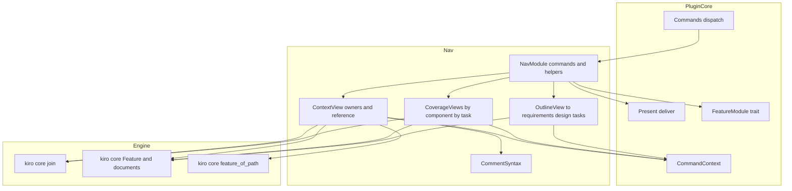
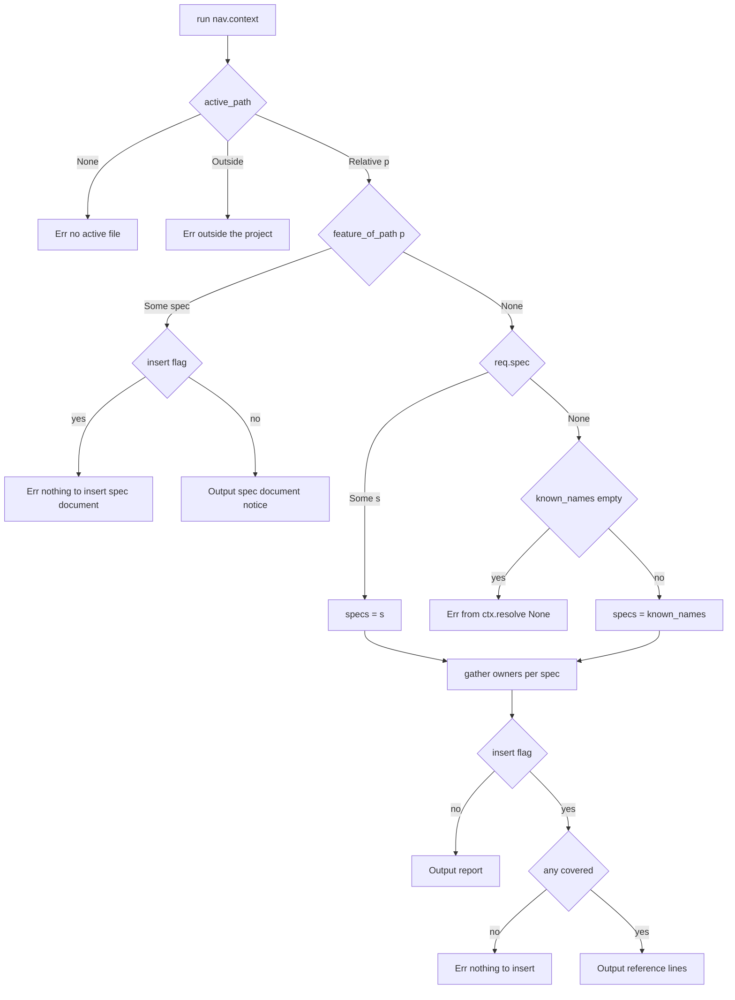

# Design Document: spec-navigation

## Overview

**Purpose**: spec-navigation adds the `nav` feature module to the Kiro plugin: six commands that answer "which spec, components, tasks and requirements own this code file?" and "which files, tasks and sections does this spec cover?" from inside OpenIDEA, plus one variant that inserts a reference line in the active file's comment syntax. The module is pure presentation: it selects which specs to ask, asks kiro-core's join and document model through plugin-core's command context, and formats the answers as text with project-relative paths and `path:line` positions for quick-open.

**Users**: developers editing code or spec documents in OpenIDEA; sibling specs (spec-visualization reuses the same engine join; vocabulary-grounding may later relabel components) only as readers of this module's command list.

**Impact**: Adds `plugins/kiro/src/nav/` and `plugins/kiro/tests/nav.rs` with a fixture tree; touches four plugin-core files by one line or one table each (`lib.rs`, `commands.rs`, `plugin.toml`, `README.md`). Nothing in `crates/kiro-core` or in the host changes.

### Goals
- Every navigation answer reachable from Search Everywhere without an argument: six base commands, one insert variant, per-spec variants supplied by plugin-core.
- `nav.context` answers across all known specs; every other command acts on the resolved current spec.
- Output readable when clipped: summary lines first, one notification, full text returned.
- No join, path matching, parsing or host call in the module; natively testable through `FakeHost`.

### Non-Goals
- Opening files, moving the cursor, or any editor write beyond `nav.context.insert`.
- Caps of its own on list length (plugin-core clips the notification at a line boundary and returns the full text).
- Vocabulary labels for components (vocabulary-grounding), diagrams (spec-visualization), findings display (`ws.current`).
- Any change to plugin-core's grammar, budget, resolution or presentation, or to kiro-core.

## Boundary Commitments

### This Spec Owns
- The `nav` feature module: its six `CommandSpec` declarations, the `FeatureModule` implementation, and the dispatch by command name.
- Spec selection for `nav.context` (explicit spec or every known spec) and the spec-document special case.
- The text of the ownership report, the reference line, the by-component and by-task coverage views, and the document outlines, including every degradation wording.
- The comment-syntax table and the wrapping of the reference line.
- The nav-specific error messages (no active file, outside project, nothing to insert, task not found, unexpected token).
- The nav manifest entries, the module-table line, the README command rows, the nav fixture tree and the nav tests.

### Out of Boundary
- Path normalisation, `feature_of_path`, `owners_of`, `coverage`, `path_matches`, outlines, task trees, criterion lookup — consumed from kiro-core; a missing engine capability is a kiro-core gap, not a local re-implementation.
- Command ids' grammar, per-spec variant registration, the 256 budget, argument tokenisation, `Request`, `CommandContext`, resolution errors, clipping, `deliver` — plugin-core.
- Showing engine findings (`TASK_BOUNDARY_UNKNOWN`, `TASK_REQ_UNKNOWN`, …) — `ws.current` and cli-gate.
- Diagrams, vocabulary labels, term checks.

### Allowed Dependencies
- plugin-core modules, in its dependency direction: `host::Level`, `registry::{CommandSpec, Group, Positional}`, `args::Request`, `present::Output`, `context::CommandContext`, `module::FeatureModule`. The nav module sits between `module` and `commands` in plugin-core's order (`… → module → ws, nav → commands`) and never imports `commands`, `bindings` or `host` functions.
- kiro-core: `source::Feature`, `spec::Doc`, `design::{DesignDoc, DesignFile}`, `tasks::{TasksDoc, Task}`, `requirements::RequirementsDoc`, `join::{owners_of, coverage, Owners, Coverage, ComponentCoverage, TaskRef}`, `resolve::{ProjectPath, feature_of_path}`, `md::Heading`.
- Rust `std` only; no new crate dependency; no host call from the module.
- Internal direction: `comment` → `context`; `mod` (helpers) → `context`, `files`, `docs`; `context`, `files` and `docs` never import each other.

### Revalidation Triggers
- plugin-core: a change to `FeatureModule`, `CommandSpec`/`Positional`, `Request` (`spec`, `insert`, `rest`), `CommandContext` (`active_path`, `known_names`, `resolve`, `load`), `Output`, `deliver`'s "inserted text == notified text" rule, or the id grammar (number of modifier segments).
- kiro-core: a change to `Owners`, `Coverage`, `ComponentCoverage`, `TaskRef`, `DesignDoc::component`, `DesignFile.responsibility`, `Heading`, `Task.{id, sub, checked, line, boundary, subtasks}`, `Feature::path`, or to `Coverage.unknown_boundary_tasks`.
- The comment-syntax table (documented in README; users may rely on a marker for a given extension).
- vocabulary-grounding supplying preferred component labels: the views would take a label function; until then names are printed as written in `design.md`.

## Architecture

### Existing Architecture Analysis
- plugin-core: `commands::run_command` parses the id, parses arguments into `Request`, builds `CommandContext` (roadmap read, known specs in roadmap order, normalised `active_path`), synchronises per-spec variants, rejects an explicit spec without readable `spec.json`, then calls `module.run(ctx, cmd, req)` and delivers the `Output` (one notification; insertion of the same text when `req.insert`; full text returned). All six nav commands are `Positional::Spec`, so `req.spec` is the explicit spec and `req.rest` holds the remaining tokens.
- kiro-core: `Feature` (loaded by `ctx.load`) exposes `requirements`, `design`, `tasks` as `Option<…Doc>` and `path(Doc)`; `join::owners_of(design, tasks, query)` and `join::coverage(design, tasks)` are pure over those values.

### Architecture Pattern & Boundary Map



**Architecture Integration**:
- Selected pattern: feature module over `CommandContext`, the same shape as plugin-core's `ws` module — chosen because plugin-core's extension contract is the only way commands enter the plugin and because it keeps every host interaction in plugin-core.
- Domain boundaries: `NavModule` knows command names and shared formatting; `ContextView` knows spec selection and ownership; `CoverageViews` knows the two coverage renderings; `OutlineView` knows the outline rendering; `CommentSyntax` knows file names only.
- Existing patterns preserved: steering's "frontends only adapt I/O and presentation"; plugin-core's `Result<_, String>` at every boundary and its lint table; kebab-case ids under the `nav` prefix.
- New components rationale: the three view files exist so the three task groups can be implemented in parallel on disjoint files; `CommentSyntax` is separate because it is a pure table with its own tests.
- Steering compliance: no `std::fs`/`net`/`thread`/`env`/`time`; no `unwrap`/`expect`/indexing; the join stays in core; paths are project-relative with `/`.

### Technology Stack

| Layer | Choice / Version | Role in Feature | Notes |
|-------|------------------|-----------------|-------|
| Plugin crate | `openidea-plugin-kiro` (plugin-core), Rust `edition = "2024"`, `wasm32-wasip2` + native | Hosts the `nav` module | No new dependency; same lint table |
| Engine | `kiro-core` by path | `owners_of`, `coverage`, documents, outlines, `feature_of_path` | Contracts in kiro-core design |
| Tests | native `cargo test` in `plugins/kiro`; `FakeHost`; `include_str!` fixtures | Unit tests per file; end-to-end in `tests/nav.rs` | Manifest test from plugin-core extended by the nav entries |

## File Structure Plan

### Directory Structure
```
plugins/
└── kiro/
    ├── plugin.toml                          # + seven nav [[contributes.commands]] entries
    ├── README.md                            # + nav rows in the command table, argument forms, comment-syntax table
    ├── src/
    │   ├── lib.rs                           # + `pub mod nav;`
    │   ├── commands.rs                      # + `Box::new(nav::Nav)` in modules()
    │   └── nav/
    │       ├── mod.rs                       # Nav, COMMANDS, FeatureModule impl, shared helpers
    │       ├── comment.rs                   # CommentStyle, extension tables, style_for, wrap
    │       ├── context.rs                   # nav.context: spec selection, ownership report, reference
    │       ├── files.rs                     # nav.files and nav.task-files
    │       └── docs.rs                      # nav.to-requirements / to-design / to-tasks
    └── tests/
        ├── nav.rs                           # End-to-end over FakeHost with the nav fixture tree
        └── fixtures/
            └── nav/
                └── .kiro/
                    ├── steering/roadmap.md  # alpha, beta, gamma
                    └── specs/
                        ├── alpha/           # Full spec: shared file, empty component, unassigned file, unscoped and unknown-boundary tasks, missing criterion
                        ├── beta/            # Full spec whose design also maps src/shared.rs
                        └── gamma/           # tasks-generated spec without design.md
```

### Files by Component

| Component | File | Responsibility |
|-----------|------|----------------|
| NavModule | `plugins/kiro/src/nav/mod.rs` | `Nav`, `COMMANDS` (six `CommandSpec`s), `STATIC_IDS`, `IDS_PER_SPEC`, `FeatureModule` impl dispatching on `cmd.name`, shared helpers (`reject_extra`, `checkbox`, `task_ref_line`, `task_line`, `file_name`) |
| CommentSyntax | `plugins/kiro/src/nav/comment.rs` | `CommentStyle`, the four extension tables and the basename table, `style_for`, `wrap` |
| ContextView | `plugins/kiro/src/nav/context.rs` | `run` for `nav.context`: active-file checks, spec-document case, spec selection, `gather`, `report_text`/`report_title`, `reference_line`/`reference_text` |
| CoverageViews | `plugins/kiro/src/nav/files.rs` | `by_component` and `by_task` for `nav.files` / `nav.task-files`, `component_text`, `task_text`, boundary label formatting |
| OutlineView | `plugins/kiro/src/nav/docs.rs` | `run(ctx, req, doc)` for the three `nav.to-*` commands, `OutlineEntry`, `outline`, `outline_text` |
| NavRegistration | `plugins/kiro/src/lib.rs` | `pub mod nav;` declaration |
| NavRegistration | `plugins/kiro/src/commands.rs` | `nav::Nav` is inserted at its canonical position in plugin-core's module table (`ws, nav, viz, vocab, check`); manifest order follows that table |
| NavRegistration | `plugins/kiro/plugin.toml` | Seven `[[contributes.commands]]` entries equal to `static_commands(&nav::COMMANDS)` |
| NavRegistration | `plugins/kiro/README.md` | Command table rows for the six commands and the insert variant, the `nav.task-files <spec> <task-id>` argument form, the comment-syntax table, the manual host check for `nav.context` |
| NavFixtures | `plugins/kiro/tests/fixtures/nav/.kiro/steering/roadmap.md` | `## Specs (dependency order)` listing `alpha`, `beta`, `gamma` |
| NavFixtures | `plugins/kiro/tests/fixtures/nav/.kiro/specs/alpha/spec.json` | `tasks-generated` |
| NavFixtures | `plugins/kiro/tests/fixtures/nav/.kiro/specs/alpha/requirements.md` | Requirement 1 with criteria 1.1 and 1.2 |
| NavFixtures | `plugins/kiro/tests/fixtures/nav/.kiro/specs/alpha/design.md` | Components `Alpha` (`src/alpha.rs` "Alpha logic", `src/shared.rs`) and `Empty` (no files) in a table plan; a tree fence adding unassigned `src/util.rs`; `#### Alpha` / `#### Empty` headings under Components and Interfaces |
| NavFixtures | `plugins/kiro/tests/fixtures/nav/.kiro/specs/alpha/tasks.md` | `1.` container with `1.1 [x]` (no boundary); `2.` with `2.1 [x]` `_Boundary: Alpha_` `_Requirements: 1.1, 1.2, 9.9_` and `2.2 [ ]` `_Boundary: Empty_`; `3.` with `3.1 [ ]` `_Boundary: Glue_` |
| NavFixtures | `plugins/kiro/tests/fixtures/nav/.kiro/specs/beta/spec.json` | `tasks-generated` |
| NavFixtures | `plugins/kiro/tests/fixtures/nav/.kiro/specs/beta/requirements.md` | Requirement 1 with criterion 1.1 |
| NavFixtures | `plugins/kiro/tests/fixtures/nav/.kiro/specs/beta/design.md` | Component `Beta` mapping `src/shared.rs` and `src/beta.rs` |
| NavFixtures | `plugins/kiro/tests/fixtures/nav/.kiro/specs/beta/tasks.md` | `1.1 [ ]` `_Boundary: Beta_` `_Requirements: 1.1_` |
| NavFixtures | `plugins/kiro/tests/fixtures/nav/.kiro/specs/gamma/spec.json` | `tasks-generated` (design intentionally absent) |
| NavFixtures | `plugins/kiro/tests/fixtures/nav/.kiro/specs/gamma/requirements.md` | Requirement 1 with criterion 1.1 |
| NavFixtures | `plugins/kiro/tests/fixtures/nav/.kiro/specs/gamma/tasks.md` | `1.1 [ ]` `_Boundary: Gamma_` |
| NavTests | `plugins/kiro/tests/nav.rs` | Builds a `FakeHost` (root `C:\proj`) from the fixture tree via `include_str!`, runs `commands::activate` and `commands::run_command` for every nav command and error path, asserts notifications, inserts, return messages, error lines and read events |

### Modified Files
- `plugins/kiro/src/lib.rs` — add `pub mod nav;` (directory module).
- `plugins/kiro/src/commands.rs` — add the `nav::Nav` entry to `modules()` at its canonical position.
- `plugins/kiro/plugin.toml` — add the seven static nav entries (`tests/manifest.rs` enforces equality with the registry).
- `plugins/kiro/README.md` — document the commands, argument forms, comment syntax, and the manual check.

## System Flows

### nav.context



Flow decisions: `reject_extra` runs before any load; `gather` loads each spec once through `ctx.load` (cached reads) and classifies it as `Covered`, `NotCovered` or `NoDesign`; on the insert path the output text is the wrapped reference lines so plugin-core's `deliver` inserts exactly what it notifies.

### Current-spec commands

`nav.files`, `nav.task-files` and `nav.to-*` call `reject_extra`, then `ctx.resolve(req.spec.as_deref())` (plugin-core's errors pass through unchanged), then `ctx.load(name)` and render the `Feature`. Missing documents become warning-level outputs, never errors; only an unknown task id (`nav.task-files`) is an error.

## Requirements Traceability

| Requirement | Summary | Components | Interfaces | Flows |
|-------------|---------|------------|------------|-------|
| 1.1 | Six base commands via the module contract | NavModule, NavRegistration | `COMMANDS`, `FeatureModule for Nav` | — |
| 1.2 | All spec-addressable | NavModule | `CommandSpec.spec_addressable = true` | — |
| 1.3 | Only `nav.context` insert-capable | NavModule | `CommandSpec.insert_capable` | — |
| 1.4 | Static ids in the manifest | NavRegistration | `plugin.toml`, `tests/manifest.rs` | — |
| 1.5 | 7 static ids, 6 per spec | NavModule | `STATIC_IDS`, `IDS_PER_SPEC` + unit test | — |
| 1.6 | Unexpected token → error | NavModule, ContextView, CoverageViews, OutlineView | `reject_extra` | both |
| 2.1 | Report per covering spec | ContextView | `gather`, `report_text`, `SpecOwners` | nav.context |
| 2.2 | Explicit spec only | ContextView | `run` (specs = `[req.spec]`) | nav.context |
| 2.3 | Every match reported | ContextView | `gather` (all components, all specs) | nav.context |
| 2.4 | Not covered, checked list, warning | ContextView | `report_text`, `report_level` | nav.context |
| 2.5 | No design listed separately | ContextView | `SpecCheck::NoDesign` | nav.context |
| 2.6 | Missing criterion marked | ContextView | `criteria_lines` | — |
| 2.7 | No active file → error | ContextView | `run` | nav.context |
| 2.8 | Outside → error | ContextView | `run` | nav.context |
| 2.9 | Spec document notice | ContextView | `spec_document_output` | nav.context |
| 2.10 | No spec known → standard error | ContextView | `ctx.resolve(None)` | nav.context |
| 2.11 | Title | ContextView | `report_title` | — |
| 3.1 | Insert one line per covering spec | ContextView | `reference_text`, `reference_line` | nav.context |
| 3.2 | Comment syntax by extension | CommentSyntax | `style_for`, extension tables | — |
| 3.3 | Extension-less names | CommentSyntax | `HASH_BASENAMES` | — |
| 3.4 | Bare fallback | CommentSyntax | `CommentStyle::Bare` | — |
| 3.5 | Nothing to insert → error | ContextView | `run` | nav.context |
| 3.6 | Same rules with insert | ContextView | `run` (single path) | nav.context |
| 4.1 | By component with files, responsibilities, tasks | CoverageViews | `component_text` | current-spec |
| 4.2 | Components without files | CoverageViews | `component_text` | — |
| 4.3 | Unassigned files | CoverageViews | `Coverage.unassigned_files` | — |
| 4.4 | Unscoped tasks | CoverageViews | `Coverage.unscoped_tasks` | — |
| 4.5 | Unknown boundary | CoverageViews | `unknown_boundary_tasks` | — |
| 4.6 | Counts first | CoverageViews | `component_text` summary | — |
| 4.7 | Design missing | CoverageViews | `component_text` (design `None`) | — |
| 4.8 | Tasks missing | CoverageViews | `component_text` (tasks `None`) | — |
| 4.9 | Unresolved → standard error | CoverageViews | `ctx.resolve` | current-spec |
| 5.1 | By task with boundary files | CoverageViews | `task_text` | current-spec |
| 5.2 | Task filter | CoverageViews | `task_text(filter)` | — |
| 5.3 | Unknown task → error | CoverageViews | `by_task` | — |
| 5.4 | unscoped / unknown / no files marks | CoverageViews | `boundary_label` | — |
| 5.5 | Summary first | CoverageViews | `task_text` summary | — |
| 5.6 | Tasks missing | CoverageViews | `task_text` (tasks `None`) | — |
| 5.7 | Design missing → all unknown | CoverageViews | `boundary_label` (design `None`) | — |
| 6.1 | Outline with line, level, text | OutlineView | `outline`, `outline_text` | current-spec |
| 6.2 | Task items merged | OutlineView | `outline` (`Doc::Tasks`) | — |
| 6.3 | Document missing | OutlineView | `outline` → `None` | — |
| 6.4 | Empty outline | OutlineView | `outline_text` | — |
| 6.5 | Title | OutlineView | `run` | — |
| 7.1 | Relative paths, `path:line` | NavModule, all views | `task_ref_line`, `task_line`, `Feature::path` | — |
| 7.2 | Summary before details | ContextView, CoverageViews, OutlineView | every `*_text` | — |
| 7.3 | One notification, full return, insert only for context | NavModule (no host call), plugin-core `deliver` | `Output` | — |
| 7.4 | Warning level rules | ContextView, CoverageViews, OutlineView | `report_level`, `Level::Warning` on missing docs | — |
| 7.5 | `[x]` / `[ ]` | NavModule | `checkbox` | — |
| 7.6 | Only spec documents read | ContextView (path only), NavTests | `ctx.load`, read events assertion | nav.context |
| 8.1 | Total, no panic | all nav files | lint table, `Result<_, String>` | — |
| 8.2 | 64 specs in 5 s | ContextView | ≤ 4 reads per spec | nav.context |
| 8.3 | Unit tests | CommentSyntax, ContextView, CoverageViews, OutlineView | in-module `#[cfg(test)]` | — |
| 8.4 | End-to-end tests | NavTests, NavFixtures | `tests/nav.rs` | — |
| 8.5 | Manifest test passes | NavRegistration | `plugin.toml` | — |
| 8.6 | wasm build, lints | NavRegistration | build commands | — |
| 8.7 | Manual host check | NavRegistration (README) | — | — |

## Components and Interfaces

| Component | Domain/Layer | Intent | Req Coverage | Key Dependencies (P0/P1) | Contracts |
|-----------|--------------|--------|--------------|--------------------------|-----------|
| NavModule | Feature | Command table, module contract, shared formatting | 1.1, 1.2, 1.3, 1.5, 1.6, 7.1, 7.3, 7.5 | plugin-core `module`, `registry`, `args`, `present` (P0) | Service |
| CommentSyntax | Feature | Comment markers from a file name | 3.2, 3.3, 3.4 | none | Service |
| ContextView | Feature | `nav.context` and the reference | 2.1–2.11, 3.1, 3.5, 3.6, 7.2, 7.4, 7.6, 8.2 | CommandContext (P0), kiro-core join/resolve (P0), CommentSyntax (P0) | Service |
| CoverageViews | Feature | `nav.files`, `nav.task-files` | 4.1–4.9, 5.1–5.7, 7.2, 7.4 | CommandContext (P0), kiro-core join/design/tasks (P0) | Service |
| OutlineView | Feature | `nav.to-requirements`, `nav.to-design`, `nav.to-tasks` | 6.1–6.5, 7.2, 7.4 | CommandContext (P0), kiro-core documents (P0) | Service |
| NavRegistration | Package | Module declaration, module table, manifest, README | 1.1, 1.4, 8.5, 8.6, 8.7 | plugin-core files (P0) | State |
| NavFixtures | Test data | Three-spec tree exercising every degradation | 8.4 | none | — |
| NavTests | Tests | End-to-end over `FakeHost` | 7.6, 8.1, 8.4 | FakeHost (P0), NavFixtures (P0) | — |

### Feature

#### NavModule

| Field | Detail |
|-------|--------|
| Intent | The command table, the module contract and the formatting helpers every view shares |
| Requirements | 1.1, 1.2, 1.3, 1.5, 1.6, 7.1, 7.3, 7.5 |

**Contracts**: Service [x]

##### Service Interface
```rust
pub struct Nav;
pub static COMMANDS: [CommandSpec; 6] = [
    CommandSpec { group: Group::Nav, name: "context",         title: "Kiro: Spec Context",         spec_addressable: true, insert_capable: true,  positional: Positional::Spec },
    CommandSpec { group: Group::Nav, name: "files",           title: "Kiro: Files by Component",   spec_addressable: true, insert_capable: false, positional: Positional::Spec },
    CommandSpec { group: Group::Nav, name: "task-files",      title: "Kiro: Files by Task",        spec_addressable: true, insert_capable: false, positional: Positional::Spec },
    CommandSpec { group: Group::Nav, name: "to-requirements", title: "Kiro: Requirements Outline", spec_addressable: true, insert_capable: false, positional: Positional::Spec },
    CommandSpec { group: Group::Nav, name: "to-design",       title: "Kiro: Design Outline",       spec_addressable: true, insert_capable: false, positional: Positional::Spec },
    CommandSpec { group: Group::Nav, name: "to-tasks",        title: "Kiro: Tasks Outline",        spec_addressable: true, insert_capable: false, positional: Positional::Spec },
];
/// 6 base + 1 insert; 6 variants per known spec. Asserted against `static_commands(&COMMANDS)` and the
/// number of spec-addressable entries by a unit test.
pub const STATIC_IDS: usize = 7;
pub const IDS_PER_SPEC: usize = 6;

impl FeatureModule for Nav {
    fn group(&self) -> Group { Group::Nav }
    fn commands(&self) -> &'static [CommandSpec] { &COMMANDS }
    /// "context" -> context::run; "files" -> files::by_component; "task-files" -> files::by_task;
    /// "to-requirements" | "to-design" | "to-tasks" -> docs::run with Doc::Requirements | Design | Tasks;
    /// any other name -> Err("unknown nav command `<name>`") (unreachable through Commands, kept total).
    fn run(&self, ctx: &mut CommandContext<'_>, cmd: &CommandSpec, req: &Request) -> Result<Output, String>;
}

/// Err("`<cmd.id()>` does not take `<token>`") for the first token in req.rest beyond `allowed`.
pub(crate) fn reject_extra(cmd: &CommandSpec, req: &Request, allowed: usize) -> Result<(), String>;
pub(crate) fn checkbox(checked: bool) -> &'static str;                       // "[x]" | "[ ]"
/// "<id> <checkbox> <description> (<tasks_path>:<line>)"
pub(crate) fn task_ref_line(t: &kiro_core::join::TaskRef, tasks_path: &str) -> String;
pub(crate) fn task_line(t: &kiro_core::tasks::Task, tasks_path: &str) -> String;   // same shape from a Task
pub(crate) fn file_name(path: &str) -> &str;                                 // text after the last '/'
```
- Invariants: `COMMANDS` validates under plugin-core's `CommandSpec::validate` (unit test); the module makes no host call other than `ctx.host.log` (every output goes back through `Output`); `reject_extra` runs before any `ctx.load` in every command.

#### CommentSyntax

| Field | Detail |
|-------|--------|
| Intent | Comment markers from the active file's name |
| Requirements | 3.2, 3.3, 3.4 |

**Contracts**: Service [x]

##### Service Interface
```rust
#[derive(Clone, Copy, Debug, PartialEq, Eq)]
pub enum CommentStyle { DoubleSlash, Hash, DoubleDash, Html, Bare }

pub const DOUBLE_SLASH_EXTENSIONS: &[&str] = &["c", "h", "cpp", "cc", "cxx", "hpp", "hh", "cs", "java", "kt", "kts", "swift", "go", "rs", "js", "mjs", "cjs", "jsx", "ts", "tsx", "dart", "scala", "groovy", "php", "zig", "wit", "proto"];
pub const HASH_EXTENSIONS: &[&str] = &["py", "rb", "sh", "bash", "zsh", "ps1", "psm1", "psd1", "toml", "yaml", "yml", "pl", "pm", "r", "cmake", "ex", "exs", "nim", "tf", "hcl"];
pub const DOUBLE_DASH_EXTENSIONS: &[&str] = &["sql", "lua", "hs", "elm", "ada", "adb", "ads", "vhd", "vhdl"];
pub const HTML_EXTENSIONS: &[&str] = &["md", "markdown", "html", "htm", "xml", "svg", "vue", "svelte", "xaml", "csproj", "fsproj", "vbproj", "props", "targets"];
pub const HASH_BASENAMES: &[&str] = &["makefile", "dockerfile", "justfile"];

/// name = text after the last '/'; extension = text after the last '.' of the name when that '.' is not the
/// first character and the remainder is non-empty; both compared in ASCII lowercase. Extension tables first,
/// then HASH_BASENAMES for names without an extension, else Bare.
pub fn style_for(path: &str) -> CommentStyle;
/// "// text", "# text", "-- text", "<!-- text -->" (every "--" inside text replaced by "- -"), or text.
/// No trailing newline.
pub fn wrap(style: CommentStyle, text: &str) -> String;
```
- Unit tests: one per table entry class including uppercase extensions (`FOO.RS`), `Makefile`/`DOCKERFILE`, `.gitignore` (leading dot → Bare), `data.json` → Bare, `archive.tar.gz` (last extension), the `--` replacement.

#### ContextView

| Field | Detail |
|-------|--------|
| Intent | `nav.context`: which specs, components, tasks and criteria own the active file; the reference line |
| Requirements | 2.1, 2.2, 2.3, 2.4, 2.5, 2.6, 2.7, 2.8, 2.9, 2.10, 2.11, 3.1, 3.5, 3.6, 7.2, 7.4, 7.6, 8.2 |

**Contracts**: Service [x]

##### Service Interface
```rust
#[derive(Clone, Debug, PartialEq, Eq)]
pub struct SpecOwners {
    pub spec: String,
    pub tasks_path: String,                       // Feature::path(Doc::Tasks)
    pub requirements_path: String,                // Feature::path(Doc::Requirements)
    pub owners: kiro_core::join::Owners,          // covered == true
    pub criteria_lines: Vec<(String, Option<usize>)>,   // owners.criteria order; line from criterion(id) or requirement(id); None = not found
}
#[derive(Clone, Debug, PartialEq, Eq)]
pub enum SpecCheck { Covered(SpecOwners), NotCovered(String), NoDesign(String) }
#[derive(Clone, Debug, PartialEq, Eq)]
pub struct ContextReport { pub file: String, pub checked: Vec<String>, pub results: Vec<SpecCheck> }

/// See flow "nav.context". Errors (single line):
///   "no active file: open a file in the editor and run the command again"
///   "active file `<path>` is outside the project"
///   "nothing to insert: `<file>` is a spec document"
///   "nothing to insert: `<file>` is not covered by <checked joined by ", ">"
/// plus plugin-core's unresolved error from ctx.resolve(None) when no spec is known, and reject_extra.
pub fn run(ctx: &mut CommandContext<'_>, req: &Request) -> Result<Output, String>;
/// Loads each spec once; design None -> NoDesign; owners_of(...).covered -> Covered else NotCovered.
pub fn gather(ctx: &mut CommandContext<'_>, file: &str, specs: &[String]) -> ContextReport;
pub fn report_text(r: &ContextReport) -> String;
pub fn report_title(r: &ContextReport) -> String;      // "Kiro: <file name> — <covering specs joined by ", ">" | "Kiro: <file name> — not covered"
pub fn report_level(r: &ContextReport) -> Level;       // Warning when no Covered or any NoDesign, else Info
/// "File: <path>\n<path> is the <document kind> of spec `<spec>`. Run `nav.files` (Kiro: Files by Component) for its components and files."
pub fn spec_document_output(path: &str, spec: &str) -> Output;   // title "Kiro: <file name> — spec document of <spec>", Info
/// "kiro-spec: <spec>; components: A, B; tasks: 2.1, 2.2; requirements: 1.1, 1.2" ("none" for empty lists)
pub fn reference_line(o: &SpecOwners) -> String;
/// One wrapped reference_line per Covered result, each followed by '\n'; None when there is no Covered result.
pub fn reference_text(r: &ContextReport, style: CommentStyle) -> Option<String>;
```
- `report_text` layout (summary first, then one block per covered spec in `checked` order):
  ```
  File: <file>
  Checked: a, b, c (3 specs)
  Covered by: a            | Covered by: none
  Not covered by: b        (omitted when empty)
  No design: c             (omitted when empty)

  a
    Components: A, B
    Tasks:
      2.1 [x] Build alpha (.kiro/specs/a/tasks.md:11)
    Requirements:
      1.1 (.kiro/specs/a/requirements.md:9)
      9.9 (not found)
  ```
  `Tasks: none` / `Requirements: none` when the lists are empty.
- Document kinds for the spec-document case: `spec.json` → "spec metadata", `requirements.md` → "requirements document", `design.md` → "design document", `tasks.md` → "tasks document", anything else → "document".
- Reads: only `ctx.load(spec)` per checked spec (≤ 4 reads each, cached); the active file is never read; `file` is `ProjectPath::Relative`'s string as given by plugin-core.

#### CoverageViews

| Field | Detail |
|-------|--------|
| Intent | The two renderings of a spec's coverage: by component and by task |
| Requirements | 4.1, 4.2, 4.3, 4.4, 4.5, 4.6, 4.7, 4.8, 4.9, 5.1, 5.2, 5.3, 5.4, 5.5, 5.6, 5.7, 7.2, 7.4 |

**Contracts**: Service [x]

##### Service Interface
```rust
/// reject_extra(cmd, req, 0); ctx.resolve(req.spec); ctx.load; component_text.
pub fn by_component(ctx: &mut CommandContext<'_>, req: &Request) -> Result<Output, String>;   // title "Kiro: <spec> files by component"
/// reject_extra(cmd, req, 1); filter = req.rest.first(); ctx.resolve; ctx.load; task_text.
pub fn by_task(ctx: &mut CommandContext<'_>, req: &Request) -> Result<Output, String>;        // title "Kiro: <spec> files by task" (+ " — task <id>" with a filter)

/// Unknown-boundary tasks are consumed from `join::Coverage.unknown_boundary_tasks` (amendment 2026-11-04, gap-analysis issue 8); this module no longer re-derives them via `design.component()`.
/// Label for one boundary name: "<Name>" | "<Name> (no files)" | "<name as written> (unknown)"; a task with
/// an empty boundary is labelled "unscoped".
pub fn boundary_label(design: Option<&DesignDoc>, name: &str) -> String;
pub fn component_text(feature: &Feature) -> (String, Level);
/// Err("task `<id>` not found in <tasks path>") for an unknown filter when tasks.md is readable.
pub fn task_text(feature: &Feature, filter: Option<&str>) -> Result<(String, Level), String>;
```
- `component_text` layout:
  ```
  Spec: <spec>
  Design: <design path>[ (missing)]
  Tasks: <tasks path>[ (missing)]
  Components: c (files: f, unassigned: u); tasks: t (unscoped: s, unknown boundary: k)

  <Component> (<n> files, <m> tasks)      | <Component> (no files, <m> tasks)
    <file path>[ — <responsibility>]
    task <id> [x] <description> (<tasks path>:<line>)

  Unassigned files (u)
    <file path>

  Unscoped tasks (s)
    task <id> [ ] <description> (<tasks path>:<line>)

  Unknown boundary (k)
    task <id> [ ] <description> (<tasks path>:<line>) — <names as written joined by ", ">
  ```
  Components come from `coverage(design, tasks).components` in design order; responsibilities from `design.files` (first `DesignFile` whose `path` equals the component file); `f` = `design.files.len()`; `t` = `tasks.counts.total`; `s` = `coverage.unscoped_tasks.len()`; `k` = `coverage.unknown_boundary_tasks.len()`. Sections with zero entries are omitted; with design `None` the component section is omitted and `Components: missing`; with tasks `None` task lines, the unscoped and unknown sections are omitted and `tasks: missing`. Level Warning when either document is `None`, else Info.
- `task_text` layout:
  ```
  Spec: <spec>
  Tasks: <tasks path>[ (missing)]
  Design: <design path>[ (missing)]
  Count: t tasks (completed c, unscoped s)[; filter: task <id>]

  1 [ ] Foundation (<tasks path>:3) — unscoped
    1.1 [x] Scaffold (<tasks path>:4) — unscoped
  2 [ ] Core (<tasks path>:10) — unscoped
    2.1 [x] Build alpha (<tasks path>:11) — Alpha
        src/alpha.rs
        src/shared.rs
    2.2 [ ] Empty work (<tasks path>:20) — Empty (no files)
    3.1 [ ] Wire (<tasks path>:30) — Glue (unknown)
  ```
  Majors at indent 0, sub-tasks at 2, files at 6; the boundary labels are joined by `, `; files of all known boundary components in boundary order, deduplicated, paths from `design.files_of(component)`. With a filter naming a major, the major and its sub-tasks; naming a sub-task, that line and its files only. Tasks `None` → the summary with `(missing)`, no list, Warning, filter ignored. Design `None` → every boundary name labelled `(unknown)`, Warning.

#### OutlineView

| Field | Detail |
|-------|--------|
| Intent | Path and outline of the current spec's requirements, design or tasks document |
| Requirements | 6.1, 6.2, 6.3, 6.4, 6.5, 7.2, 7.4 |

**Contracts**: Service [x]

##### Service Interface
```rust
#[derive(Clone, Debug, PartialEq, Eq)]
pub struct OutlineEntry { pub line: usize, pub indent: usize, pub text: String }

/// reject_extra(cmd, req, 0); ctx.resolve(req.spec); ctx.load; outline + outline_text.
/// Title "Kiro: <spec> <file name of doc>".
pub fn run(ctx: &mut CommandContext<'_>, req: &Request, doc: Doc) -> Result<Output, String>;
/// None when the document is absent. Headings -> { line, indent: 0, text: "#"*level + " " + text }.
/// For Doc::Tasks additionally every task from TasksDoc::all() -> { line, indent: 0 for majors / 2 for subs,
/// text: "- " + checkbox + " " + id + " " + description }, merged by line (stable: headings before tasks on
/// the same line, which cannot occur).
pub fn outline(feature: &Feature, doc: Doc) -> Option<Vec<OutlineEntry>>;
/// "Spec: <spec>\nDocument: <path>[ (missing)]\nOutline: <n> entries | empty\n\n<line>: <indent spaces><text>\n…"
/// Level Warning when entries is None, else Info.
pub fn outline_text(spec: &str, path: &str, entries: Option<&[OutlineEntry]>) -> (String, Level);
```
- `Doc::SpecJson` is never requested (the three commands map to the three Markdown documents); `outline` returns `None` for it, keeping the function total.

### Package

#### NavRegistration
Summary-only: `lib.rs` declares `pub mod nav;`; `nav::Nav` is inserted at its canonical position in plugin-core's module table (`ws, nav, viz, vocab, check`); manifest order follows that table; `plugin.toml` lists `nav.context` (`Kiro: Spec Context`), `nav.context.insert` (`Kiro: Spec Context — Insert at Cursor`), `nav.files`, `nav.task-files`, `nav.to-requirements`, `nav.to-design`, `nav.to-tasks` with category `Kiro`, in `static_commands` order (base commands, then the insert variant); README gains the command rows, the argument forms (`nav.context <spec>`, `nav.task-files <spec> [task-id]`; a variant plus an argument must repeat the spec), the comment-syntax table and the manual check of 8.7.

### Tests

#### NavFixtures
Summary-only: the tree in the File Structure Plan; `src/*.rs` files are never part of the fixture because the plugin never reads them — the tests only set the active file path.

#### NavTests
Summary-only: `tests/nav.rs` embeds the fixture tree with `include_str!` into a `FakeHost` with root `C:\proj`, activates, and runs each scenario in the Testing Strategy; assertions use `FakeHost::{notifications, inserts, reads}` and the `Result` of `run_command`.

## Data Models

### Domain Model
- **ContextReport** (value, per `nav.context` call): the queried file, the checked spec names in roadmap order, one `SpecCheck` per checked spec. Invariant: `results.len() == checked.len()`; a `Covered` result has `owners.covered == true` and non-empty `components`.
- **SpecOwners** (value): kiro-core's `Owners` plus the two document paths and the resolved criterion lines; `criteria_lines` preserves `owners.criteria` order.
- **OutlineEntry** (value): line, indent, display text; sorted by line.
- No state: every value lives for one command.

### Data Contracts & Integration
- Engine contracts consumed: `join::{owners_of, coverage}`, `Owners`, `Coverage`, `ComponentCoverage`, `TaskRef { id, description, line, checked }`, `DesignDoc::{component, files_of, files}`, `DesignFile { path, component, responsibility }`, `TasksDoc::{all, task, counts, tasks}`, `Task { id, sub, description, checked, line, boundary, subtasks }`, `RequirementsDoc::{criterion, requirement}`, `Heading { level, text, line }`, `Feature::{requirements, design, tasks, path}`, `resolve::{ProjectPath, feature_of_path}`.
- plugin-core contracts consumed: `CommandSpec`, `Group::Nav`, `Positional::Spec`, `Request { spec, insert, rest }`, `CommandContext { active_path, known_names, resolve, load }`, `Output::{info, with_level}`, `Level`, `FeatureModule`.
- Text contracts produced: the layouts in each component; every path project-relative with `/`; positions `path:line`; the reference line `kiro-spec: …` wrapped by `CommentSyntax::wrap`.

## Error Handling

### Error Strategy
Every nav function returns `Result<_, String>` or an infallible value; the lint table forbids panicking constructs. Errors are single lines and pass through plugin-core's `error_line`. Degradations that leave a useful answer (missing document, uncovered file, spec without design, unknown boundary, unscoped task, missing criterion) are reported in the output at warning level; only situations with no useful answer are errors.

### Error Categories and Responses
- **Active file** (2.7, 2.8): `no active file: …`; `active file `…` is outside the project`.
- **Nothing to insert** (3.5): `nothing to insert: `<file>` is not covered by a, b` or `… is a spec document`.
- **Arguments** (1.6, 5.3): `` `nav.files` does not take `x` ``; `task `9.9` not found in .kiro/specs/demo/tasks.md`.
- **Resolution** (2.10, 4.9): plugin-core's messages unchanged.
- **Missing documents** (2.5, 4.7, 4.8, 5.6, 5.7, 6.3): warning-level output naming the expected path with `(missing)`.

### Monitoring
None of its own; plugin-core logs each command with id, resolved spec and output length.

## Testing Strategy

### Unit Tests (in-module)
- CommentSyntax: every table class, uppercase extension, basenames, leading-dot name, unknown extension, no extension, `--` replacement (3.2, 3.3, 3.4).
- ContextView: `reference_line` with multiple components/tasks/criteria and with empty lists; `report_text` for covered, not covered, no design, multi-spec and multi-component; `criteria_lines` with a missing id (2.1, 2.3, 2.4, 2.5, 2.6, 3.1); `report_title` variants (2.11); `report_level` (7.4).
- CoverageViews: `component_text` with the alpha fixture values (component without files, unassigned file, unscoped task, unknown boundary, counts line first) and with design `None` / tasks `None` (4.1–4.8); `task_text` full, filtered by major, filtered by sub-task, unknown id error, tasks `None`, design `None` (5.1–5.7).
- OutlineView: headings only; tasks document with merged task items and indentation; empty document; missing document (6.1–6.4).
- NavModule: `COMMANDS` validate; `static_commands(&COMMANDS).len() == STATIC_IDS`; spec-addressable count `== IDS_PER_SPEC`; `reject_extra`; `task_ref_line`/`task_line` format; `file_name` (1.1, 1.2, 1.3, 1.5, 1.6, 7.1, 7.5).

### Integration Tests (`tests/nav.rs`)
- Activation registers the seven nav static ids among the static list (1.4, 8.5 via `tests/manifest.rs`).
- `nav.context` with active `C:\proj\src\shared.rs`: notification title `Kiro: shared.rs — alpha, beta`, body lists both specs, alpha's task `2.1 [x]` with `.kiro/specs/alpha/tasks.md:` line, criteria `1.1`, `1.2` with lines and `9.9 (not found)`, `No design: gamma`, level Warning; no `Read` event for `src/shared.rs` (2.1, 2.3, 2.5, 2.6, 2.11, 7.6).
- `nav.context.beta` with the same file: only beta reported (2.2). `nav.context` with `src/nowhere.rs`: `not covered`, checked list, Warning (2.4). `nav.context` with no active file, with `D:\elsewhere\x.rs`, and with `C:\proj\.kiro\specs\alpha\design.md` (2.7, 2.8, 2.9). Roadmap removed and no active spec document → plugin-core's "no spec is known" error (2.10). `nav.context x y` → does-not-take error (1.6).
- `nav.context.insert` with `src/shared.rs`: one `Insert` event equal to `// kiro-spec: alpha; …\n// kiro-spec: beta; …\n` and the notification body equal to it; with `docs/readme.md` → `<!-- … -->`; with `src/nowhere.rs` → nothing-to-insert error and no `Insert` event (3.1, 3.2, 3.5, 3.6).
- `nav.files` with active `.kiro/specs/alpha/design.md`: counts line, `Empty (no files, 1 tasks)`, `Unassigned files (1)`, `Unscoped tasks`, `Unknown boundary (1)` with `Glue` (4.1–4.6); `nav.files.gamma` → `Design: … (missing)`, Warning (4.7); beta with `tasks.md` removed from the host → `Tasks: … (missing)` (4.8); `nav.files` with no active file and three known specs → plugin-core's candidates error (4.9).
- `nav.task-files.alpha`: full tree with labels; `nav.task-files alpha 2` → major 2 and its subs; `alpha 2.1` → one task with two files; `alpha 9.9` → not-found error; `nav.task-files.gamma` → `Gamma (unknown)`, Warning (5.1–5.7).
- `nav.to-design.alpha`, `nav.to-tasks.alpha` (task items merged and indented), `nav.to-requirements.gamma` (present), `nav.to-design.gamma` (missing, Warning), an empty requirements document (`Outline: empty`) (6.1–6.5).
- A notification body never exceeds 16 KiB and the return message equals the full text for a synthetic spec with 400 design files (7.2, 7.3 through plugin-core's `deliver`).

### Target Tests
- `cargo build --release --target wasm32-wasip2`, `cargo clippy --all-targets -- -D warnings`, `cargo fmt --check` from `plugins/kiro` (8.6).
- Manual host check (8.7): junction into this repository's `.openidea/plugins/kiro`, Reload Plugins, open `crates/kiro-core/src/md.rs`, run `Kiro: Spec Context` → notification `Kiro: md.rs — kiro-core` naming `MarkdownScanner`; run `Kiro: Spec Context — Insert at Cursor` → a `// kiro-spec: kiro-core; …` line appears at the cursor.

## Performance & Scalability
- `nav.context`: one roadmap read (plugin-core) plus ≤ 4 reads per checked spec, each cached by the workspace; 64 specs → ≤ 257 reads, no parsing beyond kiro-core's single pass, formatting linear in the output size — well inside 5 s (8.2).
- Other commands: four reads for the resolved spec; output size linear in files + tasks; plugin-core clips at 15 KiB and returns the full text.

## Supporting References

### Command budget
- nav: 7 static ids (`STATIC_IDS`) + 6 per known spec (`IDS_PER_SPEC`).
- With plugin-core's ws (3 static + 1 per spec): 10 + 7·n.
- Projected all groups (ws 2, nav 6, viz 3, vocab 3, check 4 base = 18; 7 insert variants; 17 spec-addressable per known spec: ws 1, nav 6, viz 3, vocab 3, check 4): 25 + 17·n → 144 ids for the 7 roadmap specs; (256 − 25) / 17 = 13 specs fit, so the 14th roadmap spec is skipped by plugin-core's `sync_variants` (in roadmap order) and `ws.specs` reports it.

### Message catalogue (nav-specific, single-line)
| Situation | Message |
|-----------|---------|
| No active file | `no active file: open a file in the editor and run the command again` |
| Active file outside root | `active file `<path>` is outside the project` |
| Insert on a spec document | `nothing to insert: `<file>` is a spec document` |
| Insert with no covering spec | `nothing to insert: `<file>` is not covered by <a, b, c>` |
| Unexpected token | `` `<command id>` does not take `<token>` `` |
| Unknown task filter | `task `<id>` not found in <tasks path>` |
