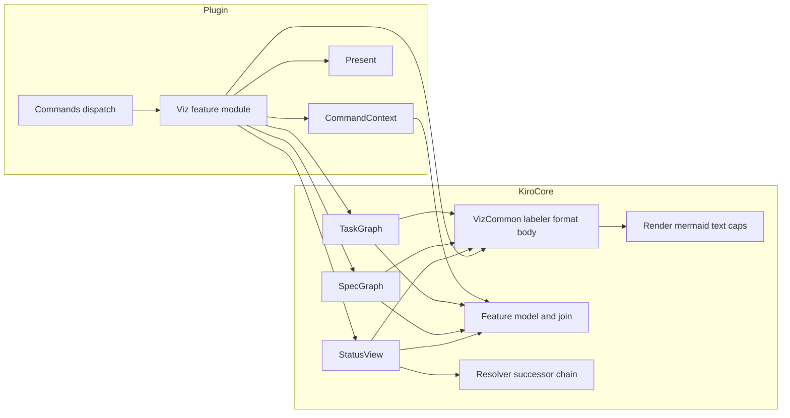
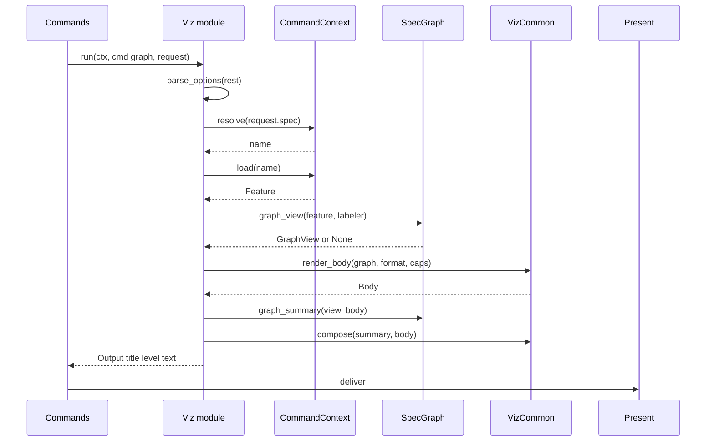
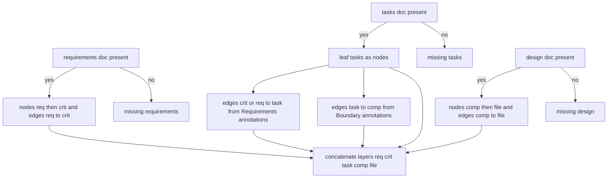

# Design Document: spec-visualization

## Overview

**Purpose**: spec-visualization turns a kiro spec's cross-document structure into three text views a developer can read in an OpenIDEA notification, paste into Markdown or consume programmatically: a status view (phase, approvals, task completion, successor chain), a spec graph (requirements → criteria → tasks → components → files) and a task dependency graph (`_Depends:_`, ordering, `(P)`, completion). The views are pure functions over kiro-core's spec model (a new `kiro_core::viz` module) rendered with kiro-core's Mermaid/text renderers, and are exposed by a thin `viz` feature module in the plugin through plugin-core's dispatch and presentation.

**Users**: developers reviewing spec state in the IDE; reviewers (kiro-review, validate-impl) who refer to the same `N.M` and task ids the graphs show; cli-gate, which may expose the same views natively.

**Impact**: Adds `crates/kiro-core/src/viz/` (one `pub mod viz;` line in kiro-core's `lib.rs`), `plugins/kiro/src/viz.rs` with one module-table entry and one `pub mod` line, six `[[contributes.commands]]` entries in `plugins/kiro/plugin.toml`, README rows, golden fixtures and tests. No engine contract, host contract or project file changes.

### Goals
- Three views whose content, order and labels are fully specified so that golden outputs are derivable from this document, up to the engine's own Mermaid and table emission shapes (which the golden files pin once generated and the lint guards).
- Diagram form capped and valid; table form complete; both deterministic and byte-identical across targets.
- Views reusable by the CLI: nothing in the view builders depends on the host.
- Vocabulary labels as a seam, not a dependency.

### Non-Goals
- Mermaid emission, id sanitising, escaping, caps, clipping (kiro-core `render`; plugin-core `present`).
- Spec resolution, argument grammar, variant registration (plugin-core).
- Loading a vocabulary or resolving terms (vocabulary-grounding); the `kiro-cli viz` subcommand (cli-gate).
- Styling (`classDef`), interactive output, host UI panels.

## Boundary Commitments

### This Spec Owns
- `kiro_core::viz`: the `Labeler` seam and `RawLabeler`, label rules (`truncate_label`, `task_label`, `phase_label`), `Format`, `render_body` (fenced Mermaid or node table), `node_table`, `compose`.
- The three view models and their text: `StatusView`/`status_text`, `GraphView`/`graph_summary`, `TasksView`/`tasks_summary` — which nodes, edges, labels, classes, order and counts appear.
- The plugin `viz` feature module: the three `CommandSpec`s, option parsing (`text`), titles, levels, error messages, the labeler constructor.
- The six manifest entries and README rows for `viz.*`; the module-table entry.
- Golden fixtures `fixtures/golden/viz-*`, `crates/kiro-core/tests/viz.rs` (including the Mermaid shape lint), `plugins/kiro/tests/viz.rs`.

### Out of Boundary
- Any change to `kiro_core::render`, `source`, `resolve`, the parsers or `Finding`; if a view needs an engine capability that is missing, the gap goes back to kiro-core.
- Any change to plugin-core's `registry`, `args`, `present`, `context`, `commands` beyond the one module-table line.
- A vocabulary-backed `Labeler` implementation (deferred to a later spec per the roadmap; it will live in the frontends — `viz::labeler(ctx)` in the plugin / the CLI — over `kiro_core::vocab::resolve`, never inside `kiro_core::vocab`; this spec reserves the constructor).
- Navigation (`nav.*`), checks (`check.*`), writing diagrams into spec files, host changes.

### Allowed Dependencies
- `kiro_core::viz` imports only `finding`, `spec`, `requirements`, `tasks`, `design`, `join` (`coverage`, `Coverage`), `source` (`Feature`), `resolve` (`SuccessorChain`) and `render`. Boundary → component matching goes through `DesignDoc::component` (already case-insensitive) and unresolved boundary counting on leaf tasks uses `join::coverage`'s `unknown_boundary_tasks` when `design` is present. It is the rightmost module of kiro-core's dependency direction: `finding` → `md` → parsers → `join` → `source` → `resolve` → `viz`; `render` → `finding` only. `viz` must not be imported by any other kiro-core module.
- `plugins/kiro/src/viz.rs` imports plugin-core's `registry` (`CommandSpec`, `Group`, `Positional`), `args` (`Request`), `present` (`Output`, `Level`, `level_of`), `context` (`CommandContext`), `module` (`FeatureModule`) and `kiro_core::{viz, spec}`. This intentionally extends plugin-core's list of consumed kiro-core modules (`source, resolve, spec, finding, render`) with `viz`. It sits between `ws` and `commands` in the plugin's direction (… → `module` → `ws` → `viz` → `commands`) but imports nothing from `ws`. It makes no host call.
- No new crate dependency anywhere.

### Revalidation Triggers
- Any change to `Graph`/`Node`/`Edge`/`Caps`/`Rendered`, `table`, `IdMap` behaviour or the Mermaid output shape (golden files, lint).
- Any change to `Task`, `Criterion`, `Requirement`, `Component`, `DesignFile`, `Coverage`, `SuccessorChain`, `Approvals` or `Feature` fields.
- Any change to `FeatureModule`, `CommandSpec`, `Request`, `Output`, `deliver` or the argument grammar (option parsing, titles).
- A vocabulary API landing in kiro-core (constructor swap, golden files with labels).
- kiro-core changing `render::DEFAULT_CAPS` (re-exported as `viz::CAPS`) or giving `Caps` a `Default` impl (the truncation line's figures).
- A change to `kiro_core::spec::phase_label` (re-exported as `viz::phase_label` and `ws::phase_label`; a plugin test asserts `ws.current` and `viz.status` show the same phase).
- cli-gate adopting the views (its output must stay byte-identical to the plugin's return message).

## Architecture

### Existing Architecture Analysis
- kiro-core (designed): `Workspace::load` yields `Feature { meta, requirements, design, tasks, findings }`; `Workspace::successor_chain(&mut self, name)`; `render::{Graph, Caps, mermaid, text::{graph_text, table}, clip_lines}`; `render` never imports the model.
- plugin-core (designed): `commands::run_command` parses the id, parses arguments into `Request { spec, insert, rest, raw }`, builds `CommandContext`, synchronises variants, loads an explicitly named spec, calls `FeatureModule::run(ctx, cmd, req) -> Result<Output, String>`, delivers via `present::deliver` and returns the full text. Feature modules make no host calls.
- Constraints inherited: no panics, no I/O in core, `Result<_, String>` at the plugin boundary, deterministic ordering, `[a-z0-9]` command ids, 256-command budget.

### Architecture Pattern & Boundary Map



**Architecture Integration**:
- Selected pattern: view models in the engine, adapter in the plugin — the same ports-and-adapters split as the two upstream designs. Chosen so that the views are pure, golden-testable natively, and reusable by cli-gate (research.md, pattern evaluation).
- Domain boundaries: `viz` knows the model and `render` but nothing about hosts, arguments or clipping; the plugin module knows commands and `Output` but builds no graph itself.
- Existing patterns preserved: one module per seam; sibling-added kiro-core modules (`vocab`, `checks`, now `viz`); `FeatureModule` with static `COMMANDS`; `Output` + `level_of`; message catalogue style.
- New components rationale: `VizCommon` holds what all three views share (labels, format, fenced body, table fallback) so each view file contains only its shape; the `Labeler` seam exists because vocabulary-grounding is specified in parallel.
- Steering compliance: no `std::fs`/`net`/`thread`/`env`/`time`; lint tables inherited from both crates; kebab-case ids `viz.status`, `viz.graph`, `viz.tasks`; shapes owned here, syntax safety and caps owned by core.

### Technology Stack

| Layer | Choice / Version | Role in Feature | Notes |
|-------|------------------|-----------------|-------|
| Engine | `kiro-core` (this repo), Rust `edition = "2024"` | New module `viz` with view builders, labels, table fallback | No new dependency; same lint table (`unwrap_used`, `indexing_slicing`, … denied) |
| Plugin | `openidea-plugin-kiro` (this repo), target `wasm32-wasip2` + native tests | New feature module `viz` plus manifest entries | No host call from the module; delivered through `present` |
| Output formats | Mermaid flowchart (`graph LR` / `graph TD`) inside a Markdown fence; Markdown tables | What users read, paste and parse | Produced by kiro-core's `mermaid` and `table`; this spec adds only the fence and composition |
| Tests | native `cargo test` in both packages; `include_str!` fixtures; `FakeHost` | Golden, caps, lint, end-to-end | wasm run optional via the existing runner config |

## File Structure Plan

### Directory Structure
```
crates/kiro-core/
├── src/
│   ├── lib.rs                               # + `pub mod viz;`
│   └── viz/
│       ├── mod.rs                           # Labeler, RawLabeler, Format, Body, label helpers, render_body, node_table, compose
│       ├── status.rs                        # StatusView, status_view, status_text
│       ├── graph.rs                         # GraphView, GraphStats, leaf_tasks, graph_view, graph_summary
│       └── tasks.rs                         # TasksView, TaskStats, tasks_view, tasks_summary
├── fixtures/golden/
│   ├── viz-status-demo.txt                  # status view of fixtures/minimal demo
│   ├── viz-status-old.txt                   # status view of the superseded `old` feature (chain line)
│   ├── viz-graph-demo.md                    # diagram form (summary + fenced Mermaid)
│   ├── viz-graph-demo-table.md              # table form
│   ├── viz-tasks-demo.md                    # diagram form
│   └── viz-tasks-demo-table.md              # table form
└── tests/
    └── viz.rs                               # golden, caps, Mermaid lint, missing-doc partials, no-panic, determinism
plugins/kiro/
├── plugin.toml                              # + six [[contributes.commands]] entries
├── README.md                                # + viz rows in the command table; `text` option note
├── src/
│   ├── lib.rs                               # + `pub mod viz;`
│   ├── commands.rs                          # modules(): + Box::new(viz::Viz)
│   └── viz.rs                               # Viz module: COMMANDS, Options, status/graph/tasks, titles, levels, labeler()
└── tests/
    └── viz.rs                               # end-to-end over FakeHost with fixtures/minimal
```

### Files by Component

| Component | File | Responsibility |
|-----------|------|----------------|
| VizCommon | `crates/kiro-core/src/viz/mod.rs` | `Labeler`, `RawLabeler`, `Format`, `Body`, `CAPS`, `LABEL_CHARS`, `truncate_label`, `task_label`, `phase_label`, `doc_file_name`, `render_body`, `node_table`, `compose`, `truncation_line`, `pub mod status/graph/tasks` |
| VizCommon | `crates/kiro-core/src/lib.rs` | Adds `pub mod viz;` and one crate-doc paragraph naming the views |
| StatusView | `crates/kiro-core/src/viz/status.rs` | `StatusView`, `TaskTotals`, `MajorRow`, `DesignFigures`, `ChainEnd`, `ChainLine`, `status_view`, `status_text` |
| SpecGraph | `crates/kiro-core/src/viz/graph.rs` | `GraphStats`, `GraphView`, `leaf_tasks`, `graph_view`, `graph_summary` |
| TaskGraph | `crates/kiro-core/src/viz/tasks.rs` | `TaskStats`, `TasksView`, `tasks_view`, `tasks_summary` |
| VizCoreTests | `crates/kiro-core/fixtures/golden/viz-status-demo.txt` | Expected `status_text` for `demo` |
| VizCoreTests | `crates/kiro-core/fixtures/golden/viz-status-old.txt` | Expected `status_text` for `old` (superseded, chain `old -> demo (terminal)`) |
| VizCoreTests | `crates/kiro-core/fixtures/golden/viz-graph-demo.md` | Expected diagram-form text of `viz.graph` for `demo` |
| VizCoreTests | `crates/kiro-core/fixtures/golden/viz-graph-demo-table.md` | Expected table-form text |
| VizCoreTests | `crates/kiro-core/fixtures/golden/viz-tasks-demo.md` | Expected diagram-form text of `viz.tasks` for `demo` |
| VizCoreTests | `crates/kiro-core/fixtures/golden/viz-tasks-demo-table.md` | Expected table-form text |
| VizCoreTests | `crates/kiro-core/tests/viz.rs` | Golden comparisons, synthetic over-cap spec, Mermaid shape lint, partial graphs with missing documents, no-panic over garbage, determinism |
| VizCommands | `plugins/kiro/src/viz.rs` | `Viz` (`FeatureModule`), `COMMANDS`, `Options`, `parse_options`, `status`, `graph`, `tasks`, `title_*`, `level_for`, `labeler` |
| VizCommands | `plugins/kiro/src/lib.rs` | Adds `pub mod viz;` and the `viz` paragraph of the crate docs |
| VizCommands | `plugins/kiro/src/commands.rs` | `viz::Viz` is inserted at its canonical position in plugin-core's module table (`ws, nav, viz, vocab, check`) |
| VizCommands | `plugins/kiro/plugin.toml` | Six entries in `static_commands(&all_commands())` order |
| VizCommands | `plugins/kiro/README.md` | Command table rows for `viz.*`; argument example `viz.graph <spec> text`; note that `text` is argument-only |
| VizPluginTests | `plugins/kiro/tests/viz.rs` | End-to-end scenarios of Requirement 8.4 over `FakeHost` |

### Modified Files
- `crates/kiro-core/src/lib.rs` — `pub mod viz;` (module list grows exactly as kiro-core's design anticipates for sibling modules).
- `plugins/kiro/src/lib.rs` — `pub mod viz;`.
- `plugins/kiro/src/commands.rs` — one entry in the module table; nothing else.
- `plugins/kiro/plugin.toml` — six `[[contributes.commands]]` blocks; the manifest test enforces order and titles.
- `plugins/kiro/README.md` — rows and the option note.

## System Flows

### Running `viz.graph`



Flow decisions: options are parsed before resolution so an unknown option never triggers reads; `None` from `graph_view` (no readable document) becomes the documented error before any rendering; the level is computed from `GraphStats` and `Body.truncated`. Because the command's positional policy is `Positional::Spec`, an option token is only recognised after an explicit spec token (`viz.graph demo text`): a bare `viz.graph text` makes `text` the spec name and fails with plugin-core's "spec `text` was not found" error, and `viz.graph.demo` with argument `text` fails with plugin-core's "spec named twice" error. Both are inherited behaviours, documented in the README and covered by the end-to-end tests.

### Building the spec graph



Flow decisions: edges are only resolved when both endpoint documents are present; an entry that cannot be resolved against a present document counts as unresolved; entries whose target document is missing are neither drawn nor counted (the `Missing:` line explains them).

## Requirements Traceability

| Requirement | Summary | Components | Interfaces | Flows |
|-------------|---------|------------|------------|-------|
| 1.1 | Three commands, spec-addressable, insert-capable, budget | VizCommands | `COMMANDS`, manifest entries | — |
| 1.2 | Resolution order via plugin | VizCommands | `CommandContext::resolve` | Running `viz.graph` |
| 1.3 | First token spec, rest options | VizCommands | `Positional::Spec`, `parse_options` | — |
| 1.4 | `text` option → table form | VizCommands, VizCommon | `Options.format`, `render_body` | — |
| 1.5 | Unknown option error, no notification | VizCommands | `parse_options` | Running `viz.graph` |
| 1.6 | No file writes; insert only on flag | VizCommands | no host call in module; `deliver` | — |
| 2.1 | One text: notification + return | VizCommands | `Output`, plugin-core `deliver` | Running `viz.graph` |
| 2.2 | Summary first, blank line, body | VizCommon | `compose` | — |
| 2.3 | Fenced Mermaid body | VizCommon | `render_body`, `FENCE_OPEN/CLOSE` | — |
| 2.4 | Insert flag → insertion + notification | VizCommands | `insert_capable: true`, plugin-core `deliver` | — |
| 2.5 | Titles with key figure | VizCommands | `title_status/graph/tasks` | — |
| 2.6 | Graph/tasks level | VizCommands | `level_for` | — |
| 2.7 | Status level from findings | VizCommands | `present::level_of` | — |
| 3.1 | Status header + approvals table | StatusView | `StatusView`, `status_text` | — |
| 3.2 | Task totals + per-major table | StatusView | `TaskTotals`, `MajorRow` | — |
| 3.3 | Document figures or `missing` | StatusView | `DesignFigures`, `requirements` tuple | — |
| 3.4 | Successor chain line | StatusView, VizCommands | `ChainLine`, `Workspace::successor_chain` | — |
| 3.5 | Findings per severity | StatusView | `StatusView.findings` | — |
| 3.6 | Unreadable spec.json still reports | StatusView | `phase_label`, `Approvals::default` | — |
| 4.1 | Spec graph nodes and classes | SpecGraph | `graph_view`, `leaf_tasks` | Building the spec graph |
| 4.2 | Spec graph edges | SpecGraph | `graph_view` | Building the spec graph |
| 4.3 | Labels and truncation | VizCommon, SpecGraph | `truncate_label`, `task_label`, `Labeler` | — |
| 4.4 | Layer order | SpecGraph | `graph_view` node/edge order | Building the spec graph |
| 4.5 | Unresolved references counted | SpecGraph | `GraphStats.unresolved_refs` | Building the spec graph |
| 4.6 | Graph summary content | SpecGraph | `graph_summary` | — |
| 4.7 | No document → error; else partial | SpecGraph, VizCommands | `graph_view -> Option`, error catalogue | Running `viz.graph` |
| 5.1 | Task nodes and classes | TaskGraph | `tasks_view` | — |
| 5.2 | Containment edges | TaskGraph | `tasks_view` | — |
| 5.3 | `depends` edges | TaskGraph | `tasks_view` | — |
| 5.4 | `order` edges | TaskGraph | `tasks_view` | — |
| 5.5 | Unknown dependencies counted | TaskGraph | `TaskStats.unknown_depends` | — |
| 5.6 | Task summary content | TaskGraph | `tasks_summary` | — |
| 5.7 | Missing tasks.md → error | VizCommands | error catalogue | — |
| 5.8 | Directions TD / LR | SpecGraph, TaskGraph | `Graph.direction` | — |
| 6.1 | Preferred label when available | VizCommon, SpecGraph | `Labeler::component_label`, `SpecMeta.topics` | — |
| 6.2 | Raw names silently when absent | VizCommon, VizCommands | `RawLabeler`, `labeler()` | — |
| 6.3 | Never cross-topic | VizCommon | `component_label(raw, topics)` receives only declared topics | — |
| 6.4 | Raw name is node identity | SpecGraph | node id `comp:<name>` | — |
| 7.1 | Caps, ellipsis, truncation line | VizCommon, SpecGraph, TaskGraph | `render_body` (engine caps), `*_summary` | — |
| 7.2 | Table form complete | VizCommon | `node_table` | — |
| 7.3 | Valid Mermaid | VizCommon (engine), VizCoreTests | `mermaid`, lint in `tests/viz.rs` | — |
| 7.4 | No panics | all | lint tables, `Result` at the plugin boundary | — |
| 7.5 | 5 s budget | VizCommands, SpecGraph, TaskGraph | linear passes, at most one extra spec load per chain hop | — |
| 7.6 | Determinism | all | document-order iteration, `IdMap` | — |
| 8.1 | Golden tests | VizCoreTests | `tests/viz.rs`, golden files | — |
| 8.2 | Over-cap test | VizCoreTests | synthetic spec in `tests/viz.rs` | — |
| 8.3 | Mermaid lint test | VizCoreTests | `lint_mermaid` helper | — |
| 8.4 | End-to-end plugin tests | VizPluginTests | `tests/viz.rs` over `FakeHost` | — |
| 8.5 | Existing tests still pass | VizCommands | manifest test, kiro-core suite | — |
| 8.6 | Build and lints on both targets | VizCommands, VizCommon | quality gate | — |

## Components and Interfaces

| Component | Domain/Layer | Intent | Req Coverage | Key Dependencies (P0/P1) | Contracts |
|-----------|--------------|--------|--------------|--------------------------|-----------|
| VizCommon | Engine / view support | Labeler seam, label rules, format, fenced body, table fallback, composition | 1.4, 2.2, 2.3, 4.3, 6.1, 6.2, 6.3, 7.1, 7.2, 7.3 | render (P0), tasks/spec model (P0) | Service |
| StatusView | Engine / view | Status model and text | 3.1–3.6 | Feature, SuccessorChain (P0), VizCommon (P0) | Service |
| SpecGraph | Engine / view | Requirements → files graph shape and summary | 4.1–4.7, 5.8, 6.4, 7.1 | Feature docs (P0), VizCommon (P0) | Service |
| TaskGraph | Engine / view | Task dependency graph shape and summary | 5.1–5.8, 7.1 | TasksDoc (P0), VizCommon (P0) | Service |
| VizCommands | Plugin / feature module | Commands, options, titles, levels, errors, labeler constructor, manifest rows | 1.1–1.6, 2.1, 2.4–2.7, 3.4, 4.7, 5.7, 6.2, 7.5, 8.5, 8.6 | plugin-core module/context/present (P0), views (P0) | Service |
| VizCoreTests | Tests | Golden, caps, lint, partial, no-panic, determinism | 7.3, 7.6, 8.1, 8.2, 8.3 | fixtures/minimal (P0) | — |
| VizPluginTests | Tests | End-to-end over `FakeHost` | 8.4 | plugin-core `FakeHost` (P0) | — |

### Engine: view support

#### VizCommon

| Field | Detail |
|-------|--------|
| Intent | Everything the three views share: the label seam, label rules, the two output forms and composition |
| Requirements | 1.4, 2.2, 2.3, 4.3, 6.1, 6.2, 6.3, 7.1, 7.2, 7.3 |

**Contracts**: Service [x]

##### Service Interface
```rust
pub const LABEL_CHARS: usize = 48;
pub const FENCE_OPEN: &str = "```mermaid";
pub const FENCE_CLOSE: &str = "```";
pub const TEXT_OPTION: &str = "text";
/// The caps every viz diagram is rendered with: kiro-core's documented defaults (`Caps` has no `Default` impl in its contract).
pub use kiro_core::render::DEFAULT_CAPS as CAPS;   // Caps { max_nodes: 200, max_edges: 400 }

/// Preferred-label seam. Implementations must only answer within `topics` (the spec's declared topics).
pub trait Labeler {
    /// Display label for a design component name, or None to use `raw`.
    fn component_label(&self, raw: &str, topics: &[String]) -> Option<String>;
}
#[derive(Debug, Clone, Copy, Default, PartialEq, Eq)]
pub struct RawLabeler;
impl Labeler for RawLabeler { /* always None */ }

#[derive(Debug, Clone, Copy, Default, PartialEq, Eq)]
pub enum Format { #[default] Mermaid, Table }

#[derive(Debug, Clone, PartialEq, Eq)]
pub struct Body { pub text: String, pub truncated: bool, pub omitted_nodes: usize, pub omitted_edges: usize, pub caps: Caps }

/// Collapses whitespace runs to one space, trims, keeps the first LABEL_CHARS chars and appends '…' when anything was cut.
pub fn truncate_label(text: &str) -> String;
/// "[x]" | "[ ]", then "*" when optional, a space, the id, " (P)" when parallel, a space, truncate_label(description).
pub fn task_label(task: &Task) -> String;
/// Re-exported from `crate::spec::phase_label` (`meta.phase_raw` trimmed when non-empty, else `"missing"`), shared with plugin-core's `ws::phase_label`.
pub use crate::spec::phase_label;
/// "spec.json" | "requirements.md" | "design.md" | "tasks.md" — the bare file name of a `Doc` (never a path).
pub fn doc_file_name(doc: Doc) -> &'static str;
/// Mermaid: FENCE_OPEN, newline, render::mermaid::mermaid(graph, caps).text (ends with '\n'), FENCE_CLOSE, newline;
/// truncation fields copied from Rendered. Table: node_table(graph) with truncated = false, omitted 0. `caps` is copied into Body.
pub fn render_body(graph: &Graph, format: Format, caps: &Caps) -> Body;
/// render::text::table(&["Kind", "Node", "Links to"], rows): one row per node in graph order;
/// Kind = node.class or ""; Node = node.label; Links to = targets of the node's outgoing edges in edge order,
/// each as "<target label>" or "<target label> (<edge label>)", joined by "; ". No caps.
pub fn node_table(graph: &Graph) -> String;
/// summary.join("\n") + "\n\n" + body (body already ends with '\n'); with an empty summary returns body unchanged.
pub fn compose(summary: &[String], body: &str) -> String;
/// Some("Diagram truncated: <n> nodes and <m> edges omitted (caps <max_nodes> nodes / <max_edges> edges); run with the `text`
/// option for the complete table.") from body.omitted_* and body.caps when body.truncated, else None. Shared by both graph views.
pub fn truncation_line(body: &Body) -> Option<String>;
```
- Invariants: `truncate_label` counts `char`s, never bytes, so multibyte labels are not split; `node_table` tolerates edges whose endpoints are not in `nodes` (they are skipped) so that a malformed `Graph` can never panic; nothing here sanitises ids or escapes labels — that is `render`'s job.

**Implementation Notes**
- Validation: unit tests for `truncate_label` (47/48/49 chars, multibyte, whitespace collapsing), `task_label` matrix (checked × optional × parallel), `phase_label` (None, empty, padded), `render_body` fence shape, `node_table` with labelled and unlabelled edges and a dangling edge.
- Risks: `…` (U+2026) in labels — accepted by Mermaid in quoted text; the engine's own ellipsis node uses the same character.

### Engine: views

#### StatusView

| Field | Detail |
|-------|--------|
| Intent | The status model of one feature and its fixed text form |
| Requirements | 3.1, 3.2, 3.3, 3.4, 3.5, 3.6 |

**Contracts**: Service [x]

##### Service Interface
```rust
#[derive(Debug, Clone, PartialEq, Eq)]
pub struct MajorRow { pub id: String, pub checked: usize, pub total: usize, pub description: String } // description truncated
#[derive(Debug, Clone, PartialEq, Eq)]
pub struct TaskTotals { pub total: usize, pub checked: usize, pub parallel: usize, pub optional: usize, pub majors: Vec<MajorRow> }
#[derive(Debug, Clone, Copy, PartialEq, Eq)]
pub struct DesignFigures { pub components: usize, pub files: usize, pub unassigned: usize }
#[derive(Debug, Clone, Copy, PartialEq, Eq)]
pub enum ChainEnd { Terminal, Cycle, NoSuccessor }
#[derive(Debug, Clone, PartialEq, Eq)]
pub struct ChainLine { pub path: Vec<String>, pub end: ChainEnd }
#[derive(Debug, Clone, PartialEq, Eq)]
pub struct StatusView {
    pub spec: String,
    pub phase: String,                       // phase_label(meta)
    pub ready: bool,                         // meta.ready_for_implementation, false when meta is None
    pub approvals: Approvals,                // meta.approvals, default when meta is None
    pub chain: Option<ChainLine>,            // Some only when feature.phase() == Phase::Superseded
    pub tasks: Option<TaskTotals>,           // None when tasks.md is unreadable
    pub requirements: Option<(usize, usize)>,// (requirements, criteria); None when unreadable
    pub design: Option<DesignFigures>,       // None when unreadable
    pub errors: usize, pub warnings: usize, pub infos: usize,   // feature.findings only (chain.findings are not counted; same set as the level)
}
/// `chain` is consulted only when the feature is superseded; callers may pass None otherwise.
pub fn status_view(feature: &Feature, chain: Option<&SuccessorChain>) -> StatusView;
pub fn status_text(view: &StatusView) -> String;   // exact format: Supporting References
```
- Derivations: `TaskTotals.total/checked` = `TasksDoc.counts`; `parallel`/`optional` count every task (`all()`) with the flag; one `MajorRow` per `TasksDoc.tasks` entry with `major.counts` and `truncate_label(description)`. `requirements` = (`requirements.len()`, sum of `criteria.len()`). `design` = (`components.len()`, `files.len()`, `unassigned_files().count()`). `ChainLine` from the upstream fields, independent of whether the resolver includes the terminal in `path`: `path` = `SuccessorChain.path` as given, with `terminal` appended when it is `Some(t)` and `path.last() != Some(t)`; when `path` is empty it starts with the spec name; `end` = `Cycle` when `cyclic` (path shown as given, the repeated name is not appended), else `Terminal` when `terminal.is_some()`, else `NoSuccessor`. When the feature is superseded and `chain` is `None`, `ChainLine { path: [spec], end: NoSuccessor }` is used so the line is always present for a superseded spec. The fixture `old` (superseded, notes naming `demo`) therefore always renders `old -> demo (terminal)`. Findings are counted over `feature.findings` only — the same set the plugin uses for the level — so the `Findings:` line and the notification level never disagree.
- Percentage in the text: `checked * 100 / total`, integer division, `0` when `total == 0`.

#### SpecGraph

| Field | Detail |
|-------|--------|
| Intent | The requirements → criteria → tasks → components → files graph and its summary |
| Requirements | 4.1, 4.2, 4.3, 4.4, 4.5, 4.6, 4.7, 5.8, 6.4, 7.1 |

**Contracts**: Service [x]

##### Service Interface
```rust
#[derive(Debug, Clone, Default, PartialEq, Eq)]
pub struct GraphStats {
    pub requirements: usize, pub criteria: usize, pub tasks: usize, pub components: usize, pub files: usize,
    pub edges: usize, pub unscoped_tasks: usize, pub unassigned_files: usize, pub unresolved_refs: usize,
    pub missing: Vec<Doc>,                   // Requirements, Design, Tasks in that order; never SpecJson; rendered with doc_file_name
}
#[derive(Debug, Clone, PartialEq, Eq)]
pub struct GraphView { pub spec: String, pub graph: Graph, pub stats: GraphStats }

/// Sub-tasks, plus majors without sub-tasks, in document order.
pub fn leaf_tasks(doc: &TasksDoc) -> Vec<&Task>;
/// None when requirements, design and tasks are all None.
pub fn graph_view(feature: &Feature, labeler: &dyn Labeler) -> Option<GraphView>;
/// Lines: see Supporting References (always two lines, plus Missing and Diagram truncated lines when applicable);
/// the truncation line takes its cap figures from `body.caps`, never from a literal.
pub fn graph_summary(view: &GraphView, body: &Body) -> Vec<String>;
```
- Node construction (`Graph.direction = LeftRight`), in this order, each id added once (a `BTreeSet` of ids guards duplicates; a duplicate keeps the first node):
  1. `req:<id>` label `R<id>: <title>` for `ReqKind::Baseline`, `<id>: <title>` for amendments, class `req`; then, for each requirement, `crit:<id>` label `<id>: <text>` class `crit` (title and text through `truncate_label`; an empty title yields `R<id>`).
  2. `task:<id>` for each leaf task, label `task_label`, class `task_done` when checked else `task`.
  3. `comp:<name>` per `DesignDoc.components` (design order), label `labeler.component_label(name, &meta.topics).unwrap_or(name)` (topics empty when `meta` is None), class `comp`; then `file:<path>` for every `files_of(name)` entry, label `path`, class `file`.
- Edge construction, in this order: `req → crit` (per requirement, per criterion); per leaf task in order, per `_Requirements:_` entry in order: an entry containing `.` resolves via `criterion(id)` → `crit:<id> → task:<id>`, otherwise via `requirement(id)` → `req:<id> → task:<id>`; per leaf task, per `_Boundary:_` entry when `design` is `Some`: `component(name)` → `task:<id> → comp:<canonical name>`; `comp → file` per component per file. Edge labels: none.
- Counting: `unresolved_refs` += 1 for each `_Requirements:_` entry on a leaf task that fails to resolve against a *present* `requirements.md`, plus (when `design` is `Some`) the count of unresolved `_Boundary:_` names on leaf tasks from `join::coverage(feature.design.as_ref(), feature.tasks.as_ref()).unknown_boundary_tasks` (filtered to leaf-task ids); entries whose target document is `None` are skipped silently (so when `design` is `None`, boundary references are neither drawn nor counted); `unscoped_tasks` = leaf tasks with empty `boundary`; `unassigned_files` = `unassigned_files().count()` (0 when design is `None`); `edges` = `graph.edges.len()`; `tasks` = leaf task count; `missing` lists each `None` document.
- A leaf task whose `_Requirements:_` names a whole requirement that also lists criteria produces only the requirement edge (no fan-out), keeping the graph faithful to the annotation.

#### TaskGraph

| Field | Detail |
|-------|--------|
| Intent | The task dependency graph (containment, explicit dependencies, ordering) and its summary |
| Requirements | 5.1, 5.2, 5.3, 5.4, 5.5, 5.6, 5.8, 7.1 |

**Contracts**: Service [x]

##### Service Interface
```rust
#[derive(Debug, Clone, Copy, Default, PartialEq, Eq)]
pub struct TaskStats {
    pub total: usize, pub checked: usize, pub majors: usize, pub parallel: usize, pub optional: usize,
    pub depends: usize, pub unknown_depends: usize, pub order: usize, pub contains: usize,
}
#[derive(Debug, Clone, PartialEq, Eq)]
pub struct TasksView { pub spec: String, pub graph: Graph, pub stats: TaskStats }
pub fn tasks_view(spec: &str, doc: &TasksDoc) -> TasksView;
pub fn tasks_summary(view: &TasksView, body: &Body) -> Vec<String>;
```
- Nodes (`Graph.direction = TopDown`): one per `doc.all()` entry in document order, id `task:<id>`, label `task_label`, class `major`/`major_done` when `sub.is_none()` and the task is in `doc.tasks` (a top-level entry), else `task`/`task_done`. Tasks demoted to top level by `TASK_HIERARCHY` are top-level entries and therefore drawn as majors and take part in the top-level `order` chain — an intended reading of "next major task" (5.4): the parser has already placed them at that level, and the view does not second-guess it. Duplicate ids (already dropped by the parser) cannot occur.
- Edges, in this order: (1) containment `task:<major> → task:<sub>` for each major, each sub (no label); (2) ordering: for consecutive top-level entries `a, b`: `a → b` labelled `order` unless `b.parallel`; then for each major, for consecutive sub-tasks `a, b`: `a → b` labelled `order` unless `b.parallel`; (3) explicit: for each task in `all()` order, for each `_Depends:_` entry in order: `doc.task(entry)` found → `task:<entry> → task:<id>` labelled `depends` (a self-reference is drawn as a self-loop), not found → `unknown_depends += 1`.
- `TaskStats`: `total`/`checked` from `doc.counts`; `majors` = `doc.tasks.len()`; `parallel`/`optional` over `all()`; `depends`, `order`, `contains` = edges drawn of each kind.

### Plugin: feature module

#### VizCommands

| Field | Detail |
|-------|--------|
| Intent | The `viz` feature module: declarations, option parsing, the three command bodies, titles, levels and errors |
| Requirements | 1.1, 1.2, 1.3, 1.4, 1.5, 1.6, 2.1, 2.4, 2.5, 2.6, 2.7, 3.4, 4.7, 5.7, 6.2, 7.5, 8.5, 8.6 |

**Contracts**: Service [x]

##### Service Interface
```rust
pub struct Viz;
pub static COMMANDS: [CommandSpec; 3] = [
    CommandSpec { group: Group::Viz, name: "status", title: "Kiro: Spec Status", spec_addressable: true, insert_capable: true, positional: Positional::Spec },
    CommandSpec { group: Group::Viz, name: "graph",  title: "Kiro: Spec Graph",  spec_addressable: true, insert_capable: true, positional: Positional::Spec },
    CommandSpec { group: Group::Viz, name: "tasks",  title: "Kiro: Task Graph",  spec_addressable: true, insert_capable: true, positional: Positional::Spec },
];
impl FeatureModule for Viz { /* group Viz; commands &COMMANDS; run dispatches on cmd.name */ }

#[derive(Clone, Copy, Debug, Default, PartialEq, Eq)]
pub struct Options { pub format: Format }
/// `viz.status` accepts no option; `viz.graph`/`viz.tasks` accept TEXT_OPTION once (repeats are accepted as the same option).
/// Err: "unknown option `<tok>` for viz.<name> (accepted: text)" | "unknown option `<tok>` for viz.status (accepted: none)".
pub fn parse_options(cmd: &CommandSpec, rest: &[String]) -> Result<Options, String>;

/// The labeler used by every viz command. Returns RawLabeler for now; the single place a
/// vocabulary-backed labeler (a later spec, in the frontends over `kiro_core::vocab::resolve`) is substituted.
pub fn labeler(ctx: &CommandContext<'_>) -> impl Labeler;

fn status(ctx: &mut CommandContext<'_>, req: &Request) -> Result<Output, String>;
fn graph(ctx: &mut CommandContext<'_>, req: &Request, opts: Options) -> Result<Output, String>;
fn tasks(ctx: &mut CommandContext<'_>, req: &Request, opts: Options) -> Result<Output, String>;

pub fn title_status(spec: &str, phase: &str) -> String;              // "Kiro: <spec> status (<phase>)"
pub fn title_graph(spec: &str, drawn_nodes: usize) -> String;        // "Kiro: <spec> graph (<n> nodes)"
pub fn title_tasks(spec: &str, checked: usize, total: usize) -> String; // "Kiro: <spec> tasks (<checked>/<total> done)"
/// Warning when missing documents, unresolved references / unknown dependencies, or truncation; else Info.
pub fn level_for(missing: bool, unresolved: usize, truncated: bool) -> Level;
```
- `status`: `parse_options` (must be empty) → `ctx.resolve(req.spec.as_deref())` → `let superseded = ctx.load(&name).phase() == Phase::Superseded;` → `let chain = superseded.then(|| ctx.workspace.successor_chain(&name));` → `let feature = ctx.load(&name);` → `status_view(feature, chain.as_ref())` → `Output { title: title_status(..), level: level_of(&feature.findings), text: status_text(&view) }`. The second `load` is cached (no reads).
- `graph`: options → resolve → load → `graph_view(feature, &labeler(ctx))` (`None` → `Err("spec `<x>` has no readable requirements.md, design.md or tasks.md")`) → `render_body(&view.graph, opts.format, &viz::CAPS)` → `compose(&graph_summary(&view, &body), &body.text)`; title uses `view.graph.nodes.len() - body.omitted_nodes`; level via `level_for(!stats.missing.is_empty(), stats.unresolved_refs, body.truncated)`.
- `tasks`: options → resolve → load → `feature.tasks` (`None` → `Err("spec `<x>` has no readable .kiro/specs/<x>/tasks.md")`) → `tasks_view` → `render_body(.., &viz::CAPS)` → summary → compose; title from `stats`; level via `level_for(false, stats.unknown_depends, body.truncated)`.
- Manifest entries (`viz::Viz` is inserted at its canonical position in plugin-core's module table (`ws, nav, viz, vocab, check`); manifest order follows that table through `static_commands(&all_commands())`): `viz.status` `Kiro: Spec Status`, `viz.graph` `Kiro: Spec Graph`, `viz.tasks` `Kiro: Task Graph`, then among the insert variants: `viz.status.insert` `Kiro: Spec Status — Insert at Cursor`, `viz.graph.insert` `Kiro: Spec Graph — Insert at Cursor`, `viz.tasks.insert` `Kiro: Task Graph — Insert at Cursor`; category `Kiro`.
- Budget: the authoritative project-wide command-id arithmetic is `25 + 17 × known specs ≤ 256` (144 ids for the seven roadmap specs; 13-spec ceiling) — see plugin-core's design. This spec contributes the six project-independent `viz` commands (three base + three `.insert` variants) plus per-spec variants within the shared 17-per-spec share.

**Implementation Notes**
- Integration: one line in `commands::modules()`; `pub mod viz;` in `lib.rs`; README rows. No other plugin-core file changes.
- Validation: unit tests for `parse_options` (empty, `text`, `text text`, `txt`, option on `status`), the three title functions, `level_for`; end-to-end in `tests/viz.rs`, including a `ws.current` vs `viz.status` phase-label equality check.
- Risks: options are reachable only after an explicit spec token. `viz.graph.demo` with argument `text` receives plugin-core's "spec named twice" error; `viz.graph` with argument `text` and no explicit spec receives plugin-core's "spec `text` was not found" error. Both are documented in the README as "options follow the spec name: `viz.graph demo text`" and covered by the end-to-end tests (expected messages are plugin-core's, not the unknown-option message).

### Tests

#### VizCoreTests
Summary-only: `tests/viz.rs` loads `fixtures/minimal` through `tests/common` into a `MemorySource`, builds `demo` and `old`, and compares `status_text`, and `compose(summary, body)` for both forms of both graphs, byte for byte with the golden files (the golden files are generated once from the engine, reviewed against the Supporting References formats, and committed; the table separator row is then pinned by them). The file is self-contained: it does not import from or modify kiro-core's existing test binaries (`no_panic.rs` and others); the garbage generator it uses is a minimal fixed-seed copy. The over-cap test generates `requirements.md` text with 250 criteria and `tasks.md` text with 300 sub-tasks referencing them (≥ 500 edges), loads both through `MemorySource`/`Workspace` and runs `graph_view` end to end, asserting `body.truncated`, the engine's ellipsis node, the `Diagram truncated:` line with figures from `body.caps` and a table form containing every node. `lint_mermaid(text)` asserts: first body line `graph LR` or `graph TD`; every other line is `    <id>["<label>"]`, `    class <id> <class>`, `    <a> --> <b>` or `    <a> -->|"<label>"| <b>` with ids `[A-Za-z0-9_]+`, labels free of raw `<`, `>` and unescaped `"`, and edge endpoints among declared ids; `lint_table(text)` asserts a header row, a separator row matching `^\|( ?:?-+:? ?\|)+$` and equal cell counts per row, so an engine table change is caught deliberately. Chain rendering is pinned by constructing `SuccessorChain` values directly for `Terminal` (with and without the terminal already in `path`), `Cycle` and `NoSuccessor`. Partial graphs: `demo` with `design.md` removed from the source (no `comp`/`file` nodes, `Missing: design.md`), with only `tasks.md` present, and with nothing present (`None`). No-panic: every view over the garbage documents of kiro-core's `no_panic.rs` generator. Determinism: two builds compare equal.

#### VizPluginTests
Summary-only: `tests/viz.rs` embeds `fixtures/minimal/.kiro/**` into a `FakeHost` (root `C:\proj`) and runs `commands::activate` / `commands::run_command`: activation registers the six static `viz` ids with the documented titles; `viz.graph` with the active file `C:\proj\.kiro\specs\demo\design.md` notifies `Kiro: demo graph (<n> nodes)` with a body starting with `Graph for demo:` and returns a text containing ```` ```mermaid ````; afterwards `viz.status.demo`, `viz.graph.demo`, `viz.tasks.demo`, `viz.status.old`, … are registered; `viz.tasks.insert` with the active file produces one `Insert` event whose text equals the returned text and one notification; `viz.graph demo text` returns a text with `| Kind | Node | Links to |` and no fence; `viz.graph demo txt` fails with the unknown-option message and no notification; `viz.graph text` with the active design file fails with plugin-core's "spec `text` was not found" message and `viz.graph.demo` with argument `text` fails with plugin-core's "spec named twice" message; `viz.status` with no active file and two known specs fails with plugin-core's candidates message; `viz.tasks.old` (superseded fixture without `tasks.md`) fails with the missing-document message; `viz.status.old` notifies `Successor chain: old -> demo (terminal)`; the `Phase:` line of `viz.status.demo` equals the `Phase:` line of `ws.current.demo`.

## Data Models

### Domain Model
- **View** (value): `StatusView`, `GraphView`, `TasksView` are plain values derived from one `Feature` (and, for status, one `SuccessorChain`); they hold no references into the workspace.
- **Graph** (value, kiro-core): node ids are the raw identities `req:<id>`, `crit:<id>`, `task:<id>`, `comp:<design name>`, `file:<path>`; labels are display text; classes are kind markers. Invariant: node ids unique within a view; every edge endpoint is a node id of the same view (the table fallback and the lint both tolerate violations without panicking).
- **Stats** (value): counts reported in summaries and titles; invariant `edges == graph.edges.len()`.

### Data Contracts & Integration
- Result text = `compose(summary, body)`; the plugin never post-processes it (clipping is `present`'s).
- Diagram body = ```` ```mermaid\n ```` + engine Mermaid + ```` ```\n ````; table body = engine Markdown table.
- Engine contracts consumed: `source::Feature`, `spec::{Phase, Approvals, SpecMeta, Doc, phase_label}`, `requirements::{RequirementsDoc, Requirement, Criterion, ReqKind}`, `tasks::{TasksDoc, Task}`, `design::DesignDoc` (`component` for case-insensitive boundary matching), `join::{coverage, Coverage}`, `resolve::SuccessorChain`, `render::{Graph, Node, Edge, Direction, Caps}`, `render::mermaid::mermaid`, `render::text::table`.
- Plugin-core contracts consumed: `FeatureModule`, `CommandSpec`, `Group::Viz`, `Positional::Spec`, `Request`, `CommandContext::{resolve, load, workspace}`, `Output`, `Level`, `level_of`, `deliver` (indirectly), `static_commands` (manifest order), `Workspace::successor_chain`.
- Exact text formats: Supporting References.

## Error Handling

### Error Strategy
The engine views never fail (`Option` for "nothing to draw", counts for dangling references); the plugin module turns the two "nothing to draw" cases and option errors into single-line `Err(String)` that plugin-core formats and shows as `<title> failed: …` without a notification. Everything else is a successful output whose summary and level report what is incomplete.

### Error Categories and Responses
- **Option errors** (1.5): `unknown option `x` for viz.graph (accepted: text)`; `unknown option `x` for viz.status (accepted: none)`. Raised before any read.
- **Nothing to draw** (4.7, 5.7): `spec `x` has no readable requirements.md, design.md or tasks.md`; `spec `x` has no readable .kiro/specs/x/tasks.md`.
- **Inherited from plugin-core**: unresolved spec, invalid spec name, spec named twice, insertion unsupported (not applicable — all three are insert-capable), no project.
- **Degradations reported in output, not errors**: missing documents (`Missing:` line, level Warning), unresolved references / unknown dependencies (counted, level Warning), truncation (`Diagram truncated:` line, level Warning), absent vocabulary (raw names, level unaffected).

### Monitoring
No logging in the engine. The plugin's existing per-command debug log (id, resolved spec, output length) covers `viz.*`; no additional log lines.

## Testing Strategy

### Unit Tests (in-module)
- VizCommon: `truncate_label` boundaries and multibyte (4.3); `task_label` matrix (4.3, 5.1); `phase_label` (3.1, 3.6); `render_body` fence and `truncated` propagation (2.3, 7.1); `node_table` links, labelled edges, dangling edge (7.2); `compose` with empty summary (2.2); `truncation_line` present/absent with figures from `body.caps` (7.1).
- StatusView: approvals default when `meta` is None (3.6); percentage 0/0 (3.2); chain `Terminal`/`Cycle`/`NoSuccessor` (3.4); `missing` figures (3.3).
- SpecGraph: leaf task rule (4.1); whole-requirement vs criterion reference (4.2); unresolved counting only against present documents (4.5); layer order (4.4); component label via a test `Labeler` returning `Some` for one name and node id unchanged (6.1, 6.4).
- TaskGraph: `order` skipping `(P)` at both levels (5.4); containment (5.2); `depends` and unknown (5.3, 5.5); self-reference drawn (5.3); TD direction (5.8).
- VizCommands: `parse_options` table (1.3, 1.4, 1.5); titles (2.5); `level_for` (2.6).

### Integration Tests
- `crates/kiro-core/tests/viz.rs`: goldens (8.1), over-cap (7.1, 7.2, 8.2), lint (7.3, 8.3), partial graphs (4.7), no-panic (7.4), determinism (7.6).
- `plugins/kiro/tests/viz.rs`: the scenarios of 8.4 (1.1, 1.2, 1.4, 1.5, 2.1, 2.4, 2.5, 3.4, 4.7, 5.7).
- Existing suites: `plugins/kiro/tests/manifest.rs` with the six new entries (8.5); kiro-core suite unchanged (8.5).

### Target Tests
- `cargo build -p kiro-core --target wasm32-wasip2`; from `plugins/kiro`: `cargo build --release --target wasm32-wasip2`, `cargo clippy --target wasm32-wasip2 -- -D warnings` (8.6).
- Manual host check: dev plugin reloaded; open `.kiro/specs/plugin-core/design.md`, run `Kiro: Spec Graph` → notification titled `Kiro: plugin-core graph (…)`; run `Kiro: Task Graph — Insert at Cursor` in a scratch Markdown buffer and open the Markdown preview to confirm the fenced diagram renders (confirms the quoted-label and class assumptions of research.md).

## Performance & Scalability
- View construction is linear in nodes plus edges; lookups (`criterion`, `requirement`, `task`, `component`) are linear scans over small vectors — for a 1 MiB spec (≈ 2 000 tasks and criteria) that is well under 10⁷ operations, far below the 5·10⁹ fuel / 5 s budget (7.5). `status` adds at most one spec load per successor hop.
- Output size: diagram form ≤ 200 nodes + 400 edges ≈ 30 KiB (clipped to 15 KiB in the notification, complete in insertion and return); table form grows linearly and is clipped by `present` only.

## Supporting References

### Status text format (`status_text`)
```
Spec: <spec>
Phase: <phase>
Successor chain: <a> -> <b> (terminal|cycle|no known successor)      ← only when superseded
Ready for implementation: yes|no

| Document | Generated | Approved |
|---|---|---|
| requirements | yes|no | yes|no |
| design | yes|no | yes|no |
| tasks | yes|no | yes|no |

Tasks: <checked>/<total> done (<pct>%); parallel <p>; optional <o>      ← or `Tasks: missing`
| Major | Done | Description |                                            ← only when tasks present and majors non-empty
|---|---|---|
| <id> | <checked>/<total> | <description> |

Requirements: <n> (<c> criteria)                                        ← or `Requirements: missing`
Design: <k> components, <f> files (<u> unassigned)                      ← or `Design: missing`
Findings: <e> errors, <w> warnings, <i> info
```
The table separator row is whatever `render::text::table` emits (its exact shape is not fixed by kiro-core's contract); the golden files pin it once generated and `lint_table` guards its shape. A single blank line separates the header block, the approvals table, the tasks block and the figures block.

### Graph summary lines (`graph_summary`)
```
Graph for <spec>: <R> requirements, <C> criteria, <T> tasks, <K> components, <F> files; <E> edges
Unscoped tasks: <u>; unassigned files: <v>; unresolved references: <x>
Missing: requirements.md, design.md                                      ← only when non-empty, in Doc order
Diagram truncated: <n> nodes and <m> edges omitted (caps <max_nodes> nodes / <max_edges> edges); run with the `text` option for the complete table.   ← only when body.truncated; figures from body.caps (200 / 400 with viz::CAPS)
```

### Task summary lines (`tasks_summary`)
```
Tasks for <spec>: <checked>/<total> done; <majors> majors; parallel <p>; optional <o>
Dependencies: <d> explicit (<u> unknown); <order> ordering edges; <contains> containment edges
Diagram truncated: … (same line as above)                                ← only when body.truncated
```

### Label catalogue
| Node | Label | Class |
|------|-------|-------|
| Requirement (baseline `1`) | `R1: <title…>` | `req` |
| Requirement (amendment `A1`) | `A1: <title…>` | `req` |
| Criterion `1.2` | `1.2: <text…>` | `crit` |
| Task `2.1`, open, parallel | `[ ] 2.1 (P) <description…>` | `task` (spec graph) / `task` or `major` (task graph) |
| Task `2.2`, done, optional | `[x]* 2.2 <description…>` | `task_done` / `task_done` or `major_done` |
| Component `Registry` | preferred label or `Registry` | `comp` |
| File `plugins/kiro/src/viz.rs` | the path, never cut | `file` |

`<…>` marks text through `truncate_label` (48 chars, `…`).

### Message catalogue (single-line, shown as `<title> failed: …`)
| Situation | Message |
|-----------|---------|
| Unknown option | `unknown option `<tok>` for viz.<name> (accepted: text)` / `(accepted: none)` |
| No document for the graph | `spec `<x>` has no readable requirements.md, design.md or tasks.md` |
| No tasks document | `spec `<x>` has no readable .kiro/specs/<x>/tasks.md` |
