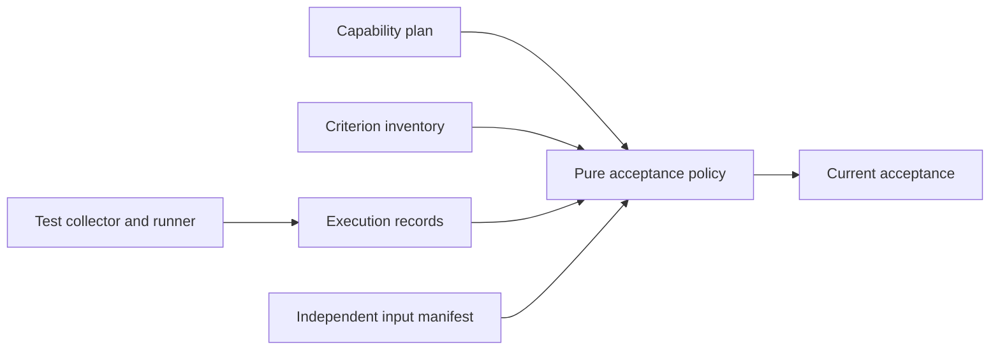
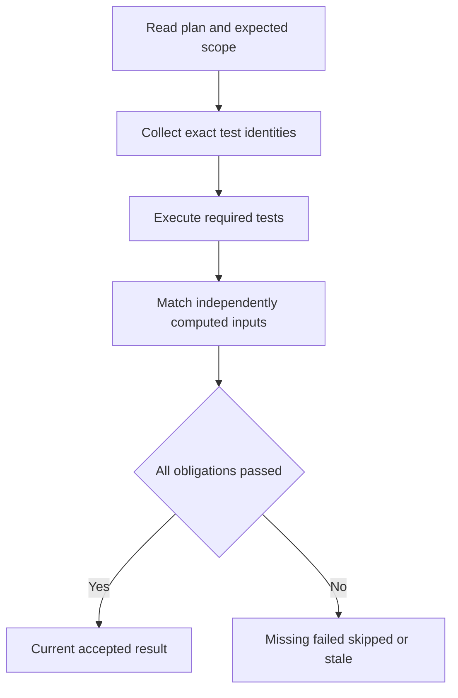

# Design Document

## Overview

Separate capability planning from executable acceptance. A TOML entry can describe work without proving it; a run record can prove behavior only for its declared and independently matched input state. This deliverable is usable on today's spec CLI before any code analyzer is built.

### Goals
- Seed all five split specs as planned and validate criterion/test references.
- Provide a shared real-binary harness and current-evidence verifier.
- Reject empty, skipped, stale or mismatched execution claims.

### Non-Goals
Feature-specific detector assertions, running licensed analyzers, IDE UI acceptance, cryptographic attestation against a malicious CI administrator or implementing a general test framework.

## Boundary Commitments

### This Spec Owns
- Ledger schema and referential checks; execution-record schema, eligibility and acceptance policy.
- Independent input identity construction, runner collection and reusable journey recording.
- Canonical local/CI verification entry point and the breadth acceptance journey.

### Out of Boundary
Feature owners write their behavioral journeys and declare required test IDs. The core module does not execute tests, read files or access clocks. Current-evidence verification does not convert prose evidence into proof.

### Allowed Dependencies
Core requirements/tasks/design parsers and Source; cli-contracts for command behavior. Native CLI performs filesystem/hashing. Existing tests/common supplies temporary fixtures and process execution. No dependency on code-constraints, clone-constraints or code-locality-data; their future tests register inputs.

### Revalidation Triggers
Ledger/reference grammar, record schema, identity algorithm, suite discovery, status policy, runner prerequisites or criterion ownership changes revalidate all current capability claims.

## Architecture

### Existing Architecture Analysis
QOpenBB's ledger provides capability links; its evidence tests additionally reject exit-zero skipped runs and mismatched identities. Adopt those distinctions. Existing CLI helper already creates temporary trees and runs CARGO_BIN_EXE_kiro-cli; extend it once.

### Architecture Pattern & Boundary Map


Core owns policy over data; native adapters calculate expected identities and load artifacts. The canonical runner executes registered commands, never shell text taken from evidence or the ledger.

### Technology Stack
| Layer | Choice / Version | Role | Constraint |
|---|---|---|---|
| Core | Existing serde/toml/serde_json lockfile versions | Parse typed plans and records | Native and wasm-safe |
| Native | Rust std plus SHA-256 library pinned at implementation | Independent input/artifact digests | Hashing dependency stays native |
| Runner | PowerShell 7 on Windows, Linux and macOS | One scripts/verify.ps1 entry point | Dagger installs/provides pwsh explicitly |
| Tests | cargo nextest and cargo test --doc | Collection, component and E2E runs | No silent required skips |

## File Structure Plan

| Component | File | Responsibility |
|---|---|---|
| BreadthLedger | `crates/kiro-core/src/breadth.rs` | Parse ledger and resolve criteria/status/path declarations |
| EvidencePolicy | `crates/kiro-core/src/evidence.rs` | Pure execution-claim validation |
| BreadthCommand | `crates/kiro-cli/src/breadth.rs` | Ledger and acceptance subcommand adapters |
| EvidenceInputs | `crates/kiro-cli/src/evidence_io.rs` | Confined manifest/artifact reads and independent identity calculation |
| JourneyHarness | `crates/kiro-cli/tests/common/mod.rs` | Reuse fixture setup and binary execution |
| JourneyHarness | `crates/kiro-cli/tests/common/evidence.rs` | Record test identities and replayable journey events |
| EvidenceTests | `crates/kiro-cli/tests/e2e_evidence.rs` | Ledger lifecycle and false-claim journeys |
| EvidenceTests | `crates/kiro-core/fixtures/evidence/valid.toml` | Ledger policy fixture |
| EvidenceTests | `crates/kiro-core/fixtures/evidence/run.json` | Execution record schema fixture |
| VerificationRunner | `scripts/verify.ps1` | Portable acceptance orchestrator with explicit suite selection |
| VerificationRunner | `.dagger/src/kiro/main.py` | Invoke canonical runner in build container |
| VerificationRunner | `.github/workflows/ci.yml` | Publish run artifacts and enforce acceptance job |
| EvidenceDocs | `docs/evidence.md` | Schema, statuses, collection, replay and scope policy |
| EvidenceDocs | `.kiro/breadth.toml` | Initial five-spec planning ledger |
| EvidenceDocs | `.kiro/verification-suites.toml` | Planned journey entrypoints, promoted only after implementation and exact collection |
| EvidenceDocs | `.opencode/skills/kiro-spec-tasks/SKILL.md` | Planned ledger entries at task generation |
| EvidenceDocs | `.opencode/skills/kiro-impl/SKILL.md` | Evidence workflow integration section |
| EvidenceDocs | `.opencode/skills/kiro-validate-impl/SKILL.md` | Current evidence acceptance section |

The existing kiro-core owner retains lib.rs/finding catalogue registration; cli-contracts retains shared CLI dispatch. This spec requests additive registrations at its serialized integration gate. Later skill additions are section-owned: this spec owns evidence workflow sections, code-constraints owns code-check sections; integration edits to those shared skills are serialized.

## System Flows



Historical ledger status remains a claim; current acceptance is computed. No required tests collected is a refusal, not a pass. Local missing tools may produce unverified records, but release acceptance fails.

## Requirements Traceability

| Requirement | Summary | Components | Interfaces | Flows |
|---|---|---|---|---|
| 1.1 | The repository shall keep a committed ledger .kiro/breadth.toml of [[capabilities]] e… | BreadthLedger, BreadthCommand, EvidenceDocs, EvidenceTests | BreadthLedger contract | Capability Ledger |
| 1.2 | When breadth check runs, the kiro-cli shall resolve every requirement reference again… | BreadthLedger, BreadthCommand, EvidenceDocs, EvidenceTests | BreadthLedger contract | Capability Ledger |
| 1.3 | When breadth check runs, the kiro-cli shall verify that every listed test and end-to-… | BreadthLedger, BreadthCommand, EvidenceDocs, EvidenceTests | BreadthLedger contract | Capability Ledger |
| 1.4 | When a status lacks its required structural support, the ledger checker shall report … | BreadthLedger, BreadthCommand, EvidenceDocs, EvidenceTests | BreadthLedger contract | Capability Ledger |
| 1.5 | When every task that references a capability's criteria is complete in its spec's tas… | BreadthLedger, BreadthCommand, EvidenceDocs, EvidenceTests | BreadthLedger contract | Capability Ledger |
| 1.6 | When breadth check runs, the kiro-cli shall report BREADTH_CRITERION_UNMAPPED at info… | BreadthLedger, BreadthCommand, EvidenceDocs, EvidenceTests | BreadthLedger contract | Capability Ledger |
| 1.7 | If the ledger is absent, is not valid TOML, lacks the capabilities list, repeats an i… | BreadthLedger, BreadthCommand, EvidenceDocs, EvidenceTests | BreadthLedger contract | Capability Ledger |
| 1.8 | The specification workflow shall seed planned capabilities during task generation, re… | BreadthLedger, BreadthCommand, EvidenceDocs, EvidenceTests | BreadthLedger contract | Capability Ledger |
| 1.9 | The repository shall seed the five split specifications in the breadth ledger before … | BreadthLedger, BreadthCommand, EvidenceDocs, EvidenceTests | BreadthLedger contract | Capability Ledger |
| 2.1 | The repository shall provide an end-to-end suite that drives the built kiro-cli binar… | JourneyHarness, VerificationRunner, EvidenceTests | JourneyHarness contract | Real-Binary Acceptance Workflow |
| 2.2 | The acceptance workflow shall track the implementer, CI, change, onboarding, sources,… | JourneyHarness, VerificationRunner, EvidenceTests | JourneyHarness contract | Real-Binary Acceptance Workflow |
| 2.3 | The end-to-end suite shall record commands, exits, stdout digests, fixture identities… | JourneyHarness, VerificationRunner, EvidenceTests | JourneyHarness contract | Real-Binary Acceptance Workflow |
| 2.4 | The CI gate shall run required journeys after component checks and validate current e… | JourneyHarness, VerificationRunner, EvidenceTests | JourneyHarness contract | Real-Binary Acceptance Workflow |
| 2.5 | The repository shall run the same acceptance entry point locally and in Dagger, repor… | JourneyHarness, VerificationRunner, EvidenceTests | JourneyHarness contract | Real-Binary Acceptance Workflow |
| 2.6 | The rules reference shall state the end-to-end-first policy: a capability's acceptanc… | JourneyHarness, VerificationRunner, EvidenceTests | JourneyHarness contract | Real-Binary Acceptance Workflow |
| 3.1 | The acceptance verifier shall require structured records naming capability, criteria,… | EvidencePolicy, EvidenceInputs, EvidenceTests | EvidencePolicy contract | Current Execution Evidence |
| 3.2 | The acceptance verifier shall compute expected source, specification, configuration, … | EvidencePolicy, EvidenceInputs, EvidenceTests | EvidencePolicy contract | Current Execution Evidence |
| 3.3 | If a required test is missing, not collected, not executed, failed or skipped, the ac… | EvidencePolicy, EvidenceInputs, EvidenceTests | EvidencePolicy contract | Current Execution Evidence |
| 3.4 | The acceptance verifier shall reject a test selector that names an existing file but … | EvidencePolicy, EvidenceInputs, EvidenceTests | EvidencePolicy contract | Current Execution Evidence |
| 3.5 | The acceptance verifier shall require every in-scope release criterion to be mapped a… | EvidencePolicy, EvidenceInputs, EvidenceTests | EvidencePolicy contract | Current Execution Evidence |
| 3.6 | The evidence workflow shall preserve historical runs without treating them as current… | EvidencePolicy, EvidenceInputs, EvidenceTests | EvidencePolicy contract | Current Execution Evidence |
| 3.7 | The evidence workflow shall preserve replayable fixture and environment identity plus… | EvidencePolicy, EvidenceInputs, EvidenceTests | EvidencePolicy contract | Current Execution Evidence |
| 3.8 | The acceptance verifier shall exclude evidence records themselves from tested-input i… | EvidencePolicy, EvidenceInputs, EvidenceTests | EvidencePolicy contract | Current Execution Evidence |
| 4.1 | The verification workflow shall provide the shared harness and one existing-binary jo… | JourneyHarness, VerificationRunner, EvidenceTests | JourneyHarness contract | Early Harness and Portable Gates |
| 4.2 | The verification workflow shall run component tests and journey tests through one can… | JourneyHarness, VerificationRunner, EvidenceTests | JourneyHarness contract | Early Harness and Portable Gates |
| 4.3 | The verification workflow shall test rejected evidence by changing test identifiers, … | JourneyHarness, VerificationRunner, EvidenceTests | JourneyHarness contract | Early Harness and Portable Gates |
| 4.4 | The verification workflow shall collect requirements and design coverage independentl… | JourneyHarness, VerificationRunner, EvidenceTests | JourneyHarness contract | Early Harness and Portable Gates |

## Components and Interfaces

### BreadthLedger
**Requirements:** 1.1–1.9. **Dependencies:** requirements/tasks parsers outbound P0, Source outbound P0. **Contracts:** Service, State.
```rust
pub enum CapabilityStatus { Planned, Implemented, Partial, Unverified, Passed, Deferred }
pub struct Capability {
    pub id: String, pub requirements: Vec<String>, pub planned_checks: Vec<String>,
    pub test_paths: Vec<String>, pub e2e_paths: Vec<String>,
    pub status: CapabilityStatus, pub evidence: Vec<String>, pub deferral: Option<Deferral>,
}
pub fn parse_ledger(text: &str) -> Result<Ledger, LedgerError>;
pub fn check_ledger(ledger: &Ledger, specs: &[SpecView], source: &dyn Source) -> BreadthReport;
```
Deferral contains owner, reason, approval_ref and excluded_criteria; it cannot exclude criteria outside its capability. Schema version 1, unique nonempty IDs. Resolve spec:N.M, spec:N, within-requirement ranges, and legacy spec/requirements.md:ref; amendment references remain accepted for older specs. The new split specs use numeric IDs. File-before-:: existence is only a planning check. Planned missing paths warn; implemented paths must exist. Passed claims require evidence references but only acceptance verification can confirm them. Unknown IDs/status, missing ledger, malformed TOML or duplicate IDs invalidate the document. Completed-task/planned drift warns; avoid vacuous truth when no task references a criterion. Unmapped criteria are informational during planning and blocking for release scope.

### EvidencePolicy
**Requirements:** 3.1–3.8, 1.4, 2.4. **Dependencies:** ledger/spec views inbound P0. **Contracts:** Service, State.
```rust
pub struct TestIdentity { pub suite: String, pub binary: String, pub name: String }
pub enum ExecutionStatus { Passed, Failed, Skipped, NotRun }
pub struct TestResult { pub id: TestIdentity, pub status: ExecutionStatus }
pub struct InputIdentity {
    pub source: String, pub specs: String, pub config: String,
    pub lock: String, pub tests: String, pub binary: String,
    pub toolchain: String, pub platform: String,
}
pub struct RunRecord {
    pub schema_version: u32, pub capability: String, pub criteria: Vec<String>,
    pub identity: InputIdentity, pub collected: Vec<TestIdentity>,
    pub results: Vec<TestResult>, pub command: Vec<String>, pub cwd: String,
    pub fixtures: String, pub exit_code: i32, pub artifacts: Vec<ArtifactDigest>,
}
pub fn accept(plan: &AcceptancePlan, expected: &ExpectedContext, records: &[RunRecord]) -> AcceptanceReport;
```
ExpectedContext includes the independently resolved required criterion/test set, relevant input manifest, required platforms and build identity. Record counts derive from unique sets rather than trusting submitted totals. Every required test must occur exactly once per suite/platform execution and be Passed; extra results do not compensate for missing ones. Exit 0 alone is insufficient. Unknown criteria, duplicate results, stale hashes and missing artifact bytes reject the claim. Optional platform tests cannot satisfy required platforms.

Deferrals are scoped ledger entries with owner, reason and an approval reference in the acceptance-plan extension; they remain Deferred and reduce only the explicitly approved release scope, never become Passed. A record is ordinary machine evidence, not a signature: CI permissions and protected configuration supply the trust boundary.

### EvidenceInputs and BreadthCommand
**Requirements:** 1.2–1.7, 3.1–3.8. **Dependencies:** CliGroups outbound P0; core policy outbound P0. **Contracts:** Service, Batch.
```rust
pub fn expected_context(root: &Path, plan: &AcceptancePlan, build: &BuiltArtifact) -> Result<ExpectedContext, EvidenceIoError>;
pub fn load_records(paths: &[PathBuf], root: &Path) -> Result<Vec<RunRecord>, EvidenceIoError>;
```
Commands: `breadth check` validates planning; `breadth accept --spec <name> --records <path>...` validates current acceptance. --all selects all non-deferred release obligations. Planning output explicitly carries current_acceptance = NotEvaluated even when all references are valid. Both compose Report/Gate profiles, but acceptance obligations are mandatory errors independent of a configurable finding threshold. Usage/I/O exits 2, invalid/incomplete claim exits 1, valid scope exits 0. Neither command runs arbitrary commands embedded in records.

Input manifest enumerates relevant files and hashes their bytes plus path; includes dirty tracked and selected untracked source files, specifications, tests, effective config and lockfiles. It excludes generated evidence/output directories. Calculate before and after execution; mutation of relevant inputs invalidates the run. Build identity is supplied by the runner from the artifact actually launched and its build manifest, not the record's self-declaration. Compare fixture digests and setup recipe, not random temporary directory names. Paths are confined and canonicalized; evidence outside the repository is accepted only through explicitly named artifact roots.

### JourneyHarness and VerificationRunner
**Requirements:** 2.1–2.6, 4.1–4.4. **Dependencies:** existing tests/common outbound P0; nextest/pwsh/Git external P0 where required. **Contracts:** Batch.

One `pwsh -NoProfile -File scripts/verify.ps1 -Scope <spec|all>` entry point. It prepares owned output under configured build-artifact directories, builds the actual binary, collects exact test identities, runs component suites once, doctests once and registered e2e_* binaries once, then invokes breadth check and breadth accept. The verification-evidence bootstrap uses a planned ledger and its own false-claim journey; it need not accept future planned capabilities. Release --all refuses their incompleteness unless scope explicitly excludes/defer them.

Use a checked-in suite registry generated from feature-owned test entrypoints during task generation; do not infer runnable tests from planned_checks. Nextest JUnit output and its collected test list are normalized into RunRecord; pin the runner format and fixture-test the adapter. Doctest results have a separate declared suite identity. When nextest cannot expose a particular required test identity, that suite remains unavailable until its adapter exists.

The registry's task-generation state declares suite ID, owning spec, journey entrypoint, required platforms, planned status and an empty required-test list. These are declarations of future work, not executable selectors. VerificationRunner validates and promotes entries only when the entrypoint exists and exact tests are independently collected; component/doctest partitions are then registered explicitly. Empty required-test lists cannot establish acceptance. The registry is a relevant configuration input for evidence identity.

The harness logs each command's argv, normalized cwd, stdout/stderr digests, retained output files and fixture recipe into an artifact file on both success and failure. Git fixtures create their own repositories and commits. Never run parallel jobs against shared mutable fixtures; bound worker count from runner configuration. A controlled negative test launches a fixture variant with a detector disabled and checks that its behavioral journey fails.

### EvidenceTests and EvidenceDocs
**Requirements:** all four groups. **Contracts:** Batch.
Unit fixtures validate statuses, references and identity comparisons; binary journeys validate the real CLI refusal paths. Documentation distinguishes planning validity, historical acceptance and current acceptance. Seeded entries have planned_checks but empty actual-test/evidence arrays until implementation supplies them.

## Data Models
Ledger is committed human planning data; run records are immutable artifacts, with compact reviewed references optionally committed. Schema version changes on meaning changes. A multi-task capability remains Partial until all required criteria/tests succeed. A later evidence-only commit can refer to a previously tested input manifest without claiming that commit was executed.

## Error Handling
BREADTH_INVALID, BREADTH_REQ_UNKNOWN, BREADTH_TEST_MISSING, BREADTH_STATUS_UNSUPPORTED, BREADTH_STALE, BREADTH_CRITERION_UNMAPPED and BREADTH_COVERAGE cover planning. EVIDENCE_INVALID, EVIDENCE_TEST_MISSING, EVIDENCE_NONPASSING, EVIDENCE_STALE and EVIDENCE_SCOPE_INCOMPLETE cover acceptance. These are additive catalogue entries; unknown schema versions fail closed. Missing required tools cannot produce a passed run.

## Testing Strategy
- Group 1: valid and missing ledger; numeric/legacy references; duplicate IDs; nonexistent path; planned versus implemented; zero-task stale check.
- Group 2: real existing check command and temporary Git journey; retain successful output; missing-tool run stays unverified.
- Group 3: exact selector absent despite existing file; empty suite; skipped with exit zero; stale source/config/lock/binary/platform; duplicate result; unrelated criterion; tampered artifact; relevant files changing mid-run; evidence-only commit does not self-invalidate.
- Group 4: shared fixture reuse; suite registry covers all required IDs; no duplicated suites; controlled broken detector fails its behavioral assertion.
- Same required test set on Windows, Linux and macOS; core wasm build remains independent of hashing/process dependencies.

## Deliverables and Development Gates
1. E0: typed ledger and pure evidence fixtures; seeded planned entries.
2. E1: shared harness and existing-binary journey before code analysis.
3. E2: independent identity and acceptance CLI; all false-claim cases rejected.
4. E3: portable runner and Dagger integration with current evidence for this spec.
G5 must pass before any capability becomes Passed. Future feature owners add journeys incrementally rather than postponing them to a final integration phase.

## Integration & Migration Notes
No automatic promotion based on test-file existence. Existing historical prose evidence is retained as history and cannot satisfy the new executable contract. The runner is a planned deliverable, not an available command today. Evidence acceptance for code/clone/locality waits on their own implementation, without blocking delivery of this foundation.
