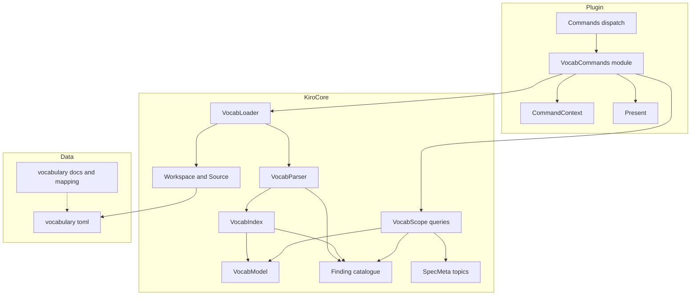
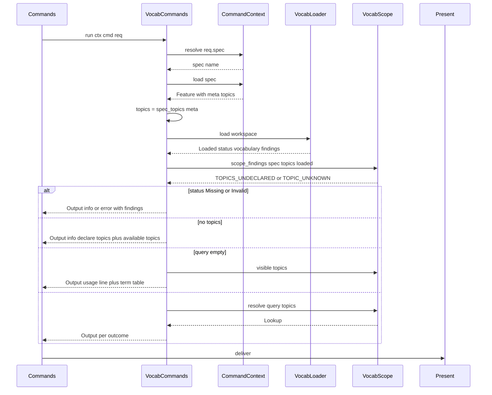
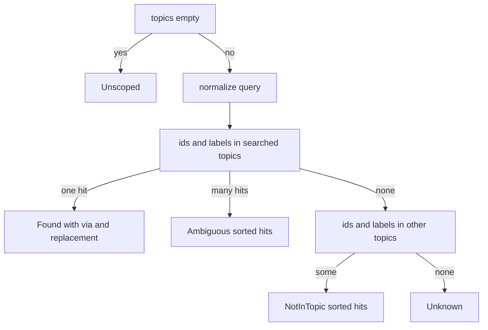

# Design Document: vocabulary-grounding

## Overview

**Purpose**: vocabulary-grounding adds the topic-scoped vocabulary to the v2 engine and the IDE. It defines the committed vocabulary file (`.kiro/vocabulary.toml`), loads and validates it inside `kiro-core`, resolves labels and ids strictly inside a spec's declared topics, exposes terms and topics through three read-only `vocab.*` plugin commands, ships the seed vocabulary for the `sdd` topic, and documents the path from an Auto Ontology export to the committed file through the SKOS → TOML mapping that cli-gate implements.

**Users**: spec authors and reviewers in OpenIDEA (`vocab.term`, `vocab.list`, `vocab.topics`); spec-constraints (every term check resolves through `Vocabulary::resolve`); spec-navigation and spec-visualization (`resolve` — component names are resolved by label, not looked up by term id; the vocabulary-backed labeler itself is deferred per the roadmap); cli-gate (same loader and findings; implements the importer against the mapping defined here); vocabulary maintainers (seed file, documentation).

**Impact**: Adds `crates/kiro-core/src/vocab/` and the `toml` dependency to kiro-core, appends finding codes to its catalogue, adds `plugins/kiro/src/vocab.rs` and one module-table line to the plugin, and creates `.kiro/vocabulary.toml` and `docs/vocabulary.md`. No upstream interface changes shape.

### Goals
- A vocabulary file that reviews well in a pull request, where every term has exactly one topic, one definition and one kind.
- A query API whose type makes cross-topic resolution impossible: every lookup takes the topics to search and answers `Found`, `NotInTopic`, `Ambiguous`, `Unknown` or `Unscoped`.
- Validation findings at the offending line, in the shared `Finding` shape, rendered identically by plugin and CLI.
- Plugin commands that are useful from Search Everywhere (no argument) and degrade to informative notifications when the vocabulary is absent or broken.
- A seed vocabulary and a documented import path so the vocabulary has a source of truth outside the IDE.

### Non-Goals
- Checks over requirement text (EARS, declared-before-use, topic mismatch, contradiction) — spec-constraints.
- The importer executable (`kiro-cli vocab import`, supporting both SKOS Turtle and `--format auto-ontology-json`) — cli-gate; only the mapping and procedure are defined here.
- Navigation/visualization commands — they call `resolve` (component names are resolved by label, not looked up by term id); the vocabulary-backed labeler itself is deferred per the roadmap and lives in the frontends.
- Editing the vocabulary or `spec.json` from the IDE; running Auto Ontology; changing the host.
- Enforcing `topics` in the spec templates (documented only).

## Boundary Commitments

### This Spec Owns
- The `.kiro/vocabulary.toml` format (schema version `2`), its id and label rules, and its semantic validation findings.
- `kiro_core::vocab`: model types, parser, index (per-topic label index, broader closure, cycle detection), the scoped query API (`resolve`, `preferred_label`, `visible`, `topics`), spec-topic derivation and scope findings, and the loader over `Workspace`.
- The vocabulary finding codes `VOCAB_*`, `TERM_*`, `TOPIC_*`, `TOPICS_UNDECLARED` in kiro-core's catalogue.
- The plugin `vocab` feature module: the three commands, their argument interpretation, their output texts and levels.
- The seed `.kiro/vocabulary.toml` (`sdd` topic) and `docs/vocabulary.md` (format, `spec.json` `topics`, Auto Ontology procedure, SKOS → TOML mapping).
- Fixtures under `crates/kiro-core/fixtures/vocab/` and the tests named in the File Structure Plan.

### Out of Boundary
- Any finding about requirement or criterion text (spec-constraints), including `TERM_UNDECLARED`, `TERM_TOPIC_MISMATCH`, `TERM_DEPRECATED` as text findings.
- Parsing SKOS/RDF anywhere (importer: cli-gate; the plugin never sees RDF).
- kiro-core's `Workspace`, `Feature`, `SpecMeta` and `Finding` shapes (consumed unchanged; only the catalogue grows).
- plugin-core's dispatch, resolution, argument grammar, presentation and budgets (consumed unchanged; only the module table, manifest and README grow).
- The spec templates and skills (the `topics` field is documented, not applied).

### Allowed Dependencies
- kiro-core `vocab` imports from `finding`, `spec` (`SpecMeta`), `source` (`Source`, `Workspace`) and `std` (`collections`); never from `resolve`, `render`, `join` or the parsers. Dependency direction becomes `finding` → `md` → parsers → `join` → `source` → {`resolve`, `vocab`}; `render` → `finding`.
- New runtime dependency of kiro-core: `toml = { version = "0.8", default-features = false, features = ["parse"] }` (pure Rust, wasm-safe; a kiro-core revalidation trigger, sanctioned by steering).
- Plugin `vocab.rs` imports `kiro_core::{vocab, finding, spec, source, render::text}` and plugin-core's `host`, `registry`, `args`, `present`, `context`, `module` (it sits where `ws.rs` sits in the module order: left of `commands`).
- Nothing else: no `std::fs`, no RDF crates, no network.

### Revalidation Triggers
- Any change to `Lookup`, `Term`, `Kind`, `Hit`, `Loaded`, `Status` or to the signatures of `resolve`, `preferred_label`, `visible`, `spec_topics`, `scope_findings`, `load` (spec-constraints, spec-navigation, spec-visualization, cli-gate).
- This spec itself fires two upstream revalidation triggers, and the corresponding upstream lines were amended during cross-spec review (this spec's integration tasks only verify them) so later boundary reviews do not flag the imports: kiro-core design "Allowed Dependencies" gains `toml` (parse only), and plugin-core design "Allowed Dependencies" gains `kiro_core::vocab` for the `vocab` module.
- Any change to the TOML format, the id rule, the label normalisation or the SKOS → TOML mapping (cli-gate importer, vocabulary maintainers).
- Renaming or re-leveling a vocabulary finding code (cli-gate JSON consumers, plugin presentation).
- Changing the command list or titles of the `vocab` group (plugin manifest test, budget worked example, README).
- Upstream: any change to kiro-core's `Workspace::read`, `SpecMeta.topics`, `Finding`, or plugin-core's `FeatureModule`, `CommandSpec`, `Request`, `Output`, `CommandContext`.

## Architecture

### Existing Architecture Analysis
- kiro-core is a pure engine behind the `Source` port with one module per seam; `Workspace` caches raw reads (`read(path) -> Option<&str>`), `SpecMeta.topics` is already parsed, `Finding::new` takes its default severity from `CODES`, and a doc test ties `lib.rs` docs to the catalogue. The crate reserves nothing for `vocab` beyond the module slot in steering's map.
- plugin-core dispatches by group to `FeatureModule`s; `CommandSpec` declares addressability and argument policy; `CommandContext` resolves the spec and loads features through its workspace; `Output` + `deliver` own clipping; the IDE passes no argument and discards the `Ok` message. `Group::Vocab` exists and the budget example assumes three `vocab` base commands.

### Architecture Pattern & Boundary Map



**Architecture Integration**:
- Selected pattern: an indexed immutable value (`Vocabulary`) built once per command from the file, queried through functions that all take the topic list — scoping is enforced by the API shape, not by caller discipline (research.md, pattern evaluation).
- Domain boundaries: `parse` knows TOML and nothing else; `index` knows validation and relations; `scope` knows queries and spec topics; the loader knows the path and the workspace; the plugin module knows texts and levels. Cross-topic knowledge exists only as `(topic, id)` hits inside `NotInTopic`.
- Existing patterns preserved: plain owned data + findings, no `Result` in core's public API, `BTreeMap` ordering, lint table, `FeatureModule` with a `COMMANDS` static like `ws.rs`.
- New components rationale: `VocabIndex` is separate from `VocabParser` so that validation is testable from constructed raw values and so the strict TOML parse stays small; `VocabScope` is separate so the hard rule lives in one file.
- Steering compliance: no fs/net/threads/clock; deterministic ordering; finding codes in `SCREAMING_SNAKE`; command ids `vocab.<name>`; TOML-first, SKOS only in the CLI.

### Technology Stack

| Layer | Choice / Version | Role in Feature | Notes |
|-------|------------------|-----------------|-------|
| Engine | Rust 2024, kiro-core lints | `vocab` module | `#![forbid(unsafe_code)]`, no `unwrap`/indexing |
| Parsing | `toml` 0.8, `default-features = false`, `features = ["parse"]` | `.kiro/vocabulary.toml` → raw types with `toml::Spanned` for line numbers | Pure Rust; builds for `wasm32-wasip2`; plugin size measured |
| Serialization | `serde` 1 (`derive`) | `Deserialize` on private raw types only | Model types stay serde-free except `Finding` (upstream) |
| Plugin | `openidea-plugin-kiro`, plugin-core seams | `vocab.rs` feature module | No new plugin dependency |
| Docs/Data | Markdown, TOML | `docs/vocabulary.md`, `.kiro/vocabulary.toml` | SKOS Turtle only as a documented input of cli-gate |

## File Structure Plan

### Directory Structure
```
.kiro/
└── vocabulary.toml                          # Seed vocabulary, topic sdd (schema 2)
docs/
└── vocabulary.md                            # Format, spec.json topics, Auto Ontology procedure, SKOS -> TOML mapping (new top-level docs/ directory for user-facing project documentation; structure.md gains the pattern in the integration task)
crates/kiro-core/
├── Cargo.toml                               # + toml dependency
├── src/
│   ├── lib.rs                               # + pub mod vocab; + vocabulary codes in the doc table
│   ├── finding.rs                           # + vocabulary codes in CODES and codes
│   └── vocab/
│       ├── mod.rs                           # Status, Loaded, parse, load, re-exports
│       ├── model.rs                         # VOCABULARY_PATH, SCHEMA_VERSION, Kind, Term, Topic, Vocabulary, Hit, normalize_label, is_id
│       ├── parse.rs                         # Raw TOML types with spans -> RawFile or VOCAB_INVALID
│       ├── index.rs                         # Semantic validation, per-topic indexes, closure, cycles
│       └── scope.rs                         # resolve, preferred_label, visible, topics, spec_topics, scope_findings
├── fixtures/vocab/
│   ├── valid.toml                           # Two topics, hierarchy, alt labels, deprecated with replacement, enum and int kinds
│   ├── invalid-syntax.toml                  # Unterminated string at a known line
│   ├── invalid-structure.toml               # Wrong-typed field and an invalid id
│   ├── semantic.toml                        # Every semantic finding code once
│   ├── cycle.toml                           # A 3-term cycle plus a self-loop
│   └── tree/.kiro/                          # Workspace tree: vocabulary + specs demo (topics sdd), both (sdd, pm), none (no topics), stale (unknown topic)
└── tests/
    └── vocab.rs                             # Integration tests over the fixtures and the seed file
plugins/kiro/
├── plugin.toml                              # + vocab.term, vocab.list, vocab.list.insert, vocab.topics
├── README.md                                # + vocab commands in the command table and argument examples
├── src/
│   ├── lib.rs                               # + pub mod vocab
│   ├── commands.rs                          # modules(): + Box::new(vocab::Vocab)
│   └── vocab.rs                             # Vocab module: COMMANDS, term, list, topics, text helpers
└── tests/
    └── vocab.rs                             # End-to-end over FakeHost with fixtures/vocab/tree and the seed file
```

### Files by Component

| Component | File | Responsibility |
|-----------|------|----------------|
| VocabModel | `crates/kiro-core/src/vocab/model.rs` | `Kind`, `Term`, `Topic`, `Hit`, `Vocabulary` (fields private, constructed by VocabIndex), `normalize_label`, `is_id`, constants |
| VocabParser | `crates/kiro-core/src/vocab/parse.rs` | Private `RawFile`/`RawTopic`/`RawTerm` with `toml::Spanned`, `parse_raw(text, file) -> Result<RawFile, Finding>`, `line_of(text, byte)` |
| VocabIndex | `crates/kiro-core/src/vocab/index.rs` | `build(raw, text, file) -> (Vocabulary, Vec<Finding>)`: id/kind/definition checks, duplicate labels per topic, cross-topic label-collision lint, broader and replaced_by validation, cycles, closure, implicit topics, `TOPIC_EMPTY` |
| VocabScope | `crates/kiro-core/src/vocab/scope.rs` | `MatchVia`, `Lookup`, `impl Vocabulary { resolve, preferred_label, visible, topics, topic }`, `spec_topics`, `scope_findings` |
| VocabLoader | `crates/kiro-core/src/vocab/mod.rs` | `Status`, `Loaded`, `parse(text, file) -> Loaded`, `load(&mut Workspace<S>) -> Loaded`, re-exports of model and scope types (including the path and schema constants defined in `model.rs`) |
| CoreIntegration | `crates/kiro-core/src/finding.rs` | Append the vocabulary codes to `CODES` and `codes` |
| CoreIntegration | `crates/kiro-core/src/lib.rs` | `pub mod vocab;`, finding-code rows in the crate docs, vocabulary grammar subsection |
| CoreIntegration | `crates/kiro-core/Cargo.toml` | `toml` dependency |
| VocabFixtures | `crates/kiro-core/fixtures/vocab/valid.toml` | Loads with zero warning/error findings and one `VOCAB_LABEL_CROSS_TOPIC` (info) finding on `pm-task`; topics `sdd` and `pm`; label `"Task"` in both topics; `broader` chain of depth 3; alt labels; deprecated term with replacement; enum and int kinds |
| VocabFixtures | `crates/kiro-core/fixtures/vocab/invalid-syntax.toml` | TOML syntax error at a known line → `VOCAB_INVALID` |
| VocabFixtures | `crates/kiro-core/fixtures/vocab/invalid-structure.toml` | `label = 3` and `[terms.Bad_Id]` → `VOCAB_INVALID` at the first problem's line |
| VocabFixtures | `crates/kiro-core/fixtures/vocab/semantic.toml` | One term per code: `TERM_NO_DEFINITION`, `TERM_KIND_INVALID` (unknown kind; enum without values), `TERM_DUPLICATE_LABEL` (label and alt label), `TERM_BROADER_UNKNOWN`, `TERM_BROADER_CROSS_TOPIC`, `TERM_DEPRECATED_NO_REPLACEMENT`, `TERM_REPLACED_BY_UNKNOWN`, `TERM_REPLACED_BY_CROSS_TOPIC`, `TOPIC_EMPTY`, `VOCAB_SCHEMA_UNSUPPORTED` |
| VocabFixtures | `crates/kiro-core/fixtures/vocab/cycle.toml` | `a → b → c → a` and `d → d` → `TERM_BROADER_CYCLE` on a, b, c, d; `e → a` still answers |
| VocabFixtures | `crates/kiro-core/fixtures/vocab/tree/.kiro/vocabulary.toml` | Copy of `valid.toml` |
| VocabFixtures | `crates/kiro-core/fixtures/vocab/tree/.kiro/steering/roadmap.md` | Roadmap listing demo, both, none, stale |
| VocabFixtures | `crates/kiro-core/fixtures/vocab/tree/.kiro/specs/demo/spec.json` | `topics: ["sdd"]` |
| VocabFixtures | `crates/kiro-core/fixtures/vocab/tree/.kiro/specs/both/spec.json` | `topics: ["sdd", "pm"]` |
| VocabFixtures | `crates/kiro-core/fixtures/vocab/tree/.kiro/specs/none/spec.json` | no `topics` |
| VocabFixtures | `crates/kiro-core/fixtures/vocab/tree/.kiro/specs/stale/spec.json` | `topics: ["sdd", "legacy"]` |
| CoreVocabTests | `crates/kiro-core/tests/vocab.rs` | Fixture-driven tests of every code, every outcome, closure, determinism, seed file, performance |
| SeedVocabulary | `.kiro/vocabulary.toml` | `sdd` topic seed in the importer's output shape |
| VocabDocs | `docs/vocabulary.md` | File format and id convention; `spec.json` `topics` and the template change; Auto Ontology export procedure (verified vs. to-confirm, using `kiro-cli vocab import --format auto-ontology-json --topic <t>` directly on the `GET /api/terms` JSON export or converting via SKOS Turtle); SKOS → TOML mapping (normative); `kiro:` namespace; review and commit procedure |
| VocabCommands | `plugins/kiro/src/vocab.rs` | `Vocab` module, `COMMANDS`, `term`, `list`, `topics`, `Scoped` helper, text helpers |
| PluginIntegration | `plugins/kiro/src/commands.rs` | `modules()` gains `Box::new(vocab::Vocab)` |
| PluginIntegration | `plugins/kiro/src/lib.rs` | `pub mod vocab;` and crate docs |
| PluginIntegration | `plugins/kiro/plugin.toml` | Four `[[contributes.commands]]` entries |
| PluginIntegration | `plugins/kiro/README.md` | Command table rows, argument examples, no-vocabulary behaviour |
| PluginVocabTests | `plugins/kiro/tests/vocab.rs` | End-to-end scenarios of Requirement 11.6 over `FakeHost` |

### Modified Files
- `crates/kiro-core/Cargo.toml` — add `toml` (parse only).
- `crates/kiro-core/src/finding.rs` — append 16 codes (15 + `VOCAB_LABEL_CROSS_TOPIC`, amendment 2026-11-04) to `CODES`/`codes` (table in Supporting References).
- `crates/kiro-core/src/lib.rs` — declare `vocab`, extend the documented code table and grammar overview.
- `.kiro/specs/vocabulary-grounding/spec.json` — add `"topics": ["sdd"]` (leaving workflow-managed fields untouched).
- `.kiro/steering/structure.md` — add the `docs/` directory pattern for user-facing project documentation.
- `plugins/kiro/src/commands.rs`, `plugins/kiro/src/lib.rs`, `plugins/kiro/plugin.toml`, `plugins/kiro/README.md` — register the module and its commands.

## System Flows

### Running `vocab.term`



Flow decisions: the spec is resolved before the vocabulary is read so that an unresolved spec fails with plugin-core's message and no vocabulary read; the spec name, its `spec.json` path (`Feature::path(Doc::SpecJson)`) and its topics are copied out of the `Feature` into owned values before `load(&mut ctx.workspace)`, and `scope_findings` consumes those copies so the dead `&Feature` borrow is never needed again; `vocab.topics` differs only in that Missing/Invalid still lists what it can (status and findings) and that it appends all vocabulary findings.

### Resolving a query



Matching inside a topic: the query is normalized once (1.5) and compared with ids (which are lower-case and whitespace-free by the id rule), normalized labels and normalized alt labels; each matching term counts as one hit however many of its names matched. `preferred_label` runs the same flow with the label indexes disabled. A `Found` outcome carries the term's broader closure, so no separate closure call exists.

## Requirements Traceability

| Requirement | Summary | Components | Interfaces | Flows |
|-------------|---------|------------|------------|-------|
| 1.1, 1.2, 1.3, 1.4 | File shape, id rule, required and optional fields | VocabParser, VocabModel, VocabDocs | `RawFile`, `is_id`, `Kind`, `Term` | — |
| 1.5, 1.6 | Label normalisation; per-topic uniqueness | VocabModel, VocabIndex | `normalize_label`, label index | — |
| 2.1, 2.2, 2.3 | Load once; missing; invalid with line | VocabLoader, VocabParser | `load`, `parse`, `Status`, `line_of` | Running `vocab.term` |
| 2.4, 2.5, 2.6, 2.7, 2.8, 2.9, 2.10, 2.11, 2.12, 2.13 | Semantic findings | VocabIndex, VocabFixtures (semantic, cycle) | `build` | — |
| 2.14 | Finding file and line | VocabIndex, CoreIntegration | `Finding` file `.kiro/vocabulary.toml`, `Term.line`, `Topic.line` | — |
| 2.15 | Cross-topic label-collision lint | VocabIndex, CoreIntegration | `VOCAB_LABEL_CROSS_TOPIC` at the later term's line | — |
| 3.1, 3.2, 3.3, 3.4 | Spec topics; undeclared; unknown; suppressed when not loaded | VocabScope | `spec_topics`, `scope_findings` | — |
| 3.5 | `topics` documentation and template change | VocabDocs | — | — |
| 4.1, 4.2, 4.3, 4.4, 4.5, 4.6, 4.8, 4.9 | Single scoped resolution with five outcomes, determinism, no unscoped API | VocabScope, VocabModel | `resolve`, `Lookup`, `Hit` | Resolving a query |
| 4.7 | Deprecated + replacement in Found | VocabScope | `Lookup::Found { replacement }` | Resolving a query |
| 5.1 | Broader closure nearest-first, only on a found term | VocabIndex, VocabScope | `ancestors`, `Lookup::Found { broader }` | Resolving a query |
| 5.2 | Preferred label by id | VocabScope | `preferred_label` | Resolving a query |
| 5.3, 5.4 | Visible terms; available topics | VocabScope | `visible`, `topics` | — |
| 6.1, 6.2, 6.3, 6.4, 6.5, 6.6 | `vocab.term` | VocabCommands, PluginIntegration | `COMMANDS`, `term` | Running `vocab.term` |
| 7.1, 7.2, 7.3, 7.4, 7.5, 7.6, 7.7 | `vocab.list`, `vocab.topics`, registration | VocabCommands, PluginIntegration | `list`, `topics`, `plugin.toml` | — |
| 8.1, 8.2, 8.3, 8.4, 8.5 | Degradation, unresolved spec, one read, no writes | VocabCommands, VocabLoader | `Scoped`, `Status` | Running `vocab.term` |
| 9.1, 9.2, 9.3, 9.4 | Seed vocabulary: term set, clean load, hierarchy and alt labels, header | SeedVocabulary, CoreVocabTests | `.kiro/vocabulary.toml` | — |
| 10.1, 10.2, 10.3, 10.4, 10.5, 10.6 | Auto Ontology procedure (verified vs. to-confirm); concept, label, definition, alt label, broader, deprecation mapping; topic and kind annotations; ignored subjects, empty definitions, ordering; namespace; review and commit | VocabDocs | mapping table | — |
| 11.1, 11.3 | Totality, both targets, determinism | VocabParser, VocabIndex, CoreVocabTests | lint table, wasm build | — |
| 11.2 | 10 000 terms < 1 s | VocabIndex, CoreVocabTests | `build` complexity | — |
| 11.4 | Catalogue completeness | CoreIntegration | `CODES`, `codes`, `lib.rs` table | — |
| 11.5 | Core tests | CoreVocabTests, VocabFixtures | `tests/vocab.rs` | — |
| 11.6 | Plugin tests | PluginVocabTests | `tests/vocab.rs`, `tests/manifest.rs` | — |

## Components and Interfaces

| Component | Domain/Layer | Intent | Req Coverage | Key Dependencies (P0/P1) | Contracts |
|-----------|--------------|--------|--------------|--------------------------|-----------|
| VocabModel | Engine / model | Term, topic, kind, vocabulary value, normalisation | 1.2, 1.3, 1.4, 1.5, 4.9 | none | State |
| VocabParser | Engine / parse | Strict TOML → raw values with spans, or one `VOCAB_INVALID` | 1.1, 2.3, 11.1 | toml (P0), Finding (P0) | Service |
| VocabIndex | Engine / validation | Semantic findings, label index, closure, cycles | 1.6, 2.4–2.15, 5.1, 11.2 | VocabModel (P0), Finding (P0) | Service |
| VocabScope | Engine / query | Scoped resolution, labels, listings, spec topics | 3.1–3.4, 4.1–4.9, 5.1–5.4 | VocabModel (P0), SpecMeta (P0) | Service |
| VocabLoader | Engine / port | Path, status, parse + build, workspace read | 2.1, 2.2, 2.3, 8.5 | Workspace (P0), VocabParser (P0), VocabIndex (P0) | Service |
| CoreIntegration | Engine / build | Catalogue, module declaration, dependency | 2.14, 2.15, 11.4 | Finding (P0) | State |
| VocabFixtures | Test data | TOML files and a workspace tree | 2.x, 4.x, 11.5 | none | — |
| CoreVocabTests | Tests | Fixture-driven engine tests | 11.1, 11.2, 11.3, 11.5, 9.2 | all engine components | — |
| SeedVocabulary | Data | `sdd` topic vocabulary | 9.1–9.4 | VocabLoader (validation) | State |
| VocabDocs | Docs | Format, topics, procedure, mapping | 3.5, 10.1–10.6 | none | — |
| VocabCommands | Plugin / feature | Three commands, outputs, degradation | 6.1–6.6, 7.1–7.6, 8.1–8.4 | Context (P0), Present (P0), VocabLoader (P0), VocabScope (P0) | Service |
| PluginIntegration | Plugin / package | Module table, manifest, README | 7.7, 11.6 | Registry (P0) | State |
| PluginVocabTests | Tests | End-to-end over `FakeHost` | 11.6 | FakeHost (P0), VocabFixtures (P1) | — |

### Engine

#### VocabModel

| Field | Detail |
|-------|--------|
| Intent | The plain data every other component shares; construction is private to the engine so an instance is always validated and indexed |
| Requirements | 1.2, 1.3, 1.4, 1.5, 4.9 |

**Contracts**: State [x]

##### State Management
```rust
pub const VOCABULARY_PATH: &str = ".kiro/vocabulary.toml";
pub const SCHEMA_VERSION: &str = "2";

#[derive(Debug, Clone, PartialEq, Eq)]
pub enum Kind { Entity, Bool, Enum { values: Vec<String> }, Int { min: Option<i64>, max: Option<i64> } }
impl Kind { pub fn name(&self) -> &'static str; }           // "entity" | "bool" | "enum" | "int"

#[derive(Debug, Clone, PartialEq, Eq)]
pub struct Term {
    pub id: String, pub topic: String, pub label: String, pub definition: String, pub kind: Kind,
    pub broader: Vec<String>,        // validated same-topic ids, declaration order (ignored relations removed)
    pub alt_labels: Vec<String>,     // as written
    pub deprecated: bool, pub replaced_by: Option<String>,   // as written (validity reported by findings)
    pub line: usize,                 // 1-based line of `[terms.<id>]`
}
#[derive(Debug, Clone, PartialEq, Eq)]
pub struct Topic { pub id: String, pub label: Option<String>, pub description: Option<String>, pub line: Option<usize>, pub term_count: usize }
#[derive(Debug, Clone, PartialEq, Eq, PartialOrd, Ord)]
pub struct Hit { pub topic: String, pub id: String }

#[derive(Debug, Clone, Default, PartialEq, Eq)]
pub struct Vocabulary {
    terms: BTreeMap<String, Term>,                       // by id
    topics: BTreeMap<String, Topic>,                     // declared or implicit
    labels: BTreeMap<String, BTreeMap<String, Vec<String>>>,   // topic -> normalized label -> ids (sorted, deduplicated)
    ancestors: BTreeMap<String, Vec<String>>,            // id -> closure, nearest first
}
impl Vocabulary { pub fn len(&self) -> usize; pub fn is_empty(&self) -> bool; }

/// Trim, collapse internal whitespace to one space, Unicode lower-case.
pub fn normalize_label(label: &str) -> String;
/// `[a-z0-9][a-z0-9-]*`
pub fn is_id(s: &str) -> bool;
```
- Invariants: every `Term.broader` entry and every `labels` id names a term of the same topic; `topics[t].term_count` equals the number of terms with `topic == t`; `ancestors[id]` never contains `id` itself and never a term of another topic; no public function returns a `&Term` without a `topics` argument — the broader closure is only reachable inside `Lookup::Found`, so forging a `Term` value (its fields are public) gives access to nothing.

#### VocabParser

| Field | Detail |
|-------|--------|
| Intent | Turn the file text into raw values with spans, or one structural finding |
| Requirements | 1.1, 2.3, 11.1 |

**Contracts**: Service [x]

##### Service Interface
```rust
#[derive(serde::Deserialize)] struct RawFile { schema_version: Option<toml::Spanned<String>>, #[serde(default)] topics: BTreeMap<String, toml::Spanned<RawTopic>>, terms: BTreeMap<String, toml::Spanned<RawTerm>> }   // `terms` is mandatory (1.1): a file without it is VOCAB_INVALID ("missing field `terms`"); an intentionally empty vocabulary writes `[terms]`
#[derive(serde::Deserialize)] struct RawTopic { label: Option<String>, description: Option<String> }
#[derive(serde::Deserialize)] struct RawTerm {
    topic: String, label: String, #[serde(default)] definition: String,
    kind: Option<String>, #[serde(default)] values: Vec<String>, min: Option<i64>, max: Option<i64>,
    #[serde(default)] broader: Vec<String>, #[serde(default)] alt_labels: Vec<String>,
    #[serde(default)] deprecated: bool, replaced_by: Option<String>,
}
/// Ok(raw) or Err(VOCAB_INVALID at the line of the first problem). Unknown keys are accepted silently.
/// After deserialisation, every `terms` and `topics` key is checked with `is_id`; the first violation is
/// `VOCAB_INVALID` at that table's line ("invalid id `X`: use [a-z0-9][a-z0-9-]*").
pub(crate) fn parse_raw(text: &str, file: &str) -> Result<RawFile, Finding>;
/// 1-based line containing byte offset `byte` (count of '\n' before it + 1); clamps past the end.
pub(crate) fn line_of(text: &str, byte: usize) -> usize;
```
- Postconditions: never panics (serde errors are values; `line_of` clamps); a BOM is stripped before parsing; CRLF is accepted by `toml`.
- The `VOCAB_INVALID` message is `toml::de::Error::message()` with the line taken from `error.span()` when present, else line 1.

#### VocabIndex

| Field | Detail |
|-------|--------|
| Intent | Semantic validation and the indexes the queries rely on, in one deterministic pass |
| Requirements | 1.6, 2.4, 2.5, 2.6, 2.7, 2.8, 2.9, 2.10, 2.11, 2.12, 2.13, 2.14, 2.15, 5.1, 11.2 |

**Contracts**: Service [x]

##### Service Interface
```rust
/// Always succeeds. Findings carry file = `file`, feature = None, line = the term's or topic's table line.
pub(crate) fn build(raw: RawFile, text: &str, file: &str) -> (Vocabulary, Vec<Finding>);
```
- Steps, in order (each over ids in `BTreeMap` order, except step 4 which runs in line order; findings are sorted with `sort_findings` afterwards, so output is deterministic either way):
  1. `schema_version` present and ≠ `"2"` → `VOCAB_SCHEMA_UNSUPPORTED` at the line of its span.
  2. Terms: `line = line_of(span.start)`; `definition.trim().is_empty()` → `TERM_NO_DEFINITION`; `kind`: `None`, unknown string, `"enum"` with empty `values`, or `"int"` with `min > max` → `TERM_KIND_INVALID` and `Kind::Entity`; else `Kind` built (`values`/`min`/`max` ignored for other kinds).
  3. Topics: every `[topics.<id>]` becomes a `Topic` with its line; every term topic not declared becomes an implicit `Topic { line: None }`; `term_count` computed; declared topics with `term_count == 0` → `TOPIC_EMPTY`.
  4. Labels: terms are visited in ascending `line` order; for each topic, each term's normalized `label` and `alt_labels` are inserted into `labels[topic]`; when a normalized label already maps to a different id in the same topic → `TERM_DUPLICATE_LABEL` at the term with the greater `line` (the later one in the file), message naming both ids and the label as written; both ids stay in the index (resolution reports `Ambiguous`). An alt label equal to the term's own label is dropped silently. A normalised label that maps to terms in two different topics → `VOCAB_LABEL_CROSS_TOPIC` (info) at the term with the greater `line`, naming both ids and their topics; both terms stay indexed (2.15).
  5. `broader`: unknown id → `TERM_BROADER_UNKNOWN`, removed; other topic → `TERM_BROADER_CROSS_TOPIC`, removed; self-reference → kept so step 6 reports it.
  6. Closure and cycles in one walk: for each term, BFS over the kept `broader` edges with a visited set, with the start term itself a legal target of the walk; the walk order (each term's `broader` in declaration order, level by level) is the closure order, nearest first. If the start id is reached, the term is transitively broader than itself → `TERM_BROADER_CYCLE` at its line (2.10 literally: `id ∈ closure(id)`); the start id is then removed from the stored `ancestors[id]`. A term that merely points into a cycle (`e → a` in `cycle.toml`) is reached by no walk from itself and is not flagged; its closure is the finite visited set. Edges are kept; no SCC algorithm is needed.
  7. `replaced_by`: unknown → `TERM_REPLACED_BY_UNKNOWN`; other topic → `TERM_REPLACED_BY_CROSS_TOPIC`; `deprecated && replaced_by.is_none()` → `TERM_DEPRECATED_NO_REPLACEMENT`. The value is kept as written.
- Complexity: `O(T log T + E)` for T terms and E broader edges plus `O(T · depth)` for the closure — 10 000 terms with depth 10 is ≈ 10⁵ steps (11.2).

#### VocabScope

| Field | Detail |
|-------|--------|
| Intent | The only query surface; every function that can return a term takes the topics to search |
| Requirements | 3.1, 3.2, 3.3, 3.4, 4.1, 4.2, 4.3, 4.4, 4.5, 4.6, 4.7, 4.8, 4.9, 5.1, 5.2, 5.3, 5.4 |

**Contracts**: Service [x]

##### Service Interface
```rust
#[derive(Debug, Clone, PartialEq, Eq)]
pub enum MatchVia { Id, Label, AltLabel(String) }          // AltLabel carries the alt label as written
#[derive(Debug, Clone, PartialEq, Eq)]
pub enum Lookup<'v> {
    Found {
        term: &'v Term,
        via: MatchVia,
        broader: Vec<&'v Term>,            // transitive closure within the term's topic, nearest first (5.1)
        replacement: Option<&'v Term>,     // replaced_by resolved in the searched topics (4.7)
    },
    NotInTopic { hits: Vec<Hit> },     // sorted; only (topic, id)
    Ambiguous { hits: Vec<Hit> },      // sorted
    Unknown,
    Unscoped,                          // topics was empty; nothing consulted
}
impl Vocabulary {
    /// Compares normalize_label(query) with ids, normalized labels and normalized alt labels of terms in `topics` (deduplicated, order-insensitive).
    pub fn resolve(&self, query: &str, topics: &[String]) -> Lookup<'_>;
    /// `resolve` with label matching disabled: Found only via Id.
    pub fn preferred_label(&self, id: &str, topics: &[String]) -> Lookup<'_>;
    /// Terms whose topic is in `topics`, ordered by (topic, id).
    pub fn visible(&self, topics: &[String]) -> Vec<&Term>;
    /// Declared or implicit topics ordered by id.
    pub fn topics(&self) -> Vec<&Topic>;
    pub fn topic(&self, id: &str) -> Option<&Topic>;
}
/// 3.1: trimmed, non-empty, deduplicated, declaration order; empty when meta is None.
pub fn spec_topics(meta: Option<&SpecMeta>) -> Vec<String>;
/// TOPICS_UNDECLARED (info) when `topics` is empty; TOPIC_UNKNOWN (warning) per declared topic absent from
/// `loaded.vocabulary.topics()` — only when `loaded.status == Status::Loaded`. Findings: feature = spec,
/// file = spec_json_path (the caller's `Feature::path(Doc::SpecJson)`), line = None. Takes owned copies so that
/// callers can drop their `&Feature` borrow before loading the vocabulary mutably through the workspace.
pub fn scope_findings(spec: &str, spec_json_path: &str, topics: &[String], loaded: &Loaded) -> Vec<Finding>;
```
- Preconditions: `query` is used as given apart from normalisation (callers strip backticks or quotes if they wish); `topics` may contain unknown topics (they match nothing).
- Postconditions: `resolve` with empty `topics` returns `Unscoped` without touching the indexes; for non-empty `topics`, `q = normalize_label(query)` is compared with ids and with the normalized label indexes of the searched set, hits deduplicated by id; exactly one → `Found` (`via` prefers `Id`, then `Label`, then the first matching `AltLabel`; `broader` = the stored closure of the term as `&Term`s), more → `Ambiguous`; none → the same collection over all other topics → `NotInTopic` or `Unknown`. `replacement` is `Some` only when `term.replaced_by` names a term whose topic is in `topics`.
- Invariants: the answer does not depend on the order of `topics` (sets are compared); every `Vec<Hit>` is sorted; no function returns data of a term outside `topics` beyond `Hit`; `Found.broader` contains only terms of `term.topic`.

#### VocabLoader

| Field | Detail |
|-------|--------|
| Intent | The entry point frontends call: one cached read, one status, one findings list |
| Requirements | 2.1, 2.2, 2.3, 8.5 |

**Contracts**: Service [x]

##### Service Interface
```rust
#[derive(Debug, Clone, Copy, PartialEq, Eq)]
pub enum Status { Loaded, Missing, Invalid }
#[derive(Debug, Clone, PartialEq, Eq)]
pub struct Loaded { pub status: Status, pub vocabulary: Vocabulary, pub findings: Vec<Finding> }   // findings sorted with sort_findings

/// Invalid -> status Invalid, empty vocabulary, [VOCAB_INVALID]; else Loaded with build findings.
pub fn parse(text: &str, file: &str) -> Loaded;
/// ws.read(VOCABULARY_PATH): None -> Missing with [VOCAB_MISSING]; Some -> parse(text, VOCABULARY_PATH).
pub fn load<S: Source>(ws: &mut Workspace<S>) -> Loaded;
pub use model::{Hit, Kind, Term, Topic, Vocabulary, VOCABULARY_PATH, SCHEMA_VERSION, normalize_label, is_id};
pub use scope::{Lookup, MatchVia, spec_topics, scope_findings};
```
- Postconditions: `load` performs at most one `Source::read` per workspace lifetime for the vocabulary (the workspace cache stores `None` too); `Loaded.vocabulary.is_empty()` whenever `status != Loaded`.

#### CoreIntegration
Summary-only: `finding.rs` gains the 16 codes (15 + `VOCAB_LABEL_CROSS_TOPIC`) of the Supporting References table in `CODES` (with severity and description) and `codes`; `lib.rs` declares `pub mod vocab;`, adds the rows to the documented code table (the existing doc test keeps docs and catalogue in sync) and a "vocabulary.toml" subsection to the accepted-grammar overview; `Cargo.toml` adds `toml`. Validation: `cargo build -p kiro-core --target wasm32-wasip2` still passes; `cargo tree -p kiro-core --target wasm32-wasip2` shows no `std::fs`-dependent crate.

### Plugin

#### VocabCommands

| Field | Detail |
|-------|--------|
| Intent | The `vocab` feature module: scope the current spec, load the vocabulary, render one notification per command |
| Requirements | 6.1, 6.2, 6.3, 6.4, 6.5, 6.6, 7.1, 7.2, 7.3, 7.4, 7.5, 7.6, 8.1, 8.2, 8.3, 8.4 |

**Contracts**: Service [x]

##### Service Interface
```rust
pub struct Vocab;
pub static COMMANDS: [CommandSpec; 3] = [
    CommandSpec { group: Group::Vocab, name: "term",   title: "Kiro: Vocabulary Term",       spec_addressable: true, insert_capable: false, positional: Positional::PassThrough },
    CommandSpec { group: Group::Vocab, name: "list",   title: "Kiro: List Vocabulary Terms", spec_addressable: true, insert_capable: true,  positional: Positional::PassThrough },
    CommandSpec { group: Group::Vocab, name: "topics", title: "Kiro: Vocabulary Topics",     spec_addressable: true, insert_capable: false, positional: Positional::PassThrough },
];
impl FeatureModule for Vocab { /* group Vocab; commands &COMMANDS; run dispatches on cmd.name */ }

/// Per-call scope: `ctx.resolve(req.spec.as_deref())` (Err passes through unchanged, 8.4), `ctx.load(&name)`,
/// copy name, `feature.path(Doc::SpecJson)` and `spec_topics(feature.meta.as_ref())` into owned values (the
/// `&Feature` borrow ends here), then `vocab::load(&mut ctx.workspace)` (one read, 8.5) and
/// `scope_findings(&spec, &spec_json, &topics, &loaded)`. Logs Debug via `ctx.host.log` with spec, topic count,
/// status and (after the command) the outcome variant.
struct Scoped { spec: String, spec_json: String, topics: Vec<String>, loaded: kiro_core::vocab::Loaded, scope_findings: Vec<Finding> }
fn scoped(ctx: &mut CommandContext<'_>, req: &Request) -> Result<Scoped, String>;

fn term(ctx: &mut CommandContext<'_>, req: &Request) -> Result<Output, String>;
fn list(ctx: &mut CommandContext<'_>, req: &Request) -> Result<Output, String>;
fn topics(ctx: &mut CommandContext<'_>, req: &Request) -> Result<Output, String>;

const DEFINITION_COLUMN_CHARS: usize = 72;
fn kind_text(kind: &Kind) -> String;            // "entity" | "bool" | "enum: a, b" | "int: 0..10" (open bounds as "..")
fn one_line(definition: &str, max_chars: usize) -> String;   // first line, whitespace collapsed, cut at max_chars on a char boundary with "…"
fn hits_text(hits: &[Hit]) -> String;           // "topic/id, topic/id"
fn degraded(scoped: &Scoped, cmd: &str) -> Option<Output>;   // Missing / Invalid / no topics outputs shared by the three commands
```
- Shared degradation (`degraded`), checked in this order after `scoped`:
  - `Status::Missing` → `Output::info("Kiro: No vocabulary", "No vocabulary file: .kiro/vocabulary.toml not found.\nSee docs/vocabulary.md to create one or import it with kiro-cli.")` (8.1).
  - `Status::Invalid` → `Output::with_findings("Kiro: Vocabulary invalid", "The vocabulary could not be loaded.", &loaded.findings)` (level Error via `level_of`) (8.2).
  - `topics.is_empty()` → `Output::info("Kiro: <spec> declares no topics", "Spec <spec> declares no topics: add \"topics\": [\"sdd\"] to .kiro/specs/<spec>/spec.json.\nAvailable topics: sdd (12 terms), pm (4 terms)")` (6.6, 7.6). For `vocab.topics` this is not a short-circuit: the full topics text is produced with "Declared: none".
- `term` text (Found): lines `Term: <id>`, `Label: <label>`, `Topic: <topic>`, `Kind: <kind_text>`, `Definition: <definition>`, `Broader: <a> > <b> > <c>` (nearest first; omitted when empty), `Alt labels: <x, y>` (omitted when empty), `Deprecated: yes, replaced by <id> (<label>)` when `replacement` is `Some`, `Deprecated: yes, replacement <id> is not in the declared topics` when `replaced_by` is set but `replacement` is `None`, or `Deprecated: yes, no replacement` when `replaced_by` is unset (omitted when not deprecated), `Matched via: id | label | alt label "<x>"`, `Scope: <spec> (topics: <a, b>)`; title `Kiro: <label> (<topic>)`; level Info. NotInTopic: title `Kiro: <query> not in scope`, level Warning, text `` `<query>` is a term of another topic: <hits_text>.\nSpec <spec> declares: <topics>.\nCross-topic matches are never resolved; declare the topic in spec.json if the spec is about it.`` (6.3). Ambiguous: title `Kiro: <query> is ambiguous`, Warning, `` `<query>` matches several terms in the declared topics: <hits_text>. Use the term id.`` Unknown: title `Kiro: <query> unknown`, Warning, `` `<query>` is not a term in topics <topics> of spec <spec>.`` (6.4). Empty query: `Output::info("Kiro: Vocabulary Term", "vocab.term expects a term label or id as its argument (e.g. run plugin.kiro.vocab.term with \"acceptance criterion\").\n\n" + list body)` (6.5). When `loaded.findings` is non-empty, a final line `Vocabulary findings: N (run Kiro: Vocabulary Topics)` is appended to every `vocab.term` outcome and to the `vocab.list` output (8.3).
- `list` text: `Spec: <spec> (topics: <a, b>)`, optional `Topic: <t>`, blank line, `table(&["Id", "Label", "Topic", "Kind", "Definition"], rows)` over `visible(&selected)` where `selected` is `topics` or the single token when it is in `topics`; a token not in `topics` → title `Kiro: topic <t> not declared`, Warning, `Topic <t> is not declared by spec <spec>; declared: <topics>.` (7.3). Title `Kiro: <n> terms visible to <spec>`. The insert flag is handled by `deliver`, which inserts the whole output text — the `Spec:` header, the table and the findings-count line — and that is the intended "complete table" of 7.2 (7.2).
- `topics` text: `Spec: <spec>`, `Declared: <a, b>` or `Declared: none`, `Available: sdd (12 terms, "Spec-driven development"), pm (4 terms)`, `Not declared: <available − declared>` (omitted when empty), `Unknown to the vocabulary: <declared − available>` (omitted when empty), `Vocabulary: loaded | missing | invalid`, blank line, `findings_text(scope_findings ++ loaded.findings)` (omitted when empty). Level = `level_of(all findings)`. Title `Kiro: Topics of <spec>` (7.5).

#### PluginIntegration
Summary-only: `vocab::Vocab` is inserted at its canonical position in plugin-core's module table (`ws, nav, viz, vocab, check`); manifest order follows that table; `plugin.toml` gains `vocab.term` (`Kiro: Vocabulary Term`), `vocab.list` (`Kiro: List Vocabulary Terms`), `vocab.list.insert` (`Kiro: List Vocabulary Terms — Insert at Cursor`), `vocab.topics` (`Kiro: Vocabulary Topics`), category `Kiro`, in `static_commands` order; README documents the three commands, the argument form `plugin.kiro.vocab.term` + `"<label or id>"`, the per-spec variants, and the no-vocabulary behaviour. The existing `tests/manifest.rs` covers the new entries without change (7.7).

### Test Data and Tests

#### VocabFixtures
Summary-only: five TOML files and one workspace tree as listed in the File Structure Plan. `valid.toml` is the reference vocabulary for scope tests: topic `sdd` with `spec`, `requirement` (broader `spec`), `acceptance-criterion` (broader `requirement`, alt `criterion`), `task` (broader `spec`), `phase` (enum), `retries` (int 0..5), `old-task` (deprecated, replaced by `task`); topic `pm` with `task` as id `pm-task` label `Task`, `milestone`, `sprint`. Because both `sdd/task` and `pm/pm-task` carry normalized label `"task"`, `valid.toml` produces zero warning/error findings and one `VOCAB_LABEL_CROSS_TOPIC` (`info`) finding on `pm-task` (2.15). `tree/` embeds a copy of `valid.toml` so `both` resolves `task` as `Ambiguous`, `demo` resolves `Task` as `Found` and `sprint` as `NotInTopic`, `none` is `Unscoped`, `stale` yields `TOPIC_UNKNOWN`, and `vocab.term`/`vocab.list` on `tree/` include the `Vocabulary findings: 1 (run Kiro: Vocabulary Topics)` footer line (8.3) while `.kiro/vocabulary.toml` (the single-topic `sdd` seed) loads with zero findings of any severity.

#### CoreVocabTests
Summary-only: `tests/vocab.rs` loads each fixture through `MemorySource` + `Workspace` and asserts: status and the exact code list per fixture (including the single `VOCAB_LABEL_CROSS_TOPIC` info finding on `valid.toml` at `pm-task`'s line); `VOCAB_INVALID` line numbers for the two invalid files; every `Lookup` variant on the tree; order-insensitivity of `topics`; `Found.broader` for the depth-3 chain and for `e` in `cycle.toml`; `preferred_label`; `visible` ordering; `spec_topics` trimming and deduplication; `scope_findings` for `none`, `stale` and a missing vocabulary; the seed file (`include_str!("../../../.kiro/vocabulary.toml")`) loads with zero findings and contains the 14 required ids; a generated 10 000-term vocabulary with depth 10 builds in < 1 s (release only); 256 fixed-seed garbage documents never panic; two runs produce identical findings.

#### PluginVocabTests
Summary-only: `tests/vocab.rs` embeds `fixtures/vocab/tree/.kiro/**` into `FakeHost` (root `C:\proj`) and asserts for `vocab.term`: Found (`Task` from `demo`, with `Matched via: label`), alt label (`criterion`), NotInTopic (`sprint` from `demo`), Ambiguous (`task` from `both`), Unknown, empty query (usage line + table), no topics (`none`), deprecated with replacement, and the `Vocabulary findings: 1 (run Kiro: Vocabulary Topics)` line (from `VOCAB_LABEL_CROSS_TOPIC` in `tree/.kiro/vocabulary.toml`, 8.3); for `vocab.list`: table rows and order, topic filter, undeclared topic warning, `insert` producing one `Insert` event; for `vocab.topics`: declared/available/not-declared/unknown lines and findings (including `VOCAB_LABEL_CROSS_TOPIC`); missing vocabulary (tree without the file) and invalid vocabulary (replaced text) across all three commands returning `Ok` with the expected level; unresolved spec error identical to plugin-core's; the vocabulary path read at most once per command.

## Data Models

### Domain Model
- **Vocabulary** (aggregate root, immutable after build): topics and terms. Invariants: term ids unique; every term has exactly one topic; labels unique per topic (violations are findings, not rejections); `broader` and `replaced_by` reference the same topic (violations are findings and the relation is ignored for `broader`).
- **Term** (entity): identity `id`; value fields; `broader` forms a DAG per topic in the ideal case, cycles are reported.
- **Topic** (entity): identity `id`; declared (has a table) or implicit (only terms).
- **Lookup** (value): the result of a scoped query; `Hit` is the only cross-topic data.
- **Loaded** (value): status + vocabulary + findings; the unit a frontend works with per command.

### Logical Data Model
TOML file (schema 2):
```toml
schema_version = "2"

[topics.sdd]
label = "Spec-driven development"
description = "Artifacts and roles of the kiro / cc-sdd workflow."

[terms.acceptance-criterion]
topic = "sdd"
label = "Acceptance criterion"
kind = "entity"
definition = "One EARS-shaped, testable statement under a requirement, identified as N.M."
broader = ["requirement"]
alt_labels = ["criterion", "AC"]

[terms.phase]
topic = "sdd"
label = "Phase"
kind = "enum"
values = ["initialized", "requirements-generated", "design-generated", "tasks-generated"]
definition = "The workflow state recorded in spec.json."

[terms.old-task]
topic = "sdd"
label = "Work item"
kind = "entity"
definition = "Former name of a task."
deprecated = true
replaced_by = "task"
```
- Ids: `[a-z0-9][a-z0-9-]*`, unique file-wide; convention `<topic>-<name>` when the same machine name is wanted in two topics.
- Kinds: `entity`, `bool`, `enum` (+ `values`, non-empty), `int` (+ optional `min`, `max`).

### Data Contracts & Integration
- **Engine → consumers**: `Loaded`, `Vocabulary` queries, `Lookup`, `Hit`, `Term`, `Kind`, `Topic` as above; findings in kiro-core's `Finding` shape with `file = ".kiro/vocabulary.toml"` (vocabulary findings, `feature = None`) or the spec's `spec.json` (scope findings, `feature = Some`).
- **Plugin → IDE**: one notification per command; texts as specified in VocabCommands; `vocab.list.insert` inserts the full table.
- **SKOS → TOML mapping (normative for cli-gate)**:

| SKOS / RDF | TOML | Rule |
|------------|------|------|
| `?c a skos:Concept` | `[terms.<id>]` | `<id>` = local name after `#` or last `/`, CamelCase → kebab-case (`InsiderThreat` → `insider-threat`, `HTTPSProxy` → `https-proxy`, `Level2Cache` → `level2-cache`), lower-cased; non-id characters → `-`; must satisfy `is_id` or the concept is reported and skipped |
| `skos:prefLabel` | `label` | prefer the literal without language tag, else `@en`, else the first in document order; absent → `label = <id>` |
| `skos:definition` | `definition` | same literal choice; absent → `""` (loader reports `TERM_NO_DEFINITION`) |
| `skos:altLabel` (each) | `alt_labels` | sorted, deduplicated |
| `skos:broader ?p`; `?p skos:narrower ?c` | `broader` | ids of the targets, sorted, deduplicated; both directions merged |
| `owl:deprecated "true"` | `deprecated = true` | — |
| `dct:isReplacedBy ?r` | `replaced_by` | id of `?r` |
| `kiro:topic "<id>"` | `topic` | else the topic given to the importer (`--topic <id>`, required) |
| `kiro:kind "entity|bool|enum|int"` | `kind` | default `entity`; `kiro:value` literals → `values` (document order); `kiro:min`/`kiro:max` integers → `min`/`max` |
| anything that is not a `skos:Concept` (schemes, collections, blank nodes) | ignored | — |
| output order | `schema_version = "2"`, `[topics.<topic>]` with `label` from the scheme's `skos:prefLabel`/`dct:title` when present, then `[terms.*]` sorted by id | identical output for identical input |

- Namespace: `kiro:` = `urn:openidea-kiro:vocab:` (predicates `urn:openidea-kiro:vocab:topic`, `…:kind`, `…:value`, `…:min`, `…:max`); a private extension SKOS tools ignore; changing it is a cli-gate constant and a documentation change.
- **Auto Ontology → TOML / SKOS (documented procedure; verified facts separated from steps the maintainer confirms against the installed version)**: `GET /api/terms` (`x-api-key`) returns a JSON array (or `{"terms": [...]}` object) of `Term { id, name, description, synonyms, related_terms, zones }`. Primary path: pass the saved JSON directly to `kiro-cli vocab import <export.json> --format auto-ontology-json --topic <t> [--output .kiro/vocabulary.toml]` (supplied by cli-gate), which maps `name` → `label` and `<topic>-<slug(name)>` id (`slug(name)` when `--no-topic-prefix` is passed or `name` already starts with `<topic>-`), `description` → `definition`, `synonyms` → sorted deduplicated `alt_labels`, `kind = "entity"`, and `broader = []` (Auto Ontology has no hierarchy; `related_terms` is ignored). Alternative SKOS path: map each term to one `skos:Concept` with `skos:prefLabel name`, `skos:definition description`, `skos:altLabel` per synonym, `skos:related` per related term, and `kiro:topic` from a zone name or `--topic`, then run `kiro-cli vocab import <file.ttl> --topic <t>`. `POST /api/model/export` (YAML `auto_ontology` format) is an alternative export with the same fields.

## Error Handling

### Error Strategy
The engine never fails: structure problems become `VOCAB_INVALID` + an empty vocabulary, semantic problems become findings on a usable vocabulary, absence is a status. The plugin module turns every engine status into a successful command with an informative notification; only plugin-core's own errors (unresolved spec, bad argument, no project) propagate as `Err`.

### Error Categories and Responses
- **File absent** (8.1): status Missing, info notification with the expected path and the docs pointer.
- **Structural error** (2.3, 8.2): status Invalid, error-level notification with `.kiro/vocabulary.toml:<line>: ERROR VOCAB_INVALID <message>`.
- **Semantic findings** (2.4–2.15): vocabulary still answers; `vocab.topics` lists them; `vocab.term`/`vocab.list` add the count line.
- **Scope problems** (3.2, 3.3): `TOPICS_UNDECLARED` short-circuits term and list with instructions; `TOPIC_UNKNOWN` is listed by `vocab.topics` and the unknown topic simply matches nothing elsewhere.
- **Query outcomes** (4.x): `NotInTopic`, `Ambiguous`, `Unknown` are warning-level notifications with actionable text; never `Err`.
- **Unresolved spec / invalid argument** (8.4): plugin-core's messages unchanged.

### Monitoring
Plugin: `vocab.rs` itself calls `ctx.host.log(LogLevel::Debug, …)` once per `vocab.*` call with spec, topic count, vocabulary status and outcome variant (plugin-core's per-command log carries only id, spec and output length). Engine: none (no logging in core).

## Testing Strategy

### Unit Tests (in-module)
- VocabModel: `normalize_label` (case, inner whitespace, tabs, Unicode), `is_id` table (1.2, 1.5).
- VocabParser: BOM, CRLF, unknown keys accepted, `line_of` on first/last/past-end offsets, `VOCAB_INVALID` line for a syntax error and for a wrong-typed field and an invalid id (2.3).
- VocabIndex: each finding code from constructed raw values (2.4–2.15), duplicate label vs. alt label vs. cross-topic same label (`VOCAB_LABEL_CROSS_TOPIC`, 1.6, 2.15), closure order for a diamond hierarchy (5.1), cycle detection on a 3-cycle and a self-loop (2.10).
- VocabScope: `Unscoped` on empty topics; `Found` via id/label/alt with `via`, including a query with surrounding and inner whitespace matching an id; `Found.broader` order for the depth-3 chain and for `e` in `cycle.toml` (5.1); `Ambiguous` within one topic (duplicate labels) and across two declared topics; `NotInTopic` hit list and that it carries no definition; `Unknown`; order-insensitivity; `replacement` only when in scope (4.1–4.9); `preferred_label` ignores labels (5.2); `visible` ordering (5.3); `topics()` with implicit topics (5.4); `spec_topics` trimming (3.1); `scope_findings` for Loaded/Missing/Invalid (3.2–3.4).
- VocabCommands: `kind_text`, `one_line`, `hits_text`; `degraded` for the three situations (6.6, 8.1, 8.2).

### Integration Tests (`tests/`)
- kiro-core `tests/vocab.rs` and plugin `tests/vocab.rs` as described in the component summaries (11.5, 11.6); the seed file is loaded by the core test (9.2).
- plugin `tests/manifest.rs` (existing) now compares seven static declarations (7.7).

### Target Tests
- `cargo build -p kiro-core --target wasm32-wasip2` and the plugin wasm build with `toml` present (11.1); `dist/plugin.wasm` size recorded in the README.
- Manual host check: open `.kiro/specs/vocabulary-grounding/requirements.md`, run `Kiro: Vocabulary Topics` → declared `sdd`; run `Kiro: List Vocabulary Terms` → the seed table; run `Kiro: Vocabulary Term` → usage line plus table.

## Performance & Scalability
- Build: one TOML parse + one pass per step over `BTreeMap`s; 10 000 terms / depth 10 under 1 s native release (11.2); typical vocabularies (≤ 200 terms) are sub-millisecond, far inside the 5 s budget even with the plugin's four spec reads.
- Memory: the vocabulary is rebuilt per command and dropped; labels index holds one `String` per label.
- Output: `vocab.list` over 200 terms ≈ 25 KiB; the notification is clipped by `deliver` at a line boundary with the trailer; the insert variant carries the whole table (< 1 MiB).

## Supporting References

### Vocabulary finding codes (appended to `finding::CODES`)

| Code | Default severity | Emitted by | Meaning |
|------|------------------|------------|---------|
| `VOCAB_MISSING` | info | VocabLoader | `.kiro/vocabulary.toml` could not be read |
| `VOCAB_INVALID` | error | VocabParser | Not valid TOML, wrong-typed field or invalid id (line of the first problem) |
| `VOCAB_SCHEMA_UNSUPPORTED` | warning | VocabIndex | `schema_version` present and not `"2"` |
| `TERM_NO_DEFINITION` | warning | VocabIndex | Empty definition |
| `TERM_KIND_INVALID` | warning | VocabIndex | Missing or unknown kind, enum without values, int with min > max; kind treated as entity |
| `TERM_DUPLICATE_LABEL` | error | VocabIndex | Two terms of one topic share a label or alt label |
| `TERM_BROADER_UNKNOWN` | warning | VocabIndex | `broader` names no term; relation ignored |
| `TERM_BROADER_CROSS_TOPIC` | error | VocabIndex | `broader` names a term of another topic; relation ignored |
| `TERM_BROADER_CYCLE` | error | VocabIndex | Term is transitively broader than itself |
| `TERM_DEPRECATED_NO_REPLACEMENT` | warning | VocabIndex | Deprecated without `replaced_by` |
| `TERM_REPLACED_BY_UNKNOWN` | warning | VocabIndex | `replaced_by` names no term |
| `TERM_REPLACED_BY_CROSS_TOPIC` | warning | VocabIndex | `replaced_by` names a term of another topic |
| `TOPIC_EMPTY` | info | VocabIndex | Declared topic without terms |
| `TOPICS_UNDECLARED` | info | VocabScope | Spec declares no topics; no term resolution |
| `TOPIC_UNKNOWN` | warning | VocabScope | Spec declares a topic the vocabulary does not have |
| `VOCAB_LABEL_CROSS_TOPIC` | info | VocabIndex | Same normalised label in two topics — a lint only; resolution never crosses topics (2.15, amendment 2026-11-04) |

(16 codes; the catalogue test iterates them with the existing ones.)

### Seed vocabulary term set (`sdd`)
`spec`, `brief`, `requirement` (broader `spec`), `acceptance-criterion` (broader `requirement`; alt `criterion`, `AC`), `ears-pattern` (enum: `event-driven`, `state-driven`, `unwanted-behavior`, `optional-feature`, `ubiquitous`), `design` (broader `spec`; alt `design document`), `task` (broader `spec`), `boundary` (alt `boundary annotation`), `component`, `phase` (enum of the four phases), `approval` (bool), `steering`, `roadmap` (broader `steering`), `finding`, `severity` (enum: `error`, `warning`, `info`), `topic`, `term` (broader `vocabulary`), `vocabulary`. Each with a one-sentence definition taken from steering and the kiro-core design. Header comment: origin (hand-authored in the `kiro-cli vocab import` output shape; replace by a real import when the SDD ontology exists in Auto Ontology), schema version, and the documentation path.
