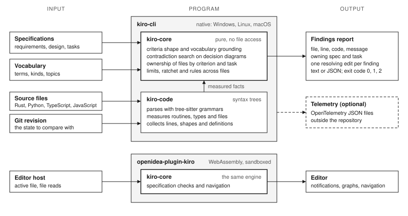

# OpenIDEA Kiro (`openidea-kiro`)

[](https://github.com/norandom/openidea-kiro/actions/workflows/ci.yml)
[](https://github.com/norandom/openidea-kiro/releases/latest)
[](LICENSE)
[](https://doi.org/10.5281/zenodo.24128225)

A coding agent that follows a specification can still deliver requirements that contradict each other and code that the next task can no longer change. `kiro-cli` is a gate that checks both. It reads the specification and the changed code, reports each problem with the spec and task that own it, and exits with a code a hook or a pipeline can act on.

It works on specifications in the kiro layout of the [cc-sdd](https://github.com/gotalab/cc-sdd) workflow: requirements, design and tasks under `.kiro/specs/`. It does not run agents. It verifies what they were given and what they produced.

## What it checks

| Level | Question | Command | Status |
| :--- | :--- | :--- | :--- |
| 1. Consistent requirements | Can two criteria contradict each other? Does every term have one meaning? | `kiro-cli check` | Implemented |
| 2. Traceable work | Which criterion, task and component own this file? | `kiro-cli status`, `graph`, `tasks` | Implemented |
| 3. Executed evidence | Which tests prove this criterion, and did they pass on the current inputs? | none yet | Specified |
| 4. Maintainable code | Did this change make the code harder to change? | `kiro-cli code check` | Implemented in part |
| 5. Less code | Can existing code be replaced by what the framework already provides? | separate project | [lesscode](https://github.com/norandom/lesscode) |

Level 4 today: limits on routines, types and files in Rust, Python, TypeScript and JavaScript; a ratchet so that only regression and new breaches block; duplicate blocks; renamed copies of a routine; definitions and state scattered over files; data addressed by position. Not built yet: grounding of column names in the vocabulary, SARIF output, a strict mode. The [vision](docs/vision.md) says what each level shows and what it does not.



*Figure 1. The engine `kiro-core` judges and never reads a file. The command-line gate adds parsing and measurement of source files; the editor plugin runs the same engine as a sandboxed WebAssembly component.*

## Install from a release

Each [release](https://github.com/norandom/openidea-kiro/releases/latest) carries a prebuilt `kiro-cli` for four platforms, the editor plugin, and `SHA256SUMS.txt`. Nothing else is needed at run time.

| Platform | Asset |
| :--- | :--- |
| Linux x86_64 | `kiro-cli-v1.1.0-x86_64-unknown-linux-gnu.tar.gz` |
| macOS Apple Silicon | `kiro-cli-v1.1.0-aarch64-apple-darwin.tar.gz` |
| macOS Intel | `kiro-cli-v1.1.0-x86_64-apple-darwin.tar.gz` |
| Windows x86_64 | `kiro-cli-v1.1.0-x86_64-pc-windows-msvc.zip` |
| OpenIDEA plugin | `openidea-plugin-kiro-v1.1.0.zip` |

**Linux and macOS**

```bash
VERSION=v1.1.0
TARGET=x86_64-unknown-linux-gnu        # or aarch64-apple-darwin, x86_64-apple-darwin
BASE=https://github.com/norandom/openidea-kiro/releases/download/$VERSION

curl -fsSLO "$BASE/kiro-cli-$VERSION-$TARGET.tar.gz"
curl -fsSLO "$BASE/SHA256SUMS.txt"
sha256sum --check --ignore-missing SHA256SUMS.txt    # macOS: shasum -a 256 --check --ignore-missing SHA256SUMS.txt

tar -xzf "kiro-cli-$VERSION-$TARGET.tar.gz"
install -m 755 kiro-cli "$HOME/.local/bin/kiro-cli"  # any directory on your PATH
kiro-cli --version
```

**Windows (PowerShell)**

```powershell
$Version = 'v1.1.0'
$Asset   = "kiro-cli-$Version-x86_64-pc-windows-msvc.zip"
$Base    = "https://github.com/norandom/openidea-kiro/releases/download/$Version"

Invoke-WebRequest "$Base/$Asset" -OutFile $Asset
Invoke-WebRequest "$Base/SHA256SUMS.txt" -OutFile SHA256SUMS.txt
$Expected = (Select-String -Path SHA256SUMS.txt -Pattern ([regex]::Escape($Asset))).Line.Split(' ')[0]
if ((Get-FileHash $Asset -Algorithm SHA256).Hash -ne $Expected) { throw 'checksum mismatch' }

$Bin = "$env:LOCALAPPDATA\Programs\kiro-cli"         # add this directory to your PATH once
New-Item -ItemType Directory -Force -Path $Bin | Out-Null
Expand-Archive $Asset -DestinationPath $Bin -Force
& "$Bin\kiro-cli.exe" --version
```

**OpenIDEA plugin.** Download `openidea-plugin-kiro-v1.1.0.zip`. In OpenIDEA open *Settings › Plugins*, choose *Install Plugin from Disk...*, select the zip, and run *Reload Plugins*. The commands are listed in the [plugin guide](plugins/kiro/README.md).

The binaries are not signed. To build from source instead, see the [build guide](docs/build.md).

## First run

Run these in a project that has a `.kiro/` directory.

```bash
kiro-cli check --all                      # requirements: shape, terms, contradictions
kiro-cli status my-feature                # phase, approvals and task progress of one spec
kiro-cli code check --task my-feature:2.1 # the files one task owns, against the limits
kiro-cli code check --changed origin/main # what a branch changed, compared with main
```

A finding names the place, the rule, the owner and one edit that resolves it:

```text
.kiro/specs/safety-brake/requirements.md:14: ERROR CONTRADICTION criteria 3.1 and 3.2 can both apply (effect armed: true vs false); witness: depth >= 1001, mode = safe

src/demo.rs:1: WARNING CODE_SIMILAR_FAMILY routine `load_users` is one of 2 similar routines (weakest similarity 1.00); also `read_orders` at src/ui.rs:1
    delete: keep one routine in the module that owns it and call it from the other 1 places [spec demo, component Core, tasks 1.1, 2]
```

Exit codes: 0 for no finding at the threshold, 1 for a finding, 2 for a usage or read failure. Every command and option is in the [CLI reference](docs/cli.md).

## In a hook and in CI

Checks of a file on its own are fast. Rules that look for copies read the whole project. Run each where its cost fits.

| Stage | Command |
| :--- | :--- |
| pre-commit | `kiro-cli code check --changed HEAD --local --summary` |
| pre-push | `kiro-cli code check --changed origin/main --summary` |
| CI | `kiro-cli check --all` and `kiro-cli code check --changed origin/main` |

On a repository of 1,875 Python files a one-file check takes about 12 seconds with the whole-project rules and 0.3 seconds with `--local`. The gate installs no hook. See [Code rules](docs/code-rules.md#in-a-hook-and-in-ci) and [CI integration](docs/ci.md).

## How contradictions are found

Acceptance criteria are written in EARS. Each term is declared once in `.kiro/vocabulary.toml` with a kind: entity, boolean, enumeration or integer. The gate turns every criterion into a boolean guard over finite regions of those terms and builds a reduced ordered binary decision diagram. Two criteria that prescribe opposite effects contradict each other exactly when the conjunction of their guards is satisfiable, and the diagram then yields a witness state.

The search is exact for what it covers and bounded: when a problem exceeds 512 variables or 100,000 nodes the gate reports `SEARCH_REFUSED` and does not guess. The encoding and its limits are in [Verification strategy](docs/verification.md).

## With lesscode

The two projects form one stack and do not repeat each other. This project prevents: it holds new and changed code to agreed limits, per task, and names the owning spec. [lesscode](https://github.com/norandom/lesscode) reduces: it measures whether a rewrite of existing code is a substantial simplification with the same behaviour. A finding here names a candidate; a lesscode receipt shows whether the replacement was worth it.

The code rules originate in `scitools-hook`, an earlier project that depended on a licensed analyzer. Its ideas are carried over on open-source parsers for Windows, Linux and macOS.

## Documentation

The [documentation index](docs/README.md) lists every page by what you want to do.

| You want to | Read |
| :--- | :--- |
| Know what is verified and what is not shown | [Vision](docs/vision.md) |
| Look up a command, option or exit code | [CLI reference](docs/cli.md) |
| Understand a finding on a specification | [Constraint checks](docs/checks.md) |
| Understand a finding on code, or change a limit | [Code rules](docs/code-rules.md) |
| Run the gate in CI | [CI integration](docs/ci.md) |
| Build from source or contribute | [Build guide](docs/build.md) |

## Citation

Cite the software with the metadata in [`CITATION.cff`](CITATION.cff); GitHub shows it under *Cite this repository*.

```bibtex
@software{openidea_kiro_2026,
  author  = {Ciepluch, M.},
  title   = {OpenIDEA Kiro: Specification-Driven Software Engineering with Domain Ontology Grounding and Bounded Binary Decision Diagram Verification},
  version = {1.1.0},
  year    = {2026},
  doi     = {10.5281/zenodo.24128225},
  url     = {https://github.com/norandom/openidea-kiro}
}
```

Every release is archived on Zenodo. The DOI [10.5281/zenodo.24128225](https://doi.org/10.5281/zenodo.24128225) stands for all versions and resolves to the latest one; the badge, `CITATION.cff` and the entry above use it. Each release also has its own DOI, listed under *Versions* on the Zenodo record. Use that one when the exact version matters. A release cannot name its own DOI, because Zenodo assigns it after the release is published.

## License

[MIT](LICENSE)
