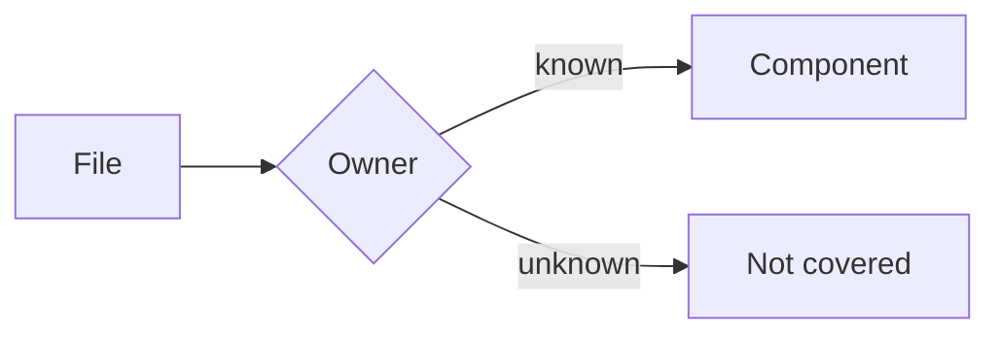

# Design Document: demo

## File Structure Plan

| Component | File |
|-----------|------|
| Core | `src/demo.rs` |
| Ui | `src/ui.rs` |

## Components and Interfaces

### Core

Owns the ownership query over the join.

### Ui

Owns the display of the query result.

## Diagrams

