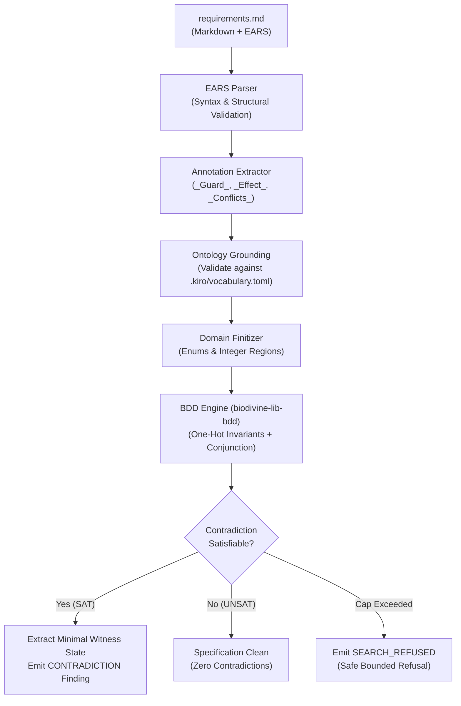

# Formal Verification Strategy: Domain Ontologies, Finitization, and BDDs

This document details the formal verification architecture of OpenIDEA Kiro (`kiro_core::checks`). It explains why Kiro uses Reduced Ordered Binary Decision Diagrams (ROBDDs) rather than traditional Satisfiability Modulo Theories (SMT) solvers, how domain ontologies ground natural language requirements into finite propositional logic, and how the finitization pipeline synthesizes exact counterexample witnesses for conflicting specifications.

---

## 1. Executive Summary: The Specification Ambiguity Crisis

Software specifications have historically suffered from a fatal dilemma: **expressiveness versus verifiability**.

When engineering teams write specifications in unrestricted natural language, they gain accessibility at the expense of correctness. Natural language specifications silently accumulate:
- **Synonym drift**: Different engineers describe the exact same system state using slightly different phrases (e.g., `"standby mode"`, `"idle state"`, `"quiescent phase"`).
- **Latent contradictions**: Two rules written in different sections of a document specify opposing behaviors under identical or overlapping conditions.
- **Untestable acceptance criteria**: Requirements omit preconditions, making automated compliance verification impossible.

Textual linters, regex checks, and LLM-based code reviewers cannot solve this problem. Regexes cannot evaluate logical conjunctions, while generative models hallucinate consistency and lack deterministic soundness.

Conversely, classical formal specification systems (e.g., TLA+, Alloy, Z notation, or SMT-based provers) provide mathematical rigor but erect steep barriers: they require specialized notations, impose heavy computational overhead, and rely on multi-megabyte C++ solver runtimes that cannot execute inside lightweight, sandboxed IDE plugins.

**Kiro resolves this dilemma through a three-part architecture:**
1. **Easy Approach to Requirements Syntax (EARS)**: Teams write human-readable requirements in familiar Markdown annotated with lightweight guards and effects.
2. **Domain Ontologies (`.kiro/vocabulary.toml`)**: A structured taxonomy grounds every word and variable into typed facets (`entity`, `bool`, `enum`, `int`) and bounds them by topic.
3. **Bounded BDD Verification Engine (`biodivine-lib-bdd`)**: A deterministic, zero-dependency Rust engine that finitizes requirements into canonical decision diagrams, detects logical contradictions in sub-millisecond time, and extracts concrete witness counterexamples.

```
┌─────────────────────────────────────────────────────────────────────────────┐
│                       NATURAL LANGUAGE SPECIFICATION                        │
│   "While mode is safe and depth exceeds 1000, the controller shall arm."    │
└──────────────────────────────────────┬──────────────────────────────────────┘
                                       │ EARS Parser + Annotation Extractor
                                       ▼
┌─────────────────────────────────────────────────────────────────────────────┐
│                          DOMAIN ONTOLOGY GROUNDING                          │
│   Term "mode"  ──▶ enum { safe, normal, emergency } (Topic: telemetry)     │
│   Term "depth" ──▶ int [min: 0, max: 5000]          (Topic: telemetry)      │
└──────────────────────────────────────┬──────────────────────────────────────┘
                                       │ Domain Finitization Engine
                                       ▼
┌─────────────────────────────────────────────────────────────────────────────┐
│                        PROPOSITIONAL FINITIZATION                           │
│   One-hot state: mode_safe ⊕ mode_normal ⊕ mode_emergency                  │
│   Region cuts:   depth_r0 [0..499], depth_r1 [500..1000], depth_r2 [1001..] │
└──────────────────────────────────────┬──────────────────────────────────────┘
                                       │ ROBDD Compilation & Conjunction
                                       ▼
┌─────────────────────────────────────────────────────────────────────────────┐
│                          CANONICAL BDD ENGINE                               │
│   Sat Check: O(1)    │ Memory: Strictly Bounded    │ Engine: Safe Rust/WASI │
│   Result: CONTRADICTION detected with exact witness:                        │
│           [depth >= 1001, mode = safe]                                      │
└─────────────────────────────────────────────────────────────────────────────┘
```

---

## 2. Architectural Comparison: SMT Solvers vs. BDDs

Modern formal methods often reach for Satisfiability Modulo Theories (SMT) solvers such as [Z3](https://github.com/Z3Prover/z3) or [CVC5](https://cvc5.github.io/). While SMT solvers excel at unbounded arithmetic and complex first-order theories, Kiro deliberately rejected SMT in favor of Reduced Ordered Binary Decision Diagrams (BDDs).

The table below contrasts the fundamental characteristics of both approaches within developer tooling:

| Dimension | SMT Solvers (e.g., Z3, CVC5) | Binary Decision Diagrams (BDDs) in Kiro | Why Kiro Chose BDDs |
| :--- | :--- | :--- | :--- |
| **Logic & Representation** | First-Order Logic combined with background theories (EUF, LIA, BV). **Non-canonical**. | Propositional Boolean logic under a fixed variable ordering (ROBDD). **Strictly canonical**. | Canonicity guarantees that equivalent logical expressions map to the exact same pointer in memory. |
| **Satisfiability Check** | **NP-complete to Undecidable**. Requires executing a DPLL(T) search loop every time. | **$O(1)$ constant time**. Simply checks whether the root pointer points to the False terminal sink ($\bot$). | Spec checks run interactively on every keystroke in the IDE without blocking the UI thread. |
| **Witness Generation** | Requires solving an existential optimization problem over uninterpreted models. | **$O(|V|)$ linear time**. Traverses any non-zero path from the root node to the True sink ($\top$). | Produces immediate, minimal, and reproducible counterexamples for user diagnostics. |
| **Runtime & Dependencies** | Massive C++ codebase (>500,000 LOC), complex memory allocators, native thread pools. | Pure, safe Rust via [`biodivine-lib-bdd`](https://crates.io/crates/biodivine-lib-bdd). Zero C/C++ bindings. | Compiles natively and cross-compiles cleanly to WebAssembly (`wasm32-wasip2`). |
| **Sandbox Portability** | Cannot run reliably inside lightweight WASI sandboxes; binary footprint exceeds 25 MB. | Total WebAssembly plugin footprint is < **2 MB**; memory overhead per check is < **500 KB**. | Runs inside OpenIDEA's WASI runtime and lightweight CI microVMs without native shims. |
| **Resource Predictability** | Unpredictable heuristic search; solvers periodically time out or return `"unknown"`. | Explicit, deterministic bounds (`max_variables = 512`, `max_nodes = 100,000`). | Kiro emits an explicit, deterministic `SEARCH_REFUSED` rather than hanging or guessing. |

### The Core Algorithmic Difference: Canonicity and Equivalence

In an SMT solver, deciding whether two logical propositions $\phi$ and $\psi$ are equivalent requires proving that their symmetric difference is unsatisfiable:
$$\text{UNSAT}(\phi \oplus \psi)$$
This invokes an expensive heuristic search through theory solvers and quantifier instantiations.

In a Reduced Ordered Binary Decision Diagram, every boolean function has a **unique, canonical directed acyclic graph (DAG)** under a fixed variable ordering:
- If two expressions represent the same logical function, the BDD construction algorithm automatically reduces them to the exact same node pointer.
- Contradiction detection between two criteria $C_1$ and $C_2$ requires computing their conjunction:
  $$B_{\text{joint}} = B_{\text{domain}} \land B_{\text{guard}}(C_1) \land B_{\text{guard}}(C_2)$$
- Once the apply operation finishes, checking whether $C_1$ and $C_2$ can ever simultaneously trigger is a simple **single-pointer comparison**:
  ```rust
  if bdd_joint.is_false() {
      // Trivially disjoint: no contradiction exists.
  } else {
      // Contradiction detected: extract witness path to true sink.
  }
  ```

---

## 3. Vocabulary Grounding: Bridging Natural Language to Logic

BDDs operate exclusively on finite, binary decision variables ($x_1, x_2, \dots, x_n \in \{0, 1\}$). Real-world specifications, however, do not speak in raw boolean bits; they describe physical systems, UI flows, domain modes, and numerical measurements.

**Vocabulary grounding** is the mechanism that bridges this semantic gap. By requiring criteria to bind their vocabulary terms to a project ontology, Kiro gives mathematical semantics to plain English words.

### Topic Scoping: Eliminating Synonym Drift and Homonym Collisions

In large codebases, different subdomains frequently reuse identical terms with distinct meanings (e.g., `"state"` in UI navigation vs. `"state"` in a database transaction). 

Kiro enforces **topic scoping**:
1. Vocabularies in `.kiro/vocabulary.toml` group terms under designated `[topics.<id>]` namespaces.
2. Each feature specification declares its permitted domain scopes in `spec.json`:
   ```json
   {
     "feature": "safety-brake",
     "topics": ["telemetry", "braking"]
   }
   ```
3. When a requirement states `_Terms: mode, depth_`, Kiro verifies that `mode` and `depth` exist within the declared topics. References to undeclared terms or foreign topics produce compile-time diagnostics (`GUARD_TERM_UNDECLARED` or `TERM_TOPIC_MISMATCH`).

### Semantic Kinds and Facets

The ontology classifies every term into one of four structural kinds:

```toml
[terms.armed]
topic = "braking"
label = "Brake armed"
kind = "bool"
definition = "Indicates whether the mechanical emergency brake is armed."

[terms.mode]
topic = "telemetry"
label = "Operating mode"
kind = "enum"
values = ["normal", "safe", "emergency"]
definition = "Discrete execution mode of the vehicle guidance system."

[terms.depth]
topic = "telemetry"
label = "Submersion depth"
kind = "int"
min = 0
max = 5000
definition = "Current depth below surface in meters."

[terms.controller]
topic = "braking"
label = "Brake controller"
kind = "entity"
definition = "Physical microcontroller board managing braking actuators."
```

Each kind serves a deliberate purpose:
- **`entity`**: Named structural concepts (e.g., `controller`, `operator`). Entities establish requirement ownership and architecture traceability, but are strictly excluded from boolean guards (`GUARD_KIND_MISMATCH`) to prevent engineers from making invalid logical assertions about physical objects.
- **`bool`**: Propositional truth values. Supports direct evaluation (`armed`, `not armed`, `armed = true`).
- **`enum`**: Discrete symbolic state spaces. Every enum defines an explicit, exhaustive set of mutually exclusive variants.
- **`int`**: Bounded or unbounded integer values. Supports threshold comparisons (`<`, `<=`, `>`, `>=`, `=`, `!=`).

### Ingestion from External Ontologies

To integrate with enterprise knowledge graphs and systems engineering standards, `kiro-cli` provides automated ingestion pipelines:
- **Auto Ontology JSON**: Ingests automated entity taxonomies directly into Kiro topics (`kiro-cli vocab import terms.json --format auto-ontology-json --topic domain`).
- **W3C SKOS RDF Turtle (`.ttl`)**: Ingests industry-standard Simple Knowledge Organization System taxonomies, preserving `skos:prefLabel`, `skos:altLabel`, `skos:broader`, and `skos:definition` hierarchies (`kiro-cli vocab import ontology.ttl --format skos-turtle --topic ops`).

---

## 4. The Domain Finitization Engine (`finitize.rs`)

Because BDDs cannot natively evaluate integer inequalities or multi-variant enums, Kiro implements a **domain finitization engine**. Finitization maps rich domain types into an equivalent set of one-hot boolean variables constrained by domain axioms.

### 1. Enum Finitization: One-Hot Mutual Exclusion

For an enum term $E$ with $k$ variants $\{v_1, v_2, \dots, v_k\}$, Kiro allocates $k$ distinct boolean variables:
$$b_{E=v_1}, b_{E=v_2}, \dots, b_{E=v_k}$$

The engine automatically synthesizes a **domain invariant BDD** ($\text{DomainAx}_E$) asserting that exactly one variant is active at any time:
$$\text{DomainAx}_E = \left( \bigvee_{i=1}^k b_{E=v_i} \right) \land \left( \bigwedge_{1 \le i < j \le k} \neg (b_{E=v_i} \land b_{E=v_j}) \right)$$

This invariant guarantees that the BDD engine will never synthesize an impossible witness where a system is simultaneously in `"safe"` and `"emergency"` mode.

### 2. Integer Finitization: Dynamic Region Partitioning

Rather than bit-blasting 64-bit integers into thousands of boolean variables (which causes severe BDD graph explosion), Kiro uses **interval-based region finitization**:

1. **Cut-Point Collection**: The engine scans all criteria in the document for comparisons involving an integer term $T$. Suppose the criteria contain:
   - Criterion 1: `depth > 1000` (cut-point: $1000$)
   - Criterion 2: `depth >= 500` (cut-point: $500$)
   - Vocabulary bound: `min = 0`
2. **Elementary Interval Partitioning**: The cut-points partition the integer domain into non-overlapping elementary regions:
   - $R_0$: `0..=499` (below lowest cut-point)
   - $R_1$: `500` (exact point)
   - $R_2$: `501..=999` (gap between cut-points)
   - $R_3$: `1000` (exact point)
   - $R_4$: `1001..` (above highest cut-point)
3. **One-Hot Region Encoding**: Each region $R_m$ becomes a boolean variable $r_m$. The engine compiles a mutual exclusion invariant:
   $$\text{DomainAx}_T = \text{ExactlyOne}(r_0, r_1, r_2, r_3, r_4)$$
4. **Predicate Translation**: Relational operators are compiled into disjunctions of region variables:
   - `depth >= 500` $\implies r_1 \lor r_2 \lor r_3 \lor r_4$
   - `depth > 1000` $\implies r_4$
   - `depth < 500` $\implies r_0$

This technique reduces an infinite 64-bit integer domain to just 5 boolean variables, executing in microseconds.

---

## 5. The Verification Pipeline

The complete specification verification pipeline runs in six deterministic phases:



### Pair Selection and Incompatibility Conditions

Two criteria $C_1$ and $C_2$ form an **incompatible candidate pair** if either of the following conditions holds:
1. **Explicit Conflict**: Either criterion explicitly names the other in its `_Conflicts:_` annotation.
2. **Effect Clash**: Both criteria assign conflicting values to the same vocabulary term in their `_Effect:_` annotations (for example, $C_1$ asserts `armed = true` while $C_2$ asserts `armed = false`).

### Joint Satisfiability Check and Witness Extraction

For every incompatible pair $(C_1, C_2)$, the engine constructs the joint propositional formula:
$$\Phi_{\text{pair}} = \text{DomainAxioms} \land \text{Guard}(C_1) \land \text{Guard}(C_2)$$

- If $\Phi_{\text{pair}} \equiv \bot$ (unsatisfiable), the two criteria can never trigger simultaneously. Their conflicting effects are safely guarded by disjoint preconditions.
- If $\Phi_{\text{pair}} \not\equiv \bot$ (satisfiable), a **logical contradiction exists**. The engine follows the lexicographically first path from the root to the $\top$ sink in the BDD graph to extract the witness state:
  ```text
  .kiro/specs/safety-brake/requirements.md:14: ERROR CONTRADICTION criteria 3.1 and 3.2 can both apply (effect armed: true vs false); witness: depth >= 1001, mode = safe
  ```

---

## 6. Resource Guarantees and Bounded Refusal

Traditional theorem provers risk non-termination, memory exhaustion, or indeterminate timeouts when expressions grow complex. In an IDE or pre-commit hook, an unbounded tool freezes the developer's environment.

Kiro replaces unbounded search with **strict resource guarantees**:

| Parameter | Default Cap | Enforcement Action |
| :--- | :--- | :--- |
| **`max_variables`** | `512` variables | If the total number of one-hot variables across the terms in a candidate pair exceeds this limit, search refuses before BDD allocation. |
| **`max_nodes`** | `100,000` nodes | Monitored during every BDD conjunction. If intermediate graph size exceeds the cap, allocation aborts immediately. |
| **Max Call Recursion** | `64` levels | AST expression nesting limit preventing stack overflow during guard parsing. |

### The `SEARCH_REFUSED` Contract

When a cap is exceeded, Kiro **never guesses, never approximates, and never claims the spec is clean**. 

Instead, it emits a `SEARCH_REFUSED` warning naming the exact pair and stage that exceeded capacity:
```text
.kiro/specs/telemetry/requirements.md:28: WARNING SEARCH_REFUSED contradiction search between criteria 2.1 and 4.3 refused: BDD node limit (100000) exceeded during guard conjunction
```

This guarantees safety: a refused search is transparent to developers and CI quality gates, prompting the engineer to narrow term scopes or split large specification documents into modular sub-specifications.

---

## 7. Summary: Why It Works

By combining domain ontologies with Reduced Ordered Binary Decision Diagrams, OpenIDEA Kiro delivers a formal verification engine that is:
1. **Mathematically sound**: Zero false negatives within declared specification scopes.
2. **Instantaneous**: Sub-millisecond BDD evaluation enables real-time verification in IDE buffers.
3. **Completely portable**: Compiles to native binaries and WebAssembly (`wasm32-wasip2`) with zero external C++ dependencies.
4. **Actionable**: Every detected contradiction produces an exact, minimal witness counterexample that pinpoints the real-world state causing the conflict.

---

## Related Documentation

- **[Specification Checks Guide](checks.md)**: Syntax rules, annotation placement, and finding catalog.
- **[Project Vocabulary Guide](vocabulary.md)**: Vocabulary schema, topic scoping, and SKOS/Auto Ontology import.
- **[CLI Reference](cli.md)**: Command-line options for `kiro-cli check` and automated CI gates.
